+++
title = "3.1.1 编辑器教程"
date = 2026-11-06T07:53:25+08:00
weight = 1
type = "docs"
description = ""
isCJKLanguage = true
draft = false
+++


> 原文链接: [https://code.visualstudio.com/docs/editing/getting-started/editor-tutorial](https://code.visualstudio.com/docs/editing/getting-started/editor-tutorial)

# 3.1.1 编辑器教程

　　在本教程中，你将创建一个小型食谱应用，同时学习 Visual Studio Code 的关键功能。你将使用文件和用户界面，预览和调试应用，自定义设置，探索可选扩展，并使用 Git 保存工作。本教程使用纯 HTML、CSS 和 JavaScript，不需要额外的扩展、构建工具、运行时、AI 账户或编程助手。

> **提示**：如果你更喜欢通过视频了解 Visual Studio Code，可以在我们的 YouTube 频道观看[入门视频](https://www.youtube.com/watch?v=f8_uF_IDV50)。

## 前提条件 {#prerequisites}

* 在计算机上[下载并安装 Visual Studio Code](https://code.visualstudio.com/download)。
* 对于源代码管理练习，请完成 [4.1 快速入门](../../../source-control/4.1-Quickstart/#prerequisites)。这些前提条件包括安装 Git，并配置 Git 作者姓名和电子邮件地址。你可以在没有 Git 的情况下完成前面的章节。

## 在 VS Code 中打开文件夹 {#open-a-folder-in-vs-code}

　　你可以使用 VS Code 处理单个文件以进行快速编辑，也可以打开一个文件夹作为*工作区*。请先新建一个文件夹，使教程文件和 Git 历史记录与其他项目分开。

1. 在现有 Git 仓库之外创建一个名为 `vscode101` 的空文件夹。

2. 打开 Visual Studio Code，然后选择 **文件** > **打开文件夹...**。

3. 选择 `vscode101` 文件夹，然后选择 **选择文件夹**（macOS 上为 **打开**）。

    VS Code 现在会将该文件夹视为工作区。

4. 在工作区信任对话框中，选择 **是的，我信任此作者**。

    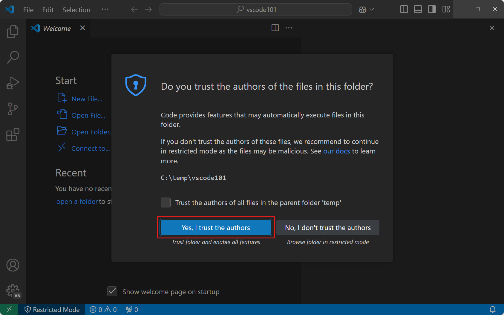

    > **重要**：工作区信任让你决定项目文件夹中的代码能否在 VS Code 中运行。从互联网下载代码时，请先审查代码，再信任该文件夹。详细了解[3.2.8.3 工作区信任](../../../editor/3.2-WriteCode/3.2.8-Workspaces/3.2.8.3-WorkspaceTrust/)。

5. 确认 **资源管理器** 视图显示 `vscode101` 文件夹。

    你可以使用资源管理器视图查看和管理工作区中的文件和文件夹。

    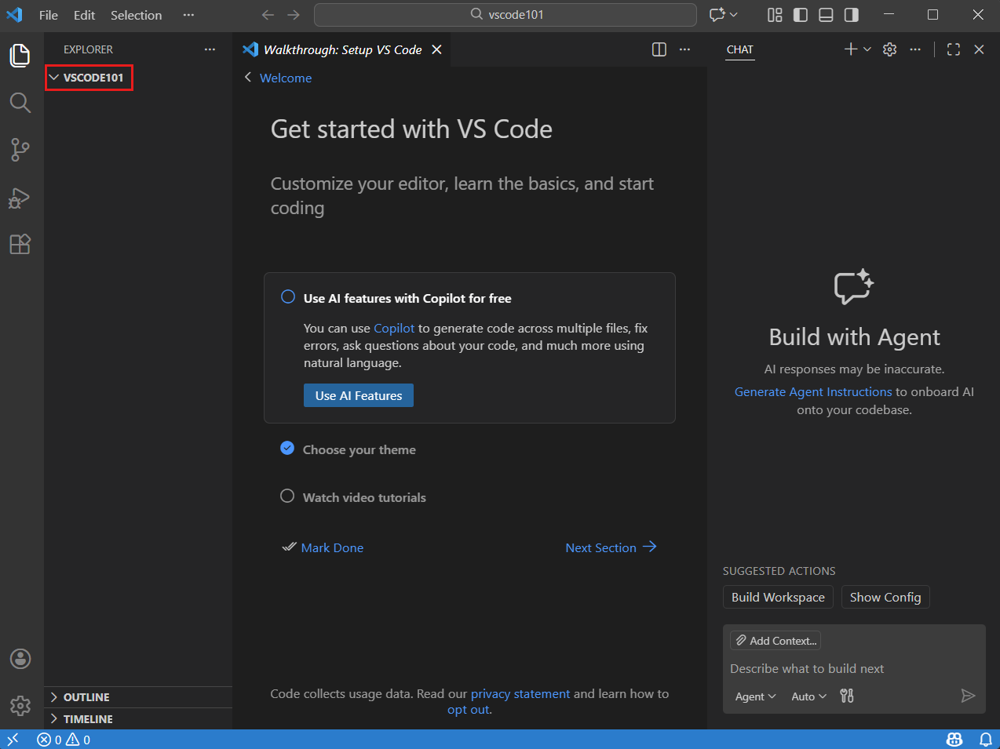

> **提示**：打开文件夹时，VS Code 可以恢复其中打开的文件、活动视图和编辑器布局。你还可以仅针对该文件夹配置设置和调试配置。详细了解[3.2.8.1 工作区概述](../../../editor/3.2-WriteCode/3.2.8-Workspaces/3.2.8.1-Overview/)。

## 探索用户界面 {#explore-the-user-interface}

　　在创建应用之前，先快速了解用户界面。

### 使用活动栏切换视图 {#switch-between-views-with-the-activity-bar}

1. 使用活动栏在视图之间切换。

    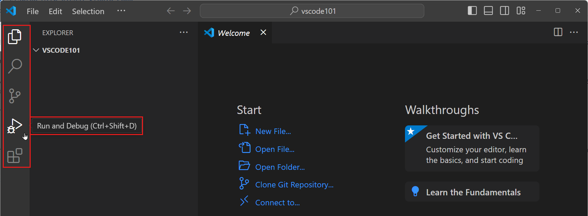

    > **提示**：将鼠标悬停在活动栏项目上可查看其名称和键盘快捷键。再次选择该项目可关闭视图。

2. 注意 **主侧边栏** 会发生变化，以显示所选视图的信息。

    例如，“运行和调试”视图包含用于配置和启动调试会话的控件。

    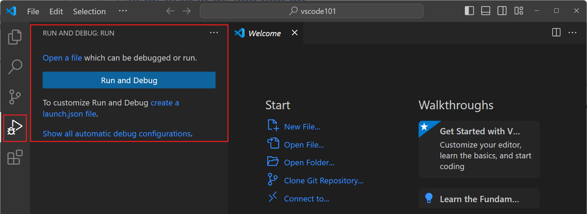

### 使用编辑器查看和编辑文件 {#view-and-edit-files-with-the-editor}

1. 在活动栏中选择资源管理器视图，然后选择 **新建文件...**。

    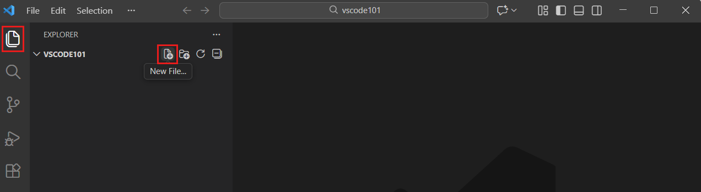

2. 输入 `index.html`，然后按 `Enter`。

    新文件会在窗口主区域的编辑器中打开。

    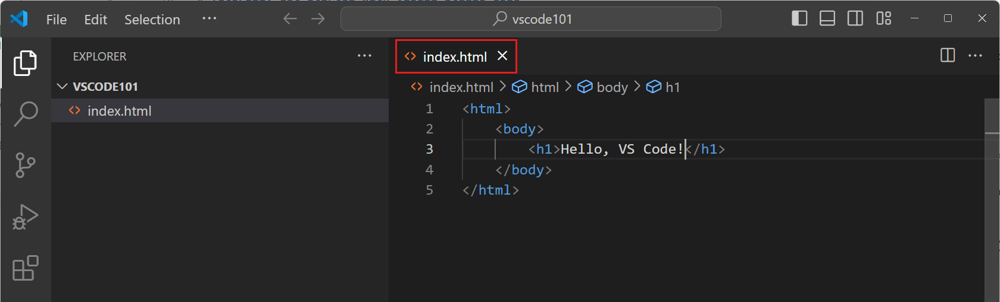

3. 输入 `<h1>My recipes</h1>`。

    在你输入时，IntelliSense 会提示补全代码的方式。使用 `↑` 和 `↓` 在建议之间导航，使用 `Tab` 插入选中的建议。

4. 使用 `Ctrl + S`（macOS 上为 `Cmd + S`）保存文件。

5. 再次选择 **新建文件...** 创建 `style.css`，然后创建 `app.js`。

    每个文件都会在新的编辑器选项卡中打开。你可以打开多个编辑器，并将它们并排查看。详细了解[3.1.2 用户界面](../../../editor/3.1-GettingStarted/3.1.2-UserInterface/#side-by-side-editing)。

    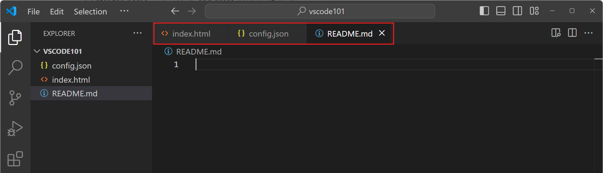

### 从面板访问终端 {#access-the-terminal-from-the-panel}

1. 使用 `Ctrl + 反引号`打开集成终端。你也可以选择 **视图** > **终端**。

    你可以从计算机上安装的 shell 中选择，例如 PowerShell、命令提示符或 Bash。

    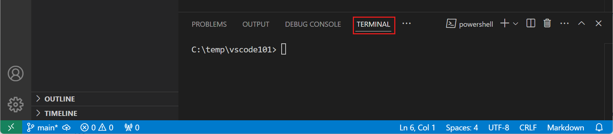

2. 输入以下命令，在工作区中创建一个文件。

    ```bash
    echo "Hello, VS Code" > greetings.txt
    ```

    终端默认从工作区根目录启动。请注意，资源管理器视图会自动显示这个新文件。

    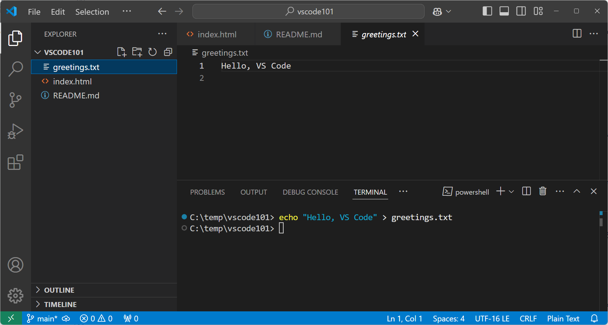

3. 选择 **启动配置文件** 下拉列表，查看可用的 shell，并打开另一个终端。

    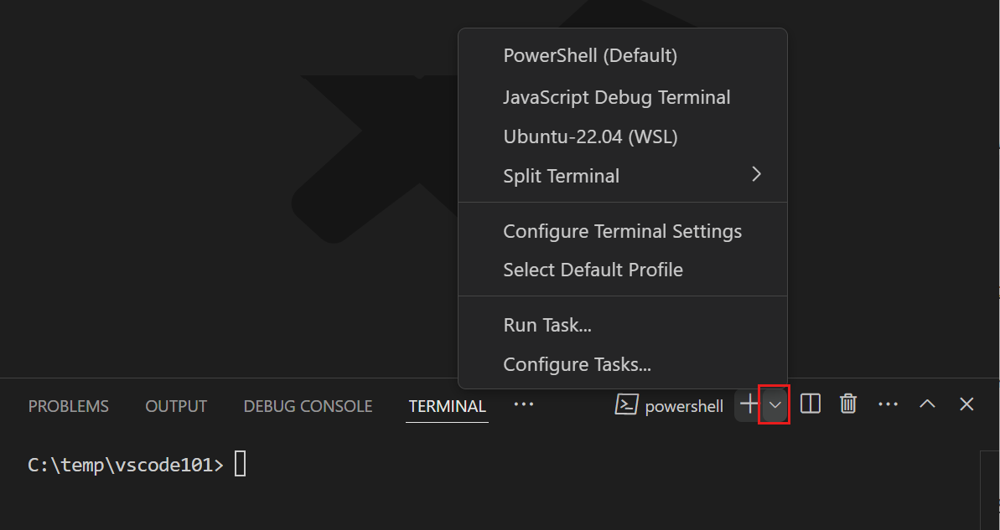

### 使用命令面板访问命令 {#access-commands-with-the-command-palette}

1. 使用 `Ctrl + Shift + P`（macOS 上为 `Cmd + Shift + P`）打开命令面板。你也可以选择 **视图** > **命令面板**。

    命令面板提供对许多 VS Code 命令的访问。扩展可以添加更多命令。

    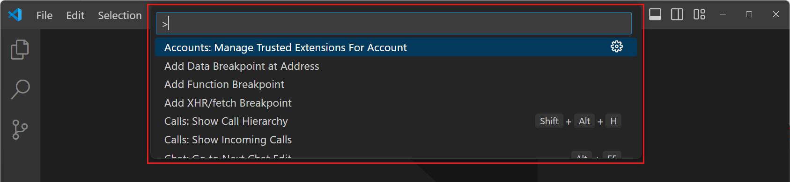

2. 尝试以下命令面板模式：

    * **命令模式（`>`）**：在 `>` 符号后输入 `move terminal`，查找将终端移动到新窗口的命令。

        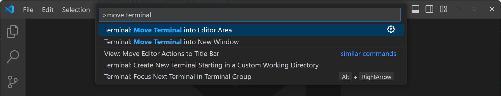

    * **快速打开模式**：删除 `>` 符号，然后输入文件名以搜索工作区。使用 `Ctrl + P`（macOS 上为 `Cmd + P`）直接打开快速打开。

        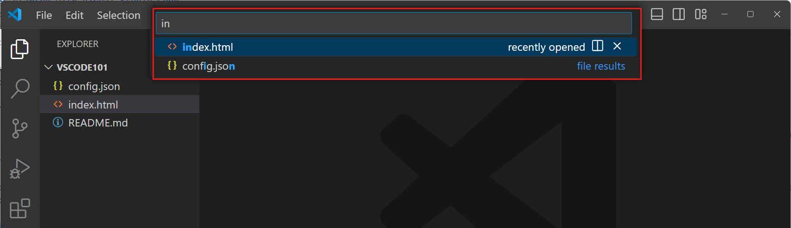

    * **符号搜索模式（`#`）**：将 `>` 符号替换为 `#`，以搜索变量和函数等符号。

> **提示**：命令面板使用模糊匹配。例如，输入 `odks` 可以找到 `Open Default Keyboard Shortcuts` 命令。

## 创建食谱应用 {#create-a-recipe-app}

　　将这三个文件的内容替换为以下固定示例。保持文件名和代码一致，可以更容易地完成后续的预览和调试练习。

1. 打开 `index.html`，将其内容替换为以下 HTML，并使用 `Ctrl + S`（macOS 上为 `Cmd + S`）保存文件。

    ```html
    <!DOCTYPE html>
    <html lang="en">
    <head>
      <meta charset="UTF-8">
      <meta name="viewport" content="width=device-width, initial-scale=1.0">
      <title>Recipe list</title>
      <link rel="stylesheet" href="style.css">
      <script src="app.js" defer></script>
    </head>
    <body>
      <main>
        <h1>My recipes</h1>
        <form id="recipe-form">
          <label for="recipe-name">Recipe name</label>
          <input id="recipe-name" name="recipe-name" required>

          <label for="recipe-description">Description</label>
          <textarea id="recipe-description" name="recipe-description" required></textarea>

          <button type="submit">Add recipe</button>
        </form>
        <ul id="recipe-list" aria-live="polite"></ul>
      </main>
    </body>
    </html>
    ```

2. 打开 `style.css`，添加以下 CSS，并保存文件。

    ```css
    :root {
      color-scheme: light dark;
      font-family: system-ui, sans-serif;
    }

    body {
      margin: 0;
      padding: 2rem;
    }

    main {
      max-width: 40rem;
      margin: 0 auto;
    }

    form {
      display: grid;
      gap: 0.75rem;
    }

    input,
    textarea,
    button {
      font: inherit;
      padding: 0.6rem;
    }

    li {
      display: flex;
      gap: 1rem;
      justify-content: space-between;
      margin-block: 1rem;
    }
    ```

3. 打开 `app.js`，添加以下 JavaScript，并保存文件。

    ```javascript
    const form = document.querySelector('#recipe-form');
    const nameInput = document.querySelector('#recipe-name');
    const descriptionInput = document.querySelector('#recipe-description');
    const recipeList = document.querySelector('#recipe-list');

    function addRecipe(event) {
      event.preventDefault();

      const name = nameInput.value.trim();
      const description = descriptionInput.value.trim();

      if (!name || !description) {
        const emptyInput = !name ? nameInput : descriptionInput;
        emptyInput.setCustomValidity('Enter at least one non-space character.');
        emptyInput.reportValidity();
        emptyInput.addEventListener('input', () => emptyInput.setCustomValidity(''), { once: true });
        return;
      }

      const item = document.createElement('li');
      const recipeText = document.createElement('span');
      recipeText.textContent = `${name}: ${description}`;

      const deleteButton = document.createElement('button');
      deleteButton.type = 'button';
      deleteButton.textContent = 'Delete';
      deleteButton.setAttribute('aria-label', `Delete ${name}`);
      deleteButton.addEventListener('click', () => item.remove());

      item.append(recipeText, deleteButton);
      recipeList.append(item);
      form.reset();
      nameInput.focus();
    }

    form.addEventListener('submit', addRecipe);
    ```

　　现在，你已经使用纯本地文件创建了一个完整应用。`textContent` 属性会将食谱输入作为文本显示，而不是将其解释为 HTML。

## 在集成浏览器中预览应用 {#preview-the-app-in-the-integrated-browser}

　　内置的[6.5 集成浏览器](../../../debugging-and-testing/6.5-IntegratedBrowser/)可以直接在 VS Code 中打开本地 HTML 文件。预览此应用不需要扩展、开发服务器或外部浏览器。

1. 在资源管理器视图中，右键单击 `index.html`，然后选择 **在集成浏览器中打开**。

    应用会在集成浏览器选项卡中打开。

    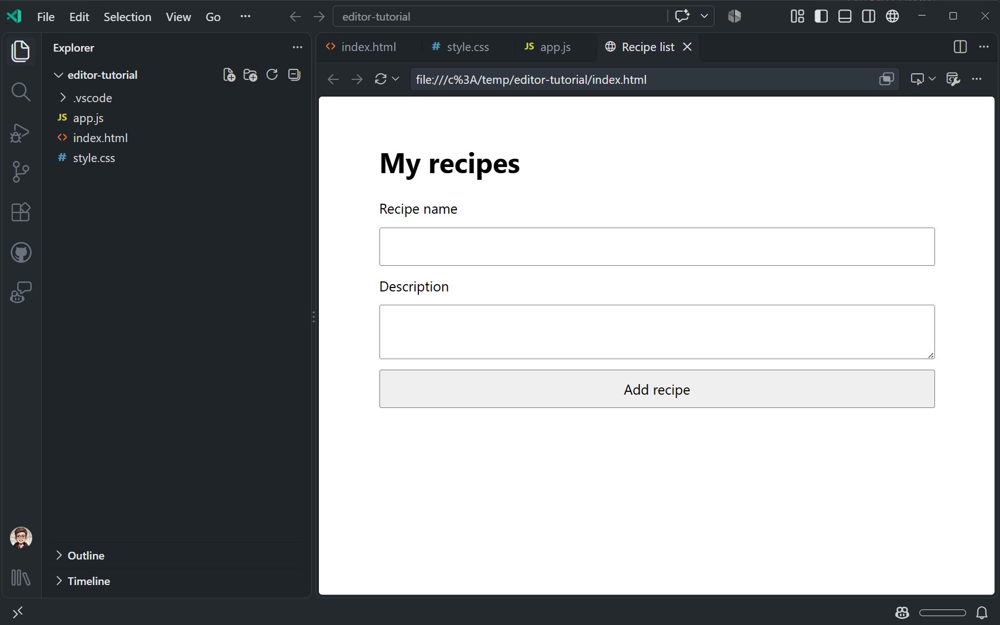

2. 手动检查应用：

    * 添加一个包含名称和描述的食谱，确认它出现在列表中。
    * 选择 **删除**，确认食谱消失。
    * 尝试提交空字段，确认浏览器要求你填写。
    * 在字段中只输入空格，确认浏览器要求输入非空格字符。
    * 输入 `<b>Soup</b>` 作为食谱名称，确认应用将字符作为文本显示，而不是将其格式化为 HTML。

3. 在 `index.html` 中，将 `My recipes` 改为 `Favorite recipes`，然后保存文件。

    检查浏览器是否显示新的标题。如果浏览器没有自动重新加载，请选择浏览器工具栏中的 **重新加载**。这个小小的修改演示了你在 VS Code 中反复使用的编辑、保存和审查循环。

## 探索扩展（可选） {#explore-extensions-optional}

　　扩展为 VS Code 添加语言、调试器和其他工具。此示例不需要安装任何扩展，但你可以探索用于其他项目的工具：

1. 在活动栏中选择 **扩展** 视图。

2. 搜索语言或工具，然后选择一个扩展，阅读其功能和要求。

　　详细了解[3.3.6.1 扩展概述](../../../editor/3.3-ConfigureTheEditor/3.3.6-Extensions/3.3.6.1-Overview/)。

## 配置 VS Code 设置 {#configure-vs-code-settings}

　　你可以在设置编辑器中自定义 VS Code，也可以编辑 `settings.json` 文件。

1. 使用 `Ctrl + ,`（macOS 上为 `Cmd + ,`）打开设置编辑器。你也可以选择 **文件** > **首选项** > **设置**。

    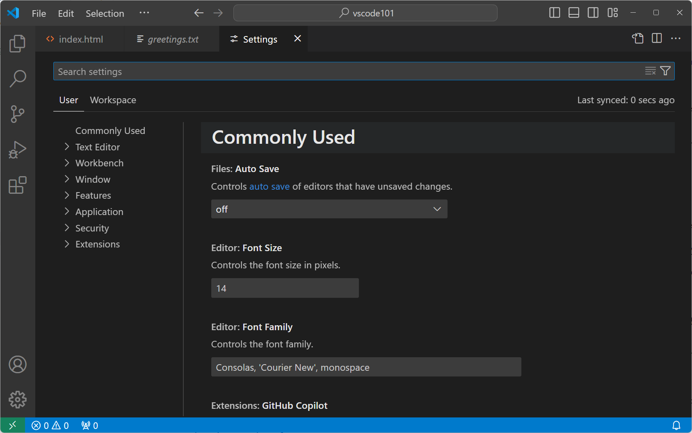

2. 使用搜索框查找 **自动保存**，然后从下拉列表中选择一个值。

    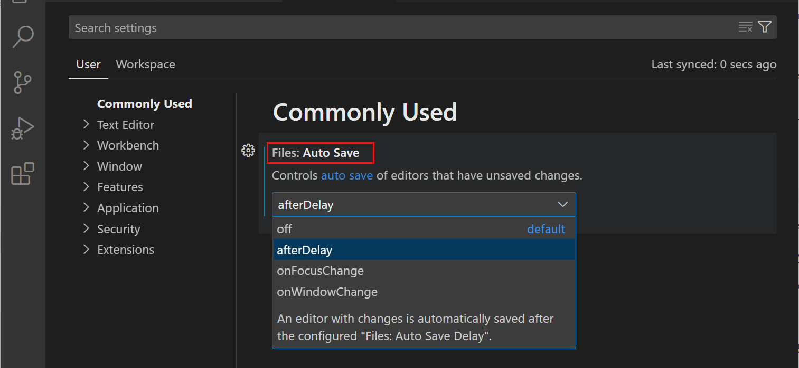

    VS Code 会立即应用设置更改。下次修改工作区文件时，所选的自动保存行为将生效。

3. 选择设置旁边的齿轮图标，然后选择 **重置设置**，恢复默认值。

    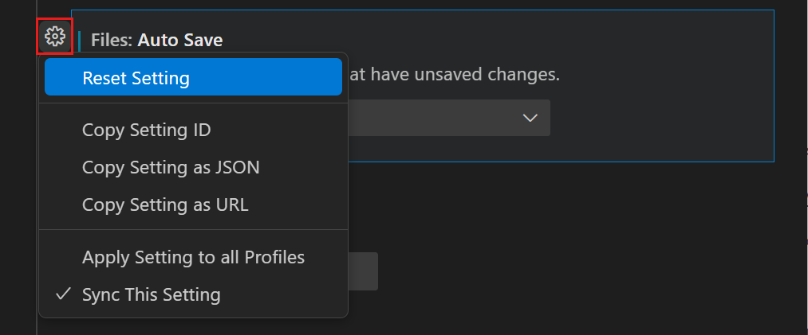

    > **提示**：在搜索框中输入 `@modified`，或选择 **已修改** 筛选器，查找更改过的设置。

4. 使用 **用户** 和 **工作区** 选项卡在设置范围之间切换。

    用户设置应用于所有工作区。工作区设置仅应用于当前工作区，并会覆盖用户设置。详细了解 [3.3.4 设置](../../../editor/3.3-ConfigureTheEditor/3.3.4-Settings/)。

## 使用源代码管理保存工作 {#save-your-work-with-source-control}

　　VS Code 包含对 Git 源代码管理的内置支持。继续之前，请确保已完成 [4.1 快速入门](../../../source-control/4.1-Quickstart/#prerequisites)。Git 使用配置的姓名和电子邮件地址来标识提交的作者。

1. 在活动栏中选择 **源代码管理** 视图。

    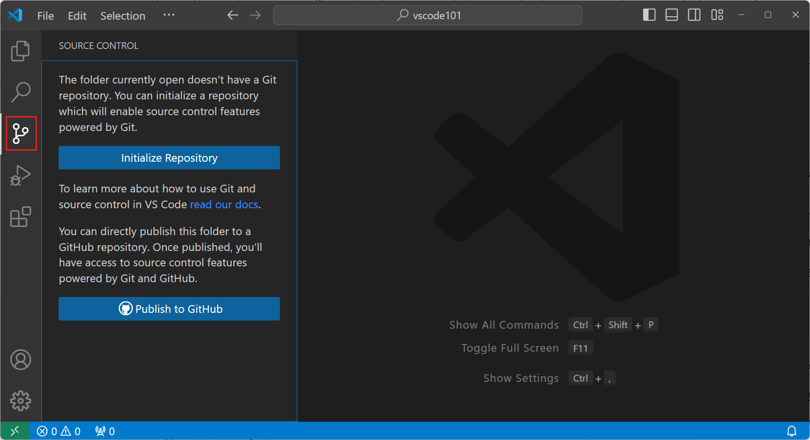

2. 选择 **初始化仓库**，在 `vscode101` 工作区中创建一个 Git 仓库。

    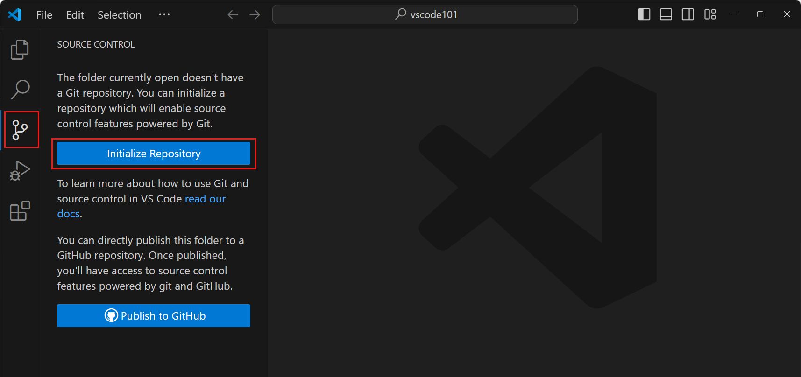

    由于你是在现有仓库之外创建的 `vscode101`，因此该仓库只包含教程文件。

3. 在 **更改** 中查看文件。将鼠标悬停在每个文件上，选择 `+` 将其暂存。

    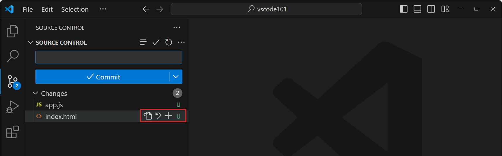

    > **提示**：要暂存所有文件，请将鼠标悬停在 **更改** 上，然后选择 **暂存所有更改**。

4. 输入 `Add recipe list app` 作为提交消息，然后选择 **提交**。

    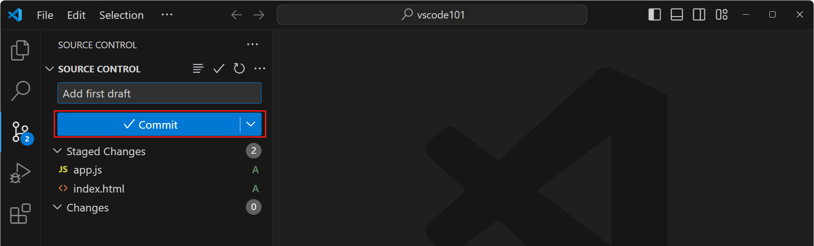

    > **提示**：在源代码管理视图中选择 **图**，查看仓库的提交历史。

　　详细了解 [4 源代码管理](../../../source-control/)。

## 在集成浏览器中调试应用 {#debug-the-app-in-the-integrated-browser}

　　将调试器附加到用于预览应用的集成浏览器选项卡。运行和调试视图不会自动创建此配置，因此请先在 工作区中添加启动配置。

1. 在资源管理器视图中，创建一个名为 `.vscode` 的文件夹。在该文件夹中，创建一个名为 `launch.json` 的文件。

2. 将以下配置添加到 `.vscode/launch.json`，然后保存文件。

    ```json
    {
      "version": "0.2.0",
      "configurations": [
        {
          "type": "editor-browser",
          "request": "attach",
          "name": "Debug recipe app"
        }
      ]
    }
    ```

3. 返回包含食谱应用的集成浏览器选项卡。如果关闭了该选项卡，请在资源管理器视图中右键单击 `index.html`，然后选择 **在集成浏览器中打开** 重新打开它。

4. 打开 `app.js`。在 `addRecipe` 函数中，将光标放在以下行上，然后按 `F9` 设置断点。

    ```javascript
    if (!name || !description) {
    ```

    编辑器边距中会出现一个红点。

5. 使用 `F5` 开始调试。

    如果出现选择器，请选择 **Debug recipe app**，然后选择包含食谱应用的集成浏览器选项卡。

6. 在集成浏览器中，输入食谱名称和描述，然后选择 **Add recipe**。

    执行会在 `addRecipe` 中的断点处暂停。

    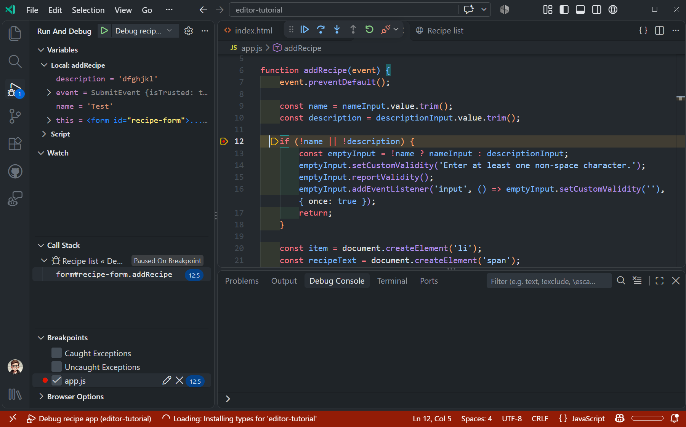

7. 将鼠标悬停在 `app.js` 中的 `name` 和 `description` 上，检查它们的值。你也可以在“运行和调试”视图的 **变量** 部分中检查它们。

8. 按 `F10` 单步跳过当前行。使用调试工具栏继续单步执行更多语句，然后选择 **继续**。

9. 在集成浏览器中确认新食谱已经出现。选择调试工具栏上的 **停止** 结束调试会话。

　　详细了解 [6.1 调试代码](../../../debugging-and-testing/6.1-Debugging/)。

## 探索 AI 辅助开发（可选） {#explore-ai-assisted-development-optional}

　　本教程不需要 AI。如果你以后选择使用 AI，聊天视图和智能体窗口都可以运行智能体。使用聊天视图在当前工作区中与智能体协作，或使用智能体窗口跨多个项目编排智能体会话。

* [1.1 智能体快速入门](../../../get-started/1.1-AgentsQuickstart/)。
* [2.1.4 智能体教程](../../../ai-in-vs-code/getting-started/2.1.4-AgentsTutorial/)。

## 后续步骤 {#next-steps}

　　你创建、编辑、预览、版本控制并调试了一个本地 Web 应用。继续学习手动编辑器工作流：

* [3.2.1 基本编辑](../../../editor/3.2-WriteCode/3.2.1-BasicEditing/)。
* [4 源代码管理](../../../source-control/)。
* [6.1 调试代码](../../../debugging-and-testing/6.1-Debugging/)。
