+++
title = "3.1.2 用户界面"
date = 2026-11-06T07:53:25+08:00
weight = 2
type = "docs"
description = ""
isCJKLanguage = true
draft = false
+++


> 原文链接: [https://code.visualstudio.com/docs/editing/getting-started/userinterface](https://code.visualstudio.com/docs/editing/getting-started/userinterface)

# 3.1.2 用户界面

　　VS Code 本质上是一个代码编辑器。像许多其他代码编辑器一样，VS Code 采用常见用户界面布局：左侧资源管理器显示可访问的所有文件和文件夹，右侧编辑器显示已打开文件的内容。

## 基本布局 {#basic-layout}

　　VS Code 布局简单直观，最大化编辑器空间，同时为浏览和访问文件夹或项目完整上下文留出充足空间。用户界面分为六个主要区域：

* **编辑器** - 编辑文件的主要区域。可以任意垂直和水平并排打开多个编辑器。
* **主侧边栏** - 包含不同视图，例如资源管理器，辅助项目工作。
* **辅助侧边栏** - 位于主侧边栏对面，默认包含聊天视图。可以将主侧边栏的视图拖放到辅助侧边栏。
* **状态栏** - 关于打开项目和编辑文件的信息。
* **活动栏** - 位于最左侧。用于切换视图，并提供额外的上下文相关指示器，例如启用 Git 时传出更改数量。可以右键单击打开上下文菜单更改活动栏位置。
* **面板** - 编辑器区域下方的额外视图空间。默认包含输出、调试信息、错误和警告以及集成终端。面板也可以移到左侧或右侧以获得更多垂直空间。

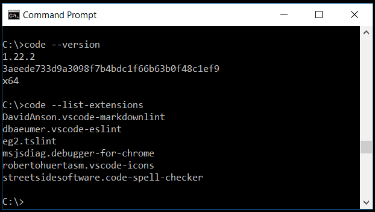

　　每次启动 VS Code 时，它会以上次关闭时的相同状态打开。文件夹、布局和打开的文件都会保留。

　　每个编辑器中的打开文件在编辑器区域顶部以带选项卡的标题显示。详细了解[选项卡](#tabs)。

> **提示**：可以右键单击活动栏，选择 **将主侧边栏移到右侧** 将主侧边栏移到右侧，或切换其可见性（`Ctrl + B`，macOS：`Cmd + B`）。

　　详细了解[主侧边栏和辅助侧边栏](../../3.3-ConfigureTheEditor/3.3.2-Layout/)。

## 并排编辑 {#side-by-side-editing}

　　可以任意垂直和水平并排打开多个编辑器。已有编辑器打开时，有多种方式在侧边打开另一个编辑器：

* 按住 `Alt` 并在资源管理器视图中选择文件。
* 按 `Ctrl + \`（macOS：`Cmd + \`） 将活动编辑器拆分为两个。
* 在资源管理器中右键单击文件，选择 **在侧边打开**（`Ctrl + Enter`，macOS：`Cmd + Enter`）。
* 选择编辑器右上角的 **拆分编辑器** 按钮。
* 将文件拖放到编辑器区域任意一侧。拖动时按住 `Ctrl`（macOS 上 `Option`）可复制选项卡而不是移动。
* 在 **快速打开**（`Ctrl + P`，macOS：`Cmd + P`）文件列表中按 `Ctrl + Enter`（macOS：`Cmd + Enter`）。

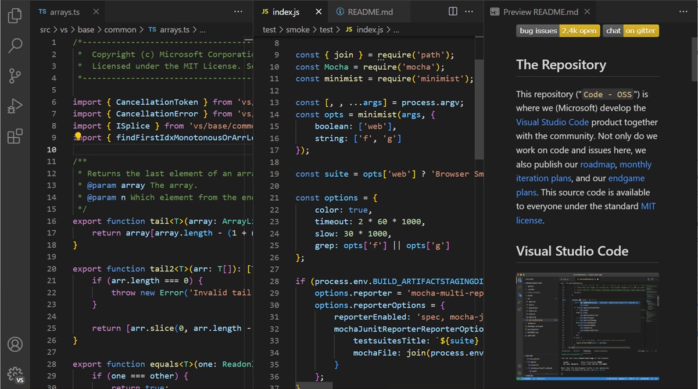

　　打开另一个文件时，活动编辑器会显示该文件内容。如果有两个并排编辑器，要将 `foo.cs` 打开到右侧编辑器，请先单击该编辑器使其活动，再打开文件。

　　默认情况下，编辑器在活动编辑器右侧打开。可以将 `workbench.editor.openSideBySideDirection` 设置为在活动编辑器下方打开。

　　打开多个编辑器时，可以按住 `Ctrl`（macOS 上 `Cmd`）并按 `1`、`2` 或 `3` 快速切换。

> **提示**：可以调整编辑器大小并重新排序。拖动编辑器标题区域重新定位或调整大小。

### 编辑器组 {#editor-groups}

　　拆分编辑器（使用 **拆分编辑器** 或 **在侧边打开** 命令）时，会创建可容纳一组项目的新编辑器区域（编辑器组）。可以任意垂直和水平并排打开多个编辑器组。

　　可以在资源管理器视图顶部的 **打开的编辑器** 部分清楚看到（切换 **...** > **打开的编辑器**）。

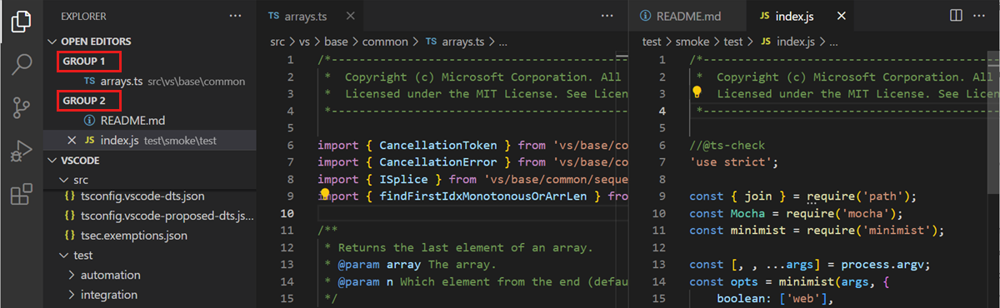

　　可以在工作台中拖放编辑器组、在组之间移动单个选项卡并快速关闭整个组（**全部关闭**）。

> **注意**：无论是否启用选项卡，VS Code 都使用编辑器组。没有选项卡时，编辑器组是打开项目的堆栈，最近选择的项目在编辑器窗格中可见。

### 在组内拆分 {#split-in-group}

　　可以使用 **View: Split Editor in Group** 命令（`Ctrl + K Ctrl + Shift + \`，macOS：`Cmd + K Cmd + Shift + \`）拆分当前编辑器而不创建新编辑器组。关于此编辑器模式和在两侧之间导航的特定命令，请参阅[自定义布局](../../3.3-ConfigureTheEditor/3.3.2-Layout/)。

### 浮动窗口 {#floating-windows}

　　可以将编辑器、终端或特定视图移到独立浮动窗口。这适合多显示器设置，希望将文件保持在不同显示器上。

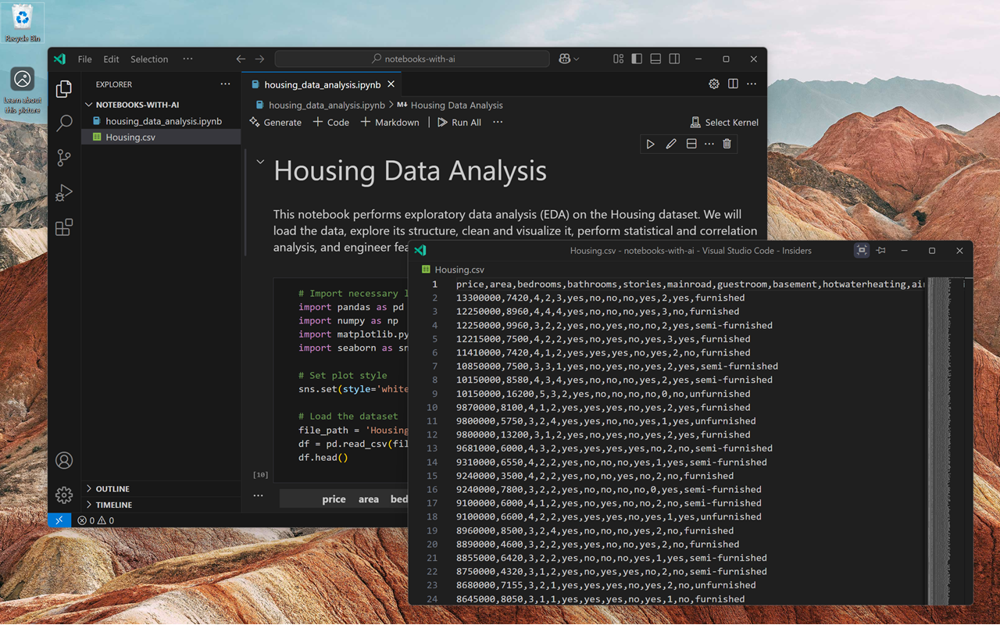

　　将编辑器选项卡拖出当前 VS Code 窗口，在浮动窗口中打开。也可以使用编辑器选项卡上下文选项 **移到新窗口** 或 **复制到新窗口**。

　　要将浮动窗口固定到屏幕顶部，请从其标题栏选择 **始终置顶** 选项（图钉图标）。

　　详细了解浮动窗口，请参阅[自定义布局](../../3.3-ConfigureTheEditor/3.3.2-Layout/)。

### 模态编辑器 {#modal-editors}

　　VS Code 中某些配置编辑器会在编辑器区域上方的居中模态覆盖层中打开，而不是常规编辑器选项卡。这些模态编辑器包括：

* **设置** 编辑器
* **键盘快捷键** 编辑器
* **配置文件** 编辑器
* **工作区信任** 编辑器
* **语言模型** 编辑器
* **扩展** 编辑器

　　可以单击外部、按 `Escape` 或选择关闭按钮关闭模态编辑器。也可以最大化以填满编辑器区域，或将其移回主窗口作为常规编辑器选项卡。

> **注意**：可以使用 `workbench.editor.useModal` 设置控制此行为。`off` 始终作为常规选项卡打开，`some` 仅将配置编辑器作为模态覆盖层（默认），`all` 将所有编辑器作为模态覆盖层打开。

## 小地图 {#minimap}

　　小地图（代码大纲）提供源代码高层概览，适合快速导航和理解代码。文件小地图显示在编辑器右侧。可以选择或拖动阴影区域快速跳转到文件不同部分。

　　如果编辑器中有[折叠标记](../../3.2-WriteCode/3.2.1-BasicEditing/#folding)，例如 `//#region` 注释，小地图会显示折叠标记名称。折叠标记因语言而异，请检查适用于你的语言的标记。

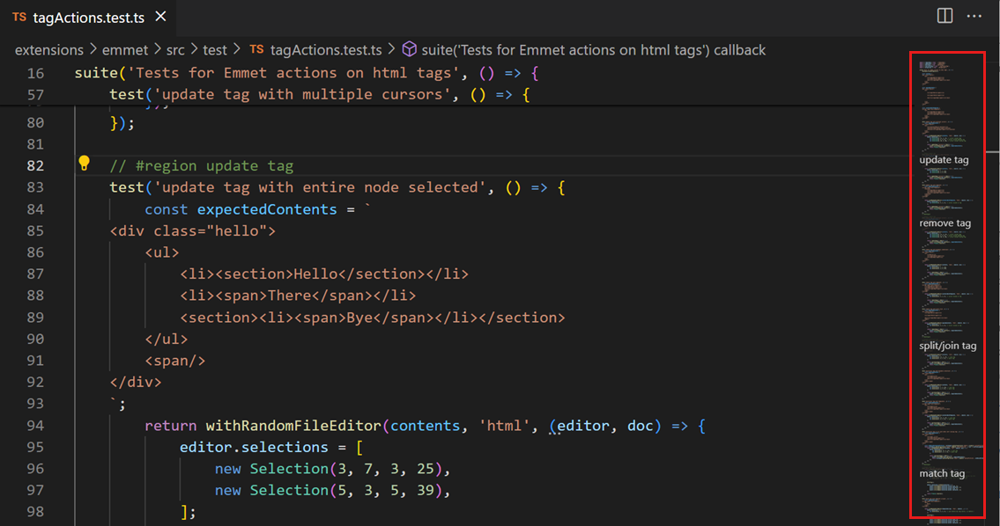

> **提示**：可以通过设置 `"editor.minimap.side": "left"` 将小地图移到左侧，或通过 `"editor.minimap.enabled": false` 完全禁用。

## 粘性滚动 {#sticky-scroll}

　　粘性滚动在编辑器顶部显示当前可见嵌套作用域的起始行。它通过指示文件中的位置方便导航，并可以快速跳回当前作用域顶部。

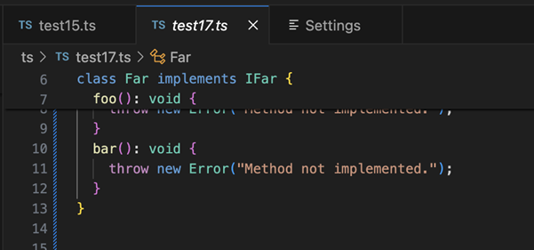

> **提示**：可以使用 `editor.stickyScroll.enabled` 设置启用/禁用粘性滚动。

　　粘性滚动使用多种内容模型创建标题。可以在大纲提供程序模型、折叠提供程序模型和缩进模型之间选择，以确定粘性滚动区域显示哪些行。当前语言不支持某个模型时，VS Code 按上述顺序回退到下一个模型。初始默认模型来自 `editor.stickyScroll.defaultModel` 设置。

### 缩进参考线 {#indent-guides}

　　编辑器显示缩进参考线（垂直线），帮助快速查看匹配的缩进级别。要禁用缩进参考线，请在用户或工作区[设置](../../3.3-ConfigureTheEditor/3.3.4-Settings/)中将 `editor.guides.indentation` 设置为 `false`。

## 面包屑 {#breadcrumbs}

　　编辑器顶部有导航栏，也称为[面包屑](https://en.wikipedia.org/wiki/Breadcrumb_(navigation))。面包屑始终显示文件路径；如果当前文件类型支持符号，还显示到光标位置的符号路径。面包屑可以在文件夹、文件和符号之间快速导航。

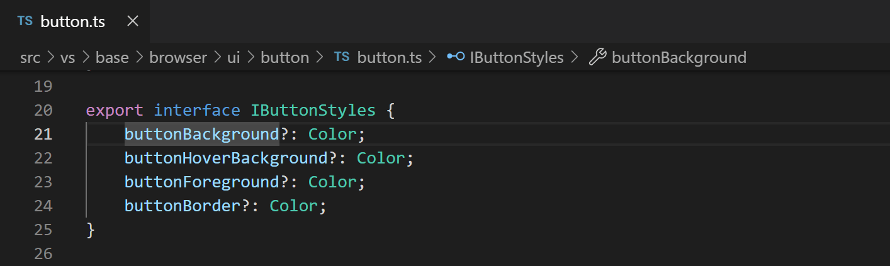

　　可以通过 **视图** > **外观** > **切换面包屑** 菜单项或 **View: Toggle Breadcrumbs** 命令禁用面包屑。关于面包屑自定义外观等详细信息，请参阅[代码导航](../../3.2-WriteCode/3.2.5-CodeNavigation/#breadcrumbs)。

## 资源管理器视图 {#explorer-view}

　　资源管理器视图用于浏览、打开和管理项目中的文件和文件夹。VS Code 基于文件和文件夹，打开文件或文件夹即可开始。

　　打开文件夹后，文件夹内容显示在资源管理器视图中。可以在这里执行许多操作：

* 创建、删除和重命名文件和文件夹。
* 拖放移动文件和文件夹。
* 使用上下文菜单探索所有选项。

> **提示**：可以从 VS Code 外部将文件拖放到资源管理器视图以复制它们。如果资源管理器为空，VS Code 会改为打开文件。也可以从外部复制粘贴文件到资源管理器。使用 `explorer.autoOpenDroppedFile` 设置配置是否自动打开文件。

　　VS Code 与其他工具（尤其是命令行工具）配合良好。如果要在当前打开文件夹的上下文中运行命令行工具，请右键单击文件夹，选择 **在集成终端中打开**。

　　也可以右键单击文件或文件夹，选择 **在文件资源管理器中显示**（Windows）、**在 Finder 中显示**（macOS）或 **打开包含文件夹**（Linux），在操作系统文件资源管理器中导航到其位置。

> **提示**：输入 `Ctrl + P`（macOS：`Cmd + P`）（**快速打开**）按名称快速搜索和打开文件。

　　默认情况下，VS Code 在资源管理器视图中排除某些文件夹，例如 `.git`。使用 `files.exclude` 设置配置隐藏规则。此设置中的 glob 模式遵循操作系统大小写规则（Windows/macOS 不区分，Linux 区分）。详细了解 [glob 模式](https://code.visualstudio.com/docs/editor/glob-patterns)。

　　也可以通过启用 `explorer.excludeGitIgnore` 设置隐藏 `.gitignore` 中指定的文件和文件夹。启用后，`.gitignore` 模式在 Windows 和 macOS 上不区分大小写，在 Linux 上区分大小写。例如 `node_modules` 会匹配 `node_modules/`、`Node_Modules/`、`NODE_MODULES/` 等，但 Linux 上只匹配精确大小写。

　　要显示排除文件夹中的选定文件或文件夹，请在 `settings.json` 中为 `files.exclude` 添加 `!` 例外。例如，隐藏 `node_modules` 但保持 `node_modules/@types` 可见：

```json
{
  "files.exclude": {
    "node_modules": true,
    "!node_modules/@types": true
  }
}
```

　　资源管理器会显示 `@types` 及其内容以及父 `node_modules` 文件夹，其他条目保持隐藏。例外也会覆盖 `.gitignore` 排除。详细了解[排除例外及其限制](https://code.visualstudio.com/docs/editor/glob-patterns#_exclude-exceptions)。

　　启用 `imageCarousel.explorerContextMenu.enabled`（实验性）后，可以右键单击资源管理器中的图像或视频文件/文件夹，选择 **在轮播中打开图像** 在专用轮播视图中浏览媒体文件。多选也适用。

> **提示**：可以隐藏派生资源文件，例如 Unity 中的 `*.meta` 或 TypeScript 项目中的 `*.js`。Unity 排除 `*.cs.meta` 的模式为 `"**/*.cs.meta": true`；TypeScript 排除生成的 JavaScript 可使用 `"**/*.js": {"when": "$(basename).ts"}`。

### 文件嵌套 {#file-nesting}

　　除了隐藏派生或伴随文件，还可以在资源管理器视图中将其嵌套在父文件下。文件嵌套根据名称视觉分组相关文件并折叠到“根”文件，减少杂乱并保持文件可访问。

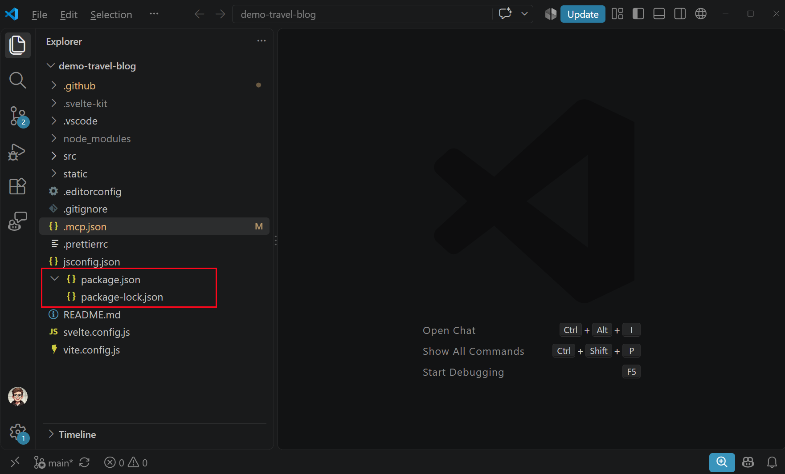

可以使用以下设置配置文件嵌套：

* `explorer.fileNesting.enabled`：控制是否启用文件嵌套，可全局或按工作区设置。
* `explorer.fileNesting.expand`：控制嵌套文件是否默认展开。
* `explorer.fileNesting.patterns`：配置决定文件分组的嵌套规则。

　　默认模式包括 TypeScript 和 JavaScript 项目规则，例如将匹配的 `.js` 文件嵌套在其 `.ts` 源文件下。可以自定义 `explorer.fileNesting.patterns`：

```json
"explorer.fileNesting.enabled": true,
"explorer.fileNesting.expand": false,
"explorer.fileNesting.patterns": {
  "*.ts": "${capture}.js, ${capture}.d.ts, ${capture}.js.map",
  "*.js": "${capture}.js.map",
  "package.json": "package-lock.json, yarn.lock, pnpm-lock.yaml"
}
```

嵌套模式支持以下令牌：

* `${capture}`：匹配模式键中 `*` 通配符匹配的字符串。
* `${basename}`：父文件基名（不含扩展名）。
* `${extname}`：父文件扩展名。
* `${dirname}`：父文件目录名。

　　嵌套折叠时，复制、剪切、拖放和删除等文件操作应用于整个嵌套组。展开时，选择和操作应用于单个文件。

### 多选 {#multi-selection}

　　可以在资源管理器视图和打开的编辑器部分选择多个文件，对多个项目执行操作（删除、拖放或在侧边打开）。按住 `Ctrl`（macOS 上 `Cmd`）选择单个文件，或按住 `Shift` 选择范围。选择两个项目时，还可以使用上下文菜单 **比较所选内容** 快速比较两个文件。

> **注意**：早期 VS Code 版本中，按住 `Ctrl`（macOS 上 `Cmd`）单击会在侧边新编辑器组打开文件。如果仍希望此行为，请将 `workbench.list.multiSelectModifier` 设置为使用 `Alt`。

```json
"workbench.list.multiSelectModifier": "alt"
```

### 高级树导航 {#advanced-tree-navigation}

　　可以筛选资源管理器视图中的文件和文件夹。资源管理器视图聚焦时，按 `Ctrl + F` 打开查找控件，输入要匹配的文件或文件夹名称的一部分。此导航功能适用于 VS Code 所有树视图。

　　按 **筛选** 按钮在突出显示和筛选两种模式之间切换。按 `↓` 聚焦第一个匹配元素并导航到后续匹配元素。突出显示模式下，文件夹上会显示徽章表示包含匹配文件。

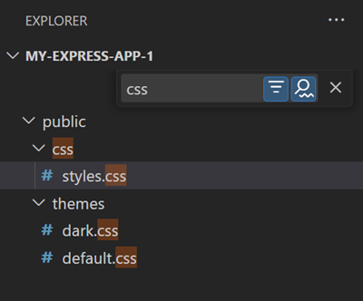

### 大纲视图 {#outline-view}

　　大纲视图是资源管理器视图底部的单独部分。展开时显示当前活动编辑器的符号树。

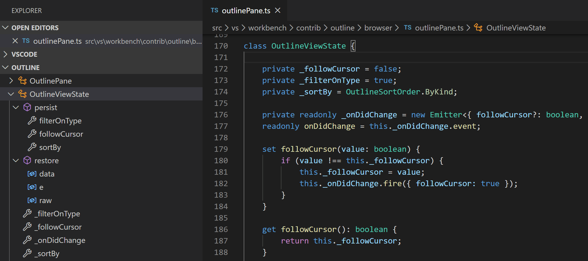

　　大纲视图有不同的 **排序方式** 模式、可选光标跟踪并支持常规打开手势。它还包括用于查找或筛选的输入框。错误和警告也会显示在大纲视图中，便于一眼看到问题位置。

　　对于符号，视图依赖已安装扩展为不同文件类型计算的信息。例如，内置 Markdown 支持返回 Markdown 文件的标题层次结构。

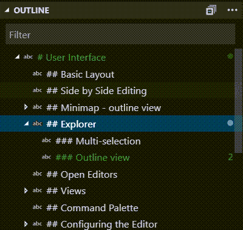

　　大纲视图有多个[设置](../../3.3-ConfigureTheEditor/3.3.4-Settings/)。搜索以 `outline.` 开头的设置，配置大纲视图显示的信息。

### 时间线视图 {#timeline-view}

　　时间线视图位于文件资源管理器底部，是可视化文件事件历史的统一视图。例如，可以在时间线视图中查看 Git 提交或本地文件保存。

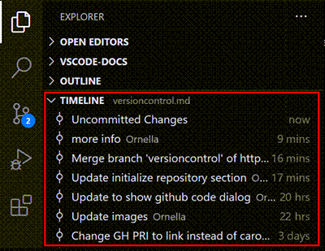

　　时间线视图工具栏中的筛选操作可以在源代码管理事件和本地文件事件之间筛选：

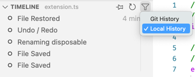

#### 本地文件历史 {#local-file-history}

　　根据设置，每次保存编辑器时，列表会添加新条目。每个本地历史条目包含创建时文件的完整内容，某些情况下可以提供更多语义信息（例如指示重构）。

从条目可以：

* 将更改与本地文件或上一条目比较。
* 恢复内容。
* 删除或重命名条目。

> **提示**：如果意外删除文件，可以在时间线视图中使用 **...** > **Local History: Find Entry to Restore** 操作，然后从快速选择中选择文件，从本地历史恢复。

可以配置以下本地历史设置：

* `workbench.localHistory.enabled` - 启用或禁用本地历史（默认 `true`）。
* `workbench.localHistory.maxFileSize` - 创建本地历史条目的文件大小限制（默认 256 KB）。
* `workbench.localHistory.maxFileEntries` - 每个文件的本地历史条目限制（默认 50）。
* `workbench.localHistory.exclude` - 从本地历史排除特定文件的 glob 模式。
* `workbench.localHistory.mergeWindow` - 后续更改添加到最后一个条目的间隔秒数（默认 10 秒）。

#### 提交历史 {#commit-history}

　　VS Code 内置 Git 支持提供指定文件的 Git 提交历史。选择提交会打开该提交引入更改的差异视图。右键单击提交，可以选择 **复制提交 ID** 和 **复制提交消息**。

右键单击历史中的提交，可以：

* **打开更改** - 打开文件更改的差异视图。
* **查看提交** - 打开多文件差异视图，查看提交中所有文件的更改。
* **选择以比较** - 选择条目与另一个条目比较。
* **复制提交 ID** - 将提交 ID 复制到剪贴板。
* **复制提交消息** - 将提交消息复制到剪贴板。

可以配置以下 Git 历史设置：

* `git.timeline.date` - 显示文件提交的提交日期或作者日期。

## 视图 {#views}

　　资源管理器视图只是 VS Code 中可用视图之一。还有：

* **搜索** - 在打开文件夹中提供全局搜索和替换。
* **源代码管理** - VS Code 默认包含 Git 源代码管理。
* **运行** - VS Code 的运行和调试视图显示变量、调用堆栈和断点。
* **扩展** - 在 VS Code 中安装和管理扩展。
* **自定义视图** - 扩展提供的视图。

> **提示**：可以使用 **View: Open View** 命令打开任何视图。

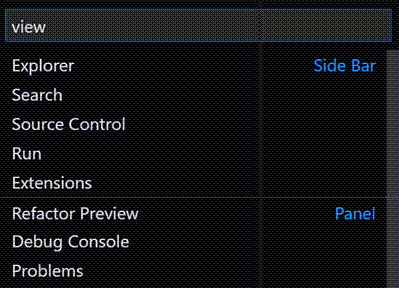

　　可以右键单击活动栏显示或隐藏视图，并通过拖放重新排序。在资源管理器视图中，可以通过“...”菜单显示或隐藏部分，或拖放部分重新排序。

<video src="https://code.visualstudio.com/assets/docs/editing/userinterface/view-management.mp4" autoplay loop controls muted title="视图管理"></video>

## 命令面板 {#command-palette}

　　VS Code 同样可以通过键盘访问。最重要的组合键是 `Ctrl + Shift + P`（macOS：`Cmd + Shift + P`），它会打开**命令面板**。从这里可以访问 VS Code 所有功能，包括最常见操作的键盘快捷键。

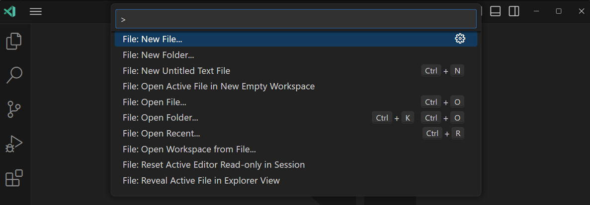

　　**命令面板**提供许多命令。可以运行编辑器命令、打开文件、搜索符号并查看文件快速大纲，全部使用同一交互窗口。一些提示：

* `Ctrl + P`（macOS：`Cmd + P`） 按名称导航到任何文件或符号。
* `Ctrl + Tab` 在最近打开的文件集之间循环。
* `Ctrl + Shift + P`（macOS：`Cmd + Shift + P`） 直接进入编辑器命令。
* `Ctrl + Shift + O`（macOS：`Cmd + Shift + O`） 导航到文件中的特定符号。
* `Ctrl + G` 导航到文件中的特定行。

在输入框中输入 `?` 获取可从命令面板运行的可用命令列表。

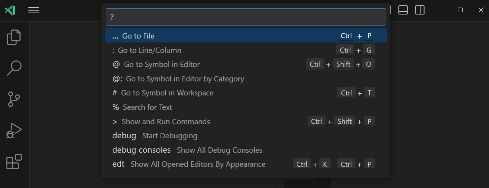

> **提示**：可以抓住命令面板顶部边缘拖到其他位置。也可以选择标题栏中的 **自定义布局** 控件，然后选择预配置的 **快速输入位置**。

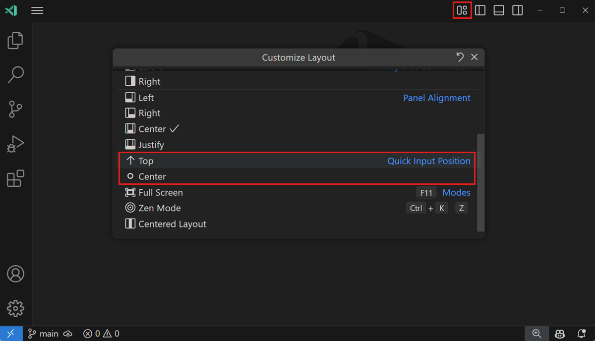

## 配置编辑器 {#configure-the-editor}

　　VS Code 提供许多编辑器配置选项。从 **视图** > **外观** 菜单可以隐藏或切换用户界面各部分，例如 **侧边栏**、**状态栏** 和 **活动栏**。

### 隐藏菜单栏（Windows、Linux） {#hide-the-menu-bar-windows-linux}

　　可以通过将 `window.menuBarVisibility` 从 `classic` 改为 `toggle` 或 `hidden` 隐藏 Windows 和 Linux 上的菜单栏。`toggle` 表示按一次 `Alt` 重新显示菜单栏。

　　也可以使用 **View: Toggle Menu Bar** 命令隐藏菜单栏。该命令将 `window.menuBarVisibility` 从 `classic` 改为 `compact`，菜单栏移入活动栏。要恢复 `classic` 位置，请再次运行 **View: Toggle Menu Bar**。

### 设置 {#settings}

　　大多数编辑器配置通过设置管理，可以直接修改。可以通过用户设置全局设置，或通过工作区设置按项目/文件夹设置。设置值存储在 [`settings.json` 文件](../../3.3-ConfigureTheEditor/3.3.4-Settings/)中。

　　可以在设置编辑器中查看和编辑设置（**文件** > **首选项** > **设置**，或按 `Ctrl + ,`（macOS：`Cmd + ,`））。使用 **用户** 和 **工作区** 选项卡切换。可以使用顶部搜索框筛选设置。

　　也可以直接在 `settings.json` 中修改用户设置。使用 **Preferences: Open User Settings (JSON)** 命令打开 `settings.json`。对于工作区设置，请打开工作区 `.vscode` 文件夹中的 `settings.json`。

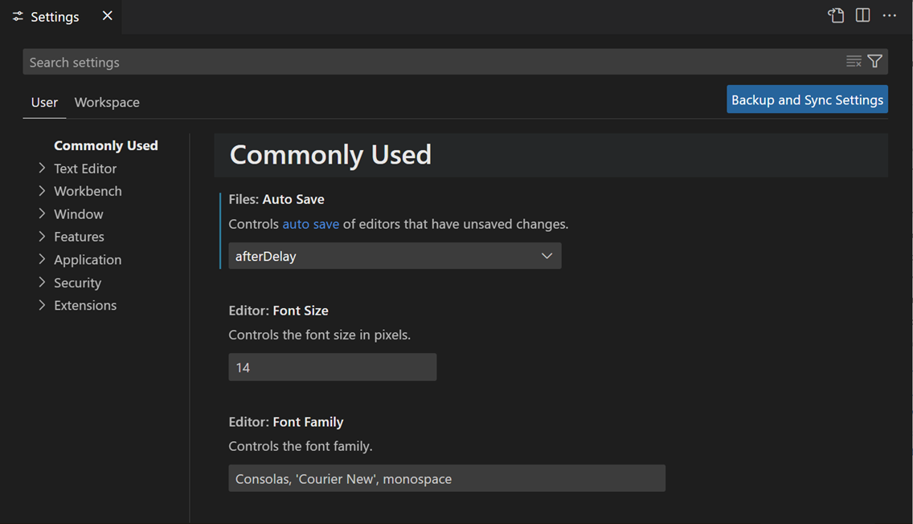

> **注意**：工作区设置覆盖用户设置，适合在团队中共享项目特定设置。

### 禅模式 {#zen-mode}

　　禅模式隐藏除编辑器外的所有 UI 元素，将 VS Code 切换为全屏并居中编辑器，让你专注于代码。可以通过 **视图** > **外观** > **禅模式** 菜单、命令面板中的 **View: Toggle Zen Mode** 或快捷键 `Ctrl + K Z`（macOS：`Cmd + K Z`） 切换。按两次 `Esc` 退出禅模式。可以通过 `zenMode.fullScreen` 禁用全屏过渡。

可以使用以下设置进一步调整禅模式：

* `zenMode.hideActivityBar` - 隐藏活动栏。默认 `true`。
* `zenMode.hideStatusBar` - 隐藏状态栏。默认 `true`。
* `zenMode.hideLineNumbers` - 隐藏行号。默认 `true`。
* `zenMode.showTabs` - 控制显示多个、单个或无编辑器选项卡。默认 `multiple`。
* `zenMode.fullScreen` - 全屏显示工作台。默认 `true`。
* `zenMode.restore` - 重启时恢复禅模式。默认 `true`。
* `zenMode.centerLayout` - 使用[居中编辑器布局](#centered-editor-layout)。默认 `true`。
* `zenMode.silentNotifications` - 不显示通知。默认 `true`。

### 使用“勿扰模式”减少通知 {#reduce-notifications-with-do-not-disturb-mode}

　　如果通知太多，可以减少所有通知或特定扩展的通知。

选择状态栏中的铃铛图标（如果通知位于右上角，则在标题栏中）打开通知区域。即使启用勿扰模式，也可以在此随时访问所有通知。可以使用 `workbench.notifications.position` 设置更改通知位置。详细了解[通知位置](../../3.3-ConfigureTheEditor/3.3.2-Layout/)。

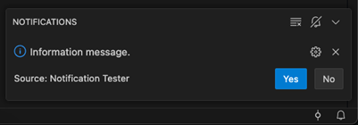

　　找到带斜线的铃铛图标，打开菜单，选择性禁用扩展通知或启用全局勿扰模式禁用所有通知。

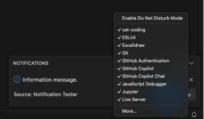

> **注意**：全局勿扰模式也会隐藏错误通知，而特定扩展筛选仍允许错误通知显示。

### 居中编辑器布局 {#centered-editor-layout}

　　居中编辑器布局将编辑器区域居中对齐。在大型显示器上使用单个编辑器时很有用。可以使用两侧边框调整视图大小（按住 `Alt` 键可独立移动两侧）。

## 选项卡 {#tabs}

　　VS Code 在编辑器上方标题区域以选项卡（带选项卡标题）显示打开项目。打开文件时会添加新选项卡。选项卡可以在项目之间快速导航。

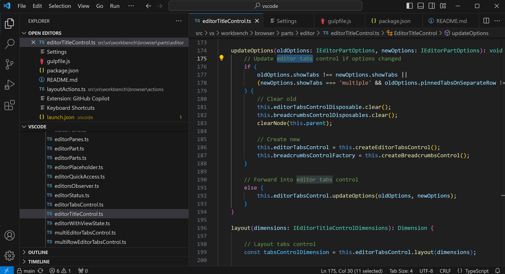

　　可以拖放选项卡重新排序。要一次对多个选项卡执行操作，请按住 `Ctrl`（macOS 上 `Cmd`）选择选项卡。要选择范围，请按住 `Shift` 选择范围中的第一个和最后一个选项卡。

　　打开项目多于标题区域可容纳数量时，可以使用资源管理器视图中的 **打开的编辑器** 部分（通过 `...` 按钮）显示选项卡项目下拉列表。

　　选项卡和编辑器区域之间有滚动条，可以拖动编辑器进入视图。可以通过将 **Workbench > Editor: Title Scrollbar Sizing**（`workbench.editor.titleScrollbarSizing`）设置为 `large` 增加滚动条高度，便于拖动。使用 `workbench.editor.titleScrollbarVisibility` 控制滚动条可见性。

　　如果不希望使用选项卡，可以将 `workbench.editor.showTabs` 设置为 `single` 禁用：

```json
    "workbench.editor.showTabs": "single"
```

　　请参阅下面[无选项卡工作](#working-without-tabs)部分优化 VS Code。

> **提示**：双击编辑器标题区域快速创建新选项卡。

### 选项卡排序 {#tab-ordering}

　　默认情况下，新选项卡添加到现有选项卡右侧。可以使用 `workbench.editor.openPositioning` 设置控制新选项卡出现位置。

例如，希望新选项卡出现在左侧：

```json
    "workbench.editor.openPositioning": "left"
```

　　可以通过拖放重新排序选项卡。

　　如果希望编辑器选项卡始终可见，可以将其固定到编辑器选项卡栏。详细了解[固定选项卡](../../3.3-ConfigureTheEditor/3.3.2-Layout/)。

　　`workbench.editor.showTabIndex` 设置可以在选项卡标题中显示索引，便于查看使用 `Ctrl`（macOS 上 `Cmd`）+ 数字快捷键切换到的选项卡编号。

### 预览模式 {#preview-mode}

　　在资源管理器视图中单击或选择文件时，文件以预览模式显示并复用现有选项卡（预览选项卡）。这适合快速浏览文件而不想每个文件都有单独选项卡。开始编辑文件或在资源管理器中双击打开时，会为该文件分配新选项卡。

　　预览模式在选项卡标题中以斜体表示：

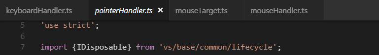

　　如果不想使用预览模式并始终创建新选项卡，可以使用以下设置：

* `workbench.editor.enablePreview` - 全局启用或禁用预览编辑器。
* `workbench.editor.enablePreviewFromQuickOpen` - 启用或禁用从 **快速打开** 打开时的预览编辑器。

### 换行选项卡 {#wrapped-tabs}

　　要查看更多编辑器选项卡，可以使用**换行选项卡**布局，编辑器选项卡在编辑器区域上方换行填充多行。使用 **Workbench > Editor: Wrap Tabs**（`workbench.editor.wrapTabs`）设置启用。

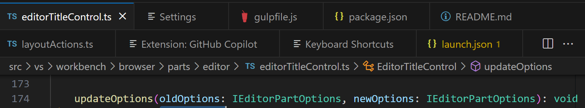

### 自定义选项卡标签 {#customize-tab-labels}

　　同时打开多个同名文件时，可能难以区分选项卡。可以为选项卡应用自定义显示标签。可以选择工作区中哪些文件应用自定义标签。

要启用自定义选项卡标签，请设置 `workbench.editor.customLabels.enabled`：

```json
    "workbench.editor.customLabels.enabled": true
```

　　可以使用 `workbench.editor.customLabels.patterns` 设置指定一个或多个命名模式。名称模式由两部分组成：

- **项目** - 匹配要应用自定义标签文件路径的 [glob 模式](https://code.visualstudio.com/docs/editor/glob-patterns)，例如 `**/static/**/*.html`。
- **值** - 自定义标签模板。模板可以使用 `${filename}`、`${extname}`、`${extname(N)}`、`${dirname}` 和 `${dirname(N)}` 等变量，动态替换为文件路径值。

以下示例将 `/src/orders/index.html` 显示为 `orders/index`：

```json
    "workbench.editor.customLabels.patterns": {
        "**/src/**/index.html": "${dirname}/${filename}"
    }
```

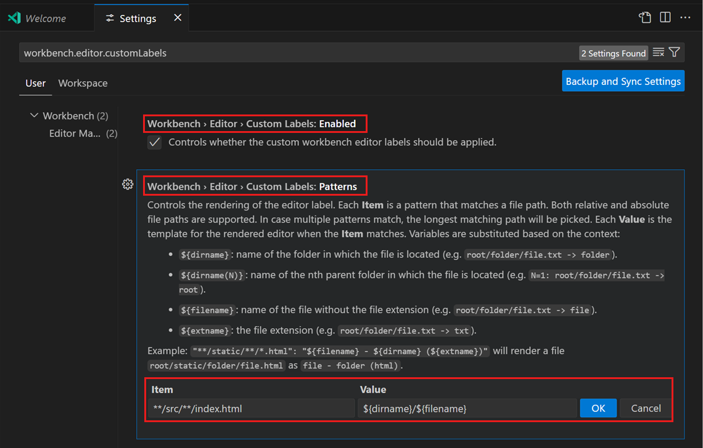

以下示例对文件 `tests/editor.test.ts` 使用 `${extname}`：

* `${filename}` => editor
* `${extname}` => test.ts
* `${extname(0)}` => ts
* `${extname(1)}` => test
* `${extname(-1)}` => test
* `${extname(-2)}` => ts

> **注意**：自定义选项卡标签也适用于打开的编辑器视图和[快速打开](../3.1.3-TipsAndTricks/#quick-open)（`Ctrl + P`，macOS：`Cmd + P`）。

## 网格编辑器布局 {#grid-editor-layout}

　　默认情况下，编辑器组按垂直列布局。例如拆分编辑器时，编辑器在侧边打开。可以任意垂直和水平排列编辑器组：

<video src="https://code.visualstudio.com/assets/docs/editing/userinterface/grid-layout.mp4" autoplay loop controls muted title="网格编辑器布局"></video>

　　为了支持灵活布局，可以创建空编辑器组。默认关闭编辑器组最后一个编辑器也会关闭组，但可以通过 `workbench.editor.closeEmptyGroups: false` 更改。

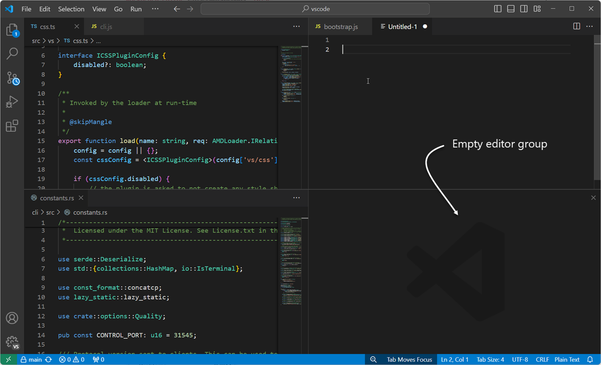

　　**视图** > **编辑器布局** 菜单提供预定义编辑器布局：

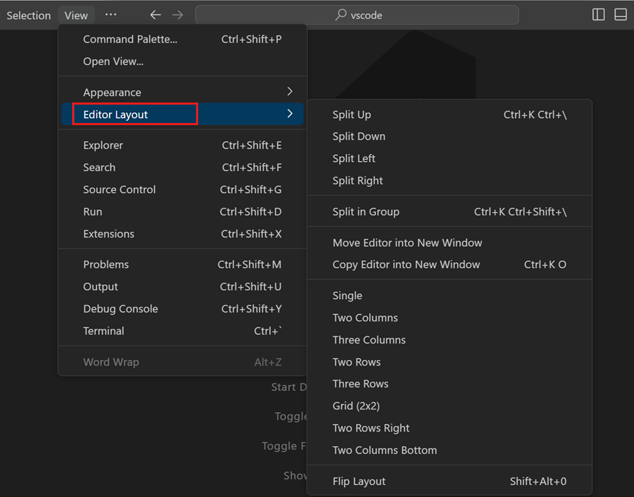

　　默认情况下，在侧边打开的编辑器（例如选择编辑器工具栏 **拆分编辑器** 操作）在活动编辑器右侧打开。如果希望下方打开，请将 `workbench.editor.openSideBySideDirection` 设置为 `down`。

　　有许多键盘命令可调整编辑器布局。如果更喜欢鼠标，可以拖放将编辑器拆分到任意方向：

<video src="https://code.visualstudio.com/assets/docs/editing/userinterface/grid-dnd.mp4" autoplay loop controls muted title="网格编辑器拖放"></video>

> **提示**：在悬停拆分编辑器工具栏操作时按住 `Alt`，会提供另一种方向的拆分。这可以快速向右或向下拆分。

<video src="https://code.visualstudio.com/assets/docs/editing/userinterface/grid-alt.mp4" title="网格 Alt 单击演示。" autoplay loop controls muted></video>

### 键盘快捷键 {#keyboard-shortcuts}

以下快捷键可在编辑器和编辑器组之间快速导航：

* `Ctrl + PageDown`（macOS：`Cmd + PageDown`） - 转到右侧编辑器。
* `Ctrl + PageUp`（macOS：`Cmd + PageUp`） - 转到左侧编辑器。
* `Ctrl + Tab` - 打开编辑器组最近使用列表中的上一个编辑器。
* `Ctrl + 1`（macOS：`Cmd + 1`） - 转到最左侧编辑器组。
* `Ctrl + 2`（macOS：`Cmd + 2`） - 转到中间编辑器组。
* `Ctrl + 3`（macOS：`Cmd + 3`） - 转到最右侧编辑器组。
* `Ctrl + W`（macOS：`Cmd + W`） - 关闭活动编辑器。
* `Ctrl + K W`（macOS：`Cmd + K W`） - 关闭编辑器组中所有编辑器。
* `Ctrl + K Ctrl + W`（macOS：`Cmd + K Cmd + W`） - 关闭所有编辑器。

> 要修改默认快捷键，请参阅[键绑定](../../3.3-ConfigureTheEditor/3.3.3-KeyboardShortcuts/)。

## 无选项卡工作 {#working-without-tabs}

　　如果不想使用选项卡，可以将 `workbench.editor.showTabs` 设置为 `single` 或 `none` 完全禁用。

### 禁用预览模式 {#disable-preview-mode}

　　没有选项卡时，资源管理器视图的 **打开的编辑器** 部分是快速文件导航方式。但启用[预览编辑器模式](#preview-mode)时，文件不会添加到打开的编辑器部分。可以通过 `workbench.editor.enablePreview` 和 `workbench.editor.enablePreviewFromQuickOpen` 设置禁用。

### 使用快捷键导航编辑器历史 {#use-keyboard-shortcuts-to-navigate-the-editor-history}

　　可以更改 `Ctrl + Tab` 的行为，使其显示历史中所有打开的编辑器，独立于活动编辑器组。

编辑[键盘快捷键](../../3.3-ConfigureTheEditor/3.3.3-KeyboardShortcuts/)，添加：

```json
{ "key": "ctrl+tab", "command": "workbench.action.openPreviousEditorFromHistory" },
{ "key": "ctrl+tab", "command": "workbench.action.quickOpenNavigateNext", "when": "inQuickOpen" },
```

### 关闭整个组而不是单个编辑器 {#close-an-entire-group-instead-of-a-single-editor}

　　如果喜欢关闭一个编辑器时关闭整个组的行为，可以在[键绑定](../../3.3-ConfigureTheEditor/3.3.3-KeyboardShortcuts/)中绑定：

macOS：

```json
{ "key": "cmd+w", "command": "workbench.action.closeEditorsInGroup" }
```

Windows/Linux：

```json
{ "key": "ctrl+w", "command": "workbench.action.closeEditorsInGroup" }
```

## 窗口管理 {#window-management}

　　VS Code 有多种选项控制窗口（实例）如何打开或在会话之间恢复。

　　`window.openFoldersInNewWindow` 和 `window.openFilesInNewWindow` 设置配置文件或文件夹是打开新窗口还是复用最后活动窗口，可能值为 `default`、`on` 和 `off`。

　　配置为 `default` 时，VS Code 根据打开请求的上下文决定复用还是打开新窗口。设置为 `on` 或 `off` 始终执行相同行为。例如，如果认为从 **文件** 菜单选择文件或文件夹应始终在新窗口打开，请设置为 `on`。

> **注意**：某些情况下此设置会被忽略，例如使用 `-new-window` 或 `-reuse-window` 命令行选项。

　　`window.restoreWindows` 设置告诉 VS Code 如何恢复上次会话打开的窗口。默认恢复上次会话所有窗口（`all`）。设置为 `none` 从不重新打开窗口，始终以空 VS Code 实例启动。设置为 `one` 重新打开最后工作的窗口，或设置为 `folders` 只恢复打开文件夹的窗口。

## 后续步骤 {#next-steps}

现在你了解了 VS Code 整体布局，可以通过以下文章开始自定义编辑器：

* [更改主题](../../3.3-ConfigureTheEditor/3.3.7-Themes/) - 设置颜色和/或文件图标主题。
* [使用自定义布局](../../3.3-ConfigureTheEditor/3.3.2-Layout/) - 了解工作台和编辑器布局自定义。

## 常见问题 {#common-questions}

### 如何更改缩进参考线颜色？ {#how-can-i-change-the-color-of-the-indent-guides}

　　缩进参考线颜色可以自定义，大多数 VS Code UI 元素也是如此。要为活动颜色主题[自定义](https://code.visualstudio.com/api/references/theme-color)缩进参考线颜色，请使用 `workbench.colorCustomizations` 设置并修改 `editorIndentGuide.background` 值。

例如，将缩进参考线设为亮蓝色：

```json
"workbench.colorCustomizations": {
    "editorIndentGuide.background": "#0000ff"
}
```

### 可以隐藏资源管理器视图中的“打开的编辑器”部分吗？ {#can-i-hide-the-open-editors-section-in-the-explorer-view}

　　可以，使用资源管理器中的视图菜单切换 **打开的编辑器** 菜单项即可显示或隐藏。

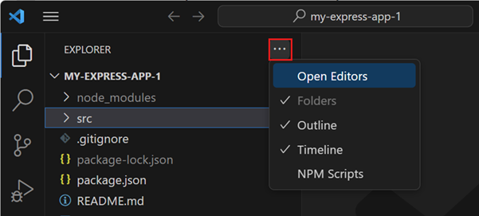
