+++
title = "3.1.3 提示和技巧"
date = 2026-11-06T07:53:25+08:00
weight = 3
type = "docs"
description = ""
isCJKLanguage = true
draft = false
+++


> 原文链接: [https://code.visualstudio.com/docs/editing/getting-started/tips-and-tricks](https://code.visualstudio.com/docs/editing/getting-started/tips-and-tricks)

# 3.1.3 提示和技巧

　　使用本文提示和技巧快速入门，学习如何高效使用 VS Code。熟悉强大的编辑、代码智能和源代码管理功能，并学习有用的键盘快捷键。请探索[入门](../3.1.2-UserInterface/)和[用户指南](../../3.2-WriteCode/3.2.1-BasicEditing/)中的深入主题。

　　如果刚刚开始，请查看 [VS Code 教程](../3.1.1-EditorTutorial/)逐步发现关键功能。

> 如果尚未安装 VS Code，请访问[下载](https://code.visualstudio.com/download)页面。平台特定设置说明请参阅[在 Linux 上运行 VS Code](../../../advanced-setup/9.2-Linux/)、[macOS](../../../advanced-setup/9.3-macOS/)和[Windows](../../../advanced-setup/9.4-Windows/)。

　　更喜欢视频？可以观看 VS Code Day 演讲 [VS Code 提示和技巧](https://learn.microsoft.com/en-us/events/visual-studio-code-vs-code-day-2021/vs-code-tips-and-tricks)或[提升 VS Code 体验](https://learn.microsoft.com/en-us/shows/vs-code-day-2023/elevate-your-vs-code-experience)。

## 基础 {#basics}

### 入门 {#getting-started}

　　动手探索 VS Code 的最佳方式是打开 **欢迎** 页面，然后选择一个 **演练**，进行设置步骤、功能和深入自定义的自助导览。学习和发现时，演练会跟踪进度。

从 **帮助** > **欢迎** 菜单打开欢迎页，或从命令面板（`Ctrl + Shift + P`，macOS：`Cmd + Shift + P`）使用 **Help: Welcome** 命令。

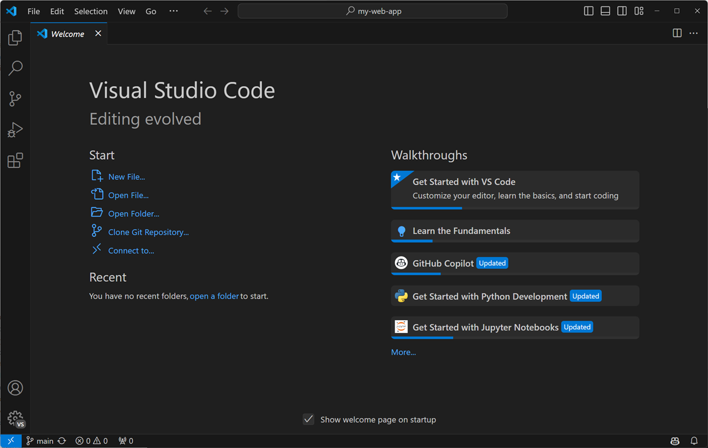

　　扩展也可以提供演练。可以从命令面板使用 **Help: Open Walkthrough...** 命令直接打开演练。

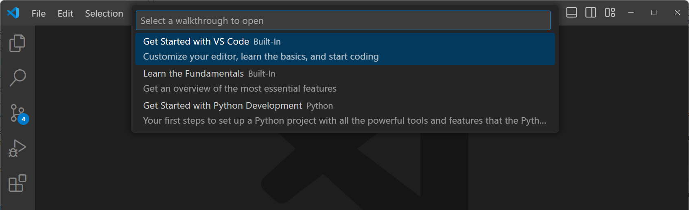

　　如果想提高代码编辑技能，请打开 **交互式编辑器游乐场**，尝试 VS Code 的[代码编辑功能](../../3.2-WriteCode/3.2.1-BasicEditing/)，例如多光标编辑、[IntelliSense](../../3.2-WriteCode/3.2.2-IntelliSense/)、代码片段、[Emmet](https://code.visualstudio.com/docs/languages/emmet)等。

从 **帮助** > **编辑器游乐场** 菜单打开欢迎页，或从命令面板使用 **Help: Interactive Editor Playground** 命令。

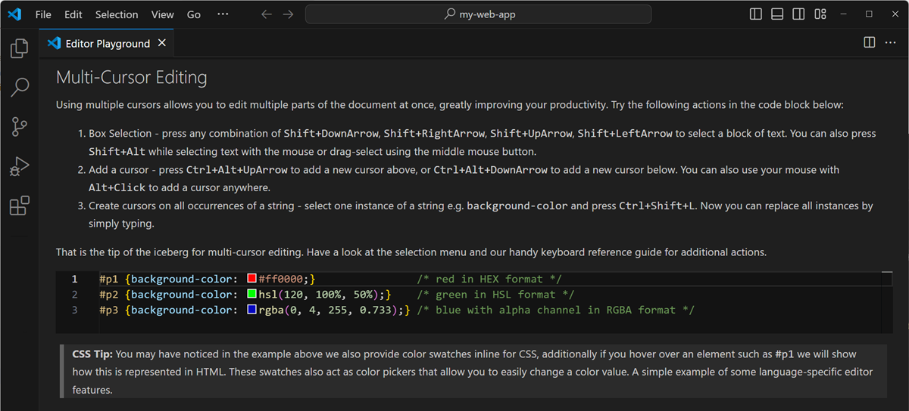

### 命令面板 {#command-palette}

根据当前上下文访问所有可用命令。

键盘快捷键：`Ctrl + Shift + P`（macOS：`Cmd + Shift + P`）

　　可以抓住命令面板顶部边缘拖到其他位置。也可以选择标题栏中的 **自定义布局** 控件，然后选择预配置的 **快速输入位置**。

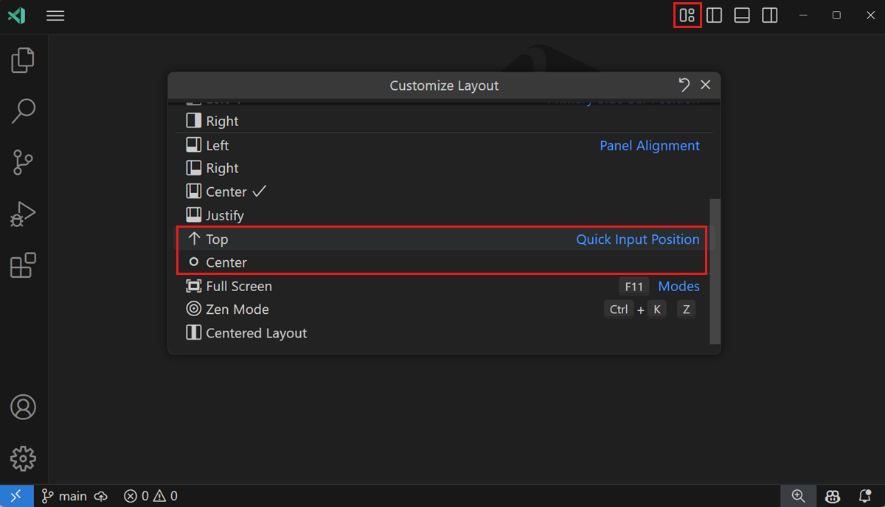

### 默认键盘快捷键 {#default-keyboard-shortcuts}

命令面板中许多命令有关联的默认键盘快捷键。在 **命令面板**（`Ctrl + Shift + P`，macOS：`Cmd + Shift + P`）中，命令旁会显示默认快捷键。

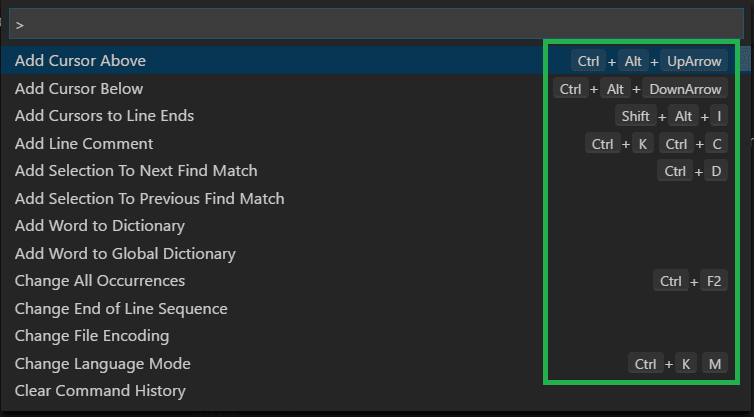

### 键盘参考表 {#keyboard-reference-sheets}

下载平台键盘快捷键参考表（[macOS](https://go.microsoft.com/fwlink/?linkid=832143)、[Windows](https://go.microsoft.com/fwlink/?linkid=832145)、[Linux](https://go.microsoft.com/fwlink/?linkid=832144)）。

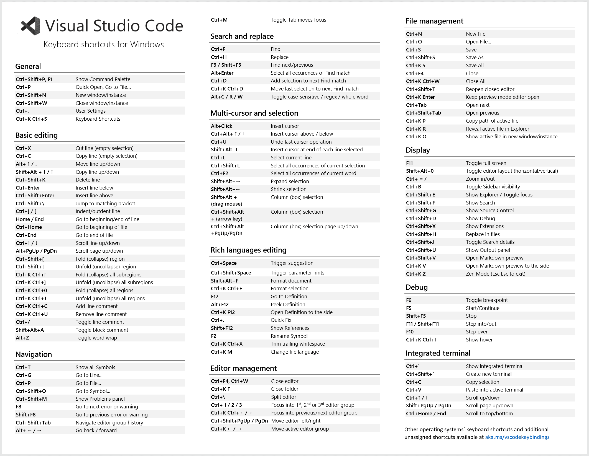

### 浮动窗口 {#floating-windows}

　　可以在浮动窗口中打开编辑器、终端或特定视图，例如将编辑器移到显示器其他位置甚至另一台显示器。

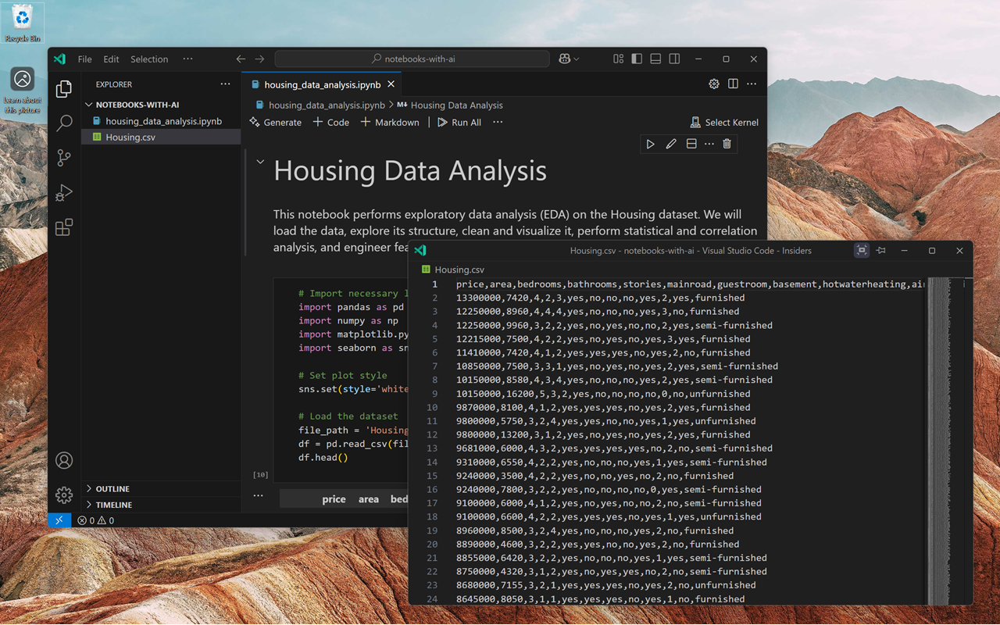

将编辑器选项卡拖出当前 VS Code 窗口，在浮动窗口中打开。也可以使用编辑器选项卡上下文选项 **移到新窗口** 或 **复制到新窗口**。

### 集成终端 {#integrated-terminal}

键盘快捷键：`Ctrl + 反引号`

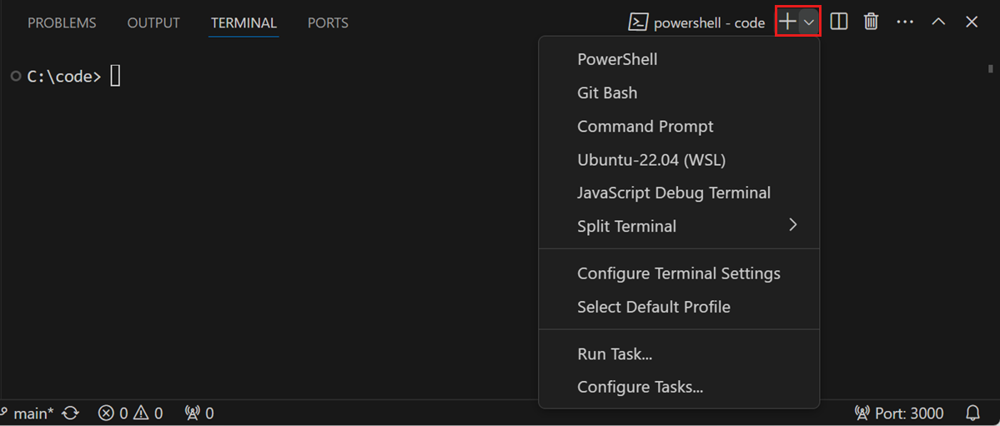

可以从下拉列表选择其他终端 shell。根据操作系统和系统配置，可能看到不同 shell。

延伸阅读：

* [集成终端](../../../terminal/5.2-TerminalBasics/)
* [掌握 VS Code 终端文章](https://www.growingwiththeweb.com/2017/03/mastering-vscodes-terminal.html)

### 切换侧边栏 {#toggle-sidebar}

键盘快捷键：`Ctrl + B`（macOS：`Cmd + B`）

### 切换面板 {#toggle-panel}

键盘快捷键：`Ctrl + J`（macOS：`Cmd + J`）

### 禅模式 {#zen-mode}

进入无干扰禅模式。

键盘快捷键：`Ctrl + K Z`（macOS：`Cmd + K Z`）

按两次 `Esc` 退出禅模式。

## 命令行 {#command-line}

　　VS Code 有强大命令行接口（CLI），可以自定义编辑器启动方式以支持各种场景。例如，从命令行启动 VS Code 打开差异编辑器比较两个文件。

> 确保 VS Code 二进制文件在 PATH 中，以便直接输入 `code` 启动。如果安装时已添加到环境路径，请参阅平台设置主题（[Linux](../../../advanced-setup/9.2-Linux/)、[macOS](../../../advanced-setup/9.3-macOS/)、[Windows](../../../advanced-setup/9.4-Windows/)）。

```bash
# 在当前目录打开代码
code .

# 在最近使用的代码窗口中打开当前目录
code -r .

# 创建新窗口
code -n

# 更改语言
code --locale=es

# 打开差异编辑器
code --diff <file1> <file2>

# 在特定行和列打开文件 <file:line[:character]>
code --goto package.json:10:5

# 查看帮助选项
code --help

# 禁用所有扩展
code --disable-extensions .
```

### .vscode 文件夹 {#vscode-folder}

　　工作区特定配置文件位于工作区根目录 `.vscode` 文件夹。例如[任务运行器](../../../debugging-and-testing/6.3-Tasks/)的 `tasks.json` 和[调试器](../../../debugging-and-testing/6.2-DebuggingConfiguration/)的 `launch.json`。

## 状态栏 {#status-bar}

### 错误和警告 {#errors-and-warnings}

键盘快捷键：`Ctrl + Shift + M`（macOS：`Cmd + Shift + M`）

　　快速跳转到项目中的错误和警告。使用 `F8` 或 `Shift + F8` 循环浏览错误。

　　可以按类型（“信息”、“错误”、“警告”）或匹配文本筛问题列表。

### 更改语言模式 {#change-language-mode}

　　状态栏语言模式指示活动编辑器关联的语言（例如 Markdown、Python 等）。选择状态栏语言模式指示器或使用快捷键更改当前编辑器语言模式。

键盘快捷键：`Ctrl + K M`（macOS：`Cmd + K M`）

　　如果要为文件类型持久保存新语言模式，请使用 **Configure File Association for** 命令将当前文件扩展名关联到已安装语言。

## 自定义 {#customization}

有许多选项可自定义 VS Code：

* 更改主题
* 更改键盘快捷键
* 调整设置
* 添加 JSON 验证
* 创建代码片段
* 安装扩展

### 更改主题 {#change-your-theme}

　　VS Code 内置多个[颜色主题](../../3.3-ConfigureTheEditor/3.3.7-Themes/)。使用 **Preferences: Color Theme** 命令或快捷键。

键盘快捷键：`Ctrl + K Ctrl + T`（macOS：`Cmd + K Cmd + T`）

　　可以从 VS Code 扩展 [Marketplace](https://marketplace.visualstudio.com/search?target=VSCode&category=Themes&sortBy=Installs)安装更多主题。选择 **Preferences: Color Theme** > **+ Browse Additional Color Themes...** 命令搜索 Marketplace 主题。

　　还可以安装和更改文件图标主题。

### 键映射 {#keymaps}

　　习惯其他编辑器的快捷键？可以安装键映射扩展，将喜欢的编辑器快捷键带到 VS Code。使用 **Preferences: Keymaps** 命令查看 [Visual Studio Marketplace](https://marketplace.visualstudio.com/search?target=VSCode&category=Keymaps&sortBy=Installs)当前列表。

一些流行键映射：

* [Vim](https://marketplace.visualstudio.com/items?itemName=vscodevim.vim)
* [Sublime Text Keymap](https://marketplace.visualstudio.com/items?itemName=ms-vscode.sublime-keybindings)
* [Emacs Keymap](https://marketplace.visualstudio.com/items?itemName=hiro-sun.vscode-emacs)
* [Atom Keymap](https://marketplace.visualstudio.com/items?itemName=ms-vscode.atom-keybindings)
* [Brackets Keymap](https://marketplace.visualstudio.com/items?itemName=ms-vscode.brackets-keybindings)
* [Eclipse Keymap](https://marketplace.visualstudio.com/items?itemName=alphabotsec.vscode-eclipse-keybindings)
* [Visual Studio Keymap](https://marketplace.visualstudio.com/items?itemName=ms-vscode.vs-keybindings)

### 自定义键盘快捷键 {#customize-your-keyboard-shortcuts}

　　可以在 **键盘快捷键** 编辑器中查看和自定义快捷键。使用 **Preferences: Open Keyboard Shortcuts** 命令或快捷键打开编辑器。

键盘快捷键：`Ctrl + K Ctrl + S`（macOS：`Cmd + K Cmd + S`）

选择铅笔图标或在特定条目上按 `Enter` 编辑快捷键。使用搜索字段筛选列表。

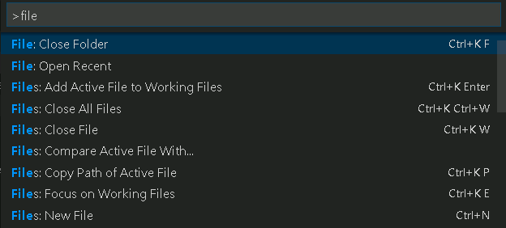

也可以搜索快捷键并将自定义快捷键添加到 `keybindings.json` 文件。

更多信息请参阅[VS Code 键绑定](../../3.3-ConfigureTheEditor/3.3.3-KeyboardShortcuts/)。

### 调整设置 {#tune-your-settings}

　　默认情况下，VS Code 显示设置编辑器查看和编辑设置。也可以使用 **Open User Settings (JSON)** 命令或通过 `workbench.settings.editor` 设置更改默认设置编辑器，编辑底层 `settings.json`。

打开用户设置 `settings.json`：

键盘快捷键：`Ctrl + ,`（macOS：`Cmd + ,`）

更改各种 UI 元素字号：

```json
// 主编辑器
"editor.fontSize": 18,
// 终端面板
"terminal.integrated.fontSize": 14,
// 输出面板
"[Log]": {
    "editor.fontSize": 15
}
```

更改缩放级别：

```json
"window.zoomLevel": 5
```

字体连字：

```json
"editor.fontFamily": "Fira Code",
"editor.fontLigatures": true
```

> **提示**：需要安装支持字体连字的字体。[FiraCode](https://github.com/tonsky/FiraCode)是 VS Code 团队常用字体。

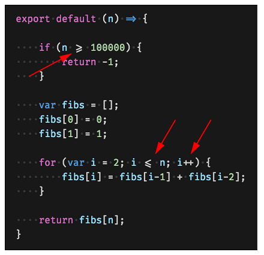

对齐全角字符：

　　在 CJK 和混合文字文档中，全角字符可能无法与等宽字符网格的两个单元格对齐。将 `editor.fullwidthCharacterWidth` 设置为 `twoCells`，使每个识别出的全角字符居中于恰好两个字符单元格：

```json
"editor.fullwidthCharacterWidth": "twoCells"
```

　　默认值 `font` 使用字体定义的字符宽度。`twoCells` 仅在 VS Code 检测到编辑器字体为等宽时适用。它适用于单个全角字符，但不会将多码点序列（例如 emoji 序列）作为整体调整大小。受影响行使用 DOM 渲染而不是 GPU 渲染，因此在 CJK 较多文件中可能增加行渲染成本。

自动保存：

```json
"files.autoSave": "afterDelay"
```

　　也可以从顶级菜单 **文件** > **自动保存** 切换自动保存。

保存时格式化：

```json
"editor.formatOnSave": true
```

粘贴时格式化：

```json
"editor.formatOnPaste": true
```

更改 Tab 字符大小：

```json
"editor.tabSize": 4
```

空格或制表符：

```json
"editor.insertSpaces": true
```

渲染空白字符：

```json
"editor.renderWhitespace": "all"
```

　　文本选择中默认渲染空白字符。

忽略文件/文件夹：

从编辑器窗口移除这些文件/文件夹：

```json
"files.exclude": {
    "somefolder/": true,
    "somefile": true
}
```

从搜索结果移除这些文件/文件夹：

```json
"search.exclude": {
    "someFolder/": true,
    "somefile": true
}
```

　　了解更多[其他自定义项](../../3.3-ConfigureTheEditor/3.3.4-Settings/)。

### 语言特定设置 {#language-specific-settings}

　　可以使用语言标识符为特定语言限定设置。常用语言 ID 列表请参阅[语言标识符](https://code.visualstudio.com/docs/languages/identifiers)参考。

```json
"[languageid]": {

}
```

> **提示**：也可以使用 **Configure Language Specific Settings** 命令创建语言特定设置。

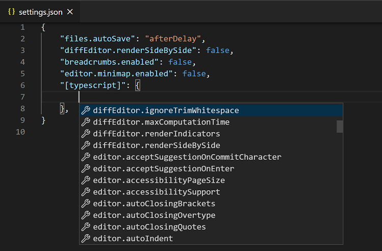

### 添加 JSON 验证 {#add-json-validation}

　　许多文件类型默认启用 JSON 验证。在 `settings.json` 中创建自己的 schema 和验证：

```json
"json.schemas": [
    {
        "fileMatch": [
            "bower.json"
        ],
        "url": "https://json.schemastore.org/bower"
    }
]
```

或者为工作区中定义的 schema：

```json
"json.schemas": [
    {
        "fileMatch": [
            "**/foo.json"
        ],
        "url": "./foo-schema.json"
    }
]
```
或使用自定义 schema：

```json
"json.schemas": [
    {
        "fileMatch": [
            "/.myconfig"
        ],
        "schema": {
            "type": "object",
            "properties": {
                "name" : {
                    "type": "string",
                    "description": "The name of the entry"
                }
            }
        }
    }
]
```

更多信息请参阅 [JSON](https://code.visualstudio.com/docs/languages/json) 文档。

### 配置默认浏览器 {#configure-the-default-browser}

　　在 VS Code 中，可以 `Ctrl + 单击`（macOS 上 `Cmd + 单击`）链接，在默认浏览器中打开。可以通过 `workbench.externalBrowser` [设置](../../3.3-ConfigureTheEditor/3.3.4-Settings/)配置默认浏览器。

将浏览器可执行文件完整路径作为设置值。也可以使用浏览器别名（例如 `edge`、`chrome` 或 `firefox`），确保跨设备正常工作。

```json
"workbench.externalBrowser": "edge"
```

### 将多个日志合并到单一视图 {#combine-multiple-logs-into-a-single-view}

　　输出面板显示各种服务的输出。每个服务通常有自己的日志。要分析多个服务的相关日志，可以将多个日志合并为单个*复合日志*。

从输出面板溢出菜单中选择 **Create Compound Log...**。

## 扩展 {#extensions}

键盘快捷键：`Ctrl + Shift + X`（macOS：`Cmd + Shift + X`）

### 查找扩展 {#find-extensions}

可以从多个来源查找扩展：

* VS Code [Marketplace](https://marketplace.visualstudio.com/vscode)。
* 在 VS Code **扩展** 视图中搜索。
* 查看扩展推荐。
* 社区整理的扩展列表，例如 [awesome-vscode](https://github.com/viatsko/awesome-vscode)。

### 查找热门扩展 {#find-popular-extensions}

在 **扩展** 视图中选择 **筛选** 控件，然后选择 **最热门** 或 **排序依据** > **安装量**。

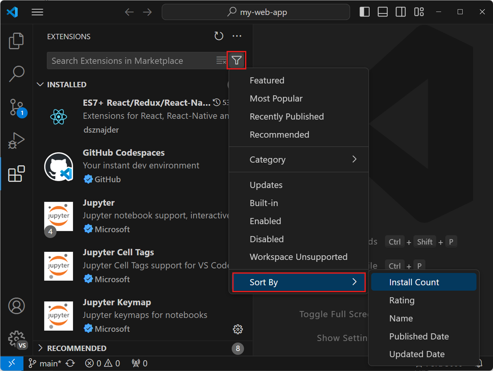

### 扩展推荐 {#extension-recommendations}

在 **扩展** 视图中选择 **筛选** 控件，然后选择 **推荐** 查看推荐扩展列表。

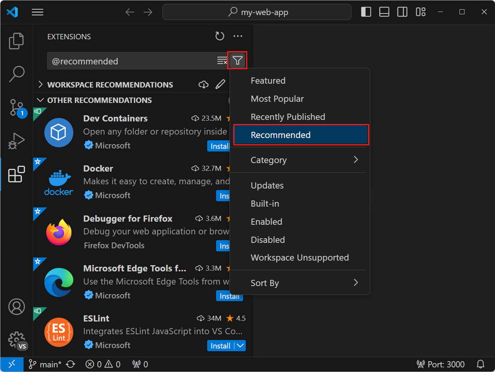

### 创建自己的扩展 {#create-your-own-extension}

　　有兴趣创建自己的扩展？请学习[扩展 API 文档](https://code.visualstudio.com/api)，特别是[贡献点文档](https://code.visualstudio.com/api/references/contribution-points)。

* 配置
* 命令
* 键盘快捷键
* 语言
* 调试器
* 语法
* 主题
* 代码片段
* JSON 验证

## 文件和文件夹 {#files-and-folders}

### 简单文件对话框 {#simple-file-dialog}

　　使用简单文件对话框，可以在 VS Code 内用更简单的快速选择对话框替换系统默认的打开/保存文件和文件夹对话框。

设置：`files.simpleDialog`

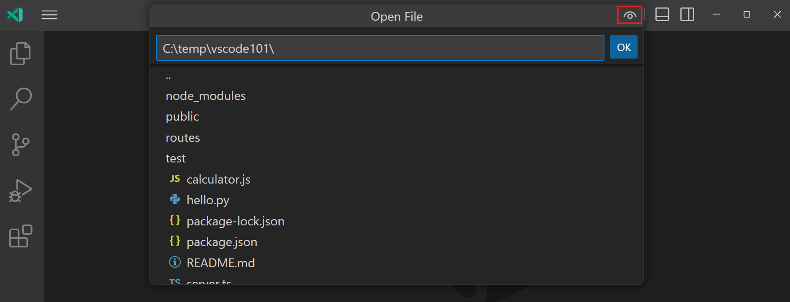

> **提示**：使用右上角眼睛图标显示或隐藏以点开头的文件和文件夹。

　　打开文件夹并输入不存在的路径时，简单文件对话框会提示创建文件夹。

### 显示资源管理器视图 {#show-explorer-view}

键盘快捷键：`Ctrl + Shift + E`（macOS：`Cmd + Shift + E`）

### 快速打开 {#quick-open}

快速搜索并打开文件。

键盘快捷键：`Ctrl + P`（macOS：`Cmd + P`）

> **提示**：输入 `?` 查看命令建议。

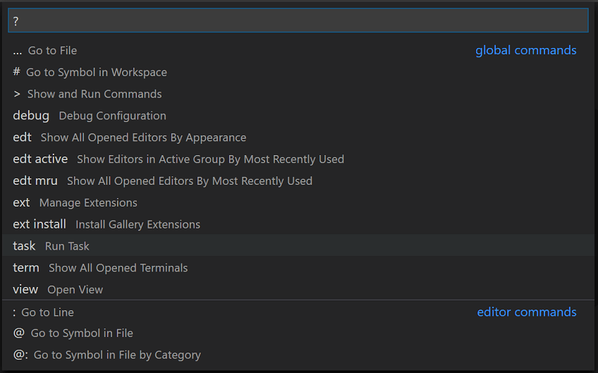

　　输入 `edt` 或 `term` 等命令后跟空格，会显示下拉列表。

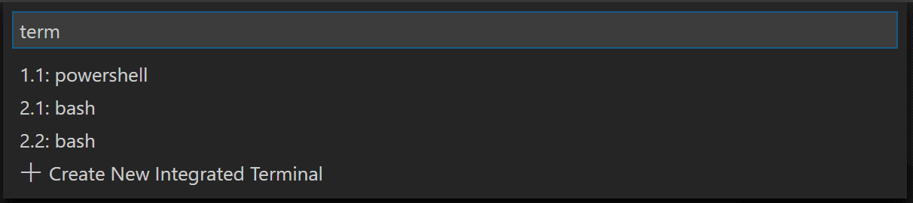

#### 在最近打开的文件之间导航 {#navigate-between-recently-opened-files}

　　重复按 **快速打开** 快捷键，在最近打开的文件之间快速循环。

#### 从快速打开打开多个文件 {#open-multiple-files-from-quick-open}

　　按 `→` 可以从 **快速打开** 打开多个文件。这会在后台打开当前选中文件，可以继续从 **快速打开** 选择文件。

### 在最近打开的文件夹和工作区之间导航 {#navigate-between-recently-opened-folders-and-workspaces}

打开最近的文件夹或工作区。

键盘快捷键：`Ctrl + R`

　　显示快速选择下拉列表，包含 **文件** > **打开最近** 中的最近文件夹和工作区，然后是文件。

### 从链接创建或打开文件 {#create-or-open-a-file-from-a-link}

键盘快捷键：`Ctrl + 单击`（macOS 上 `Cmd + 单击`）

　　将光标移到文件链接上，然后按 `Ctrl + 单击`（macOS：`Cmd + 单击`），可以快速打开文件或图像，或创建新文件。

### 关闭当前打开的文件夹 {#close-the-currently-opened-folder}

键盘快捷键：`Ctrl + K F`（macOS：`Cmd + K F`）

### 导航历史 {#navigation-history}

导航整个历史：`Ctrl + Tab`

后退：`Alt + ←`（macOS：`Ctrl + -`）

前进：`Alt + →`（macOS：`Ctrl + Shift + -`）

### 文件关联 {#file-associations}

　　为未正确检测的文件创建语言关联。例如，许多使用自定义扩展名的配置文件实际上是 JSON。

```json
"files.associations": {
    ".database": "json"
}
```

### 防止脏写入 {#preventing-dirty-writes}

　　尝试保存已在磁盘上更改而无法保存的文件时，VS Code 会显示错误消息。VS Code 会阻止保存，以防覆盖编辑器外部所做的更改。

要解决保存冲突，请在通知弹窗中选择 **比较** 操作，打开差异编辑器，比较磁盘文件内容（左侧）和 VS Code 中的内容（右侧）：

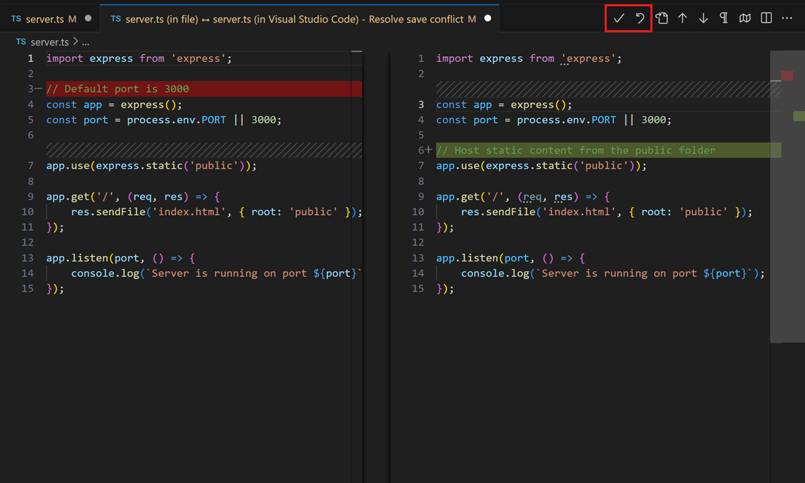

使用编辑器工具栏操作解决保存冲突。可以 **接受** 更改并覆盖磁盘上的任何更改，或 **还原** 到磁盘版本。还原意味着丢失你的更改。

**注意**：在选择两个操作之一解决冲突之前，文件保持脏状态且无法保存。

## 编辑技巧 {#editing-hacks}

　　以下是编辑代码的常用功能。如果更熟悉其他编辑器的快捷键，请考虑安装[键映射扩展](https://marketplace.visualstudio.com/search?target=VSCode&category=Keymaps&sortBy=Installs)。

**提示**：在 **扩展** 视图中将搜索筛选为 `@recommended:keymaps`，可以查看推荐键映射扩展。

### 并排编辑 {#side-by-side-editing}

键盘快捷键：`Ctrl + \`（macOS：`Cmd + \`）

　　也可以拖放编辑器创建新编辑器组，并在组之间移动编辑器。

### 在编辑器之间切换 {#switch-between-editors}

键盘快捷键：`Ctrl + 1`（macOS：`Cmd + 1`）、`Ctrl + 2`（macOS：`Cmd + 2`）、`Ctrl + 3`（macOS：`Cmd + 3`）

### 多光标选择 {#multi-cursor-selection}

　　要在任意位置添加光标，请用鼠标选择位置并按 `Alt + 单击`（macOS 上 `Option + 单击`）。

要在当前位置上方或下方设置光标，请使用：

键盘快捷键：`Ctrl + Alt + ↑`（macOS：`Cmd + Option + ↑`） 或 `Ctrl + Alt + ↓`（macOS：`Cmd + Option + ↓`）

　　使用 `Ctrl + Shift + L`（macOS：`Cmd + Shift + L`） 可以在当前选择的所有出现位置添加光标。

> **注意**：也可以使用 `editor.multiCursorModifier` [设置](../../3.3-ConfigureTheEditor/3.3.4-Settings/)将应用多光标的修饰键改为 `Ctrl/Cmd`。详情请参阅[多光标修饰键](../../3.2-WriteCode/3.2.1-BasicEditing/)。

　　如果不想添加当前选择的所有出现位置，可以改用 `Ctrl + D`（macOS：`Cmd + D`）。它只选择当前选择之后的下一个出现位置，因此可以逐个添加选择。

### 列（框）选择 {#column-box-selection}

　　按住 `Shift + Alt`（macOS 上 `Shift + Option`）并拖动鼠标，可以选择文本块。每个选中行末尾会添加单独光标。

　　也可以使用[键盘快捷键](../../3.2-WriteCode/3.2.1-BasicEditing/)触发列选择。

### 垂直标尺 {#vertical-rulers}

　　使用 `editor.rulers` 设置向编辑器添加垂直列标尺。该设置接受列字符位置数组。

```json
{
    "editor.rulers": [
        20, 40, 60
    ]
}
```

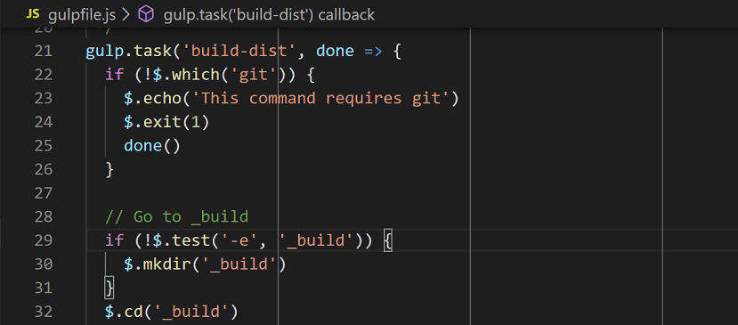

### 快速滚动 {#fast-scrolling}

　　按 `Alt`（macOS：`Option`）键可在编辑器和资源管理器中快速滚动。默认快速滚动使用 5 倍速度，可以通过 **Editor: Fast Scroll Sensitivity**（`editor.fastScrollSensitivity`）设置控制倍数。

### 锁定滚动 {#locked-scrolling}

　　使用 **View: Toggle Locked Scrolling Across Editors** 命令，可以在所有可见编辑器之间同步滚动。在一个编辑器中滚动时，其他编辑器会滚动相同距离，保持对齐。

　　可以只在按住特定快捷键时激活滚动同步。为 `workbench.action.holdLockedScrolling` 命令设置快捷键，临时锁定编辑器滚动。

### 向上/向下复制行 {#copy-line-up--down}

键盘快捷键：`Shift + Alt + ↑`（macOS：`Shift + Option + ↑`） 或 `Shift + Alt + ↓`（macOS：`Shift + Option + ↓`）

> **向上/向下复制行** 命令在 Linux 上未绑定，因为 VS Code 默认快捷键会与 Ubuntu 快捷键冲突，请参阅[议题 #509](https://github.com/microsoft/vscode/issues/509)。仍可将 `editor.action.copyLinesUpAction` 和 `editor.action.copyLinesDownAction` 设置为首选快捷键。

### 向上/向下移动行 {#move-line-up-and-down}

键盘快捷键：`Alt + ↑`（macOS：`Option + ↑`） 或 `Alt + ↓`（macOS：`Option + ↓`）

### 缩小/扩大选择 {#shrink--expand-selection}

键盘快捷键：`Shift + Alt + ←`（macOS：`Ctrl + Cmd + Shift + ←`） 或 `Shift + Alt + →`（macOS：`Ctrl + Cmd + Shift + →`）

　　更多信息请参阅[基本编辑](../../3.2-WriteCode/3.2.1-BasicEditing/)。

### 转到文件中的符号 {#go-to-symbol-in-file}

键盘快捷键：`Ctrl + Shift + O`（macOS：`Cmd + Shift + O`）

　　添加冒号 `@:` 可以按类型分组符号。

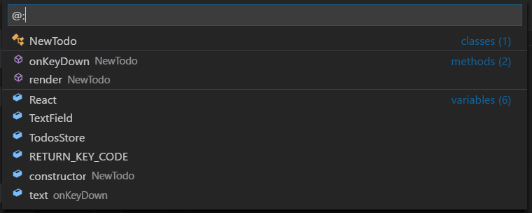

### 转到工作区中的符号 {#go-to-symbol-in-workspace}

键盘快捷键：`Ctrl + T`（macOS：`Cmd + T`）

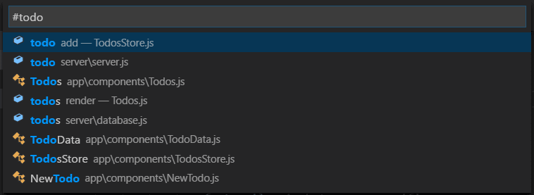

### 大纲视图 {#outline-view}

　　文件资源管理器中的大纲视图（默认折叠在底部）显示当前打开文件的符号。

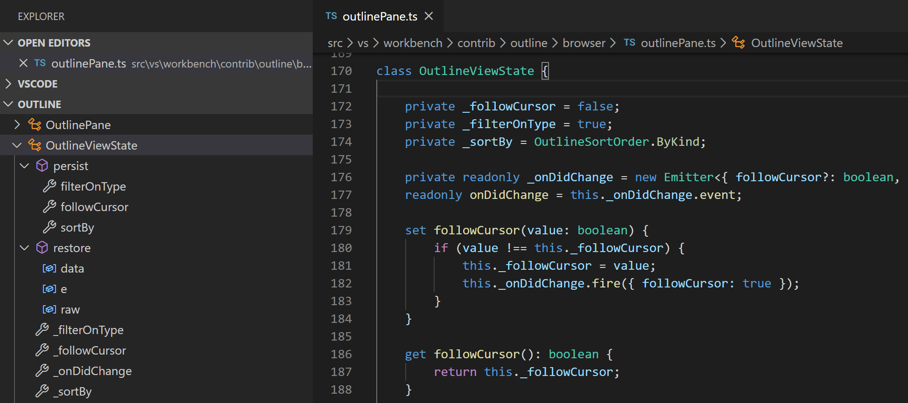

　　可以按符号名称、类别和文件中的位置排序，快速导航到符号位置。

### 导航到特定行 {#navigate-to-a-specific-line}

键盘快捷键：`Ctrl + G`

### 撤销光标位置 {#undo-cursor-position}

键盘快捷键：`Ctrl + U`（macOS：`Cmd + U`）

### 删除尾随空白 {#trim-trailing-whitespace}

键盘快捷键：`Ctrl + K Ctrl + X`（macOS：`Cmd + K Cmd + X`）

### 转换文本命令 {#transform-text-commands}

　　可以使用命令面板中的 **转换** 命令将选中文本改为大写、小写和标题大小写。

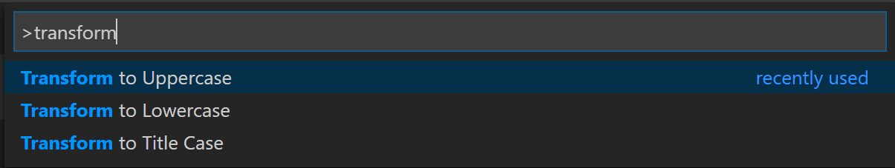

### 代码格式化 {#code-formatting}

格式化当前选中源代码：`Ctrl + K Ctrl + F`（macOS：`Cmd + K Cmd + F`）

格式化整个文档：`Shift + Alt + F`（macOS：`Shift + Option + F`）

### 代码折叠 {#code-folding}

键盘快捷键：`Ctrl + Shift + [`（macOS：`Cmd + Option + [`）、`Ctrl + Shift + ]`（macOS：`Cmd + Option + ]`） 和 `Ctrl + K Ctrl + L`（macOS：`Cmd + K Cmd + L`）

　　也可以使用 **全部折叠**（`Ctrl + K Ctrl + 0`，macOS：`Cmd + K Cmd + 0`）和 **全部展开**（`Ctrl + K Ctrl + J`，macOS：`Cmd + K Cmd + J`）折叠/展开编辑器所有区域。

使用 **折叠所有块注释**（`Ctrl + K Ctrl + /`，macOS：`Cmd + K Cmd + /`）折叠所有块注释。

### 选择当前行 {#select-current-line}

键盘快捷键：`Ctrl + L`（macOS：`Cmd + L`）

### 导航到文件开头和末尾 {#navigate-to-beginning-and-end-of-file}

键盘快捷键：`Ctrl + Home`（macOS：`Cmd + ↑`） 和 `Ctrl + End`（macOS：`Cmd + ↓`）

### 打开 Markdown 预览 {#open-markdown-preview}

在 Markdown 文件中使用：

键盘快捷键：`Ctrl + Shift + V`（macOS：`Cmd + Shift + V`）

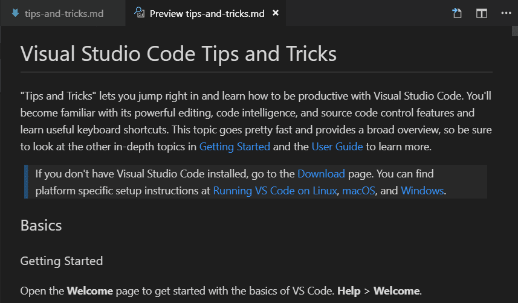

### 并排 Markdown 编辑和预览 {#side-by-side-markdown-edit-and-preview}

在 Markdown 文件中使用：

键盘快捷键：`Ctrl + K V`（macOS：`Cmd + K V`）

预览和编辑器会在任一视图滚动时同步。

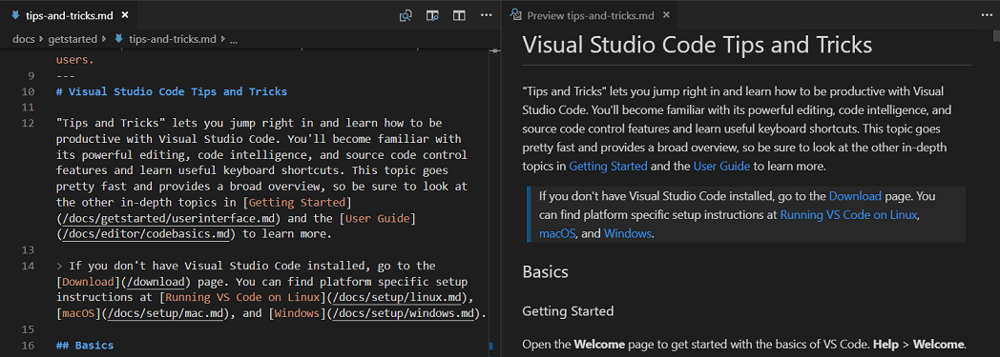

## IntelliSense {#intellisense}

`Ctrl + Space` 触发建议组件。

可以查看可用方法、参数提示、简短文档等。

### 速览 {#peek}

选择符号后按 `Alt + F12`（macOS：`Option + F12`）。也可以使用上下文菜单。
### 转到定义 {#go-to-definition}

选择符号后按 `F12`。也可以使用上下文菜单或 `Ctrl + 单击`（macOS 上 `Cmd + 单击`）。

可以使用 **转到** > **后退** 命令或 `Alt + ←`（macOS：`Ctrl + -`） 返回之前位置。

悬停在类型上时按 `Ctrl`（macOS 上 `Cmd`）也可以查看类型定义。

### 转到引用 {#go-to-references}

选择符号后按 `Shift + F12`。也可以使用上下文菜单。

### 查找所有引用视图 {#find-all-references-view}

选择符号后按 `Shift + Alt + F12`（macOS：`Shift + Option + F12`），打开引用视图，在专用视图中显示文件所有符号引用。

### 重命名符号 {#rename-symbol}

选择符号后按 `F2`。也可以使用上下文菜单。

### 搜索和修改 {#search-and-modify}

　　除了搜索和替换表达式，还可以使用带捕获组的正则表达式搜索并复用匹配部分。单击搜索框中的 **使用正则表达式** `.*` 按钮（`Alt + R`，macOS：`Cmd + Option + R`）启用正则表达式，然后编写正则表达式并用括号定义组。可以在替换字段中使用 `$1`、`$2` 等复用每个组匹配的内容。

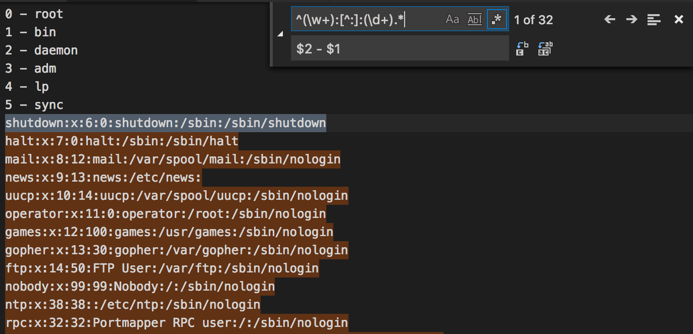

### .eslintrc.json {#eslintrcjson}

安装 [ESLint 扩展](https://marketplace.visualstudio.com/items?itemName=dbaeumer.vscode-eslint)。按需配置 linter。lint 规则和选项详情请参阅 [ESLint 规范](https://eslint.org/docs/user-guide/configuring)。

以下是使用 ES6 的配置：

```json
{
    "env": {
        "browser": true,
        "commonjs": true,
        "es6": true,
        "node": true
    },
    "parserOptions": {
        "ecmaVersion": 6,
        "sourceType": "module",
        "ecmaFeatures": {
            "jsx": true,
            "classes": true,
            "defaultParams": true
        }
    },
    "rules": {
        "no-const-assign": 1,
        "no-extra-semi": 0,
        "semi": 0,
        "no-fallthrough": 0,
        "no-empty": 0,
        "no-mixed-spaces-and-tabs": 0,
        "no-redeclare": 0,
        "no-this-before-super": 1,
        "no-undef": 1,
        "no-unreachable": 1,
        "no-use-before-define": 0,
        "constructor-super": 1,
        "curly": 0,
        "eqeqeq": 0,
        "func-names": 0,
        "valid-typeof": 1
    }
}
```

### package.json {#packagejson}

　　为 `package.json` 文件提供 IntelliSense。

### Emmet 语法 {#emmet-syntax}

[支持 Emmet 语法](https://code.visualstudio.com/docs/languages/emmet)。

## 代码片段 {#snippets}

### 创建自定义代码片段 {#create-custom-snippets}

**文件** > **首选项** > **配置代码片段**，选择语言并创建代码片段。

```json
"create component": {
    "prefix": "component",
    "body": [
        "class $1 extends React.Component {",
        "",
        "\trender() {",
        "\t\treturn ($2);",
        "\t}",
        "",
        "}"
    ]
},
```

更多详情请参阅[创建自己的代码片段](../../3.2-WriteCode/3.2.7-Snippets/)。

## Git 集成 {#git-integration}

键盘快捷键：`Ctrl + Shift + G`

　　VS Code 开箱即用提供 Git 集成。可以从[扩展 Marketplace](../../3.3-ConfigureTheEditor/3.3.6-Extensions/3.3.6.2-ExtensionMarketplace/)安装其他源代码管理（SCM）提供程序。本节描述 Git 集成，但许多 UI 和手势对其他 SCM 提供程序通用。

## Git 追溯 {#git-blame}

　　VS Code 在编辑器内联和状态栏显示 Git 追溯信息。将鼠标悬停在状态栏项或内联提示上查看详细追溯信息。

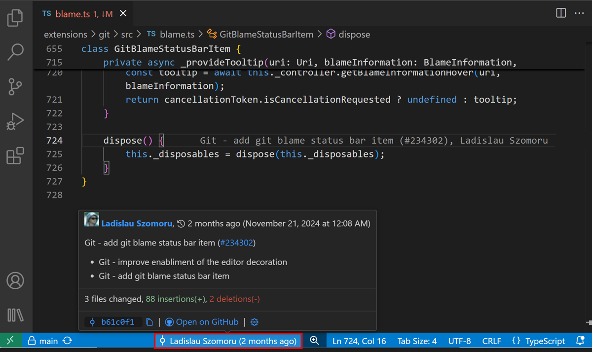

要启用或禁用 Git 追溯信息，请使用 **Git: Toggle Git Blame Editor Decoration** 和 **Git: Toggle Git Blame Status Bar Item** 命令，或配置：

* `git.blame.statusBarItem.enabled`（默认启用）
* `git.blame.editorDecoration.enabled`

　　详细了解 [VS Code 中的 Git 追溯支持](https://code.visualstudio.com/docs/sourcecontrol/history#_view-git-blame-information)以及如何自定义布局。

### 差异 {#diffs}

　　在 **源代码管理** 视图中选择文件打开差异编辑器。也可以选择右上角 **打开更改** 按钮比较当前打开文件。

#### 视图 {#views}

　　差异默认使用 **自动** 布局。空间足够时并排显示更改，编辑器较窄时切换为内联。

要选择布局，请选择 **更多操作**（**...**）> **差异视图**，然后选择 **内联**、**并排** 或 **自动**。

　　详细了解[选择差异布局](https://code.visualstudio.com/docs/sourcecontrol/staging-commits#_choose-a-diff-layout)及配置行为。

#### 可访问差异查看器 {#accessible-diff-viewer}

　　使用 `Alt + F2`（macOS：`Option + F2`）和 `Shift + Alt + F2`（macOS：`Shift + Option + F2`）在差异中导航。这以统一补丁格式呈现更改。可以使用方向键导航行，按 `Enter` 跳回差异编辑器和选中行。

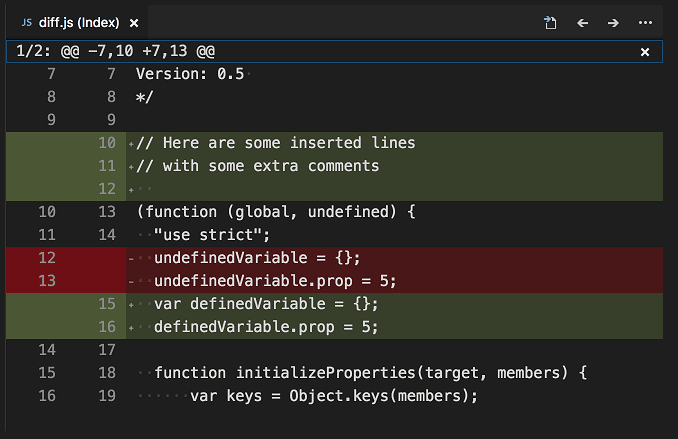

#### 编辑待处理更改 {#edit-pending-changes}

　　在差异编辑器中查看更改时，可以直接在待处理更改一侧编辑。

### 分支 {#branches}

　　通过状态栏轻松切换 Git 分支。

### 暂存 {#staging}

#### 暂存文件更改 {#stage-file-changes}

　　将鼠标悬停在文件数量上，选择加号按钮暂存文件。

选择减号按钮取消暂存更改。

#### 暂存选择 {#stage-selected}

　　可以在文件中选择文本，然后从 **命令面板** 或差异编辑器上下文菜单（右键单击）选择 **暂存所选范围**，暂存文件的一部分。

### 撤销上次提交 {#undo-last-commit}

　　选择 (...) 按钮，然后选择 **提交** > **撤销上次提交** 撤销上一次提交。更改会添加到暂存更改部分。

### 查看 Git 输出 {#see-git-output}

　　VS Code 可以轻松查看实际运行的 Git 命令。学习 Git 或调试困难源代码管理问题时很有帮助。

要查看 Git 输出，请在源代码管理视图中选择 (...) 按钮，然后选择 **显示 Git 输出**，使用 **Git: Show Git Output** 命令，或使用 **切换输出** 命令（`Ctrl + Shift + U`，macOS：`Cmd + Shift + U`）并从下拉列表选择 **Git**。

### 装订线指示器 {#gutter-indicators}

　　编辑器在装订线中提供视觉提示，显示更改位置和类型（添加、修改或删除行）。详情请参阅[源代码管理文档](https://code.visualstudio.com/docs/sourcecontrol/overview)。

### 解决合并冲突 {#resolve-merge-conflicts}

　　合并期间，转到 **源代码管理** 视图（`Ctrl + Shift + G`）并在差异视图中进行更改。

可以使用内联 CodeLens 解决合并冲突，选择 **接受当前更改**、**接受传入更改**、**接受双方更改** 和 **比较更改**。

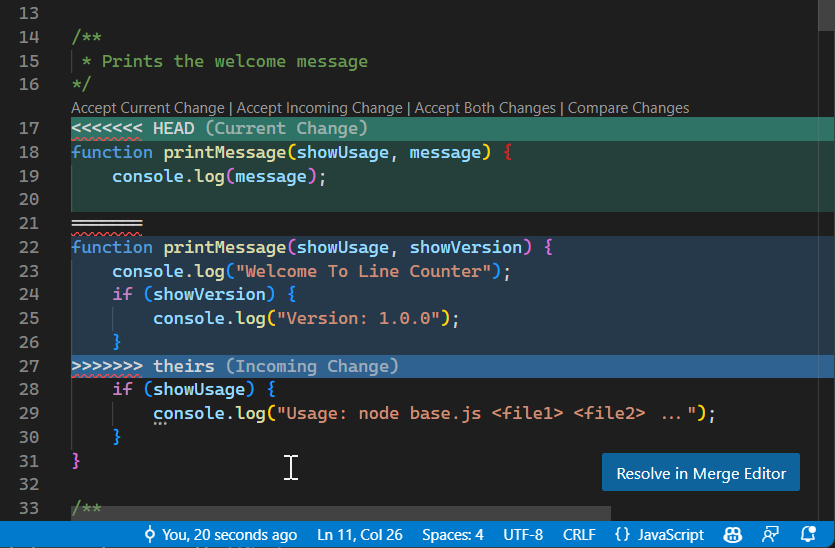

　　详细了解源代码管理文档中的[解决合并冲突](https://code.visualstudio.com/docs/sourcecontrol/merge-conflicts)。

### 将 VS Code 设置为默认合并工具 {#set-vs-code-as-default-merge-tool}

```bash
git config --global merge.tool vscode
git config --global mergetool.vscode.cmd 'code --wait $MERGED'
```

### 将 VS Code 设置为默认差异工具 {#set-vs-code-as-default-diff-tool}

```bash
git config --global diff.tool vscode
git config --global difftool.vscode.cmd 'code --wait --diff $LOCAL $REMOTE'
```

## 将文件与剪贴板比较 {#compare-file-with-the-clipboard}

键盘快捷键：`Ctrl + K C`（macOS：`Cmd + K C`）

　　使用命令面板（`Ctrl + Shift + P`，macOS：`Cmd + Shift + P`）中的 **File: Compare Active File with Clipboard** 命令，快速比较活动文件与剪贴板内容。

## 调试 {#debugging}

### 配置调试器 {#configure-debugger}

　　在运行和调试视图（`Ctrl + Shift + D`，macOS：`Cmd + Shift + D`）中，选择 **创建 launch.json 文件**，会提示选择与项目匹配的环境（Node.js、Python、C++ 等）。这会在工作区生成包含调试器配置的 `launch.json` 文件。

　　Node.js 支持内置，其他环境需要安装相应语言扩展。详情请参阅[调试文档](../../../debugging-and-testing/6.2-DebuggingConfiguration/)。

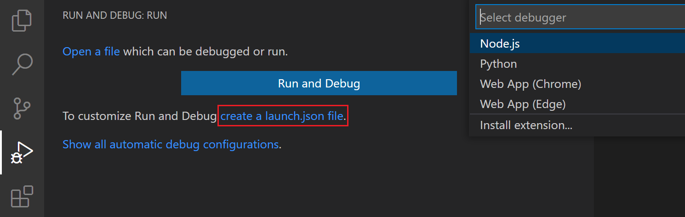

### 断点和单步执行 {#breakpoints-and-stepping-through}

　　选择编辑器边距或在当前行使用 `F9` 切换断点。编辑器边距中的断点通常显示为红色实心圆。

　　调试会话开始后，编辑器顶部出现 **调试工具栏**，可以在调试时单步执行或进入代码。详细了解[调试操作](../../../debugging-and-testing/6.1-Debugging/)。

### 数据检查 {#data-inspection}

　　可以在 **运行和调试** 视图的 **变量** 部分、编辑器源代码悬停或调试控制台中检查变量。

### 日志点 {#logpoints}

　　日志点行为类似断点，但命中时不暂停调试器，而是向控制台记录消息。日志点特别适合在调试无法修改或暂停的生产服务器时注入日志。

使用左侧编辑器装订线中的 **添加日志点** 命令添加日志点，会显示为“菱形”图标。日志消息是纯文本，但可以包含在花括号（`{}`）中求值的表达式。

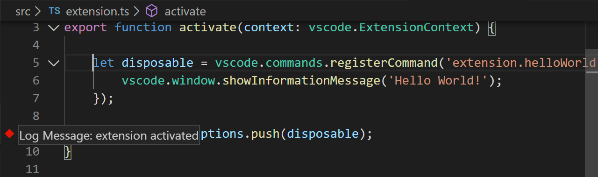

### 触发断点 {#triggered-breakpoints}

　　触发断点在另一个断点命中后自动启用。诊断仅在特定前置条件后发生的代码失败时非常有用。

可以通过右键单击字形边距，选择 **添加触发断点**，然后选择启用该断点的其他断点。

## 任务运行器 {#task-runner}

　　VS Code 中的任务可以配置为运行脚本和启动进程，从而无需输入命令行或编写新代码即可在 VS Code 中使用这些工具。

### 自动检测任务 {#auto-detect-tasks}

　　从顶级菜单选择 **终端**，运行 **配置任务** 命令，然后选择要运行的任务类型。这会生成类似以下的 `tasks.json` 文件。详情请参阅[任务](../../../debugging-and-testing/6.3-Tasks/)文档。

```json
{
    // See https://go.microsoft.com/fwlink/?LinkId=733558
    // for the documentation about the tasks.json format
    "version": "2.0.0",
    "tasks": [
        {
            "type": "npm",
            "script": "install",
            "group": {
                "kind": "build",
                "isDefault": true
            }
        }
    ]
}
```

　　自动生成偶尔会有问题。请查阅文档使其正常工作。

### 从终端菜单运行任务 {#run-tasks-from-the-terminal-menu}

　　从顶级菜单选择 **终端**，运行 **运行任务** 命令，选择要运行的任务。运行 **终止任务** 命令终止正在运行的任务。

### 为任务定义键盘快捷键 {#define-keyboard-shortcuts-for-tasks}

　　可以为任何任务定义键盘快捷键。从 **命令面板**（`Ctrl + Shift + P`，macOS：`Cmd + Shift + P`）选择 **Preferences: Open Keyboard Shortcuts File**，将所需快捷键绑定到 `workbench.action.tasks.runTask` 命令，并将 **Task** 定义为 `args`。

例如，将 `Ctrl + H` 绑定到 `Run tests` 任务：

```json
{
    "key": "ctrl+h",
    "command": "workbench.action.tasks.runTask",
    "args": "Run tests"
}
```

### 从资源管理器将 npm 脚本作为任务运行 {#run-npm-scripts-as-tasks-from-the-explorer}

　　在资源管理器视图中，可以在编辑器中打开脚本、将其作为任务运行，并使用 Node 调试器启动（当脚本定义 `--inspect-brk` 等调试选项时）。单击默认操作是打开脚本。要单击运行脚本，请将 `npm.scriptExplorerAction` 设置为 `run`。使用 `npm.exclude` 设置排除特定文件夹中 `package.json` 的脚本。

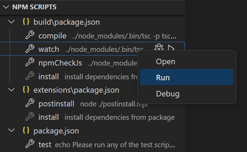

　　使用 `npm.enableRunFromFolder` 设置，可以在资源管理器文件夹上下文菜单中运行 npm 脚本。选择文件夹时，该设置启用 **Run NPM Script in Folder...** 命令，显示该文件夹中 npm 脚本的快速选择列表，可以选择作为任务执行。

## 便携模式 {#portable-mode}

　　VS Code 有[便携模式](../../../advanced-setup/9.7-PortableMode/)，可以将设置和数据保存在安装位置（例如 USB 驱动器）中。

## Insiders 版本 {#insiders-builds}

　　VS Code 团队使用 Insiders 版本测试最新功能和错误修复。也可以[下载 Insiders 版本](https://code.visualstudio.com/insiders)。

* **面向早期采用者**：Insiders 包含最新代码更改，供用户和扩展作者试用。
* **频繁构建**：每天新构建，包含最新修复和功能。
* **并排安装**：Insiders 安装在 Stable 版本旁，可以独立使用。
