+++
title = "3.2.1 基本编辑"
date = 2026-11-06T07:53:25+08:00
weight = 1
type = "docs"
description = ""
isCJKLanguage = true
draft = false
+++


> 原文链接: [https://code.visualstudio.com/docs/editing/codebasics](https://code.visualstudio.com/docs/editing/codebasics)

# 3.2.1 基本编辑

　　VS Code 首先是一个编辑器，包含高效编辑源代码所需的功能。本主题介绍编辑器基础，帮助你开始使用代码。

## 键盘快捷键 {#keyboard-shortcuts}

　　编写代码时保持双手在键盘上是提高效率的关键。VS Code 有丰富的默认键盘快捷键，也允许自定义。

* [键盘快捷键参考](../../3.3-ConfigureTheEditor/3.3.3-KeyboardShortcuts/) - 下载参考表，了解最常用和流行的快捷键。
* [安装键映射扩展](../../3.3-ConfigureTheEditor/3.3.3-KeyboardShortcuts/) - 通过安装键映射扩展，在 VS Code 中使用旧编辑器（例如 Sublime Text、Atom 和 Vim）的快捷键。
* [自定义键盘快捷键](../../3.3-ConfigureTheEditor/3.3.3-KeyboardShortcuts/) - 更改默认快捷键以适应你的风格。

## 多重选择（多光标） {#multiple-selections-multi-cursor}

　　VS Code 支持多个光标进行快速同时编辑。可以使用 `Alt + 单击`（macOS：`Option + 单击`）添加辅助光标（渲染得更细）。每个光标根据所在上下文独立操作。添加更多光标的常用方法是 `Ctrl + Alt + ↓`（macOS：`Cmd + Option + ↓`） 或 `Ctrl + Alt + ↑`（macOS：`Cmd + Option + ↑`），在下方或上方插入光标。

> **注意**：显卡驱动（例如 NVIDIA）可能会覆盖这些默认快捷键。

<video src="https://code.visualstudio.com/assets/docs/editing/codebasics/multicursor.mp4" title="多光标演示。" autoplay loop controls muted></video>

`Ctrl + D`（macOS：`Cmd + D`） 选择光标处的单词，或当前选择的下一个出现位置。

> **提示**：使用多光标查找时，可以运行 `Ctrl + K Ctrl + D`（macOS：`Cmd + K Cmd + D`） 跳过下一个匹配项。这有助于在编辑重复文本时避免添加不需要的选择。

<video src="https://code.visualstudio.com/assets/docs/editing/codebasics/multicursor-word.mp4" title="多光标选择下一个单词演示。" autoplay loop controls muted></video>

> **提示**：也可以使用 `Ctrl + Shift + L`（macOS：`Cmd + Shift + L`） 添加更多光标，这会在当前选中文本的每个出现位置添加选择。

### 多光标修饰键 {#multi-cursor-modifier}

　　如果希望将应用多光标的修饰键改为 macOS 上的 `Cmd + 单击` 和 Windows/Linux 上的 `Ctrl + 单击`，请使用 `editor.multiCursorModifier` 设置。这让来自 Sublime Text 或 Atom 等编辑器的用户可以继续使用熟悉的键盘修饰键。

该设置可以设置为：

* `ctrlCmd` - 在 Windows 上映射到 `Ctrl`，在 macOS 上映射到 `Cmd`。
* `alt` - 现有默认值 `Alt`。

也可以通过 **选择** > **切换为 Ctrl+Click 多光标** 或 **选择** > **切换为 Alt+Click 多光标** 菜单项快速切换。

　　**转到定义** 和 **打开链接** 手势也会遵循此设置并相应调整，以免冲突。例如，设置为 `ctrlCmd` 时，可以使用 `Ctrl/Cmd + 单击` 添加多光标，使用 `Alt + 单击` 打开链接或转到定义。

### 缩小/扩大选择 {#shrinkexpand-selection}

　　快速缩小或扩大当前选择。使用 `Shift + Alt + ←`（macOS：`Ctrl + Cmd + Shift + ←`） 和 `Shift + Alt + →`（macOS：`Ctrl + Cmd + Shift + →`） 触发。

以下是使用 `Shift + Alt + →`（macOS：`Ctrl + Cmd + Shift + →`） 扩大选择的示例：

<video src="https://code.visualstudio.com/assets/docs/editing/codebasics/expandselection.mp4" title="扩大选择演示。" autoplay loop controls muted></video>

## 列（框）选择 {#column-box-selection}

　　将光标放在一个角，然后按住 `Shift + Alt` 拖动到对角：

<video src="https://code.visualstudio.com/assets/docs/editing/codebasics/column-select.mp4" title="列文本选择演示。" autoplay loop controls muted></video>

> **注意**：使用 `Ctrl/Cmd` 作为[多光标修饰键](#multi-cursor-modifier)时，这会变为 `Shift + Ctrl/Cmd`。

　　macOS 和 Windows 上还有列选择的默认快捷键，但 Linux 没有。

键|命令|命令 ID
---|-------|----------
`Ctrl + Alt + Shift + ↓`|向下选择列|`cursorColumnSelectDown`
`Ctrl + Alt + Shift + ↑`|向上选择列|`cursorColumnSelectUp`
`Ctrl + Alt + Shift + ←`|向左选择列|`cursorColumnSelectLeft`
`Ctrl + Alt + Shift + →`|向右选择列|`cursorColumnSelectRight`
`Ctrl + Alt + Shift + PageDown`|向下选择列页|`cursorColumnSelectPageDown`
`Ctrl + Alt + Shift + PageUp`|向上选择列页|`cursorColumnSelectPageUp`

　　可以根据需要[编辑](../../3.3-ConfigureTheEditor/3.3.3-KeyboardShortcuts/) `keybindings.json`，将它们绑定到更熟悉的键。

### 粘贴列选择 {#paste-a-column-selection}

　　复制列选择并在单个光标处粘贴时，`editor.multiCursorPaste` 的默认 `spread` 值会将每个复制行插入连续行的相同可见列。为保留列位置，编辑器会用普通空格填充较短的目标行或复制行。

在此示例中，复制行为 `A`、`B` 和 `C`，`|` 表示光标：

```text
Before          After
abc|            abcA
x               x  B
123456          123C456
```

　　将 `editor.multiCursorPaste` 设置为 `full`，可以在一个目标位置将复制文本作为普通多行文本粘贴。

　　在多个光标处粘贴时，如果复制行数等于光标数，行会按文档顺序分配。否则，完整复制文本会粘贴到每个光标处。

### 列选择模式 {#column-selection-mode}

　　用户设置 **Editor: Column Selection** 控制此功能。进入此模式后（状态栏会指示），鼠标手势和方向键默认创建列选择。也可以通过 **选择** > **列选择模式** 菜单项访问此全局切换。此外，可以从状态栏禁用列选择模式。

## 自动关闭括号 {#auto-closing-brackets}

　　输入左括号时，VS Code 可以根据活动语言配置插入匹配的右括号。`editor.autoClosingBrackets` 设置控制此行为：

* `languageDefined`：使用语言配置确定何时插入右括号。默认值。
* `beforeWhitespace`：仅当光标在空白之前时插入右括号。
* `always`：始终插入右括号。
* `never`：不插入右括号。

　　对于 `languageDefined` 和 `beforeWhitespace`，如果文档后面存在匹配的未配对右括号，VS Code 不会插入重复项。将 `editor.autoClosingBrackets` 设置为 `always`，即使已存在未配对右括号也插入。

> **注意**：括号平衡依赖令牌感知的括号信息。在令牌化完成前，或文件太大无法进行括号对分析时，编辑器使用标准自动关闭行为。使用多光标时，如果任一光标可以配对未配对右括号，编辑器会在每个光标处抑制自动关闭。

　　引号的自动关闭由 `editor.autoClosingQuotes` 设置单独控制。

## 保存/自动保存 {#save--auto-save}

　　默认情况下，VS Code 需要显式操作 `Ctrl + S`（macOS：`Cmd + S`） 将更改保存到磁盘。

　　编辑器有未保存更改时，编辑器选项卡显示圆点指示器，资源管理器视图显示未保存文件数量徽章。这些更改尚未保存到磁盘，但 VS Code 会自动备份，以便应用意外关闭后恢复（请参阅 [热退出](#hot-exit)）。

　　但是，可以轻松开启**自动保存**，在配置延迟后或焦点离开编辑器时保存更改。开启后无需显式保存。最简单的方式是使用 **文件** > **自动保存** 切换。

要更精细控制自动保存，请打开用户或工作区[设置](../../3.3-ConfigureTheEditor/3.3.4-Settings/)，找到相关设置：

* `files.autoSave`：
  * `off` - 禁用自动保存。
  * `afterDelay` - 配置延迟后保存（默认 1000 毫秒）。
  * `onFocusChange` - 焦点离开脏文件编辑器时保存。
  * `onWindowChange` - 焦点离开 VS Code 窗口时保存。
* `files.autoSaveDelay`：`afterDelay` 时的延迟毫秒数，默认 1000。

　　要为特定语言或文件类型自定义自动保存，可以在 `settings.json` 中添加语言特定规则。

例如，为 LaTeX 文件禁用自动保存：

```json
    "[latex]": {
        "files.autoSave": "off",
    },
```

## 热退出 {#hot-exit}

　　默认情况下，VS Code 在退出时记住未保存的文件更改。通过 **文件** > **退出**（macOS 上 **Code** > **退出**）关闭应用或关闭最后一个窗口时触发热退出。

可以将 `files.hotExit` 设置为：

* `"off"`：禁用热退出。
* `"onExit"`：应用关闭时触发热退出，即 Windows/Linux 上关闭最后一个窗口，或触发 `workbench.action.quit` 命令。下次启动时恢复所有没有打开文件夹的窗口。
* `"onExitAndWindowClose"`：应用关闭时触发，并且任何打开文件夹的窗口关闭时也触发，无论是否为最后一个窗口。下次启动时恢复所有没有打开文件夹的窗口。要将文件夹窗口恢复为关闭前状态，请将 `window.restoreWindows` 设置为 `all`。

　　如果热退出出问题，标准安装位置的备份存储在：

* **Windows** `%APPDATA%\Code\Backups`
* **macOS** `$HOME/Library/Application Support/Code/Backups`
* **Linux** `$HOME/.config/Code/Backups`

## 查找和替换 {#find-and-replace}

　　VS Code 可以快速查找和替换当前打开文件中的文本。按 `Ctrl + F`（macOS：`Cmd + F`） 打开查找控件并输入搜索字符串。搜索结果会在编辑器、概览标尺和小地图中高亮。

　　VS Code 会在输入时立即搜索。如果只想在按 `Enter` 时搜索，请清除 `editor.find.findOnType` 设置。

　　要在找到匹配后自动关闭查找控件并将焦点返回编辑器，请启用 `editor.find.closeOnResult` 设置。

　　如果当前文件有多个匹配，按 `Enter` 转到下一个结果，或按 `Shift + Enter` 转到上一个结果。

　　默认情况下，VS Code 会保存工作区的查找和替换查询历史，并在重启后恢复。可以使用 `editor.find.history` 和 `editor.find.replaceHistory` 配置。设置为 `never` 禁用历史保存。

### 从选择填充搜索字符串 {#seed-search-string-from-selection}

　　打开查找控件时，编辑器中的选中文本会自动填充到查找输入框。如果选择为空，光标处的单词会插入输入框。

<video src="https://code.visualstudio.com/assets/docs/editing/codebasics/seed-search-string-from-selection.mp4" title="从选择填充搜索字符串演示。" autoplay loop controls muted></video>

　　将 `editor.find.seedSearchStringFromSelection` 设置为 `"never"` 可以关闭此功能。

### 在选择中查找 {#find-in-selection}

　　默认情况下，查找操作在整个文件中运行。要将搜索限制为选中文本，请选择查找控件中的 **在选择中查找** 图标，或按 `Ctrl + F`（macOS：`Cmd + F`） 后按 `Alt + L`（macOS：`Cmd + Option + L`）。

<video src="https://code.visualstudio.com/assets/docs/editing/codebasics/find-in-selection.mp4" title="在选择中查找演示。" autoplay loop controls muted></video>

　　如果希望这是查找控件的默认行为，请将 `editor.find.autoFindInSelection` 设置为 `always`，或设置为 `multiline`，仅在选中多行内容时在选中文本中查找。

### 高级查找和替换选项 {#advanced-find-and-replace-options}

查找控件提供：

* 匹配大小写
* 全字匹配
* 正则表达式

替换控件提供：

* 保留大小写

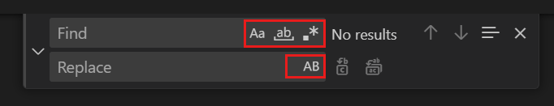

### 多行支持和查找控件调整大小 {#multiline-support-and-find-control-resizing}

　　可以通过将文本粘贴到查找和替换输入框来搜索多行文本。按 `Ctrl + Enter` 在输入框中插入新行。

<video src="https://code.visualstudio.com/assets/docs/editing/codebasics/multiple-line-support.mp4" title="多行支持演示。" autoplay loop controls muted></video>

　　搜索长文本时，查找控件默认尺寸可能太小。可以拖动左侧分隔条放大查找控件，或双击左侧分隔条最大化或恢复默认大小。

<video src="https://code.visualstudio.com/assets/docs/editing/codebasics/resize-find-widget.mp4" title="调整查找控件大小演示。" autoplay loop controls muted></video>

## 跨文件搜索 {#search-across-files}

　　VS Code 可以快速搜索当前打开文件夹中的所有文件。按 `Ctrl + Shift + F`（macOS：`Cmd + Shift + F`） 并输入搜索词。搜索结果按包含搜索词的文件分组，显示每个文件的命中数和位置。展开文件查看其中所有命中的预览。单击命中项在编辑器中查看。

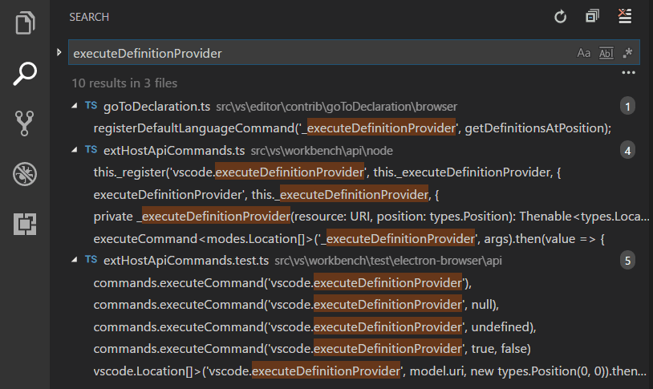

> **提示**：VS Code 还支持在搜索框中用正则表达式搜索。

　　可以选择搜索框右下方的省略号（**切换搜索详细信息**）配置高级搜索选项，或按 `Ctrl + Shift + J`（macOS：`Cmd + Shift + J`）。这会显示额外字段。

> **提示**：可以使用快速搜索在当前打开文件夹的所有文件中快速查找文本。打开命令面板（`Ctrl + Shift + P`，macOS：`Cmd + Shift + P`），输入 **Search: Quick Search** 命令。

### 高级搜索选项 {#advanced-search-options}

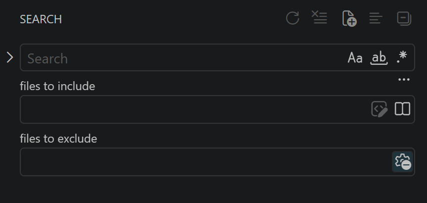

　　在搜索框下方的两个输入框中，可以输入要包含或排除的模式。输入 `example` 会匹配工作区中所有名为 `example` 的文件夹和文件。输入 `./example` 会匹配工作区顶层的 `example/` 文件夹。使用 `,` 分隔多个模式。路径必须使用正斜杠。也可以使用 [glob 模式](https://code.visualstudio.com/docs/editor/glob-patterns)语法，例如：

* `*` 匹配路径段中零个或多个字符
* `?` 匹配路径段中一个字符
* `**` 匹配任意数量路径段，包括零个
* `{}` 分组条件（例如 `{**/*.html,**/*.txt}` 匹配所有 HTML 和文本文件）
* `[]` 声明字符范围（`example.[0-9]` 匹配 `example.0`、`example.1` 等）
* `[!...]` 否定字符范围（`example.[!0-9]` 匹配 `example.a`、`example.b`，但不匹配 `example.0`）

**关于大小写敏感性**：glob 模式遵循操作系统文件系统规则。Windows 和 macOS 上模式不区分大小写（例如 `*.CS` 匹配 `file.cs`）。Linux 上区分大小写。这独立于搜索文本的 **匹配大小写** 切换。

　　VS Code 默认排除一些文件夹以减少无关结果（例如 `node_modules`）。在[设置](../../3.3-ConfigureTheEditor/3.3.4-Settings/)中修改 `files.exclude` 和 `search.exclude`。

　　要在不显示于资源管理器的情况下搜索排除文件夹中的选定文件，请在 `settings.json` 中为 `search.exclude` 添加 `!` 例外。例如，以下例外会搜索 `node_modules/@types`，尽管默认排除 `node_modules`：

```json
{
  "search.exclude": {
    "!node_modules/@types": true
  }
}
```

　　搜索继承 `files.exclude` 的模式，任一设置中的例外可以覆盖另一设置中的排除。例外也适用于快速打开中的文件搜索，并覆盖 `.gitignore` 规则。它们只适用于这些设置，不适用于 **要排除的文件** 输入框。优先级规则和限制请参阅[排除例外](https://code.visualstudio.com/docs/editor/glob-patterns#_exclude-exceptions)。

　　注意搜索视图中的 glob 模式与 `files.exclude`、`search.exclude` 等设置中的模式不同。在设置中，要匹配 `folder1/example` 中名为 `example` 的文件夹，必须使用 `**/example`。在搜索视图中，`**` 前缀是隐含的。这些设置中的 glob 模式始终相对于工作区文件夹路径评估。

　　还要注意 **要排除的文件** 框中的 **使用排除设置和忽略文件** 切换按钮。该切换决定是否排除被 `.gitignore` 忽略或匹配 `files.exclude`、`search.exclude` 的文件。

　　在 **要包含的文件** 框中，可以使用 **仅在更改的文件中搜索** 切换，将结果限制为有未提交源代码管理更改的文件。没有仓库或没有更改时，该切换禁用。

> **注意**：`.gitignore` 模式在 Windows 和 macOS 上不区分大小写，在 Linux 上区分大小写。详细了解 [glob 模式大小写敏感性](https://code.visualstudio.com/docs/editor/glob-patterns#_case-sensitivity)。

> **提示**：在资源管理器中右键单击文件夹，选择 **在文件夹中查找**，只在文件夹内搜索。

### 排查搜索性能和过多 ripgrep 进程 {#troubleshoot-search-performance-and-excessive-ripgrep-processes}

　　VS Code 使用 [ripgrep](https://github.com/BurntSushi/ripgrep)（`rg`）执行快速工作区搜索。在大型代码库中，如果搜索变慢或多个 `rg` 进程占用高 CPU，请检查：

1. **检查“使用排除设置和忽略文件”切换**：在搜索视图中展开 **切换搜索详细信息**（省略号 `...`），确认 **要排除的文件** 框中的 **使用排除设置和忽略文件** 切换（齿轮图标）已启用。关闭它会绕过忽略文件及 `files.exclude`、`search.exclude`，可能包含 `node_modules` 和构建输出，增加搜索时间和 CPU 使用量。
2. **验证忽略设置**：确认 `search.useIgnoreFiles` 设置为 `true`（默认），以便搜索时遵循 `.gitignore` 和 `.ignore`。
3. **禁用符号链接跟随**：如果工作区包含循环或大型符号链接目录，请将 `search.followSymlinks` 设置为 `false`。
4. **排除大型生成目录**：将项目构建文件夹、包管理器产物或工作树添加到 `search.exclude`：

   ```json
   {
     "search.exclude": {
       "**/node_modules/**": true,
       "**/target/**": true,
       "**/.worktrees/**": true
     }
   }
   ```

> **提示**：搜索结果缺失或耗时超出预期时，请查阅 [搜索问题 wiki](https://github.com/microsoft/vscode/wiki/Search-Issues)。

### 搜索和替换 {#search-and-replace}

　　也可以跨文件搜索和替换。展开搜索组件显示替换文本框。

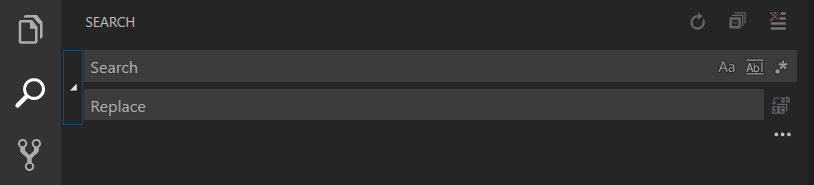

　　在替换文本框输入文本时，会看到待处理更改的差异显示。可以从替换框替换所有文件、替换一个文件中的全部内容或替换单个更改。

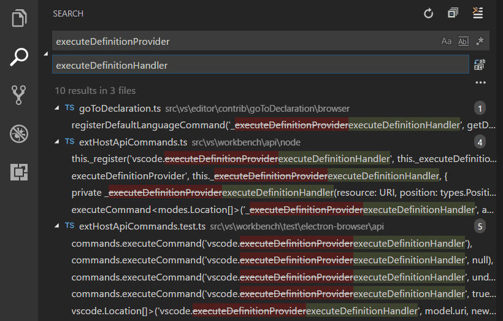

> **提示**：可以使用 `↓` 和 `↑` 在搜索词历史中导航，快速复用之前的搜索词。

### 正则替换中的大小写转换 {#case-changing-in-regex-replace}

　　VS Code 支持在编辑器或全局搜索替换时更改正则匹配组的大小写。使用修饰符 `\u\U\l\L`，其中 `\u` 和 `\l` 改变单个字符大小写，`\U` 和 `\L` 改变匹配组其余部分大小写。

示例：

<video src="https://code.visualstudio.com/assets/docs/editing/codebasics/case-change-replace.mp4" title="查找替换时更改大小写演示。" autoplay loop controls muted></video>

　　修饰符可以叠加，例如 `\u\u\u$1` 将组的前三个字符大写，`\l\U$1` 将第一个字符小写、其余大写。捕获组在替换字符串中用 `$n` 引用，`n` 是捕获组顺序。

## 搜索编辑器 {#search-editor}

　　搜索编辑器让你在完整大小的编辑器中查看工作区搜索结果，支持语法高亮和可选的上下文行。

以下是搜索单词“SearchEditor”，并显示匹配前后两行上下文：

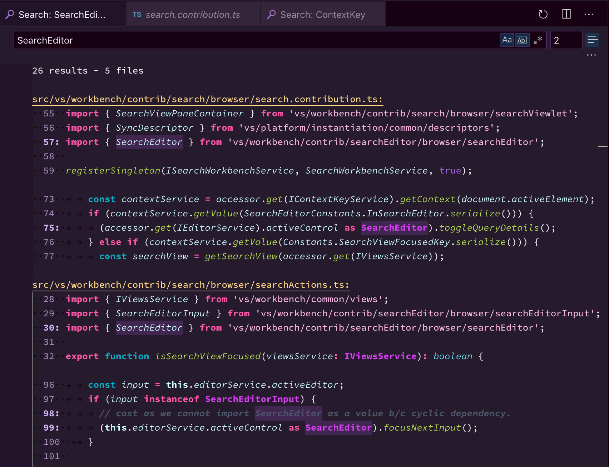

　　**打开搜索编辑器** 命令会打开现有搜索编辑器（如果存在），否则创建新编辑器。**新建搜索编辑器** 命令始终创建新搜索编辑器。

　　在搜索编辑器中，可以使用 **转到定义** 操作导航结果，例如 `F12` 在当前编辑器组打开源位置，或 `Ctrl + K F12`（macOS：`Cmd + K F12`） 在侧边打开。还可以使用 `search.searchEditor.singleClickBehaviour` 和 `search.searchEditor.doubleClickBehaviour` 设置配置单击或双击搜索结果的行为，例如打开速览定义窗口或源位置。

　　也可以使用搜索视图顶部的 **打开新搜索编辑器** 按钮，并通过结果树顶部的 **在编辑器中打开** 链接或 **Search Editor: Open Results in Editor** 命令将现有结果复制到搜索编辑器。

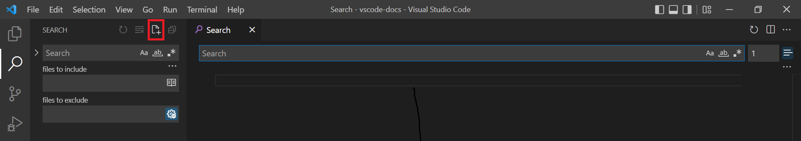

　　上面的搜索编辑器是通过选择搜索视图顶部的 **打开新搜索编辑器** 按钮（第三个按钮）打开的。

### 搜索编辑器命令和参数 {#search-editor-commands-and-arguments}

* `search.action.openNewEditor` - 在新选项卡中打开搜索编辑器。
* `search.action.openInEditor` - 将当前搜索结果复制到新搜索编辑器。
* `search.action.openNewEditorToSide` - 在当前窗口旁的新窗口中打开搜索编辑器。

　　可以向搜索编辑器命令（`search.action.openNewEditor`、`search.action.openNewEditorToSide`）传递两个参数，让快捷键配置新搜索编辑器的行为：

* `triggerSearch` - 打开搜索编辑器时是否自动运行搜索。默认 `true`。
* `focusResults` - 是否将焦点放在搜索结果还是查询输入框。默认 `true`。

例如，以下快捷键在打开搜索编辑器时运行搜索，但将焦点留在搜索查询控件：

```json
{
    "key": "ctrl+o",
    "command": "search.action.openNewEditor",
    "args": { "query": "VS Code", "triggerSearch":true, "focusResults": false }
}
```

### 搜索编辑器上下文默认值 {#search-editor-context-default}

　　`search.searchEditor.defaultNumberOfContextLines` 设置默认值为 1，表示搜索结果每行前后显示一行上下文。

### 复用上次搜索编辑器配置 {#reuse-last-search-editor-configuration}

　　`search.searchEditor.reusePriorSearchConfiguration` 设置（默认 `false`）允许创建新搜索编辑器时复用上次活动搜索编辑器的配置。

## IntelliSense {#intellisense}

　　我们始终提供单词补全，但对于 JavaScript、JSON、HTML、CSS、SCSS、Less、C# 和 TypeScript 等丰富[语言](../../../languages-and-runtimes/10.1-Overview/)，我们提供真正的 IntelliSense 体验。如果语言服务知道可能的补全，IntelliSense 建议会在输入时弹出。也可以使用 `Ctrl + Space` 手动触发。默认接受键是 `Tab` 或 `Enter`，也可以[自定义这些快捷键](../../3.3-ConfigureTheEditor/3.3.3-KeyboardShortcuts/)。

> **提示**：建议筛选支持 CamelCase，可以输入方法名中的大写字母来限制建议。例如，“cra”会快速带出“createApplication”。

> **提示**：IntelliSense 建议可以通过 `editor.quickSuggestions` 和 `editor.suggestOnTriggerCharacters` [设置](../../3.3-ConfigureTheEditor/3.3.4-Settings/)配置。

　　JavaScript 和 TypeScript 开发者可以利用 [npmjs](https://www.npmjs.com) 类型声明文件仓库，为常见 JavaScript 库（Node.js、React、Angular）获取 IntelliSense。详细信息请参阅 [JavaScript 语言](../../../languages-and-runtimes/10.1-Overview/)主题和 [Node.js](https://code.visualstudio.com/docs/nodejs/nodejs-tutorial) 教程。

　　更多信息请参阅 [IntelliSense](../3.2.2-IntelliSense/)。

## 格式化 {#formatting}

　　VS Code 对源代码格式化有良好支持。编辑器有两个显式格式化操作：

* **格式化文档**（`Shift + Alt + F`，macOS：`Shift + Option + F`） - 格式化整个活动文件。
* **格式化选区**（`Ctrl + K Ctrl + F`，macOS：`Cmd + K Cmd + F`） - 格式化选中文本。

　　可以从**命令面板**（`Ctrl + Shift + P`，macOS：`Cmd + Shift + P`）或编辑器上下文菜单调用。

　　VS Code 为 JavaScript、TypeScript、JSON、HTML 和 CSS 提供默认格式化程序。每种语言有特定格式化选项（例如 `html.format.indentInnerHtml`），可以在用户或工作区[设置](../../3.3-ConfigureTheEditor/3.3.4-Settings/)中调整。如果安装了为同一语言提供格式化的其他扩展，也可以禁用默认语言格式化程序。

```json
"html.format.enable": false
```

　　除了手动调用格式化，还可以在输入、保存或粘贴时触发格式化。这些默认关闭，可以通过以下[设置](../../3.3-ConfigureTheEditor/3.3.4-Settings/)启用：

* `editor.formatOnType` - 输入后格式化行。
* `editor.formatOnSave` - 保存时格式化文件。
* `editor.formatOnPaste` - 格式化粘贴内容。

> **注意**：并非所有格式化程序都支持粘贴时格式化，因为它们必须支持格式化选区或文本范围。

　　除了默认格式化程序，还可以在 Marketplace 中查找支持其他语言或格式化工具的扩展。有 `Formatters` 类别，便于搜索[格式化扩展](https://marketplace.visualstudio.com/search?target=VSCode&category=Formatters&sortBy=Installs)。在扩展视图搜索框中输入“formatters”或“category:formatters”查看筛选列表。

## 折叠 {#folding}

　　可以使用行号与行首之间装订线中的折叠图标折叠源代码区域。将鼠标移到装订线并单击以折叠或展开区域。在折叠图标上使用 `Shift + 单击` 折叠或展开该区域及其内部所有区域。

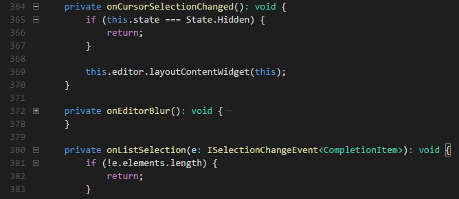

还可以使用以下操作：

* 折叠（`Ctrl + Shift + [`，macOS：`Cmd + Option + [`）折叠光标处最内层未折叠区域。
* 展开（`Ctrl + Shift + ]`，macOS：`Cmd + Option + ]`）展开光标处折叠区域。
* 切换折叠（`Ctrl + K Ctrl + L`，macOS：`Cmd + K Cmd + L`）折叠或展开光标处区域。
* 递归折叠（`Ctrl + K Ctrl + [`，macOS：`Cmd + K Cmd + [`）折叠光标处最内层未折叠区域及内部所有区域。
* 递归展开（`Ctrl + K Ctrl + ]`，macOS：`Cmd + K Cmd + ]`）展开光标处区域及内部所有区域。
* 全部折叠（`Ctrl + K Ctrl + 0`，macOS：`Cmd + K Cmd + 0`）折叠编辑器中所有区域。
* 全部展开（`Ctrl + K Ctrl + J`，macOS：`Cmd + K Cmd + J`）展开编辑器中所有区域。
* 折叠级别 X（级别 2 为 `Ctrl + K Ctrl + 2`，macOS：`Cmd + K Cmd + 2`）折叠所有级别 X 区域，但当前光标位置区域除外。
* 折叠所有块注释（`Ctrl + K Ctrl + /`，macOS：`Cmd + K Cmd + /`）折叠所有以块注释标记开头的区域。

　　折叠区域默认根据行缩进评估。当一行缩进小于后续一行或多行时开始折叠区域，当出现相同或更小缩进的行时结束。

　　折叠区域也可以根据编辑器配置语言的语法令牌计算。以下语言已提供语法感知折叠：Markdown、HTML、CSS、LESS、SCSS 和 JSON。

　　如果希望为上述一种（或所有）语言切回基于缩进的折叠，请使用：

```json
  "[html]": {
    "editor.foldingStrategy": "indentation"
  },
```

　　区域也可以由各语言定义的标记定义。目前定义了标记的语言：

语言|开始区域|结束区域
--------|------------|----------
Bat|`::#region` 或 `REM #region`|`::#endregion` 或 `REM #endregion`
C#|`#region`|`#endregion`
C/C++|`#pragma region`|`#pragma endregion`
CSS/Less/SCSS|`/*#region*/`|`/*#endregion*/`
Coffeescript|`#region`|`#endregion`
F#|`//#region` 或 `(#region)`|`//#endregion` 或 `(#endregion)`
Java|`//#region` 或 `//<editor-fold>`|`//#endregion` 或 `//</editor-fold>`
Markdown|`<!-- #region -->`|`<!-- #endregion -->`
Perl5|`#region` 或 `=pod`|`#endregion` 或 `=cut`
PHP|`#region`|`#endregion`
PowerShell|`#region`|`#endregion`
Python|`#region` 或 `# region`|`#endregion` 或 `# endregion`
TypeScript/JavaScript|`//#region`|`//#endregion`
Visual Basic|`#Region`|`#End Region`

只折叠和展开标记区域：

* 折叠标记区域（`Ctrl + K Ctrl + 8`，macOS：`Cmd + K Cmd + 8`）折叠所有标记区域。
* 展开标记区域（`Ctrl + K Ctrl + 9`，macOS：`Cmd + K Cmd + 9`）展开所有标记区域。

### 折叠选择 {#fold-selection}

命令 **从选择创建手动折叠范围**（`Ctrl + K Ctrl + ,`，macOS：`Cmd + K Cmd + ,`）从当前选中行创建折叠范围并折叠。该范围称为**手动**折叠范围，位于折叠提供程序计算的范围之上。

手动折叠范围可以使用 **移除手动折叠范围**（`Ctrl + K Ctrl + .`，macOS：`Cmd + K Cmd + .`）移除。

手动折叠范围在编程语言不支持折叠时特别有用。

## 缩进 {#indentation}

　　VS Code 允许控制文本缩进以及使用空格还是制表符。默认插入空格，每个 `Tab` 使用 4 个空格。要使用其他默认值，请修改 `editor.insertSpaces` 和 `editor.tabSize` [设置](../../3.3-ConfigureTheEditor/3.3.4-Settings/)。

```json
    "editor.insertSpaces": true,
    "editor.tabSize": 4,
```

### 自动检测 {#auto-detection}

　　VS Code 分析打开文件并确定文档使用的缩进。自动检测的缩进会覆盖默认缩进设置。检测结果显示在状态栏右侧：


　　可以单击状态栏缩进显示，打开包含缩进命令的下拉列表，更改打开文件的默认设置或在制表符和空格之间转换。

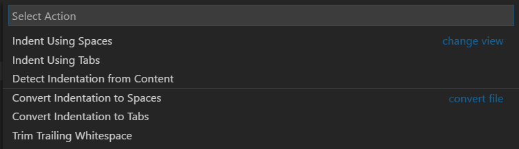

> **注意**：VS Code 自动检测 2、4、6 或 8 个空格缩进。如果文件使用其他空格数，缩进可能无法正确检测。例如，如果约定使用 3 个空格缩进，可以关闭 `editor.detectIndentation` 并显式设置制表符大小为 3。

```json
    "editor.detectIndentation": false,
    "editor.tabSize": 3,
```

## 文件编码支持 {#file-encoding-support}

　　使用**用户设置**或**工作区设置**中的 `files.encoding` 设置，全局或按工作区设置文件编码。

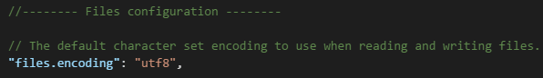

　　可以在状态栏查看文件编码。


　　单击状态栏编码按钮，以不同编码重新打开或保存活动文件。

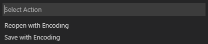

然后选择编码。

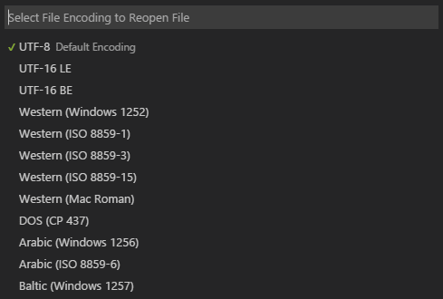

## 覆盖模式 {#overtype-mode}

　　在 1.96 版之前，VS Code 仅支持*插入*模式，字符插入光标位置，除非安装 Vim [键映射扩展](../../3.3-ConfigureTheEditor/3.3.3-KeyboardShortcuts/)。

　　从 1.96 版开始，VS Code 支持*覆盖*模式，可以覆盖现有字符，而不是在光标位置插入。默认关闭覆盖模式。

　　要在插入和覆盖模式之间切换，请在命令面板运行 **切换覆盖/插入模式** 命令，或按 `Insert`。处于覆盖模式时，状态栏显示 `OVR`。

　　可以通过 `editor.overtypeCursorStyle` 设置更改覆盖模式光标样式。

　　使用 `editor.overtypeOnPaste` 设置在粘贴时覆盖文本。需要处于覆盖模式该设置才生效。

## 比较文件 {#compare-files}

　　VS Code 支持多种比较当前文件或任意两个文件内容的方式。

当编辑器中有活动文件时，有以下比较选项：

* **与工作区文件比较**：在命令面板选择 **File: Compare Active File With...**，然后选择另一个文件。
* **与剪贴板比较**：在命令面板选择 **File: Compare Active File with Clipboard**（`Ctrl + K C`，macOS：`Cmd + K C`）比较当前文件与剪贴板内容。
* **与已保存内容比较**：在命令面板选择 **File: Compare Active File with Saved**（`Ctrl + K D`，macOS：`Cmd + K D`）比较当前文件与最后保存版本。

比较任意两个文件：

* 在资源管理器中右键单击文件，选择 **选择以比较**。然后右键单击第二个文件，选择 **与所选内容比较**。
* 要在两个空编辑器窗口之间比较，请从命令面板选择 **File: Compare New Untitled Text Files**。

> **提示**：可以从命令行使用 `--diff` 选项启动 VS Code 比较两个文件。详细了解 [VS Code 命令行接口](../../3.3-ConfigureTheEditor/3.3.10-CommandLineInterface/)。

## 后续步骤 {#next-steps}

你已经了解了基本用户界面，VS Code 还有更多功能：

* [入门视频 - 设置和基础](https://code.visualstudio.com/docs/introvideos/basics)
* [用户/工作区设置](../../3.3-ConfigureTheEditor/3.3.4-Settings/)
* [代码导航](../3.2.5-CodeNavigation/)
* [集成终端](../../../terminal/5.2-TerminalBasics/)
* [IntelliSense](../3.2.2-IntelliSense/)
* [调试](../../../debugging-and-testing/6.1-Debugging/)

## 常见问题 {#common-questions}

### 可以全局搜索和替换吗？ {#is-it-possible-to-globally-search-and-replace}

　　可以。展开搜索视图文本框以包含替换字段。可以搜索和替换工作区中所有文件。注意，如果没有在文件夹上打开 VS Code，搜索只会在当前打开文件中运行。


### 如何开启自动换行？ {#how-do-i-turn-on-word-wrap}

　　可以通过 `editor.wordWrap` [设置](../../3.3-ConfigureTheEditor/3.3.4-Settings/)控制自动换行。默认 `off`，设置为 `on` 时文本会在编辑器视口宽度处换行。

```json
    "editor.wordWrap": "on"
```

　　可以使用 `Alt + Z`（macOS：`Option + Z`） 切换当前 VS Code 会话的自动换行。

　　还可以使用 `editor.rulers` 设置添加垂直列标尺，该设置接受列字符位置数组。

　　与其他编辑器一样，**剪切** 和 **复制** 等命令应用于整个换行行。三击选择整个换行行。按两次 `Home` 将光标移到行首。按两次 `End` 将光标移到行尾。

### 如何避免在自动换行行中添加额外光标？ {#how-can-i-avoid-placing-extra-cursors-in-word-wrapped-lines}

　　如果希望在上方或下方添加光标时忽略换行，请在快捷键的 `args` 中传入 `{ "logicalLine": true }`：

```json
{
  "key": "shift+alt+down",
  "command": "editor.action.insertCursorBelow",
  "when": "textInputFocus",
  "args": { "logicalLine": true },
},
{
  "key": "shift+alt+up",
  "command": "editor.action.insertCursorAbove",
  "when": "textInputFocus",
  "args": { "logicalLine": true },
},
```

### 为什么搜索很慢或占用过多 CPU？ {#why-is-search-slow-or-consuming-excessive-cpu}

　　VS Code 搜索由 ripgrep（`rg`）驱动。如果多个 `rg` 进程运行或搜索很慢，请检查搜索视图详细信息中的 **使用排除设置和忽略文件** 切换是否开启，确认 `search.useIgnoreFiles` 已启用，并在 `search.exclude` 中排除 `node_modules` 或构建缓存等大型目录。分步说明请参阅[排查搜索性能](#troubleshoot-search-performance-and-excessive-ripgrep-processes)。
