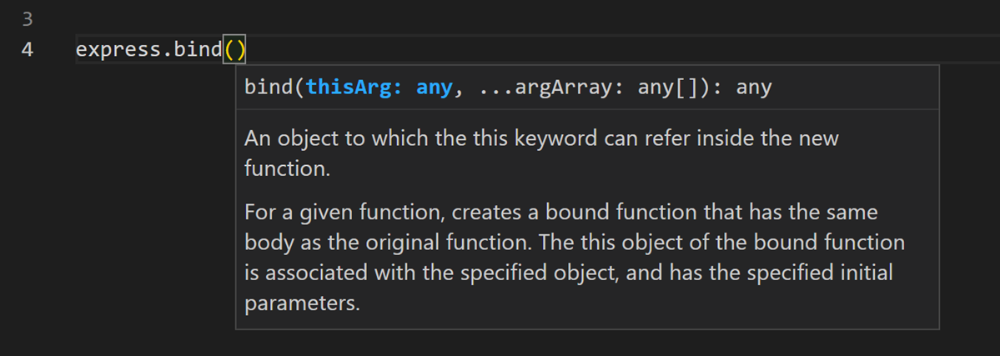
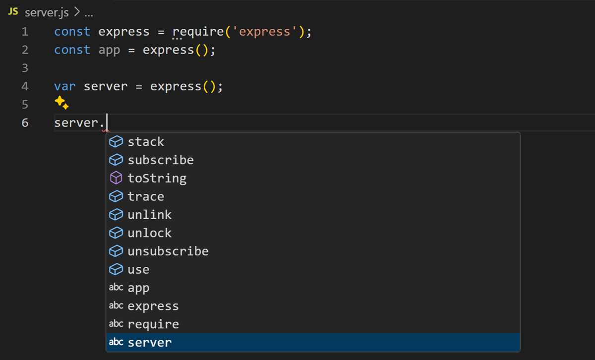
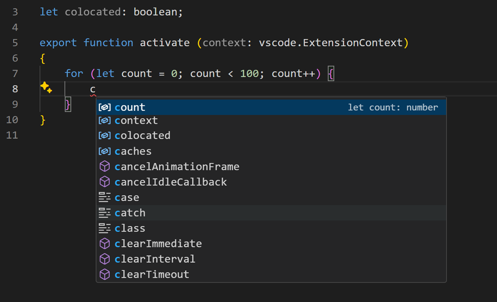
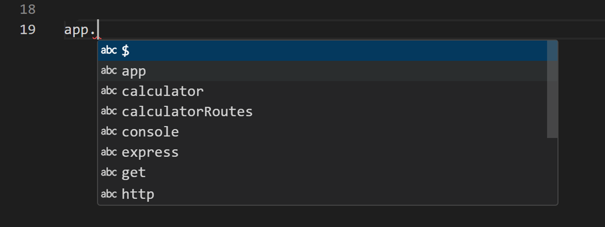

+++
title = "3.2.2 IntelliSense"
date = 2026-11-06T07:53:25+08:00
weight = 2
type = "docs"
description = ""
isCJKLanguage = true
draft = false
+++


> 原文链接: [https://code.visualstudio.com/docs/editing/intellisense](https://code.visualstudio.com/docs/editing/intellisense)

# 3.2.2 IntelliSense

　　IntelliSense 是各种代码编辑功能的统称，包括代码补全、参数信息、快速信息和成员列表。有时也称为“代码补全”“内容辅助”或“代码提示”。

## 适用于你的编程语言的 IntelliSense {#intellisense-for-your-programming-language}

　　VS Code 开箱即提供适用于 JavaScript、TypeScript、JSON、HTML、CSS、SCSS 和 Less 的 IntelliSense。VS Code 支持任何编程语言的基于单词的补全，也可以安装语言扩展来获得更丰富的 IntelliSense。

## IntelliSense 功能 {#intellisense-features}

　　IntelliSense 功能由语言服务提供。语言服务根据语言语义和对源代码的分析提供智能代码补全。如果语言服务知道可能的补全项，建议会在你输入时弹出。继续输入字符会筛选成员列表（变量、方法等），只显示包含所输入字符的成员。按 `Tab` 或 `Enter` 插入所选成员。

　　可以在任何编辑器窗口中按 `Ctrl + Space` 触发 IntelliSense，或输入触发字符（例如 JavaScript 中的点 `.`）。

> **提示**：建议控件支持 CamelCase 筛选，即输入方法名中的大写字母来缩小建议范围。例如输入 `cra` 可找到 `createApplication`。

　　可以关闭输入时的 IntelliSense。通过 `editor.quickSuggestions` 等设置自定义；详见[自定义 IntelliSense](#customizing-intellisense)。

　　语言服务提供每个方法的**快速信息**。按 `Ctrl + Space` 或选择 `>` 图标，可展开方法文档。文档会随列表导航更新。



　　选择方法后会显示**参数信息**。适用时，语言服务会在快速信息和方法签名中显示底层类型。

## 补全类型 {#types-of-completions}

　　VS Code IntelliSense 提供不同类型的补全，包括语言服务器建议、代码片段和基于单词的简单文本补全。



| 图标 | 名称 | 符号类型 |
| ---- | ---- | ----------- |
| 方法/函数 | Methods and Functions | `method`、`function`、`constructor` |
| 变量 | Variables | `variable` |
| 字段 | Fields | `field` |
| 类型参数 | Type parameters | `typeParameter` |
| 常量 | Constants | `constant` |
| 类 | Classes | `class` |
| 接口 | Interfaces | `interface` |
| 结构 | Structures | `struct` |
| 事件 | Events | `event` |
| 运算符 | Operators | `operator` |
| 模块 | Modules | `module` |
| 属性和特性 | Properties and Attributes | `property` |
| 枚举 | Enumerations | `enum` |
| 枚举成员 | Enumeration members | `enumMember` |
| 引用 | References | `reference` |
| 关键字 | Keywords | `keyword` |
| 文件 | Files | `file` |
| 文件夹 | Folders | `folder` |
| 颜色 | Colors | `color` |
| 单位 | Unit | `unit` |
| 代码片段前缀 | Snippet prefixes | `snippet` |
| 单词 | Words | `text` |

## 自定义 IntelliSense {#customizing-intellisense}

### 设置 {#settings}

```javascript
{
    // 控制输入时是否显示快速建议
    "editor.quickSuggestions": {
        "other": true,
        "comments": false,
        "strings": false
    },

    // 控制是否在提交字符上接受建议
    "editor.acceptSuggestionOnCommitCharacter": true,

    // 控制是否用 Enter 接受建议
    "editor.acceptSuggestionOnEnter": "on",

    // 控制快速建议出现的延迟（毫秒）
    "editor.quickSuggestionsDelay": 10,

    // 控制是否在触发字符后自动显示建议
    "editor.suggestOnTriggerCharacters": true,

    // 控制 Tab 是否插入最佳建议并在建议间循环
    "editor.tabCompletion": "off",

    // 控制排序是否偏向光标附近的单词
    "editor.suggest.localityBonus": true,

    // 控制建议列表的预选方式
    "editor.suggestSelection": "first",

    // 启用基于单词的建议
    "editor.wordBasedSuggestions": "matchingDocuments",

    // 启用参数提示
    "editor.parameterHints.enabled": true,
}
```

### Tab 补全 {#tab-completion}

　　编辑器支持 *Tab 补全*：按 Tab 插入最佳匹配的补全，无论建议控件是否显示。也可以在插入建议后按 Tab 插入下一个最佳建议。默认禁用，使用 `editor.tabCompletion` 启用：`off`、`on` 或 `onlySnippets`。

### 就近排序 {#locality-bonus}

　　建议排序取决于扩展信息及其与当前单词的匹配程度。使用 `editor.suggest.localityBonus` 可以提升光标附近出现的建议。



### 建议选择 {#suggestion-selection}

　　`editor.suggestSelection` 控制建议列表的预选方式：`first`（默认，选择第一项）、`recentlyUsed`（选择最近使用的项，除非输入前缀选择了其他项）或 `recentlyUsedByPrefix`（根据之前补全过的前缀选择）。

　　使用 `recentlyUsedByPrefix` 时，如果输入 `co` 后选择 `console`，下次输入 `co` 时会预选 `console`，便于将不同前缀映射到不同建议。

### 建议中的代码片段 {#snippets-in-suggestions}

　　默认情况下，代码片段和补全建议显示在同一控件中。使用 `editor.snippetSuggestions` 配置：`top`、`bottom`、`inline`（默认）或 `none`。

### 键盘快捷键 {#keyboard-shortcuts}

| 命令 | 键绑定 |
| --- | --- |
| `editor.action.triggerSuggest` | `Ctrl + Space` |
| `toggleSuggestionDetails` | `Ctrl + Space` |
| `toggleSuggestionFocus` | `Ctrl + Alt + Space` |

> **提示**：打开 **默认键盘快捷键**，搜索“suggest”可查看更多 IntelliSense 快捷键。

## 使用 AI 增强补全 {#enhance-completions-with-ai}

　　GitHub Copilot 会在你输入时提供编码建议，也可以询问与编码相关的问题，例如如何编写、修复错误或理解别人的代码。请参阅[2 VS Code 中的 AI](../../../ai-in-vs-code/)。

## 故障排除 {#troubleshooting}

　　如果 IntelliSense 停止工作，语言服务可能未运行。重新启动 VS Code 通常可以解决。如果安装语言扩展后仍缺少 IntelliSense 功能，请在该扩展仓库中提交问题。

> **注意**：在非常大的工作区中，IntelliSense 功能可能因性能原因被部分禁用。可以使用 `files.exclude` 或 `search.exclude` 排除大型文件夹（例如 `node_modules` 或构建输出目录）。

　　特定语言扩展可能不支持所有 IntelliSense 功能，请查看扩展 README。如果认为语言扩展有问题，可以在 [Visual Studio Marketplace](https://marketplace.visualstudio.com/vscode)中打开扩展详情页，选择 **支持** 链接。

## 后续步骤 {#next-steps}

* [6.1 调试代码](../../../debugging-and-testing/6.1-Debugging/)：了解如何为应用程序设置调试。
* [创建语言扩展](https://code.visualstudio.com/api/language-extensions/programmatic-language-features)：了解如何为新编程语言添加 IntelliSense。
* [2 VS Code 中的 AI](../../../ai-in-vs-code/)：了解如何使用 AI 增强编码。

## 常见问题 {#common-questions}

### 为什么没有收到任何建议？ {#why-am-i-not-getting-any-suggestions}

　　原因可能多种多样。先尝试重新启动 VS Code。如果问题持续，请查阅语言扩展文档。JavaScript 特定排查请参阅 [JavaScript 语言主题](https://code.visualstudio.com/docs/languages/javascript#intellisense)。

### 为什么看不到方法和变量建议？ {#why-am-i-not-seeing-method-and-variable-suggestions}



　　这通常是因为 JavaScript 缺少类型声明文件。大多数常见 JavaScript 库会附带声明文件或提供类型声明文件。请确保安装了所用库的 npm 或 yarn 包。
