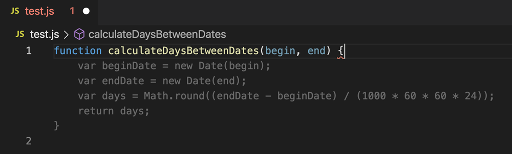
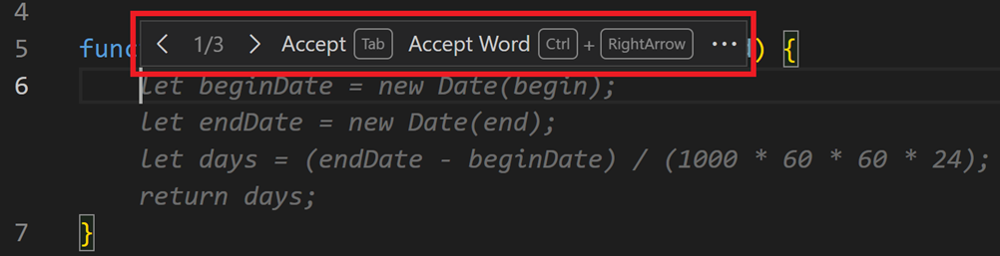
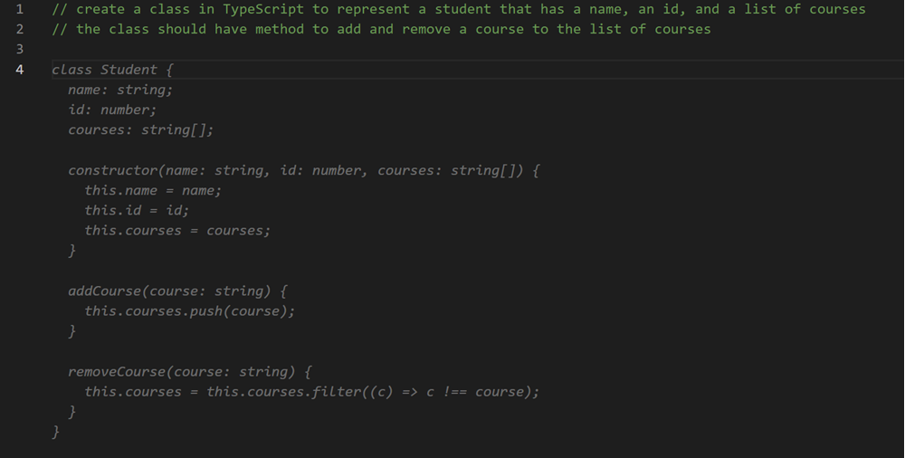
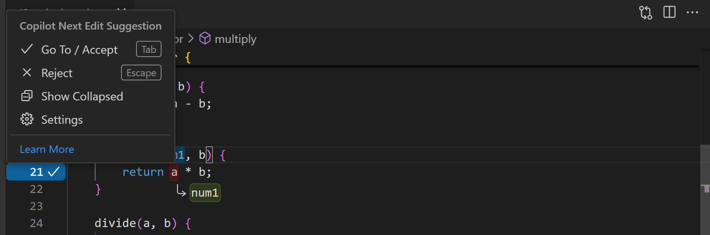
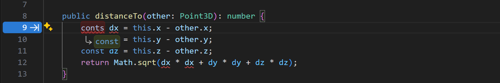
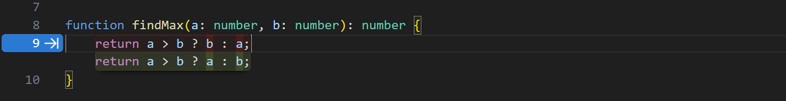
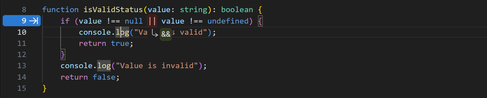
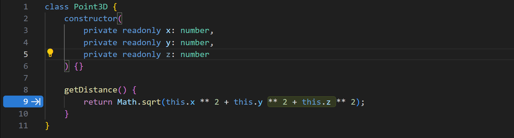
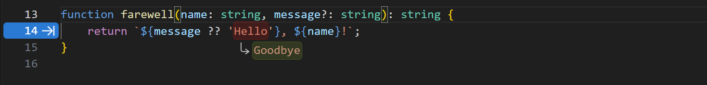
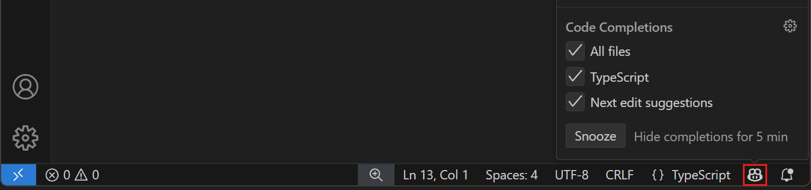

+++
title = "3.2.3 内联建议"
date = 2026-11-06T07:53:25+08:00
weight = 3
type = "docs"
description = ""
isCJKLanguage = true
draft = false
+++

> 原文链接: [https://code.visualstudio.com/docs/editing/ai-powered-suggestions](https://code.visualstudio.com/docs/editing/ai-powered-suggestions)

# 3.2.3 内联建议

　　当你希望继续自己编写代码，同时获得补全代码、注释或测试以及进行相关编辑的帮助时，请使用内联建议。GitHub Copilot 会在你输入时在编辑器中建议更改。你逐条审查建议，并决定接受、接受一部分还是继续输入。

　　GitHub Copilot 会使用现有代码作为两类建议的上下文：

* **幽灵文本建议**：光标处的淡色文本建议如何补全你正在编写的代码。
* **下一次编辑建议**：根据你最近的编辑，GitHub Copilot 会建议另一处更改及其位置。

　　内联建议不需要启动聊天。随着任务变化，也可以[将它们与聊天和智能体结合](#combine-suggestions-with-chat-and-agents)。

## 前提条件 {#prerequisites}

* 在计算机上安装 Visual Studio Code。按照[设置 VS Code](../../../get-started/)的步骤操作。
* 拥有 GitHub Copilot 订阅的访问权限。按照[设置 GitHub Copilot](../../../advanced-setup/9.1-GitHubCopilotSetup/)的步骤操作。可以设置 Copilot Free，获得每月内联建议和 AI 点数额度。

## 幽灵文本建议 {#ghost-text-suggestions}

### 获取第一批建议 {#getting-your-first-suggestions}

　　Copilot 会在你输入时提供淡色的*幽灵文本*建议：有时补全当前行，有时补全整个新代码块。

1. 打开一种编程语言的文件并开始输入。输入时应该会看到 Copilot 的内联建议。

    以下示例展示 Copilot 如何使用淡色*幽灵文本*建议 `calculateDaysBetweenDates` JavaScript 函数的实现：

    

2. 审查建议的代码。按 `Tab` 接受，或按 `Escape` 忽略。

    要只接受建议的一部分：

    * 使用 `Ctrl + →`（macOS 上为 `Cmd + →`）接受下一个单词。
    * 从命令面板（`Ctrl + Shift + P`，macOS：`Cmd + Shift + P`）运行 **Accept Next Line Of Inline Suggestion** 接受下一行。

3. 继续编辑，并检查接受的代码是否按预期工作。建议可能不正确，因此在依赖结果之前请运行相关测试。

### 其他建议 {#alternative-suggestions}

　　对于同一输入，GitHub Copilot 可能提供多个建议。将鼠标悬停在建议上查看工具栏，然后使用其下一个和上一个控件比较备选建议。

### 根据代码注释生成建议 {#generate-suggestions-from-code-comments}

　　除了依赖 Copilot 提供建议，还可以通过代码注释提示你期望的代码。例如，可以指定要使用的算法或概念（例如“使用递归”或“使用单例模式”），或者要添加到类中的方法和属性。

以下示例展示如何指示 Copilot 用 TypeScript 创建表示学生的类，并提供方法和属性信息：

## 下一次编辑建议 {#next-edit-suggestions}

　　当一次编辑引发另一次编辑时，下一次编辑建议帮助你进行相关更改。例如，为函数添加参数后，GitHub Copilot 可以建议更新使用该函数的代码。建议可能出现在光标处或文件中的其他位置，并可能更改一个符号、一行或几行。

<video src="https://code.visualstudio.com/assets/docs/editing/inline-suggestions/nes-video.mp4" title="视频展示下一次编辑建议在 Point TypeScript 类中的实际效果。" loop controls muted poster="./images/point3d.png"></video>

要使用下一次编辑建议（Copilot NES），请确认 `github.copilot.nextEditSuggestions.enabled` 已启用。

### 导航并接受编辑建议 {#navigate-and-accept-edit-suggestions}

　　按 `Tab` 导航到建议的编辑。审查提议的更改，然后再次按 `Tab` 接受，或按 `Escape` 忽略。

　　边距中的箭头表示是否有可用的编辑建议。箭头指示下一次编辑建议相对于当前光标位置的方向。

　　可以将鼠标悬停在箭头上，浏览编辑建议菜单，其中包含键盘快捷键和设置配置：

> **重要**：如果你使用 [VS Code Vim 扩展](https://marketplace.visualstudio.com/items?itemName=vscodevim.vim)，请使用最新版本，以避免与 NES 的键绑定冲突。

### 通过编辑建议减少干扰 {#reduce-distractions-by-edit-suggestions}

　　默认情况下，编辑建议由边距箭头指示，并在编辑器中显示代码更改。启用 `editor.inlineSuggest.edits.showCollapsed` 可在导航到建议之前保持更改折叠。也可以将鼠标悬停在边距箭头上，从菜单中选择 **显示折叠**。

### 下一次编辑建议的用例 {#use-cases-for-next-edit-suggestions}

**捕获并纠正错误**

* **Copilot 可以帮助处理拼写错误等简单错误。** 它会建议修复缺失或交换字母的地方，例如 `cont x = 5` 或 `conts x = 5`，这些本应是 `const x = 5`。

    

* **Copilot 还可以帮助处理更困难的逻辑错误**，例如反转的三元表达式：

    

    或者本应使用 `&&` 而不是 `||` 的比较：

    

**更改意图**

* **Copilot 会建议其余代码中与新意图匹配的更改。** 例如，将类从 `Point` 更改为 `Point3D` 时，Copilot 会建议在类定义中添加 `z` 变量。接受该更改后，Copilot NES 会接着建议在距离计算中添加 `z`：

    

**重构**

* **在文件中重命名一次变量，Copilot 会建议在其他所有位置更新它。** 如果使用新的名称或命名模式，Copilot 会建议以类似方式更新后续代码。

    

* **匹配代码风格。** 复制粘贴一些代码后，Copilot 会建议如何调整它，以匹配粘贴位置当前的代码。

## 启用或禁用内联建议 {#enable-or-disable-inline-suggestions}

　　可以为所有语言或仅特定语言启用或禁用内联建议。要启用或禁用，请选择状态栏中的 Copilot 菜单，然后勾选或取消勾选相应选项。为特定语言禁用内联建议的选项取决于活动编辑器的语言。

　　也可以在设置编辑器中修改 `github.copilot.enable` 设置。为每种要启用或禁用内联建议的语言添加条目。要为所有语言启用或禁用内联建议，请将 `*` 的值设置为 `true` 或 `false`。

　　要临时禁用编辑器中的所有内联建议，请选择状态栏中的 Copilot 菜单，然后选择 **暂停** 按钮，将暂停时间增加五分钟。要恢复内联建议，请选择 Copilot 菜单中的 **取消暂停** 按钮。

　　也可以使用命令面板中的 **Snooze Inline Suggestions** 和 **Cancel Snooze Inline Suggestions** 命令。

## 在按流量计费的连接上使用内联建议 {#use-inline-suggestions-on-metered-connections}

　　当 VS Code 将网络连接视为按流量计费时，GitHub Copilot 不会启动新的自动幽灵文本或下一次编辑建议请求。已经进行中的请求会继续。

　　你仍然可以显式请求建议。从命令面板运行 **Trigger Inline Suggestion** 命令。

　　此行为仅适用于内置 GitHub Copilot 提供商，不会改变仅本地或第三方补全提供程序的行为。

## 更改建议使用的 AI 模型 {#change-the-ai-model-for-suggestions}

　　不同的大型语言模型（LLM）使用不同类型的数据训练，可能具有不同的能力和优势。详细了解如何在 VS Code 中[选择不同的 AI 语言模型](../../../ai-in-vs-code/choose-models-and-agents/2.3.1-ChooseAndConfigureModels/)。

要更改编辑器中生成幽灵文本建议所使用的语言模型：

1. 在 VS Code 标题栏的 **聊天** 菜单中选择 **配置内联建议...**。

2. 选择 **更改补全模型...**，然后从列表中选择一个模型。

> **注意**：可用模型列表可能随时间变化。没有其他可用模型时，更改模型的选项不可用。
>
> 如果你是 Copilot Business 或 Enterprise 用户，管理员需要在 GitHub.com 的 [Copilot 策略设置](https://docs.github.com/en/enterprise-cloud@latest/copilot/managing-copilot/managing-github-copilot-in-your-organization/managing-policies-for-copilot-in-your-organization#enabling-copilot-features-in-your-organization)中选择启用 `Editor Preview Features`，为组织启用特定模型。

## 提示和技巧 {#tips-tricks}

### 上下文 {#context}

　　为了提供相关的内联建议，Copilot 会查看编辑器中当前和打开的文件，分析上下文并生成合适的建议。使用 Copilot 时在 VS Code 中打开相关文件有助于建立此上下文，让 Copilot 更全面地了解项目。

### 用代码引导建议 {#guide-suggestions-with-your-code}

　　内联建议使用光标周围的代码作为上下文。在要补全的代码中明确表达意图：

* **使用描述性名称和注释。** 按函数实现的行为命名。使用简短的模块注释说明其用途，并使用有针对性的函数注释说明输入、预期结果或名称中不清晰的约束。

* **包含打算使用的导入。** 现有导入有助于指示适合项目的库和 API。例如，导入项目的日志库比不指定日志方案提供更具体的起点。

* **提供有代表性的示例。** 在相关的打开文件中保留一个小而正确的目标 API 或编码模式示例。这在处理不熟悉的库版本时可能有帮助。不要将临时示例代码留在生产文件中。

* **保持模式一致并审查结果。** 建议可能重复周围代码中的错误，也可能重复有用的模式。接受建议前检查提议的 API、依赖项和行为。

## 将建议与聊天和智能体结合 {#combine-suggestions-with-chat-and-agents}

　　内联建议只是使用 AI 的一种方式，不会阻止你使用其他方法：

* 对于用自己语言描述的聚焦编辑，请使用[内联聊天](../../../ai-in-vs-code/work-with-ai/2.2.4-InlineChatAndQuickChat/#use-editor-inline-chat)。

* 要在代码旁提问或进行更大的更改，请使用[聊天视图](../../../ai-in-vs-code/work-with-ai/2.2.2-ChatView/)。

* 要分配任务并跨项目管理智能体会话，请使用[智能体窗口](../../../ai-in-vs-code/work-with-ai/2.2.3-AgentsWindow/)。

　　在使用聊天或智能体时，可以继续使用内联建议。如果已有智能体对话，请了解如何[在另一个界面继续受支持的会话](../../../ai-in-vs-code/work-with-ai/sessions/2.2.11.1-ManageSessions/#continue-an-existing-session)。

## 设置 {#settings}

### 幽灵文本建议设置 {#ghost-text-suggestions-settings}

* `github.copilot.enable`：为所有或特定语言启用或禁用内联补全。
* `editor.inlineSuggest.fontFamily`：配置内联补全的字体。
* `editor.inlineSuggest.showToolbar`：启用或禁用内联补全显示的工具栏。
* `editor.inlineSuggest.syntaxHighlightingEnabled`：启用或禁用内联补全的语法突出显示。

### 下一次编辑建议设置 {#next-edit-suggestions-settings}

* `github.copilot.nextEditSuggestions.enabled`：启用 Copilot 下一次编辑建议（Copilot NES）。
* `editor.inlineSuggest.edits.allowCodeShifting`：配置 Copilot NES 是否可以移动代码以显示建议。
* `editor.inlineSuggest.edits.renderSideBySide`：配置 Copilot NES 是否可以在可能时并排显示较大的建议，还是始终在相关代码下方显示。
    * **auto（默认）**：如果视口中有足够空间，并排显示较大的编辑建议；否则在相关代码下方显示。
    * **never**：从不并排显示建议，始终在相关代码下方显示。
* `github.copilot.nextEditSuggestions.fixes`：启用基于诊断（波浪线）的下一次编辑建议，例如缺少导入。
* `editor.inlineSuggest.minShowDelay`：显示内联建议前等待的毫秒数，默认值为 `0`。

## 后续步骤 {#next-steps}

* 在[快速入门](../../../ai-in-vs-code/getting-started/2.1.3-AgentsQuickstart/)中了解关键功能。
* 在 YouTube 上观看 [VS Code Copilot 系列](https://www.youtube.com/playlist?list=PLj6YeMhvp2S5_hvBl2SE-7YCHYlLQ0bPt)视频。
