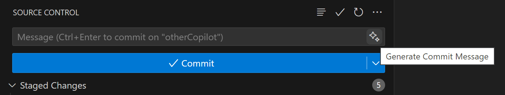
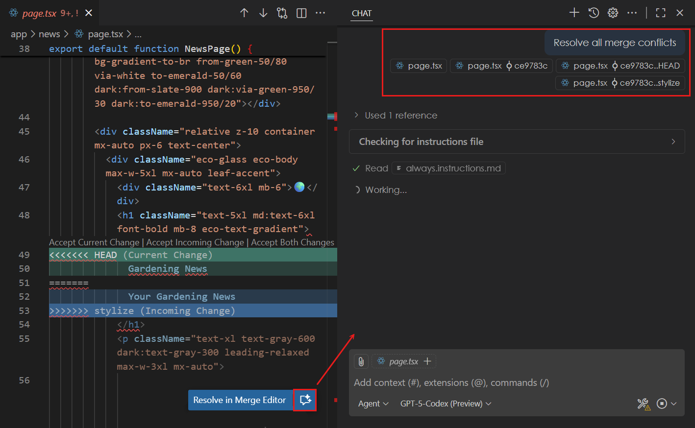
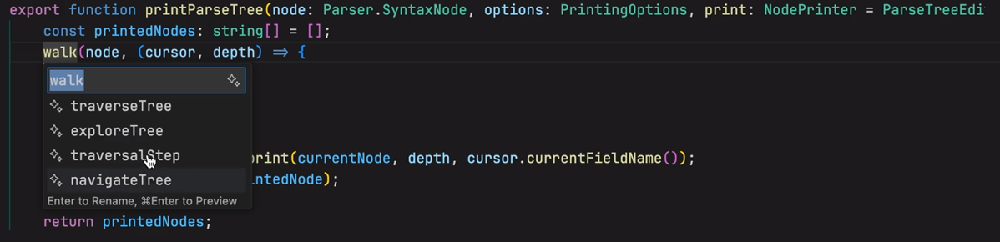
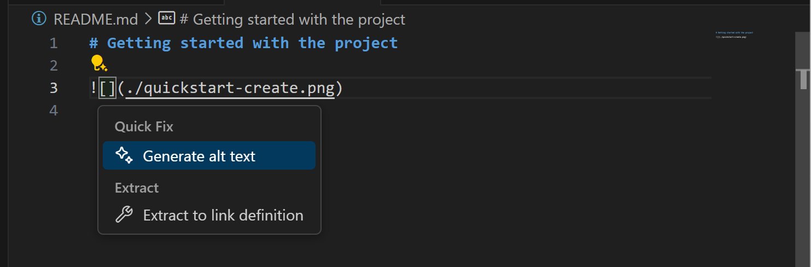
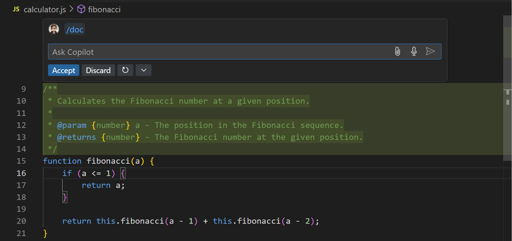
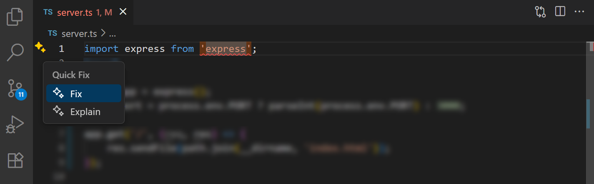
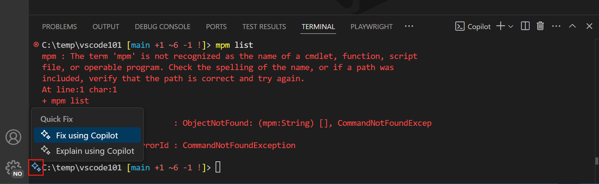
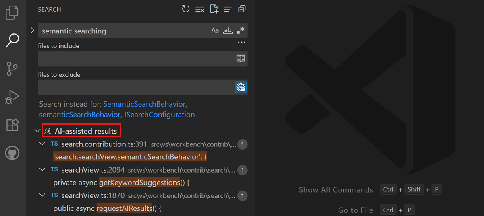
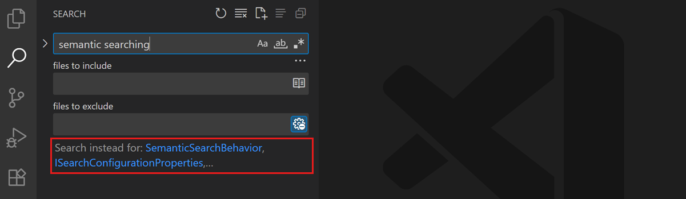
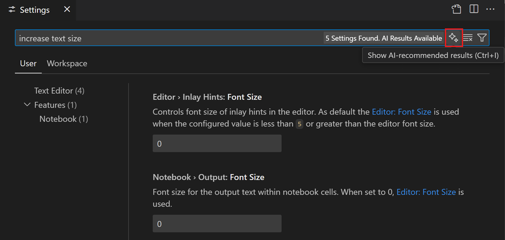

+++
title = "3.2.4 AI 智能操作"
date = 2026-11-06T07:53:25+08:00
weight = 4
type = "docs"
description = ""
isCJKLanguage = true
draft = false
+++

> 原文链接: [https://code.visualstudio.com/docs/editing/copilot-smart-actions](https://code.visualstudio.com/docs/editing/copilot-smart-actions)

# 3.2.4 AI 智能操作

　　对于多种常见场景，可以使用*智能操作*从 AI 获得帮助，而无需编写提示词。示例包括生成提交消息、生成文档、解释或修复代码以及执行代码审查。这些智能操作遍布 VS Code UI。

## 生成提交消息和 PR 信息 {#generate-a-commit-message-and-pr-information}

　　根据代码更改帮助生成提交消息以及拉取请求（PR）标题和描述。使用源代码管理视图或 GitHub PR 扩展中的*闪光*图标生成总结更改的标题和描述。

## 使用 AI 解决合并冲突（实验性） {#resolve-merge-conflicts-with-ai-experimental}

　　使用 AI 帮助解决 Git 合并冲突。在编辑器中选择 **使用 AI 解决合并冲突** 按钮，打开聊天视图并启动智能体流程帮助解决合并冲突。合并基线和每个分支的更改会作为 AI 上下文提供。

## 重命名符号 {#rename-symbols}

　　重命名代码中的符号时，根据符号上下文和代码库获得 AI 生成的新名称建议。

## 为 Markdown 图像生成替代文本 {#generate-alt-text-for-images-in-markdown}

　　使用 AI 为 Markdown 文件中的图像生成或更新替代文本。生成替代文本：

1. 打开 Markdown 文件。
2. 将光标放在图像链接上。
3. 选择代码操作（灯泡）图标，选择 **生成替代文本**。

    

4. 已有替代文本时，选择代码操作，然后选择 **优化替代文本**。

## 生成文档 {#generate-documentation}

使用 AI 为多种语言生成代码文档。

1. 打开应用程序代码文件。
2. 可选：选择要生成文档的代码。
3. 右键单击并选择 **生成代码** > **生成文档**。

    

## 生成测试 {#generate-tests}

　　无需编写提示词即可为应用程序代码生成测试，可以使用编辑器智能操作。

1. 打开应用程序代码文件。
2. 可选：选择要测试的代码。
3. 右键单击并选择 **生成代码** > **生成测试**。

    VS Code 会在现有测试文件中生成测试代码，如果不存在则创建新测试文件。

4. 可选：在内联聊天提示词中提供额外上下文来完善生成的测试。

## 解释代码 {#explain-code}

获取编辑器中代码块的解释。

1. 打开应用程序代码文件。
2. 选择要修复的代码。
3. 右键单击并选择 **解释**。

    VS Code 会提供所选代码块的解释。

## 修复编码错误 {#fix-coding-errors}

　　无需编写提示词即可修复应用程序代码问题，可以使用编辑器智能操作。

1. 打开应用程序代码文件。
2. 选择要修复的代码。
3. 右键单击并选择 **生成代码** > **修复**。

    VS Code 会提供修复代码的建议。

4. 可选：在聊天提示词中提供额外上下文来完善生成的代码。

　　或者，代码文件存在编译或 lint 问题时，VS Code 会在编辑器中显示代码操作帮助解决问题。

## 修复测试错误 {#fix-testing-errors}

　　直接从测试资源管理器获取修复代码库中失败测试的帮助。

1. 在测试资源管理器中悬停失败的测试。
2. 选择 **修复测试失败** 按钮（闪光图标）。
3. 审查并应用 Copilot 建议的修复。

　　或者，打开聊天视图并要求智能体调查失败测试。提供失败输出和预期行为。

> **提示**：使用[智能体](../../../ai-in-vs-code/concepts/2.7.1-Agents/)时，智能体运行测试时监视测试输出，并自动尝试修复和重新运行失败测试。

## 修复终端错误 {#fix-terminal-errors}

　　终端命令运行失败时，VS Code 会在装订线中显示闪光图标，提供快速修复解释发生了什么。

## 审查代码 {#review-code}

　　VS Code 可以帮助审查代码，包括编辑器中的代码块或拉取请求中的所有更改（需要 [GitHub Pull Requests 扩展](https://marketplace.visualstudio.com/items/?itemName=GitHub.vscode-pull-request-github)）。

审查编辑器中的代码块：

1. 打开应用程序代码文件。
2. 选择要修复的代码。
3. 右键单击并选择 **生成代码** > **审查**。

    VS Code 会在 **评论** 面板中创建审查评论，并在编辑器中内联显示。

审查拉取请求中的所有更改：

1. 使用 GitHub Pull Requests 扩展创建拉取请求。
2. 在 **文件更改** 视图中选择 **代码审查** 按钮。

    VS Code 会在 **评论** 面板中创建审查评论，并在编辑器中内联显示。

## 语义搜索结果（预览） {#semantic-search-results-preview}

　　VS Code 搜索视图可以跨文件搜索文本。语义搜索可以找到与查询语义相关的结果，即使文本不完全匹配。查找与概念而非特定术语相关的代码片段或文档，或不知道确切搜索词时特别有用。

　　使用 `search.searchView.semanticSearchBehavior` 设置在搜索视图中配置语义搜索。可以选择自动运行语义搜索，或仅在显式请求时运行。

　　还可以在搜索视图中获得 AI 生成的关键词建议，提供相关替代搜索词。使用 `search.searchView.keywordSuggestions` 设置启用搜索关键词建议。

　　可以从 **添加上下文** 快速选择中选择 **从搜索视图获取结果**，在聊天提示词中引用搜索结果。也可以在聊天提示词中输入 `#searchResults`。

## 使用 AI 搜索设置 {#search-settings-with-ai}

　　不知道要更改的设置确切名称时，可以使用 AI 根据搜索查询帮助找到相关设置。例如搜索“increase text size”找到控制编辑器字号的设置。

　　使用 `workbench.settings.showAISearchToggle` 设置启用此功能。在设置编辑器中，可以使用 **使用 AI 搜索设置** 按钮打开或关闭 AI 搜索结果。

## 相关资源 {#related-resources}

* [Copilot 快速入门](../../../ai-in-vs-code/getting-started/2.1.3-AgentsQuickstart/)
