+++
title = "3.2.5 代码导航"
date = 2026-11-06T07:53:25+08:00
weight = 5
type = "docs"
description = ""
isCJKLanguage = true
draft = false
+++


> 原文链接: [https://code.visualstudio.com/docs/editing/editingevolved](https://code.visualstudio.com/docs/editing/editingevolved)

# 3.2.5 代码导航

　　VS Code 拥有高效代码编辑器，结合编程语言服务后，可以提供 IDE 的能力和文本编辑器的速度。本主题先介绍 VS Code 的语言智能功能（建议、参数提示、智能代码导航），然后展示核心文本编辑器的能力。

## 快速文件导航 {#quick-file-navigation}

> **提示**：输入 `Ctrl + P`（macOS：`Cmd + P`）（**快速打开**）即可按名称打开任何文件。

资源管理器适合在探索项目时导航文件。但处理任务时，你会发现自己在一组相同文件之间快速跳转。VS Code 提供两个强大命令，通过易用快捷键在文件内和跨文件导航。

按住 `Ctrl` 并按 `Tab` 查看编辑器组中打开的所有文件。再次按 `Tab` 选择要导航到的文件，然后释放 `Ctrl` 打开。

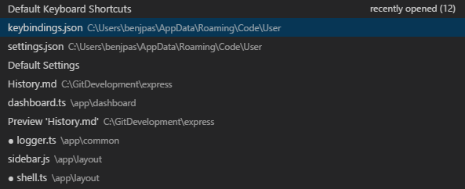

也可以使用 `Alt + ←`（macOS：`Ctrl + -`） 和 `Alt + →`（macOS：`Ctrl + Shift + -`） 在文件和编辑位置之间导航。如果在同一文件的不同行之间跳转，这些快捷键可以轻松导航到那些位置。

## 面包屑 {#breadcrumbs}

　　编辑器内容上方有导航栏，称为[面包屑](https://en.wikipedia.org/wiki/Breadcrumb_(navigation))。它显示当前位置，并允许在文件夹、文件和符号之间快速导航。

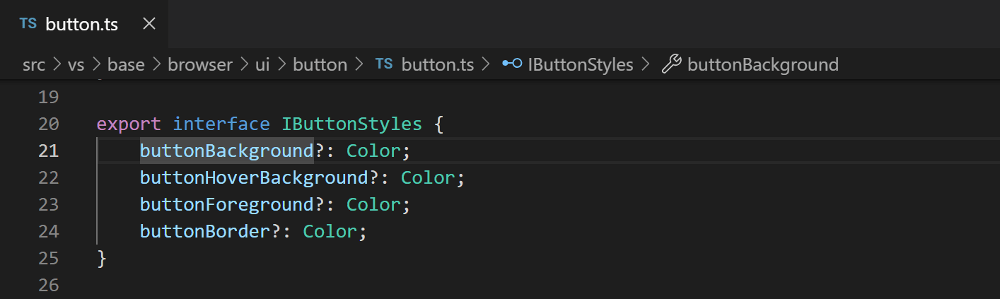

　　面包屑始终显示文件路径，并借助语言扩展显示到光标位置的符号路径。显示的符号与大纲视图和转到符号相同。

选择路径中的面包屑会显示该级别同级项的下拉列表，可以快速导航到其他文件夹和文件。

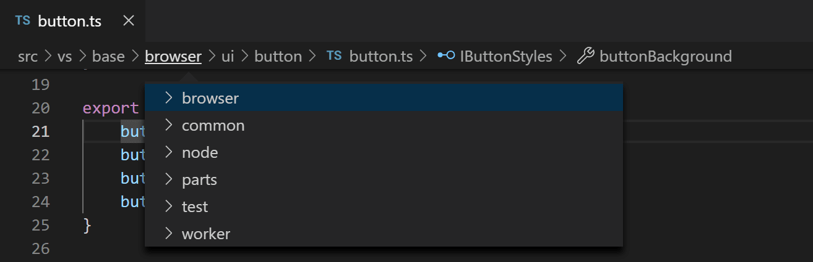

　　如果当前文件类型支持符号语言服务，会看到当前符号路径以及同级和下级其他符号的下拉列表。

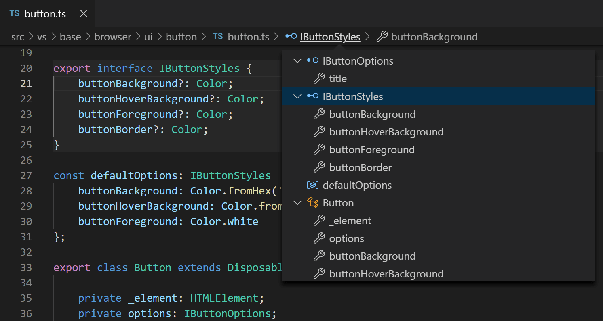

　　可以通过 **视图** > **显示面包屑** 切换或 `breadcrumbs.enabled` [设置](../../3.3-ConfigureTheEditor/3.3.4-Settings/)关闭面包屑。

### 面包屑自定义 {#breadcrumb-customization}

　　可以自定义面包屑外观。如果路径很长，或只关心文件路径或符号路径，请使用 `breadcrumbs.filePath` 和 `breadcrumbs.symbolPath` 设置。两者都支持 `on`、`off` 和 `last`，定义是否或显示路径的哪部分。默认情况下，面包屑左侧显示文件和符号图标，可以将 `breadcrumbs.icons` 设置为 `false` 移除图标。

### 面包屑中的符号顺序 {#symbol-order-in-breadcrumbs}

　　可以使用 `breadcrumbs.symbolSortOrder` 设置控制面包屑下拉列表中符号的排序。

允许的值：

* `position` - 文件中的位置（默认）
* `name` - 字母顺序
* `type` - 符号类型顺序

### 复制面包屑路径 {#breadcrumb-path-copying}

　　可以右键单击编辑器选项卡，选择 **复制面包屑路径**，复制完整面包屑路径。这会将包括文件和符号名称的完整路径复制到剪贴板。

　　可以使用 `breadcrumbs.symbolPathSeparator` 设置配置符号路径分隔符。默认值为 `.`。

### 面包屑键盘导航 {#breadcrumb-keyboard-navigation}

　　要与面包屑交互，请使用 **聚焦面包屑** 命令或按 `Ctrl + Shift + .`（macOS：`Cmd + Shift + .`）。它会选择最后一个元素并打开下拉列表，可以导航到同级文件或符号。使用 `Ctrl + Shift + ;`（macOS：`Cmd + Shift + ;`） 和 `Ctrl + Shift + '` 快捷键转到当前元素之前或之后。下拉列表出现后开始输入——所有匹配元素会高亮，最佳匹配会被选中以便快速导航。

　　也可以不使用下拉列表与面包屑交互。按 `Ctrl + Shift + .`（macOS：`Cmd + Shift + .`） 聚焦最后一个元素，使用 `Ctrl + Shift + ;`（macOS：`Cmd + Shift + ;`） 和 `Ctrl + Shift + '` 导航，使用 `Ctrl + Shift + Enter` 在编辑器中显示该元素。

## 转到定义 {#go-to-definition}

　　如果[语言](../../../languages-and-runtimes/10.1-Overview/)支持，可以按 `F12` 转到符号定义。

　　按住 `Ctrl` 并将鼠标悬停在符号上，会显示声明预览：

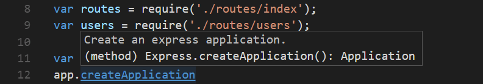

> **提示**：可以使用 `Ctrl + 单击` 跳转到定义，或使用 `Ctrl + Alt + 单击` 在侧边打开定义。

## 转到类型定义 {#go-to-type-definition}

　　某些[语言](../../../languages-and-runtimes/10.1-Overview/)还支持从编辑器上下文菜单或**命令面板**运行 **转到类型定义** 命令。这会转到符号类型的定义。命令 `editor.action.goToTypeDefinition` 默认未绑定快捷键，但可以添加自定义[键绑定](../../3.3-ConfigureTheEditor/3.3.3-KeyboardShortcuts/)。

## 转到实现 {#go-to-implementation}

　　[语言](../../../languages-and-runtimes/10.1-Overview/)还可以支持按 `Ctrl + F12`（macOS：`Cmd + F12`） 转到符号实现。对于接口，会显示该接口的所有实现者；对于抽象方法，会显示该方法的所有具体实现。

## 转到符号 {#go-to-symbol}

　　可以使用 `Ctrl + Shift + O`（macOS：`Cmd + Shift + O`） 在文件内导航符号。输入 `:` 会按类别分组符号。按 `↑` 或 `↓` 导航到目标位置。

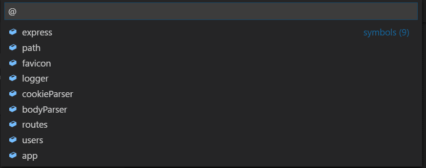

## 按名称打开符号 {#open-symbol-by-name}

　　某些语言支持使用 `Ctrl + T`（macOS：`Cmd + T`） 跨文件跳转到符号。输入目标类型的首字母，无论它位于哪个文件，然后按 `Enter`。

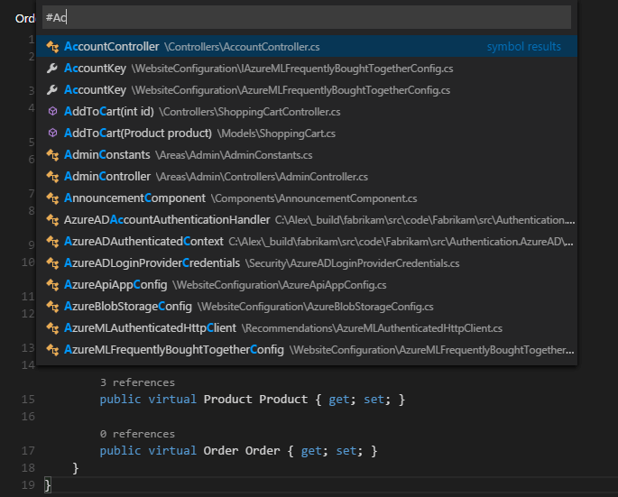

## 速览 {#peek}

　　当你只想快速检查内容时，最大的困扰莫过于上下文切换。因此我们支持速览编辑器。执行 **转到引用** 搜索（`Shift + F12`）或 **速览定义**（`Alt + F12`，macOS：`Option + F12`）时，结果会内联嵌入：

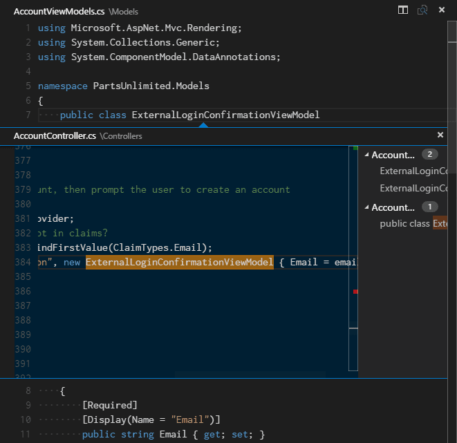

　　可以在速览编辑器的不同引用之间导航，并直接进行快速编辑。单击速览编辑器文件名或双击结果列表，会在外部编辑器中打开引用。

> **提示**：按 `Escape` 或双击速览编辑器区域会关闭速览窗口。可以使用 `editor.stablePeek` [设置](../../3.3-ConfigureTheEditor/3.3.4-Settings/)禁用此行为。

## 括号匹配 {#bracket-matching}

　　光标靠近括号时，匹配括号会高亮。

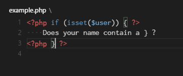

> **提示**：可以使用 `Ctrl + Shift + \`（macOS：`Cmd + Shift + \`） 跳转到匹配括号。

### 括号对着色 {#bracket-pair-colorization}

　　将 `editor.bracketPairColorization.enabled` 设置为 `true` 也可以为匹配括号对着色。

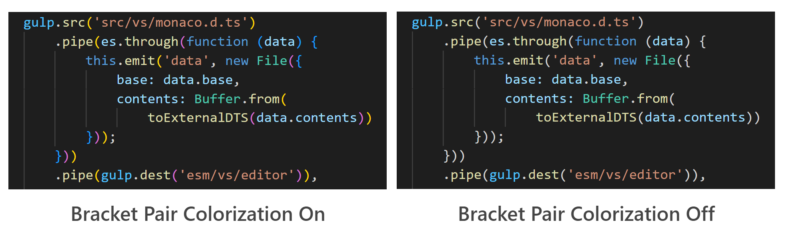

　　所有颜色都可主题化，最多可配置六种颜色。

可以在设置中使用 `workbench.colorCustomizations` 覆盖主题提供的颜色：

```json
"workbench.colorCustomizations": {
    "editorBracketHighlight.foreground1": "#FFD700",
    "editorBracketHighlight.foreground2": "#DA70D6",
    "editorBracketHighlight.foreground3": "#179fff",
},
```

## 引用信息 {#reference-information}

　　C# 等语言支持实时更新的内联引用信息。这让你可以快速分析编辑影响，或方法/属性在项目中的使用程度：

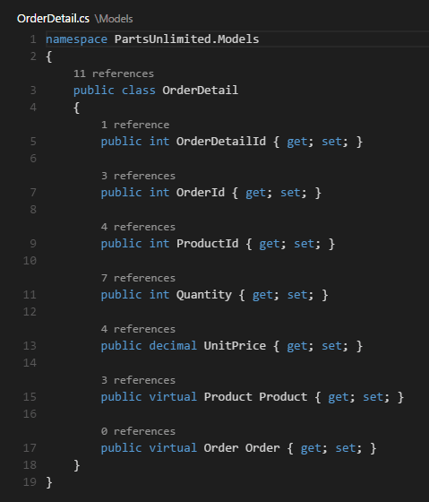

> **提示**：单击这些注释可直接调用 **速览引用** 操作。

> **提示**：可以通过 `editor.codeLens` [设置](../../3.3-ConfigureTheEditor/3.3.4-Settings/)打开或关闭 CodeLens 中的引用信息。

## 重命名符号 {#rename-symbol}

　　某些语言支持跨文件重命名符号。按 `F2`，输入新名称并按 `Enter`。符号的所有用法都会跨文件重命名。

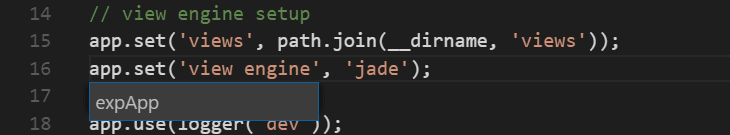

## 错误和警告 {#errors--warnings}

　　警告或错误可以由[配置的任务](../../../debugging-and-testing/6.3-Tasks/)、丰富语言服务或后台持续分析代码的 linter 生成。由于我们喜欢无错误代码，警告和错误会显示在多个位置：

* 状态栏显示所有错误和警告数量的摘要。
* 可以单击摘要或按 `Ctrl + Shift + M`（macOS：`Cmd + Shift + M`） 显示 **问题** 面板，列出当前所有错误。
* 打开有错误或警告的文件时，它们会内联渲染在文本中，并显示在概览标尺中。

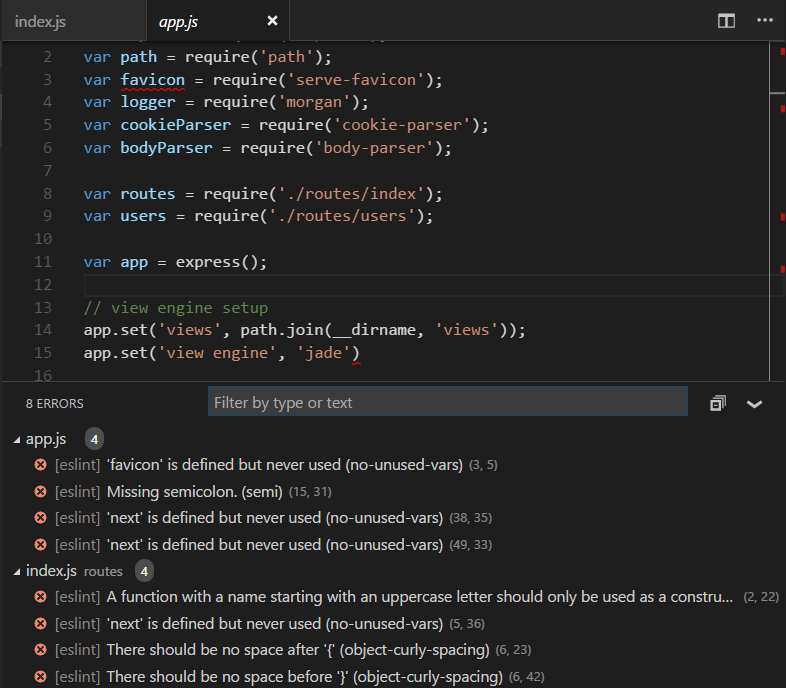

> **提示**：要在当前文件中循环浏览错误或警告，请按 `F8` 或 `Shift + F8`，会显示内联区域，详细说明问题及可能的代码操作（如果可用）：

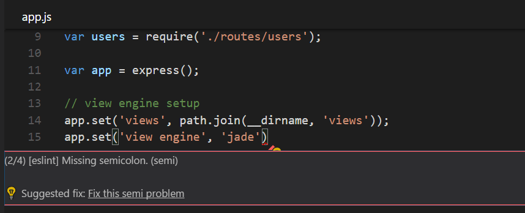

## 代码操作 {#code-action}

　　警告和错误可以提供代码操作（也称为快速修复）来帮助解决问题。它们会在编辑器左边距显示为灯泡。单击灯泡会显示代码操作选项或执行操作。

## 内联提示 {#inlay-hints}

　　某些语言提供内联提示：即内联渲染的源代码附加信息。通常用于显示推断类型。以下示例显示 JavaScript 变量和函数返回类型的推断类型内联提示。

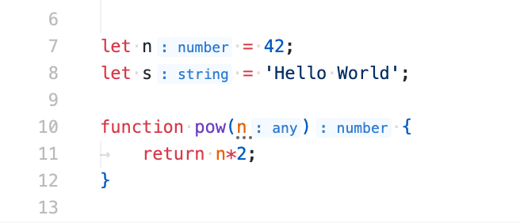

　　可以使用 `editor.inlayHints.enabled` 设置启用/禁用内联提示，默认启用。需要 TypeScript 或 Rust 等扩展提供实际内联提示信息。

## 出站链接保护 {#outgoing-link-protection}

　　为了保护你，VS Code 在从编辑器打开外部网站链接前会显示提示。

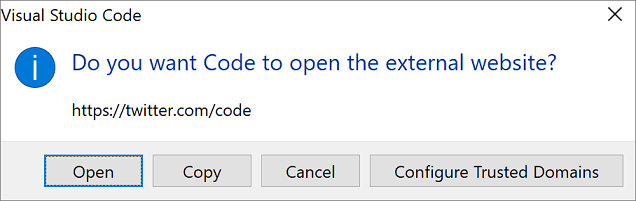

　　可以在浏览器中继续访问外部网站，或复制链接、取消请求。如果选择 **配置受信任域**，下拉列表允许信任确切 URL、信任 URL 域和子域，或信任所有域以禁用出站链接保护。

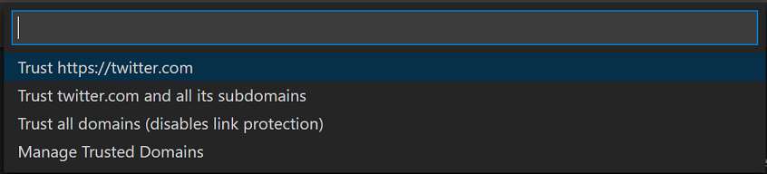

　　**管理受信任域** 选项也可随时从命令面板使用，会打开 **受信任域** JSON 文件，可以在其中添加、删除或修改受信任域。

```jsonc
// You can use the "Manage Trusted Domains" command to open this file.
// Save this file to apply the trusted domains rules.
[
  "*.twitter.com"
]
```

　　**受信任域** JSON 文件还包含支持域名格式示例的注释，以及默认受信任域列表，例如 `https://*.visualstudio.com` 和 `https://*.microsoft.com`。

## 后续步骤 {#next-steps}

现在你已了解编辑器如何工作，可以尝试其他功能……

* [代码编辑入门视频](https://code.visualstudio.com/docs/introvideos/codeediting)
* [用户界面](../../3.1-GettingStarted/3.1.2-UserInterface/)
* [键绑定](../../3.3-ConfigureTheEditor/3.3.3-KeyboardShortcuts/)
* [调试](../../../debugging-and-testing/6.1-Debugging/)

## 常见问题 {#common-questions}

### 如何自动选择快速打开中的第二项而不是第一项？ {#how-can-i-automatically-select-the-second-entry-in-quick-open-instead-of-the-first}

　　使用 `workbench.action.quickOpenPreviousEditor` 命令，可以让快速打开自动选择第二项。如果希望不必调用另一个快捷键就选择列表中的上一项，这会很有用：

```json
[
    {
        "key": "ctrl+p",
        "command": "workbench.action.quickOpenPreviousEditor"
    },
    {
        "key": "ctrl+p",
        "command": "-workbench.action.quickOpen"
    }
]
```

### 如何配置 Ctrl+Tab 在所有组的所有编辑器之间导航 {#how-can-i-configure-ctrltab-to-navigate-across-all-editors-of-all-groups}

　　默认情况下，`Ctrl + Tab` 在同一编辑器组的编辑器之间导航。如果希望在所有组的所有打开编辑器之间导航，可以为 `workbench.action.quickOpenPreviousRecentlyUsedEditor` 和 `workbench.action.quickOpenLeastRecentlyUsedEditor` 命令创建键盘快捷键：

```json
[
    {
        "key": "ctrl+tab",
        "command": "workbench.action.quickOpenPreviousRecentlyUsedEditor",
        "when": "!inEditorsPicker"
    },
    {
        "key": "ctrl+shift+tab",
        "command": "workbench.action.quickOpenLeastRecentlyUsedEditor",
        "when": "!inEditorsPicker"
    }
]
```

### 如何在不打开选择器的情况下在最近使用的编辑器之间导航 {#how-can-i-navigate-between-recently-used-editors-without-a-picker}

以下命令可以在不打开选择器的情况下导航编辑器：

键|命令|命令 ID
---|-------|----------
`Ctrl + Tab`|打开下一个最近使用的编辑器|`workbench.action.openNextRecentlyUsedEditor`
`Ctrl + Shift + Tab`|打开上一个最近使用的编辑器|`workbench.action.openPreviousRecentlyUsedEditor`
`Ctrl + K Ctrl + Tab`|打开组中下一个最近使用的编辑器|`workbench.action.openNextRecentlyUsedEditorInGroup`
`Ctrl + K Ctrl + Shift + Tab`|打开组中上一个最近使用的编辑器|`workbench.action.openPreviousRecentlyUsedEditorInGroup`
