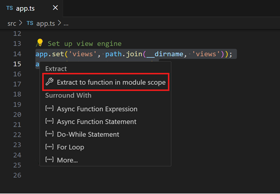
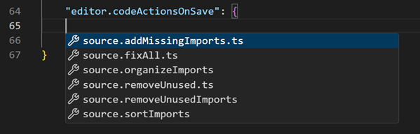
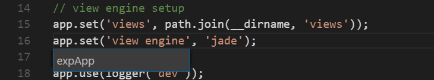
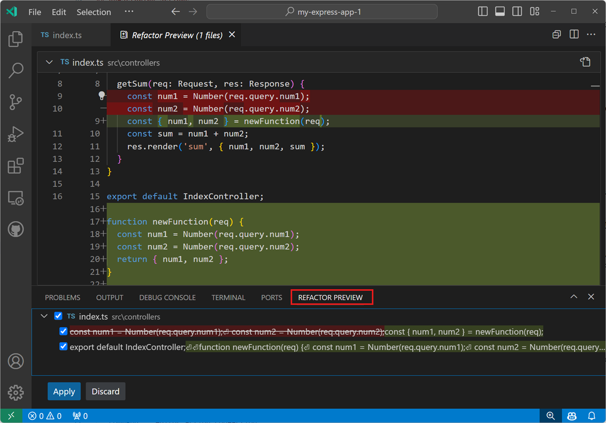
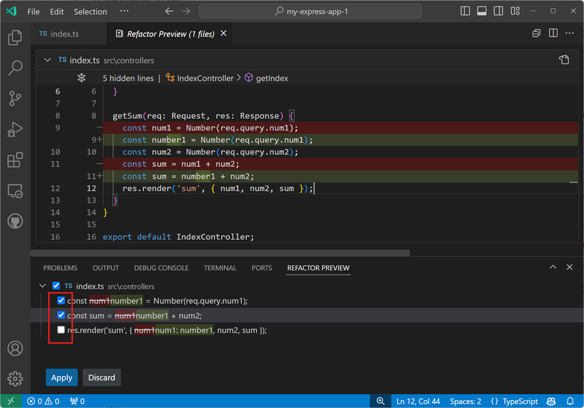
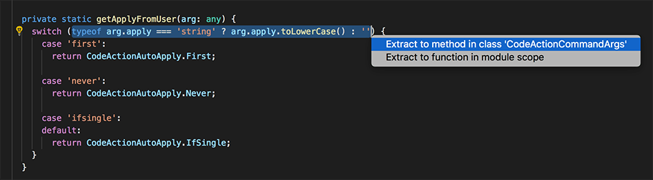

+++
title = "3.2.6 重构"
date = 2026-11-06T07:53:25+08:00
weight = 6
type = "docs"
description = ""
isCJKLanguage = true
draft = false
+++


> 原文链接: [https://code.visualstudio.com/docs/editing/refactoring](https://code.visualstudio.com/docs/editing/refactoring)

# 3.2.6 重构

　　[源代码重构](https://en.wikipedia.org/wiki/Code_refactoring)可以在不改变运行时行为的情况下重构代码，从而提高项目质量和可维护性。VS Code 支持[提取方法](https://refactoring.com/catalog/extractMethod.html)和[提取变量](https://refactoring.com/catalog/extractVariable.html)等重构操作。



　　重构由语言服务提供。VS Code 通过 [TypeScript](https://www.typescriptlang.org/)语言服务内置支持 TypeScript 和 JavaScript 重构。其他编程语言的重构支持通过贡献语言服务的 [3.3.6.2 扩展市场](../../3.3-ConfigureTheEditor/3.3.6-Extensions/3.3.6.2-ExtensionMarketplace/)启用。不同语言的重构 UI 和命令相同。

## 代码操作 = 快速修复和重构 {#code-actions-quick-fixes-and-refactorings}

　　在 VS Code 中，代码操作可以提供重构和检测到问题（红色波浪线）的快速修复。当光标位于波浪线上或选定文本区域时，编辑器会显示灯泡图标，表示有可用的代码操作。选择灯泡或使用 **快速修复** 命令（`Ctrl + .`，macOS：`Cmd + .`）会显示快速修复和重构控件。

　　如果只想查看重构而不显示快速修复，请使用 **重构** 命令（`Ctrl + Shift + R`）。

> **注意**：可以使用 `editor.lightbulb.enable` 设置完全禁用编辑器中的代码操作灯泡。仍可通过 **快速修复** 命令和快捷键打开快速修复。

### 保存时的代码操作 {#code-actions-on-save}

　　使用 `editor.codeActionsOnSave` 设置可以配置保存文件时自动应用的代码操作，例如组织导入。IntelliSense 会根据工作区文件和活动扩展提供可用代码操作列表。



　　可以配置一个或多个代码操作，它们会按列出顺序运行。示例：

```json
// 显式保存时运行 sortImports 源代码操作。自动保存（窗口或焦点变化）时运行 organizeImports 源代码操作。
"editor.codeActionsOnSave": {
    "source.organizeImports": "always",
    "source.sortImports": "explicit",
},
```

　　每个代码操作支持的值：`explicit`（默认，显式保存时触发）、`always`（显式保存以及窗口或焦点变化自动保存时触发）或 `never`（从不在保存时触发）。

> **注意**：`true` 和 `false` 目前仍然有效，但将被弃用，建议使用 `explicit`、`always` 和 `never`。

## 重构操作 {#refactoring-actions}

### 提取方法 {#extract-method}

　　选择要提取的源代码，然后选择边距中的灯泡或按 `Ctrl + .`（macOS：`Cmd + .`） 查看可用重构。可以将代码片段提取到不同作用域的新方法或新函数中，重构期间会提示提供有意义的名称。

### 提取变量 {#extract-variable}

　　TypeScript 语言服务提供 **提取为常量** 重构，为当前选定的表达式创建新的局部变量。处理类时，还可以将值提取为新属性。

### 重命名符号 {#rename-symbol}

　　重命名是与源代码重构相关的常见操作，VS Code 有单独的 **重命名符号** 命令（`F2`）。某些语言支持跨文件重命名符号。按 `F2`，输入新名称并按 `Enter`，所有文件中的符号实例都会被重命名。



## 重构预览 {#refactor-preview}

　　应用重构时，更改会直接应用到代码。在 **重构预览** 面板中，可以预览重构操作将应用的更改。打开代码操作控件，将鼠标悬停在重构上，然后按 `Ctrl + Enter`（macOS：`Cmd + Enter`） 打开预览。

　　可以选择 **重构预览** 面板中的任何更改，以获取该重构操作结果的差异视图。



　　使用 **接受** 或 **放弃** 控件应用或取消建议的重构更改。也可以通过取消选择部分建议更改，部分应用重构。



## 代码操作的键盘快捷键 {#keyboard-shortcuts-for-code-actions}

　　`editor.action.codeAction` 命令可以为特定代码操作配置快捷键。例如，以下快捷键触发 **提取函数** 重构代码操作：

```json
{
  "key": "ctrl+shift+r ctrl+e",
  "command": "editor.action.codeAction",
  "args": {
    "kind": "refactor.extract.function"
  }
}
```

　　代码操作类型由扩展使用增强的 `CodeActionProvider` API 指定，类型是分层的：`"kind": "refactor"` 显示所有重构代码操作，而 `"kind": "refactor.extract.function"` 只显示 **提取函数** 重构。

　　如果只有一个 `refactor.extract.function` 代码操作可用，会自动应用；如果有多个，VS Code 会显示上下文菜单供选择。



　　可以使用 `apply` 参数控制代码操作的自动应用方式：

```json
{
  "key": "ctrl+shift+r ctrl+e",
  "command": "editor.action.codeAction",
  "args": {
    "kind": "refactor.extract.function",
    "apply": "first"
  }
}
```

　　`apply` 的有效值：`first`（始终自动应用第一个可用代码操作）、`ifSingle`（默认，仅一个可用时自动应用，否则显示菜单）或 `never`（始终显示菜单）。

　　当代码操作快捷键配置了 `"preferred": true` 时，只显示首选的快速修复和重构。首选快速修复解决底层错误，首选重构是最常见的重构选择。例如：

```json
{
  "key": "shift+ctrl+e",
  "command": "editor.action.codeAction",
  "args": {
    "kind": "refactor.extract.constant",
    "preferred": true,
    "apply": "ifSingle"
  }
}
```

　　此快捷键始终尝试将选定源代码提取为局部作用域中的常量。

## 支持重构的扩展 {#extensions-with-refactorings}

　　可以在 VS Code [Marketplace](https://marketplace.visualstudio.com/vscode) 中查找支持重构的扩展。转到扩展视图（`Ctrl + Shift + X`，macOS：`Cmd + Shift + X`），在搜索框中输入 `refactor`，然后按安装量或评分排序。

> **提示**：显示的扩展是动态查询的。选择扩展磁贴可阅读说明和评论，以确定最适合你的扩展。

## 后续步骤 {#next-steps}

* [3.2.5 代码导航](../3.2.5-CodeNavigation/)：在源代码中快速移动。
* [6.1 调试代码](../../../debugging-and-testing/6.1-Debugging/)：了解如何使用 VS Code 调试。
* [代码编辑入门视频](https://code.visualstudio.com/docs/introvideos/codeediting)。

## 常见问题 {#common-questions}

### 代码有错误时为什么看不到灯泡？ {#why-dont-i-see-any-light-bulbs-when-there-are-errors-in-my-code}

　　灯泡（代码操作）仅在光标位于显示错误的文本上时出现。将鼠标悬停在文本上会显示错误说明，但需要移动光标或选择文本才能看到快速修复和重构的灯泡。
