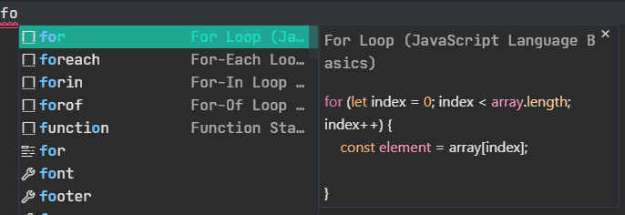
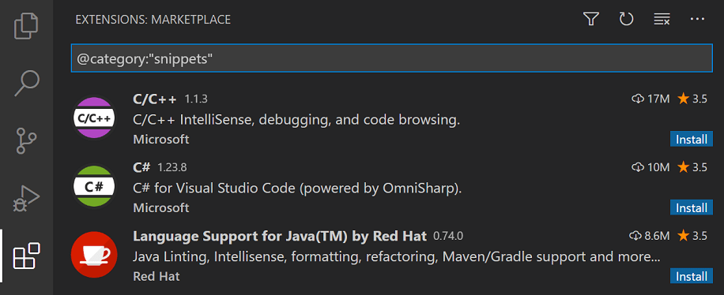
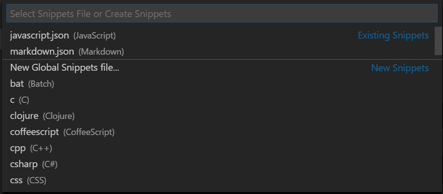
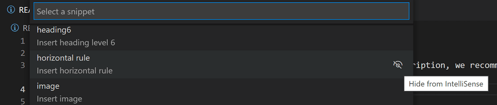

+++
title = "3.2.7 代码片段"
date = 2026-11-06T07:53:25+08:00
weight = 7
type = "docs"
description = ""
isCJKLanguage = true
draft = false
+++


> 原文链接: [https://code.visualstudio.com/docs/editing/userdefinedsnippets](https://code.visualstudio.com/docs/editing/userdefinedsnippets)

# 3.2.7 代码片段

　　代码片段是可复用代码模板，便于输入循环或条件语句等重复代码模式。

　　在 VS Code 中，代码片段会与 IntelliSense（`Ctrl + Space`）的其他建议一起出现，也会出现在专用代码片段选择器（命令面板中的 **插入代码片段**）中。还支持 Tab 补全：通过 `"editor.tabCompletion": "on"` 启用，输入**代码片段前缀**（触发文本），按 `Tab` 插入。

　　代码片段语法遵循 [TextMate 代码片段语法](https://manual.macromates.com/en/snippets)，但不支持“插值 shell 代码”和 `\u`。

<video src="https://code.visualstudio.com/assets/docs/editing/userdefinedsnippets/ajax-snippet.mp4" title="Ajax 代码片段演示。" autoplay loop controls muted></video>

## 内置代码片段 {#built-in-snippets}

　　VS Code 为 JavaScript、TypeScript、Markdown 和 PHP 等语言提供内置代码片段。



　　可以在命令面板运行 **插入代码片段** 命令，查看当前文件语言的代码片段列表。但请注意，该列表还包括你定义的用户代码片段以及已安装扩展提供的代码片段。

## 从 Marketplace 安装代码片段 {#install-snippets-from-the-marketplace}

　　[Visual Studio Marketplace](https://marketplace.visualstudio.com/vscode) 上的许多[扩展](../../3.3-ConfigureTheEditor/3.3.6-Extensions/3.3.6.2-ExtensionMarketplace/)包含代码片段。可以在扩展视图（`Ctrl + Shift + X`）中使用 `@category:"snippets"` 筛选器搜索包含代码片段的扩展。



　　找到要使用的扩展后，安装并重启 VS Code，新代码片段即可使用。

## 创建自己的代码片段 {#create-your-own-snippets}

　　无需任何扩展即可轻松定义自己的代码片段。要创建或编辑代码片段，请在 **文件** > **首选项** 下选择 **配置代码片段**，然后选择代码片段应出现的语言（按[语言标识符](https://code.visualstudio.com/docs/languages/identifiers)），或选择 **新建全局代码片段文件** 使其适用于所有语言。VS Code 会管理底层代码片段文件的创建和刷新。



　　代码片段文件使用 JSON 编写，支持 C 风格注释，可以定义无限数量的代码片段。代码片段支持大多数 TextMate 动态行为语法，会根据插入上下文智能格式化空白，并允许轻松多行编辑。

以下是 JavaScript `for` 循环代码片段示例：

```json
// in file 'Code/User/snippets/javascript.json'
{
    "For Loop": {
        "prefix": [
          "for",
          "for-const"
        ],
        "body": [
          "for (const ${2:element} of ${1:array}) {",
          "\t$0",
          "}"
        ],
        "description": "A for loop."
    }
}
```

在上例中：

* “For Loop”是代码片段名称。如果没有提供 `description`，会在 IntelliSense 中显示。
* `prefix` 定义一个或多个在 IntelliSense 中显示代码片段的触发词。前缀会进行子字符串匹配，因此“fc”可以匹配“for-const”。
* `body` 是一行或多行内容，插入时会合并为多行。换行和嵌入制表符会根据插入上下文格式化。
* `description` 是 IntelliSense 显示的可选代码片段说明。

　　此外，上述示例的 `body` 有三个占位符（按遍历顺序）：`${1:array}`、`${2:element}` 和 `$0`。可以使用 `Tab` 快速跳到下一个占位符，此时可以编辑占位符或跳到下一个。冒号 `:` 后的字符串（如果有）是默认文本，例如 `${2:element}` 中的 `element`。占位符遍历按数字升序从 1 开始；零是可选特殊情况，始终最后出现，并在指定位置退出代码片段模式。

### 文件模板代码片段 {#file-template-snippets}

　　如果代码片段旨在填充或替换文件内容，可以在代码片段定义中添加 `isFileTemplate` 属性。在新文件或现有文件中运行 **Snippets: Fill File with Snippet** 命令时，文件模板代码片段会显示在下拉列表中。

## 代码片段作用域 {#snippet-scope}

　　代码片段有作用域，只建议相关代码片段。代码片段可以通过以下方式限定作用域：

1. 代码片段适用的**语言**（可能是所有语言）
2. 代码片段适用的**项目**（可能是所有项目）

### 语言代码片段作用域 {#language-snippet-scope}

每个代码片段根据定义位置限定为一个、多个或所有（“全局”）语言：

1. **语言**代码片段文件
2. **全局**代码片段文件

单语言用户代码片段定义在特定语言代码片段文件中（例如 `javascript.json`），可以通过 **Snippets: Configure Snippets** 按语言标识符访问。代码片段仅在编辑其定义语言时可访问。

多语言和全局用户代码片段都定义在“全局”代码片段文件中（`.code-snippets` 后缀 JSON），也可以通过 **Snippets: Configure Snippets** 访问。全局代码片段文件中，代码片段定义可以额外有 `scope` 属性，接受一个或多个[语言标识符](https://code.visualstudio.com/docs/languages/identifiers)，使代码片段仅对指定语言可用。没有 `scope` 属性时，全局代码片段在**所有**语言中可用。

大多数用户代码片段限定为单一语言，因此定义在语言特定代码片段文件中。

### 项目代码片段作用域 {#project-snippet-scope}

　　也可以有作用于项目的全局代码片段文件（`.code-snippets` 后缀 JSON）。项目文件夹代码片段通过 **Snippets: Configure Snippets** 下拉菜单中的 **New Snippets file for '\<folder-name\>'...** 选项创建，位于项目根目录的 `.vscode` 文件夹。项目代码片段文件适合与项目所有用户共享代码片段。项目文件夹代码片段与全局代码片段类似，可以通过 `scope` 属性限定为特定语言。

### 文件模式作用域 {#file-pattern-scope}

　　可以使用可选 `include` 和 `exclude` 属性指定文件模式，进一步控制代码片段出现时机。这些属性适用于语言特定和全局代码片段文件，并可以与 `scope` 属性组合，更精确控制代码片段建议。

* `include` - 一个 glob 模式或 glob 模式数组，指定代码片段应出现在哪些文件中。
* `exclude` - 一个 glob 模式或 glob 模式数组，指定代码片段不应出现在哪些文件中。

模式匹配如下：

* **仅文件名模式**（例如 `*.test.ts`）根据文件名匹配，与文件在项目中的位置无关。
* **基于路径的模式**（例如 `**/*.test.ts` 或 `**/dist/**`）匹配完整文件路径。
* 如果文件同时匹配 `include` 和 `exclude` 模式，`exclude` 优先。
* 如果两个属性都未指定，代码片段根据 `scope` 属性出现在所有适用文件中。

**示例：测试代码片段**

此代码片段仅出现在 TypeScript 测试文件中：

```json
{
  "Test Block": {
    "prefix": "test",
    "body": [
      "test('${1:description}', () => {",
      "\t${0}",
      "});"
    ],
    "description": "Insert a test block",
    "scope": "typescript",
    "include": ["**/*.test.ts", "**/*.spec.ts"]
  }
}
```

**示例：排除目录**

此代码片段出现在所有 JavaScript 文件中，但 `dist` 或 `node_modules` 目录中的文件除外：

```json
{
  "Console Log": {
    "prefix": "log",
    "body": "console.log(${0});",
    "description": "Insert console.log",
    "scope": "javascript",
    "exclude": ["**/dist/**", "**/node_modules/**"]
  }
}
```

**示例：配置文件代码片段**

此代码片段仅出现在 `travis.yml` 文件中，使用仅文件名模式：

```json
{
  "Travis CI Node": {
    "prefix": "travis-node",
    "body": [
      "language: node_js",
      "node_js:",
      "  - ${1:18}"
    ],
    "description": "Travis CI Node.js configuration",
    "scope": "yaml",
    "include": ["travis.yml"]
  }
}
```

　　使用 `include` 和 `exclude` 模式可以只在相关位置显示代码片段，减少 IntelliSense 杂乱。

## 代码片段语法 {#snippet-syntax}

　　代码片段的 `body` 可以使用特殊构造控制光标和插入文本。支持以下功能及语法：

### 制表位 {#tabstops}

　　使用制表位可以让编辑器光标在代码片段内移动。使用 `$1`、`$2` 指定光标位置。数字是制表位访问顺序，`$0` 表示最终光标位置。同一制表位的多次出现会链接并同步更新。

### 占位符 {#placeholders}

　　占位符是带值的制表位，例如 `${1:foo}`。占位符文本会被插入并选中，便于轻松更改。占位符可以嵌套，例如 `${1:another ${2:placeholder}}`。

### 选择 {#choice}

　　占位符值可以是选项。语法为用管道字符括起的逗号分隔值枚举，例如 `${1|one,two,three|}`。插入代码片段并选择占位符时，会提示用户选择一个值。

### 变量 {#variables}

　　使用 `$name` 或 `${name:default}` 插入变量值。变量未设置时，插入其**默认值**或空字符串。变量未知（名称未定义）时，插入变量名并转换为占位符。

可以使用以下变量：

* `TM_SELECTED_TEXT` 当前选中文本或空字符串
* `TM_CURRENT_LINE` 当前行内容
* `TM_CURRENT_WORD` 光标下单词内容或空字符串
* `TM_LINE_INDEX` 从零开始的行号
* `TM_LINE_NUMBER` 从 1 开始的行号
* `TM_FILENAME` 当前文档文件名
* `TM_FILENAME_BASE` 当前文档文件名（不含扩展名）
* `TM_DIRECTORY` 当前文档目录
* `TM_FILEPATH` 当前文档完整路径
* `RELATIVE_FILEPATH` 当前文档相对于打开工作区或文件夹的路径
* `CLIPBOARD` 剪贴板内容
* `WORKSPACE_NAME` 打开工作区或文件夹名称
* `WORKSPACE_FOLDER` 打开工作区或文件夹路径
* `CURSOR_INDEX` 从零开始的光标编号
* `CURSOR_NUMBER` 从 1 开始的光标编号

插入当前日期和时间：

* `CURRENT_YEAR` 当前年份
* `CURRENT_YEAR_SHORT` 当前年份后两位
* `CURRENT_MONTH` 两位月份（例如 '02'）
* `CURRENT_MONTH_NAME` 月份完整名称（例如 'July'）
* `CURRENT_MONTH_NAME_SHORT` 月份短名称（例如 'Jul'）
* `CURRENT_DATE` 两位日期（例如 '08'）
* `CURRENT_DAY_NAME` 星期名称（例如 'Monday'）
* `CURRENT_DAY_NAME_SHORT` 星期短名称（例如 'Mon'）
* `CURRENT_HOUR` 24 小时制当前小时
* `CURRENT_MINUTE` 两位当前分钟
* `CURRENT_SECOND` 两位当前秒
* `CURRENT_MILLISECOND` 三位当前毫秒（例如 `078`）
* `CURRENT_SECONDS_UNIX` Unix 纪元以来的秒数
* `CURRENT_MILLISECONDS_UNIX` Unix 纪元以来的毫秒数
* `CURRENT_TIMEZONE_OFFSET` 当前 UTC 时区偏移，格式 `+HH:MM` 或 `-HH:MM`（例如 `-07:00`）
* `CURRENT_TIMEZONE_NAME` 当前时区 IANA 名称（例如 `America/Los_Angeles`）

插入随机值：

* `RANDOM` 6 个随机十进制数字
* `RANDOM_HEX` 6 个随机十六进制数字
* `UUID` 版本 4 UUID

插入遵循当前语言的行或块注释：

* `BLOCK_COMMENT_START` 示例输出：PHP 中 `/*`，HTML 中 `<!--`
* `BLOCK_COMMENT_END` 示例输出：PHP 中 `*/`，HTML 中 `-->`
* `LINE_COMMENT` 示例输出：PHP 中 `//`

以下代码片段在 JavaScript 文件中插入 `/* Hello World */`，在 HTML 文件中插入 `<!-- Hello World -->`：

```json
{
    "hello": {
        "scope": "javascript,html",
        "prefix": "hello",
        "body": "$BLOCK_COMMENT_START Hello World $BLOCK_COMMENT_END"
    }
}
```

### 变量转换 {#variable-transforms}

　　转换允许在插入前修改变量值。转换定义由三部分组成：

1. 与变量值匹配的正则表达式；变量无法解析时匹配空字符串。
2. 允许引用正则匹配组的“格式字符串”，支持条件插入和简单修改。
3. 传递给正则表达式的选项。

以下示例插入当前文件名并去掉结尾，例如 `foo.txt` 变为 `foo`。

```
${TM_FILENAME/(.*)\\..+$/$1/}
  |           |         |  |
  |           |         |  |-> no options
  |           |         |
  |           |         |-> references the contents of the first
  |           |             capture group
  |           |
  |           |-> regex to capture everything before
  |               the final `.suffix`
  |
  |-> resolves to the filename
```

### 占位符转换 {#placeholder-transform}

　　与变量转换类似，占位符转换允许在移动到下一制表位时更改占位符插入文本。插入文本与正则表达式匹配，匹配项（取决于选项）替换为指定替换格式文本。每个占位符可以使用第一个占位符的值独立定义自己的转换。占位符转换格式与变量转换相同。

### 转换示例 {#transform-examples}

　　示例用双引号显示，如同在代码片段正文中，以说明某些字符需要双重转义。示例转换及文件名 `example-123.456-TEST.js` 的结果：

示例 | 输出 | 说明
-------------|--------|------------
`"${TM_FILENAME/[\\.]/_/}"` | `example-123_456-TEST.js` | 将第一个 `.` 替换为 `_`
`"${TM_FILENAME/[\\.-]/_/g}"` | `example_123_456_TEST_js` | 将每个 `.` 或 `-` 替换为 `_`
`"${TM_FILENAME/(.*)/${1:/upcase}/}"` | `EXAMPLE-123.456-TEST.JS` | 全部大写
`"${TM_FILENAME/[^0-9a-z]//gi}"` | `example123456TESTjs` | 移除非字母数字字符

### 语法 {#grammar}

以下是代码片段的 EBNF（[扩展巴科斯范式](https://en.wikipedia.org/wiki/Extended_Backus%E2%80%93Naur_form)）。使用 `\`（反斜杠）转义 `$`、`}` 和 `\`。在选择元素中，反斜杠还转义逗号和管道字符。只能转义需要转义的字符，因此在这些构造中不应转义 `$`，选择构造中也不应转义 `$` 或 `}`。

```
any         ::= tabstop | placeholder | choice | variable | text
tabstop     ::= '$' int
                | '${' int '}'
                | '${' int  transform '}'
placeholder ::= '${' int ':' any '}'
choice      ::= '${' int '|' text (',' text)* '|}'
variable    ::= '$' var | '${' var '}'
                | '${' var ':' any '}'
                | '${' var transform '}'
transform   ::= '/' regex '/' (format | text)+ '/' options
format      ::= '$' int | '${' int '}'
                | '${' int ':' '/upcase' | '/downcase' | '/capitalize' | '/camelcase' | '/pascalcase' | '/snakecase' | '/kebabcase' '}'
                | '${' int ':+' if '}'
                | '${' int ':?' if ':' else '}'
                | '${' int ':-' else '}' | '${' int ':' else '}'
regex       ::= JavaScript Regular Expression value (ctor-string)
options     ::= JavaScript Regular Expression option (ctor-options)
var         ::= [_a-zA-Z] [_a-zA-Z0-9]*
int         ::= [0-9]+
text        ::= .*
if          ::= text
else        ::= text
```

## 使用 TextMate 代码片段 {#using-textmate-snippets}

　　也可以在 VS Code 中使用现有 TextMate 代码片段（.tmSnippets）。请参阅扩展 API 部分的[使用 TextMate 代码片段](https://code.visualstudio.com/api/language-extensions/snippet-guide#_using-textmate-snippets)。

## 为代码片段分配键盘快捷键 {#assign-keyboard-shortcuts-to-snippets}

　　可以创建自定义[键盘快捷键](../../3.3-ConfigureTheEditor/3.3.3-KeyboardShortcuts/)插入特定代码片段。打开 `keybindings.json`（**Preferences: Open Keyboard Shortcuts File**），添加一个将 `"snippet"` 作为额外参数传递的快捷键：

```json
{
  "key": "cmd+k 1",
  "command": "editor.action.insertSnippet",
  "when": "editorTextFocus",
  "args": {
    "snippet": "console.log($1)$0"
  }
}
```

　　快捷键会调用 **插入代码片段** 命令，但不会提示选择代码片段，而是插入提供的代码片段。像往常一样定义自定义[键绑定](../../3.3-ConfigureTheEditor/3.3.3-KeyboardShortcuts/)，包括快捷键、命令 ID 和可选的 [when 子句上下文](../../3.3-ConfigureTheEditor/3.3.3-KeyboardShortcuts/)。

　　此外，可以使用 `langId` 和 `name` 参数引用现有代码片段，而不是使用 `snippet` 参数值内联定义。`langId` 选择插入 `name` 代码片段的语言，例如以下示例选择 `csharp` 文件可用的 `myFavSnippet`。

```json
{
  "key": "cmd+k 1",
  "command": "editor.action.insertSnippet",
  "when": "editorTextFocus",
  "args": {
    "langId": "csharp",
    "name": "myFavSnippet"
  }
}
```

## 后续步骤 {#next-steps}

* [命令行](../../3.3-ConfigureTheEditor/3.3.10-CommandLineInterface/) - VS Code 有丰富命令行接口，可打开或比较文件并安装扩展。
* [扩展 API](https://code.visualstudio.com/api) - 了解扩展 VS Code 的其他方式。
* [代码片段指南](https://code.visualstudio.com/api/language-extensions/snippet-guide) - 可以打包代码片段供 VS Code 使用。

## 常见问题 {#common-questions}

### 想使用 .tmSnippet 文件中的现有 TextMate 代码片段怎么办？ {#what-if-i-want-to-use-existing-textmate-snippets-from-a-tmsnippet-file}

　　可以轻松打包 TextMate 代码片段文件供 VS Code 使用。请参阅扩展 API 文档中的[使用 TextMate 代码片段](https://code.visualstudio.com/api/language-extensions/snippet-guide#_using-textmate-snippets)。

### 如何让代码片段在粘贴脚本中放置变量？ {#how-do-i-have-a-snippet-place-a-variable-in-the-pasted-script}

　　要在粘贴脚本中放置变量，需要转义 `$variable` 名称中的 `$`，使其不被代码片段展开阶段解析。

```json
"VariableSnippet":{
    "prefix": "_Var",
    "body": "\\$MyVar = 2",
    "description": "A basic snippet that places a variable into script with the $ prefix"
  }
```

粘贴结果为：

```
$MyVar = 2
```

### 可以从 IntelliSense 中移除代码片段吗？ {#can-i-remove-snippets-from-intellisense}

　　可以。在 **插入代码片段** 命令下拉列表中，选择代码片段项右侧的 **从 IntelliSense 隐藏** 按钮，即可隐藏特定代码片段，不在 IntelliSense（补全列表）中显示。



　　仍可以使用 **插入代码片段** 命令选择该代码片段，但隐藏的代码片段不会显示在 IntelliSense 中。
