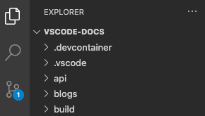
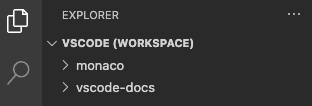
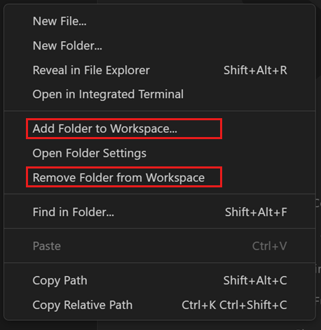
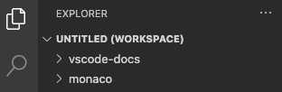
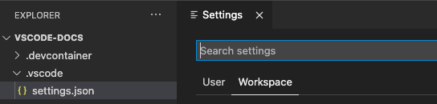
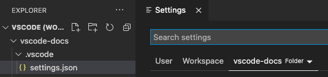

+++
title = "3.2.8.1 工作区概述"
date = 2026-11-06T07:53:25+08:00
weight = 1
type = "docs"
description = ""
isCJKLanguage = true
draft = false
+++


> 原文链接: [https://code.visualstudio.com/docs/editing/workspaces/workspaces](https://code.visualstudio.com/docs/editing/workspaces/workspaces)

# 3.2.8.1 工作区概述

　　VS Code *工作区*是 VS Code 窗口（实例）中打开的一个或多个文件夹的集合。大多数情况下，你会将单个文件夹作为工作区打开。但根据开发工作流，也可以使用称为[多根工作区](#multi-root-workspaces)的高级配置包含多个文件夹。

工作区概念使 VS Code 能够：

* 配置仅适用于特定文件夹而不适用于其他文件夹的设置。
* 持久保存仅在该工作区上下文中有效的[任务](../../../../debugging-and-testing/6.3-Tasks/)和[调试器启动](../../../../debugging-and-testing/6.2-DebuggingConfiguration/)配置。
* 存储和恢复与该工作区关联的 UI 状态（例如打开的文件）。
* 仅针对该工作区选择性启用或禁用扩展。

　　在 VS Code 文档、议题和社区讨论中，“文件夹”和“工作区”可能互换使用。请将工作区视为项目根目录，具有额外的 VS Code 知识和能力。

> **注意**：也可以在没有工作区的情况下打开 VS Code。例如，通过平台 **文件** 菜单选择文件打开新 VS Code 窗口时，你不在工作区中。此模式下，VS Code 的某些能力会减少，但仍可以打开和编辑文本文件。

## 如何打开 VS Code“工作区”？ {#how-do-i-open-a-vs-code-workspace}

　　可以通过 **文件** > **打开文件夹...** 菜单，然后选择文件夹打开工作区。

　　或者，从终端启动 VS Code 时，可以将文件夹路径作为 `code` 命令的第一个参数。例如，使用以下命令在当前文件夹（`.`）中打开 VS Code：

```bash
code .
```

## 单文件夹工作区 {#single-folder-workspaces}

　　除了用 VS Code 打开文件夹外，无需做任何操作即可使文件夹成为 VS Code 工作区。打开文件夹后，VS Code 会自动跟踪配置，例如打开的文件或编辑器布局。再次在 VS Code 中打开该文件夹时，编辑器会保持上次离开时的状态。

　　还可以添加其他文件夹特定配置，例如工作区特定[设置](../../../3.3-ConfigureTheEditor/3.3.4-Settings/)（相对于全局用户设置）、[任务定义](../../../../debugging-and-testing/6.3-Tasks/)和[调试启动](../../../../debugging-and-testing/6.2-DebuggingConfiguration/)文件（请参阅下面的[工作区设置](#workspace-settings)部分）。



*在 VS Code 中打开的单文件夹工作区*

## 多根工作区 {#multi-root-workspaces}

　　[多根工作区](../3.2.8.2-MultiRootWorkspaces/)是 VS Code 的高级能力，允许将多个不同文件夹配置为同一工作区的一部分。不是将文件夹作为工作区打开，而是打开列出工作区所有文件夹的 `<name>.code-workspace` JSON 文件。例如：

```json
{
    "folders": [
        {
            "path": "my-folder-a"
        },
        {
            "path": "my-folder-b"
        }
    ]
}
```



*在 VS Code 中打开的多根工作区*

> **注意**：打开文件夹与打开 `.code-workspace` 文件的视觉差异可能很细微。为了提示已打开 `.code-workspace` 文件，某些 UI 区域（例如文件资源管理器根目录）会在名称旁显示额外的 **（工作区）** 后缀。

### 未命名多根工作区 {#untitled-multi-root-workspaces}

　　可以灵活添加或移除工作区中的文件夹。先在 VS Code 中打开一个文件夹，然后按需添加更多文件夹。



*用于在工作区中添加或移除文件夹的文件资源管理器上下文菜单*

　　除非已经打开 `.code-workspace` 文件，否则第一次向工作区添加第二个文件夹时，VS Code 会自动创建一个*未命名*工作区。在后台，VS Code 会自动维护 `untitled.code-workspace` 文件，包含当前会话的所有文件夹和工作区设置。工作区会保持*未命名*，直到你决定保存到磁盘。



*在 VS Code 中打开的未命名多根工作区*

> **注意**：未命名工作区和已保存工作区没有区别，只是未命名工作区为你自动创建，并会一直恢复直到保存。关闭打开未命名工作区的窗口时，VS Code 会在询问确认后自动删除未命名工作区。

## 工作区设置 {#workspace-settings}

　　工作区设置让你在已打开工作区的上下文中配置设置。工作区设置始终覆盖全局用户设置。它们物理存储在 JSON 文件中，位置取决于将文件夹作为工作区打开，还是打开 `.code-workspace` 文件。

　　设置作用域及其文件位置的完整说明请参阅[设置](../../../3.3-ConfigureTheEditor/3.3.4-Settings/)文档。

### 单文件夹工作区设置 {#single-folder-workspace-settings}

　　将文件夹作为工作区打开时，工作区设置存储在 `.vscode/settings.json`。



*将文件夹作为工作区打开时的设置编辑器*

### 多根工作区设置 {#multi-root-workspace-settings}

　　将 `.code-workspace` 作为工作区打开时，所有工作区设置都会添加到 `.code-workspace` 文件。

　　仍然可以为每个根文件夹配置设置，设置编辑器会显示第三个设置作用域 **文件夹设置**：



*打开多根工作区时的设置编辑器*

　　按文件夹配置的设置会覆盖 `.code-workspace` 中定义的设置。

## 工作区任务和启动配置 {#workspace-tasks-and-launch-configurations}

　　与[工作区设置](#workspace-settings)特定于工作区类似，任务和启动配置也可以限定到工作区。

　　根据将文件夹作为工作区打开还是打开 `.code-workspace` 文件，工作区任务和启动配置位于 `.vscode` 文件夹或 `.code-workspace` 文件中。此外，即使打开 `.code-workspace` 文件，任务和启动配置也始终可以在文件夹级别定义。

　　关于如何在 VS Code 中使用任务和启动配置的完整概述，请参阅[任务](../../../../debugging-and-testing/6.3-Tasks/)和[调试](../../../../debugging-and-testing/6.2-DebuggingConfiguration/)章节。

## 常见问题 {#common-questions}

### 多根工作区比文件夹有什么好处？ {#what-is-the-benefit-of-multi-root-workspace-over-a-folder}

　　最明显的优势是多根工作区允许处理可能不在磁盘上同一父文件夹中的多个项目。可以从任何位置选择文件夹添加到工作区。

　　即使主要处理基于单文件夹的项目，也可以从 `.code-workspace` 文件中受益。可以在文件夹中存储多个 `.code-workspace` 文件，根据场景提供项目的特定文件夹视图（例如 `client.code-workspace`、`server.code-workspace` 从文件资源管理器中过滤无关文件夹）。由于 `.code-workspace` 文件的 `folders` 部分支持相对路径，这些工作区文件适用于所有人，无论文件夹存储在哪里。

　　最后，如果希望某些项目应用相同的工作区设置或任务/启动配置，可以考虑将它们添加到 `.code-workspace` 文件，并在该工作区中添加或移除这些文件夹。

### 为什么 VS Code 重启时恢复所有未命名工作区？ {#why-is-vs-code-restoring-all-untitled-workspaces-on-a-restart}

　　未命名工作区设计为必须明确决定是否保留。首次创建未命名工作区时，VS Code 会将指定文件夹添加到工作区文件，并添加所有现有工作区设置。在未命名工作区保存或删除之前，这些用户数据会始终恢复并显示在 VS Code 窗口中。

### 如何删除未命名工作区？ {#how-do-i-delete-an-untitled-workspace}

　　可以关闭其窗口，并忽略保存未命名工作区的提示，从而删除未命名工作区。

### 可以使用没有文件夹的多根工作区吗？ {#can-i-use-a-multi-root-workspace-without-folders}

　　可以将 `.code-workspace` 文件的 `folders` 部分留空，从而得到一个不显示任何根文件夹的 VS Code 实例。这种情况下仍可以存储工作区设置甚至任务或启动配置。

### VS Code 支持项目或解决方案吗？ {#does-vs-code-support-projects-or-solutions}

　　VS Code 没有其他开发工具（例如 Visual Studio IDE）中有时定义的“项目”或“解决方案”概念。VS Code 文档中可能出现“项目”一词，但通常指“你正在处理的内容”。根据编程语言或框架，工具集本身可能支持称为“项目”的内容，以帮助定义构建配置或枚举包含的文件。
