+++
title = "3.2.8.2 多根工作区"
date = 2026-11-06T07:53:25+08:00
weight = 2
type = "docs"
description = ""
isCJKLanguage = true
draft = false
+++


> 原文链接: [https://code.visualstudio.com/docs/editing/workspaces/multi-root-workspaces](https://code.visualstudio.com/docs/editing/workspaces/multi-root-workspaces)

# 3.2.8.2 多根工作区

　　使用多根工作区，可以在 VS Code 中处理多个项目文件夹。同时处理几个相关项目时，这会很有帮助。例如，你可能有一个包含产品文档的仓库，希望在更新产品源代码时保持文档最新。

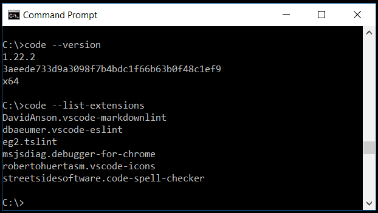

> **注意**：如果想进一步了解 VS Code“工作区”概念，请参阅[什么是 VS Code 工作区？](../3.2.8.1-Overview/)。除非显式创建多根工作区，“工作区”就是项目的单个根文件夹。

## 添加文件夹 {#adding-folders}

　　向现有工作区添加另一个文件夹很容易。有多种添加文件夹的手势：

### 将文件夹添加到工作区 {#add-folder-to-workspace}

　　**文件** > **将文件夹添加到工作区** 命令会打开“打开文件夹”对话框以选择新文件夹。

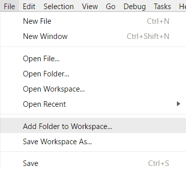

　　添加根文件夹后，资源管理器会在文件资源管理器中将新文件夹显示为根。可以右键单击任何根文件夹，使用上下文菜单添加或移除文件夹。

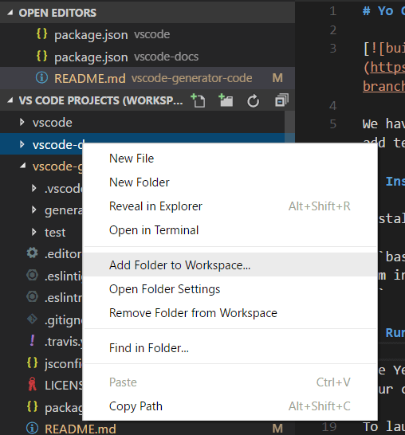

　　文件资源管理器应像以前一样工作。可以在根文件夹之间移动文件，并使用上下文菜单和资源管理器视图提供的典型文件操作。

　　如果配置了 `files.exclude` 等设置，它们支持每个根文件夹；如果配置为全局用户设置，则适用于所有文件夹。

### 拖放 {#drag-and-drop}

　　可以使用拖放将文件夹添加到工作区。将文件夹拖到文件资源管理器即可添加到当前工作区。甚至可以同时选择和拖动多个文件夹。

> **注意**：将单个文件夹拖放到 VS Code 编辑器区域仍会以单文件夹模式打开。如果将多个文件夹拖放到编辑器区域，会创建新的多根工作区。

　　也可以使用拖放重新排序工作区中的文件夹。

### 原生文件打开对话框多选 {#multiple-selection-native-file-open-dialogs}

　　使用平台原生文件打开对话框打开多个文件夹会创建多根工作区。

### 命令行 --add {#command-line---add}

　　将文件夹或多个文件夹添加到最后一个活动 VS Code 实例，形成多根工作区。

```bash
  code --add vscode vscode-docs
```

### 移除文件夹 {#removing-folders}

　　可以使用 **从工作区中移除文件夹** 上下文菜单命令从工作区移除文件夹。

## 工作区文件 {#workspace-file}

　　添加多个文件夹时，它们最初位于名为 **UNTITLED WORKSPACE** 的工作区中，保存工作区之前名称保持不变。不需要立即保存工作区，直到希望将其放在永久位置（例如桌面）。未命名工作区在使用它的 VS Code 实例打开期间存在。完全关闭带有未命名工作区的实例后，如果计划再次打开，会要求保存：

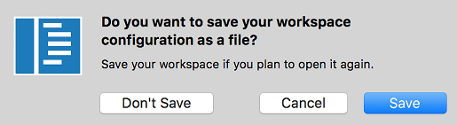

　　保存工作区时，会创建 `.code-workspace` 文件，文件名会显示在文件资源管理器中。

### 工作区另存为... {#save-workspace-as}

　　如果希望将工作区文件移到新位置，可以使用 **文件** > **工作区另存为** 命令，它会自动设置相对于新工作区文件位置的正确文件夹路径。

### 打开工作区文件 {#opening-workspace-files}

要重新打开工作区，可以：

* 在平台文件资源管理器中双击 `.code-workspace` 文件。
* 使用 **文件** > **打开工作区** 命令并选择工作区文件。
* 从 **文件** > **打开最近**（`Ctrl + R`）列表选择工作区。工作区带有 **（工作区）** 后缀，以区别于文件夹。

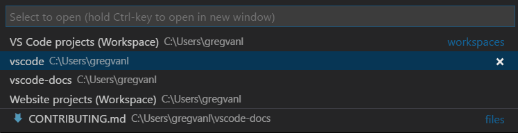

　　与在 VS Code 中打开单个文件夹时的 **关闭文件夹** 类似，**关闭工作区**（`Ctrl + K F`）命令用于关闭活动工作区。

### 工作区文件架构 {#workspace-file-schema}

　　`.code-workspace` 的架构相当简单。它包含带有绝对或相对路径的文件夹数组。希望共享工作区文件时，相对路径更好。

　　可以使用 `name` 属性覆盖文件夹显示名称，为资源管理器中的文件夹提供更有意义的名称。例如，可以将项目文件夹命名为“Product”和“Documentation”，以便按文件夹名轻松识别内容：

```json
{
    "folders": [
        {
            // Source code
            "name": "Product",
            "path": "vscode"
        },
        {
            // Docs and release notes
            "name": "Documentation",
            "path": "vscode-docs"
        },
        {
            // Yeoman extension generator
            "name": "Extension generator",
            "path": "vscode-generator-code"
        }
    ]
}
```

这会在资源管理器中显示：

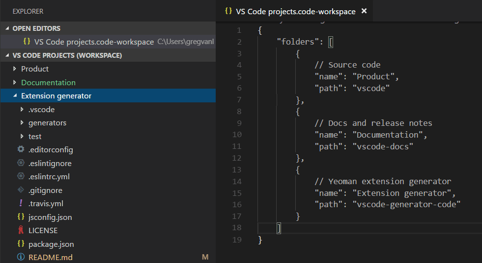

　　如示例所示，可以在工作区文件中添加注释。

　　工作区文件还可以在 `settings` 下包含工作区[全局设置](#settings)，在 `extensions` 下包含[扩展推荐](#extensions)，下面会讨论。

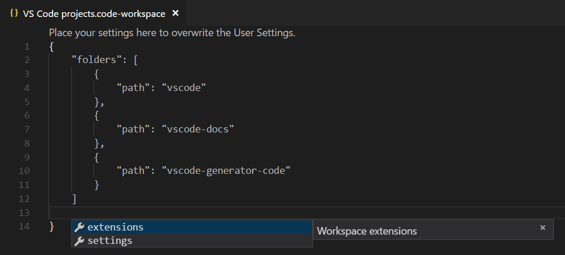

## 常规 UI {#general-ui}

### 编辑器 {#editor}

　　使用多根工作区时，VS Code UI 只有少量变化，主要用于区分文件夹中的文件。例如，多个文件夹中的文件名称冲突时，VS Code 会在选项卡标题中包含文件夹名。

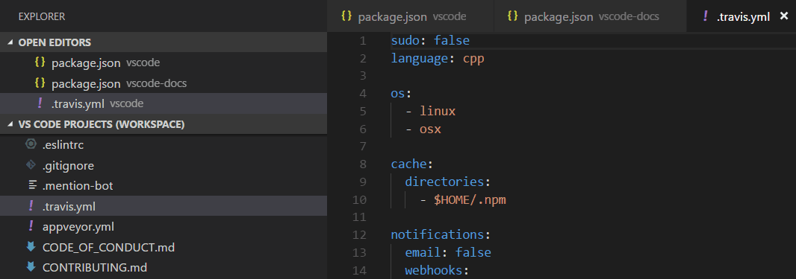

　　如果希望选项卡标题始终显示文件夹，可以使用 `workbench.editor.labelFormat` [设置](../../../3.3-ConfigureTheEditor/3.3.4-Settings/)的 `medium` 或 `long` 值显示文件夹或完整路径。

```json
"workbench.editor.labelFormat": "medium"
```

　　**打开的编辑器** 和 **快速打开**（`Ctrl + P`）列表等 VS Code UI 会包含文件夹名。

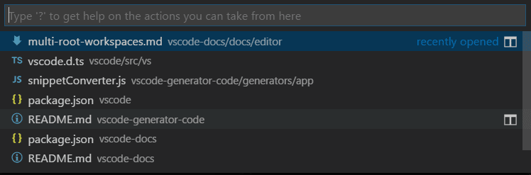

　　如果使用[文件图标主题](../../../3.3-ConfigureTheEditor/3.3.7-Themes/)且活动主题支持，会看到特殊工作区图标。

以下是内置 **Minimal (VS Code)** 文件图标主题中的工作区图标：

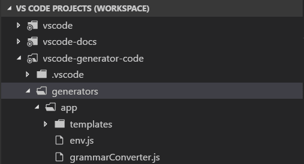

### 搜索 {#search}

　　VS Code 的全局搜索等功能会跨所有文件夹工作，并按文件夹分组搜索结果。

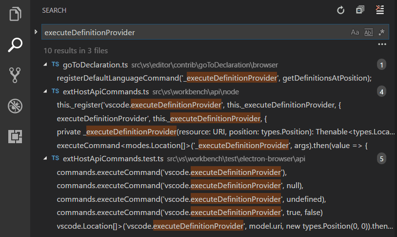

　　打开多根工作区时，可以在 **要包含的文件** 框中使用 `./` 语法选择在单个根文件夹中搜索。例如，输入 `./project1/**/*.txt` 会搜索 `project1/` 根文件夹下的所有 `.txt` 文件。

## 设置 {#settings}

　　一个工作区有多个根文件夹时，每个根文件夹可以有 `.vscode` 文件夹，定义适用于该文件夹的设置。为避免设置冲突，多根工作区只应用资源（文件、文件夹）设置。影响整个编辑器的设置（例如 UI 布局）会被忽略。例如，两个项目不能同时设置缩放级别。

　　用户设置与单文件夹项目一样受支持，还可以设置适用于多根工作区所有文件夹的全局工作区设置。全局工作区设置存储在 `.code-workspace` 文件中。

```json
{
    "folders": [
        {
            "path": "vscode"
        },
        {
            "path": "vscode-docs"
        },
        {
            "path": "vscode-generator-code"
        }
    ],
    "settings": {
        "window.zoomLevel": 1,
        "files.autoSave": "afterDelay"
    }
}
```

　　从单文件夹实例转到多文件夹时，VS Code 会将第一个文件夹中适当的编辑器范围设置添加到新的全局工作区设置。

　　可以通过设置编辑器轻松审查和修改不同设置文件。设置编辑器选项卡允许选择用户设置、全局工作区设置和单个文件夹设置。

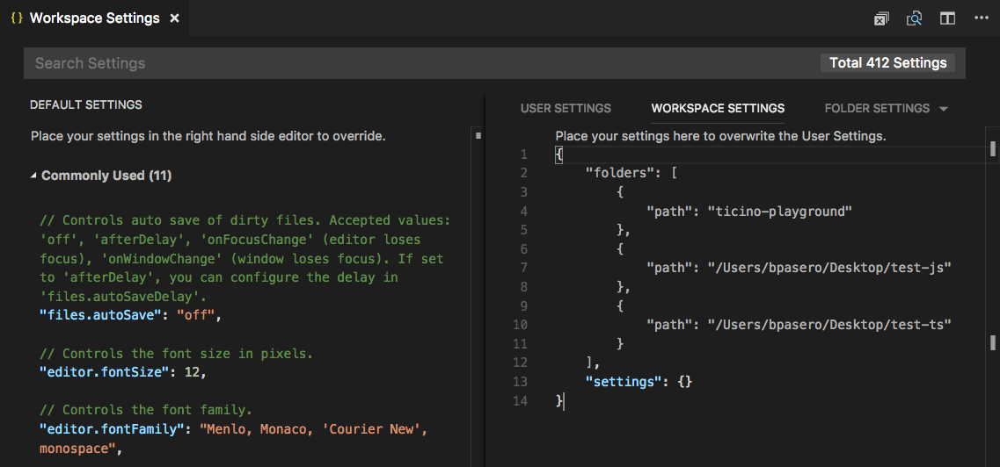

还可以使用以下命令打开特定设置文件：

* **首选项：打开用户设置** - 打开全局用户设置。
* **首选项：打开工作区设置** - 打开工作区文件的设置部分。
* **首选项：打开文件夹设置** - 打开活动文件夹的设置。

　　全局工作区设置覆盖用户设置，文件夹设置可以覆盖工作区或用户设置。

### 不支持的文件夹设置 {#unsupported-folder-settings}

　　不支持的编辑器范围文件夹设置会在文件夹设置中显示为灰色，并从 **默认文件夹设置** 列表中过滤掉。设置前还会显示信息图标。

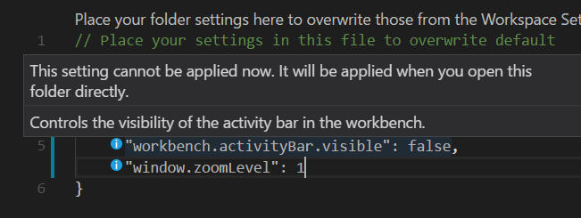

## 调试 {#debugging}

　　使用多根工作区时，VS Code 会跨所有文件夹搜索 `launch.json` 调试配置文件，并显示文件夹名后缀。此外，VS Code 还会显示工作区配置文件中定义的启动配置。

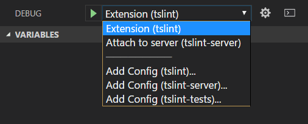

　　上例显示 [TSLint 扩展](https://marketplace.visualstudio.com/items?itemName=eg2.tslint)的调试配置。`tslint` 扩展文件夹中有一个 `launch` 配置，用于在 VS Code 扩展宿主中启动扩展；`tslint-server` 文件夹中还有一个 `attach` 配置，用于将调试器附加到运行中的 TSLint 服务器。

　　还可以看到 vscode-tslint [工作区](https://github.com/microsoft/vscode-tslint/blob/main/vscode-tslint.code-workspace)中 `tslint`、`tslint-server` 和 `tslint-tests` 文件夹的三个 **添加配置** 命令。**添加配置** 命令会打开文件夹 `.vscode` 子文件夹中的现有 `launch.json`，或创建新文件并显示调试配置模板下拉列表。

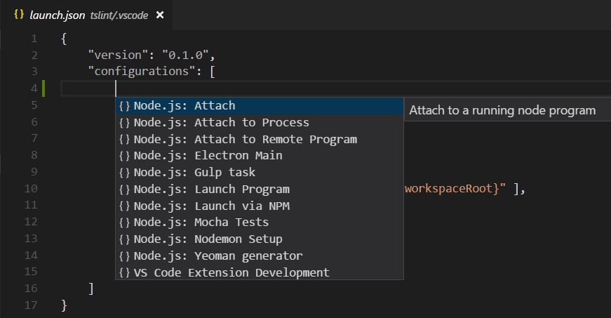

　　配置中使用的[变量](../../../3.4-Reference/3.4.3-SubstitutionVariables/)（例如 `${workspaceFolder}` 或已弃用的 `${workspaceRoot}`）相对于所属文件夹解析。可以通过在变量后附加根文件夹名（用冒号分隔）将变量限定到每个工作区文件夹。

### 工作区启动配置 {#workspace-launch-configurations}

　　工作区作用域启动配置位于工作区配置文件的 `"launch"` 部分（命令面板中的 **Workspaces: Open Workspace Configuration File**）：

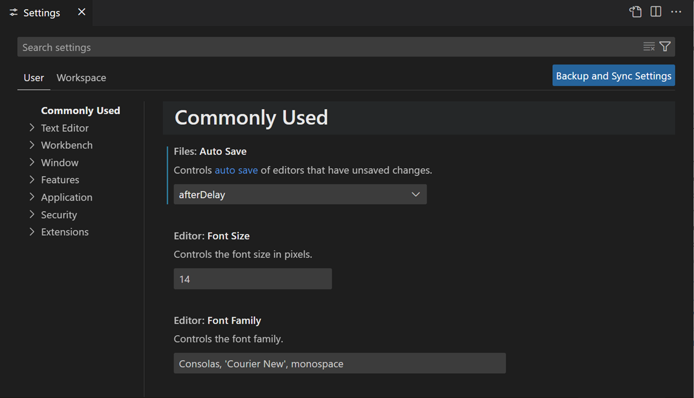

　　也可以通过启动配置下拉菜单的“添加配置（工作区）”项添加新的启动配置：

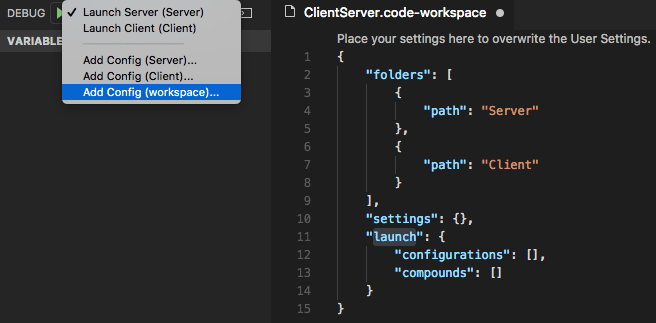

　　复合启动配置可以按名称引用各个启动配置，只要名称在工作区内唯一，例如：

```json
  "compounds": [{
      "name": "Launch Server & Client",
      "configurations": [
        "Launch Server",
        "Launch Client"
      ]
  }]
```

　　如果各个启动配置名称不唯一，可以使用更详细的“folder”语法指定限定文件夹：

```json
  "compounds": [{
      "name": "Launch Server & Client",
      "configurations": [
        "Launch Server",
        {
          "folder": "Web Client",
          "name": "Launch Client"
        },
        {
          "folder": "Desktop Client",
          "name": "Launch Client"
        }
      ]
  }]
```

　　除了 `compounds`，工作区配置文件的 `launch` 部分也可以包含常规启动配置。确保所有使用的变量都显式限定到特定文件夹，否则它们对工作区无效。显式限定变量的详情请参阅[变量参考](../../../3.4-Reference/3.4.3-SubstitutionVariables/)。

以下示例中，程序位于“Program”文件夹，步进时应跳过“Library”文件夹中的所有文件：

```json
"launch": {
  "configurations": [{
      "type": "node",
      "request": "launch",
      "name": "Launch test",
      "program": "${workspaceFolder:Program}/test.js",
      "skipFiles": [
        "${workspaceFolder:Library}/out/**/*.js"
      ]
  }]
}
```

## 任务 {#tasks}

　　与搜索调试配置类似，VS Code 还会尝试跨工作区所有文件夹自动检测 gulp、grunt、npm 和 TypeScript 项目文件中的任务，并搜索 `tasks.json` 文件中定义的任务。任务位置由文件夹名后缀指示。注意，`tasks.json` 中定义的任务必须是 2.0.0 版。

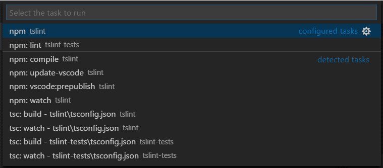

　　在上面的 TSLint 扩展[工作区](https://github.com/microsoft/vscode-tslint/blob/main/vscode-tslint.code-workspace)示例中，`tslint` 和 `tslint-tests` 文件夹的 `tasks.json` 中有两个**配置的任务**，还有多个自动检测的 npm 和 TypeScript 编译器**检测任务**。

### 工作区任务配置 {#workspace-task-configuration}

　　工作区作用域任务位于工作区配置文件的 `"tasks"` 部分（命令面板中的 **Workspaces: Open Workspace Configuration File**）。工作区配置文件只能定义 `"shell"` 和 `"process"` 类型任务。

## 源代码管理 {#source-control}

　　多根工作区有 **源代码管理提供程序** 部分，在有多个活动仓库时提供概览。这些仓库可以由多个 SCM 提供商贡献；例如，可以同时有 Git 仓库和 Azure DevOps Server 工作区。在此视图中选择仓库时，下方会显示源代码管理详情。

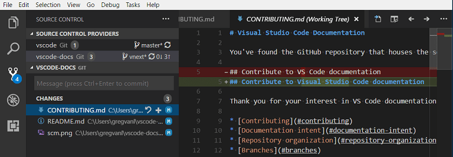

　　可以使用 `Ctrl + 单击` 或 `Shift + 单击` 选择多个仓库。它们的详情会显示在下方独立区域。

## 扩展 {#extensions}

　　如果你是扩展作者，可以阅读[采用多根工作区 API](https://github.com/microsoft/vscode/wiki/Adopting-Multi-Root-Workspace-APIs) 指南，了解 VS Code 多根工作区 API 以及如何使扩展在多个文件夹中良好工作。

以下是已采用多根工作区 API 的一些流行扩展。

　　注意：如果扩展尚不支持多个文件夹，它仍会在多根工作区的第一个文件夹中工作。

### 扩展推荐 {#extension-recommendations}

　　VS Code 通过文件夹 `.vscode` 子文件夹中的 `extensions.json` 支持文件夹级扩展推荐。也可以将全局工作区扩展推荐添加到 `.code-workspace` 文件。可以使用 **Extensions: Configure Recommended Extensions (Workspace Folder)** 命令打开工作区文件，并将扩展标识符（{publisherName}.{extensionName}）添加到 `extensions.recommendations` 数组。

```json
{
    "folders": [
        {
            "path": "vscode"
        },
        {
            "path": "vscode-docs"
        }
    ],
    "extensions": {
        "recommendations": [
            "eg2.tslint",
            "dbaeumer.vscode-eslint",
            "esbenp.prettier-vscode"
        ]
    }
}
```

## 后续步骤 {#next-steps}

* [什么是 VS Code 工作区？](../3.2.8.1-Overview/) - 进一步了解单文件夹和多根工作区。
* [调试](../../../../debugging-and-testing/6.2-DebuggingConfiguration/) - 了解如何为应用设置调试。
* [任务](../../../../debugging-and-testing/6.3-Tasks/) - 任务让你在 VS Code 中运行编译器外部工具。

## 常见问题 {#common-questions}

### 如何回到使用单个项目文件夹？ {#how-can-i-go-back-to-working-with-a-single-project-folder}

　　可以关闭工作区并直接打开文件夹，或从工作区移除文件夹。

### 作为扩展作者需要做什么？ {#as-an-extension-author-what-do-i-need-to-do}

　　请参阅[采用多根工作区 API](https://github.com/microsoft/vscode/wiki/Adopting-Multi-Root-Workspace-APIs) 指南。大多数扩展可以轻松支持多根工作区。
