+++
title = "3.2.8.3 工作区信任"
date = 2026-11-06T07:53:25+08:00
weight = 3
type = "docs"
description = ""
isCJKLanguage = true
draft = false
+++


> 原文链接: [https://code.visualstudio.com/docs/editing/workspaces/workspace-trust](https://code.visualstudio.com/docs/editing/workspaces/workspace-trust)

# 3.2.8.3 工作区信任

　　VS Code 重视安全，希望帮助你安全浏览和编辑任何来源或作者的代码。工作区信任功能让你决定项目文件夹中的代码是否可以由 VS Code 和扩展执行，而无需你明确批准。

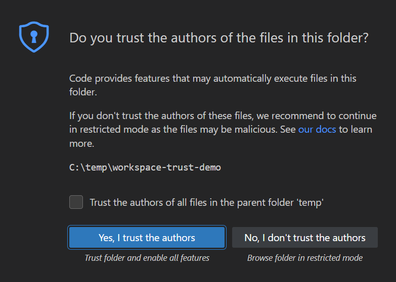

> **注意**：如有疑问，请将文件夹保持在[受限模式](#restricted-mode)。之后可以随时[启用信任](#trusting-a-workspace)。

## 安全浏览代码 {#safe-code-browsing}

　　公共仓库和文件共享中有大量源代码，这很好。无论编码任务或问题是什么，某处可能已有良好解决方案。有这么多强大编码工具帮助理解、调试和优化代码也很好。但使用开源代码和工具确实有风险，可能面临恶意代码执行和漏洞利用。

　　工作区信任在处理不熟悉代码时提供额外安全层：如果工作区在“受限模式”中打开，会阻止工作区中任何代码自动执行。

> **重要**：工作区信任在 VS Code 窗口和智能体窗口之间共享。如果工作区在 VS Code 中不受信任，在智能体窗口中也不受信任，两个位置都不会运行智能体。可以从任一界面管理工作区信任，信任状态在两者之间共享。

## 受限模式 {#restricted-mode}

　　打开新的不熟悉文件夹时，VS Code 会以受限模式打开，防止你在审查内容时自动执行代码。在 Workspace Trust 对话框中选择 **不，我不信任作者** 也会进入受限模式。

　　工作台顶部显示横幅，链接到通过工作区信任编辑器 **管理** 文件夹。状态栏也会显示徽章，表示工作区处于受限模式。准备好后，可以从横幅或工作区信任编辑器信任文件夹。

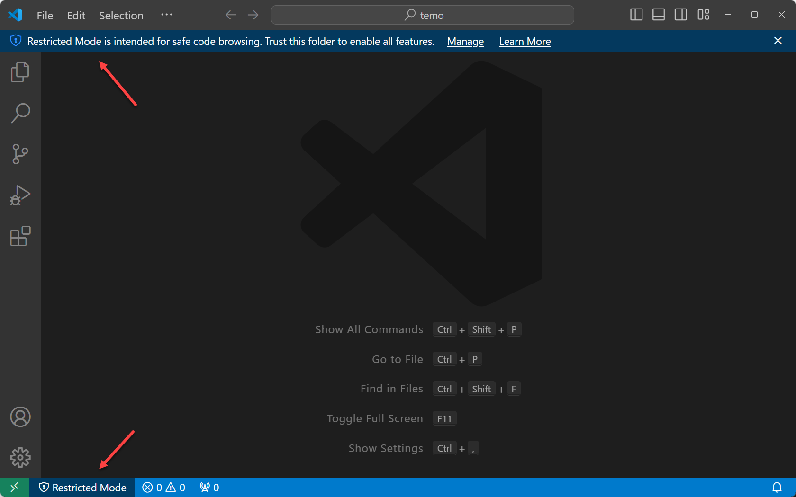

　　受限模式通过禁用或限制多项 VS Code 功能来防止自动代码执行：AI 智能体、终端、任务、调试、工作区设置和扩展。

　　要查看受限模式禁用功能的完整列表，请通过横幅中的 **管理** 链接或状态栏受限模式徽章打开工作区信任编辑器。工作区信任编辑器默认在编辑器区域上方的[模态覆盖层](../../../3.1-GettingStarted/3.1.2-UserInterface/#modal-editors)中打开。

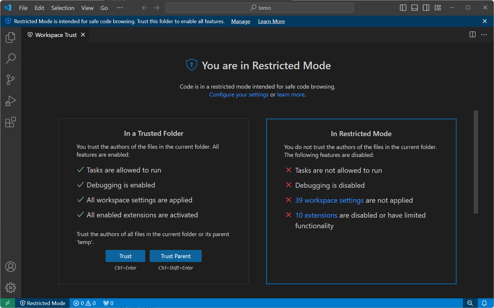

> **警告**：工作区信任不能阻止恶意扩展执行代码并忽略**受限模式**。只应安装和运行来自你信任的知名发布者的扩展。

### AI 智能体 {#ai-agents}

　　使用 VS Code 中智能体等 AI 开发功能时，这些智能体会代表你执行操作，包括更改代码库、运行终端命令或发起 Web 请求。任何文件都可能通过智能体被拉入上下文，理论上可能导致提示词注入攻击。

　　审查项目是否存在恶意内容之前，请依赖工作区信任边界并以受限模式打开。在受限模式打开工作区会禁用该工作区中的智能体。

　　详细了解在 VS Code 中使用 AI 开发功能时的 [AI 安全注意事项](../../../../ai-in-vs-code/work-with-ai/permissions-and-security/2.2.12.3-AISecurity/)。

### 终端 {#terminal}

　　Shell 可以根据工作区内容自动执行代码，例如 source `.env` 文件或运行引用当前目录的 shell 初始化脚本。为防止这种情况，文件夹在受限模式中打开时，默认阻止打开[终端](../../../../terminal/5.2-TerminalBasics/)。

　　在受限模式尝试打开终端时，VS Code 会提示确认信任文件夹。取消对话框后，VS Code 保持受限模式且不打开终端。

　　如果配置 shell 以防止基于工作区内容自动执行代码，可以启用 `terminal.integrated.allowInUntrustedWorkspace` 设置，允许终端在受限模式中打开而无需信任提示。

### 任务 {#tasks}

　　VS Code [任务](../../../../debugging-and-testing/6.3-Tasks/)可以运行脚本和工具二进制文件。任务定义位于工作区 `.vscode` 文件夹，是仓库已提交源代码的一部分，共享给该仓库每个用户。如果有人创建恶意任务，任何克隆该仓库的人都可能在不知情下运行。

　　在受限模式尝试运行或枚举任务（**任务** > **运行任务**）时，VS Code 会提示确认信任文件夹并继续执行任务。取消对话框后，VS Code 保持受限模式。

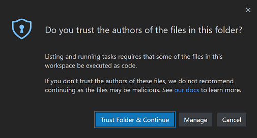

### 调试 {#debugging}

　　与运行 VS Code 任务类似，调试扩展可以在启动调试会话时运行调试器二进制文件。因此，文件夹在受限模式中打开时，[调试](../../../../debugging-and-testing/6.1-Debugging/)也会被禁用。

　　在受限模式尝试启动调试会话（**调试** > **开始调试**）时，VS Code 会提示确认信任文件夹并继续启动调试器。取消对话框后，VS Code 保持受限模式，不启动调试会话。

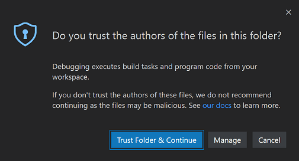

### 工作区设置 {#workspace-settings}

　　工作区[设置](../../../3.3-ConfigureTheEditor/3.3.4-Settings/)存储在仓库根目录 `.vscode` 文件夹中，因此任何克隆工作区仓库的人都会共享。某些设置包含可执行文件路径（例如 linter 二进制文件），如果指向恶意代码，可能造成损害。因此，VS Code 在受限模式中禁用一组工作区设置。

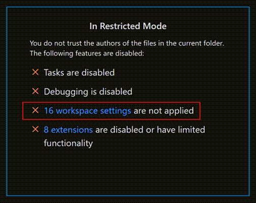

　　在工作区信任编辑器中，选择未应用工作区设置的链接，会打开按 `@tag:requireTrustedWorkspace` 标签限定的设置编辑器。

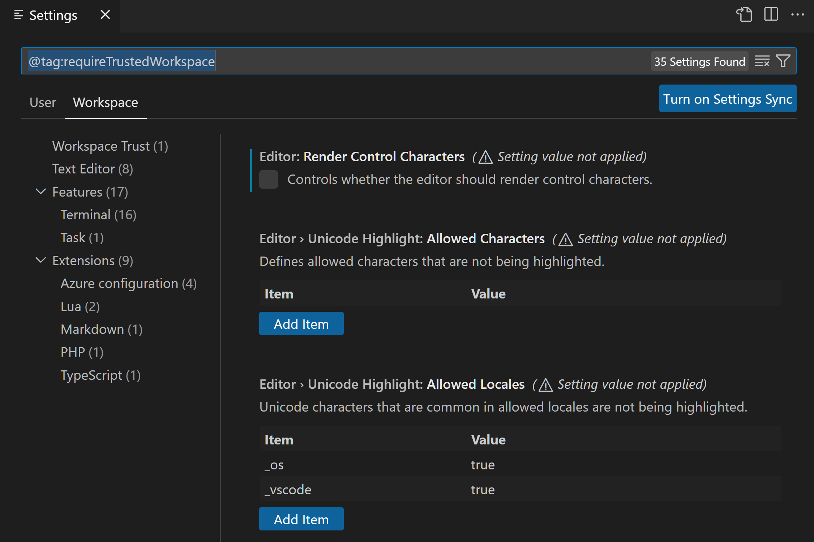

### 扩展 {#extensions}

　　VS Code [扩展](../../../3.3-ConfigureTheEditor/3.3.6-Extensions/3.3.6.2-ExtensionMarketplace/)生态极其丰富多样。人们创建了帮助几乎任何编程任务或编辑器自定义的扩展。某些扩展提供完整编程语言支持（IntelliSense、调试、代码分析），其他扩展可以播放音乐或拥有虚拟[宠物](https://marketplace.visualstudio.com/items?itemName=tonybaloney.vscode-pets)。

　　大多数扩展代表你运行代码，可能造成伤害。某些扩展的设置如果配置为运行意外可执行文件，可能使其恶意行为。因此，未明确选择支持工作区信任的扩展在受限模式中默认禁用。

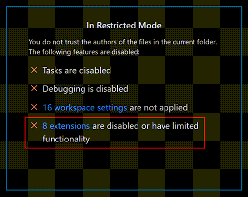

　　可以在工作区信任编辑器中选择 **扩展已禁用或功能受限** 链接，查看已安装扩展状态，这会显示按 `@workspaceUnsupported` 筛选的扩展视图。

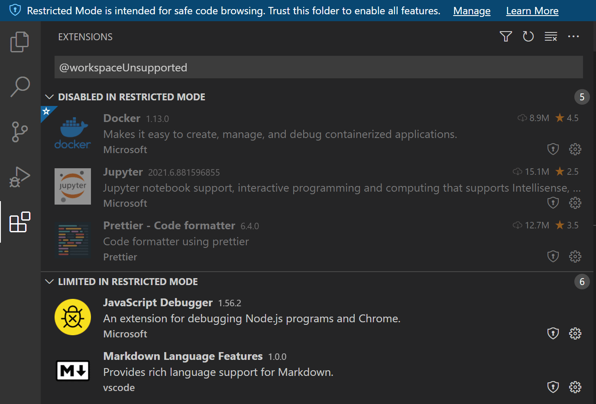

　　未选择工作区信任的扩展可以在受限模式中禁用或受限。

**受限模式中禁用**

　　未明确表示支持受限模式运行的扩展显示在 **受限模式中禁用** 部分。如果扩展作者认为其扩展可能被工作区修改（设置或文件）滥用，也可以表示绝不在受限模式中启用。

**受限模式中受限**

　　扩展作者还可以评估扩展可能的安全漏洞，并声明在受限模式中**有限**支持。这意味着扩展可能禁用某些功能以防止可能的利用。

　　扩展可以在扩展视图的工作区信任徽章中添加自定义文本，解释在不受信任文件夹中运行时的限制。例如，VS Code 内置 PHP 扩展将 `php.validate.executablePath` 设置限制为受信任文件夹，因为覆盖此设置可能运行恶意程序。

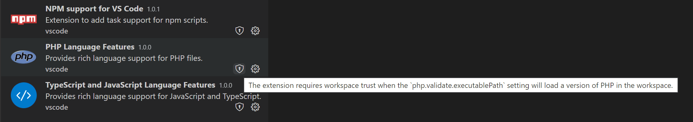

　　可以使用 `extensions.supportUntrustedWorkspaces` 设置覆盖扩展的工作区信任支持级别，详见下面[启用扩展](#enabling-extensions)部分。

　　在受限模式尝试安装扩展时，会提示你信任工作区或仅安装扩展。如果扩展不支持工作区信任，它会安装但被禁用或功能受限运行。

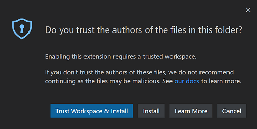

> **注意**：扩展作者可以阅读[工作区信任扩展指南](https://code.visualstudio.com/api/extension-guides/workspace-trust)了解如何更新扩展以支持工作区信任。

## 信任工作区 {#trusting-a-workspace}

　　如果信任项目作者和维护者，可以信任本地机器上的项目文件夹。例如，通常可以安全信任来自 github.com/microsoft 或 github.com/docker 等知名 GitHub 组织的仓库。

　　打开新文件夹时，它会以[受限模式](#restricted-mode)打开并显示信任横幅。准备好后，使用横幅或工作区信任编辑器信任文件夹及其子文件夹。


　　也可以打开工作区信任编辑器，选择 **信任** 按钮快速切换文件夹信任状态。

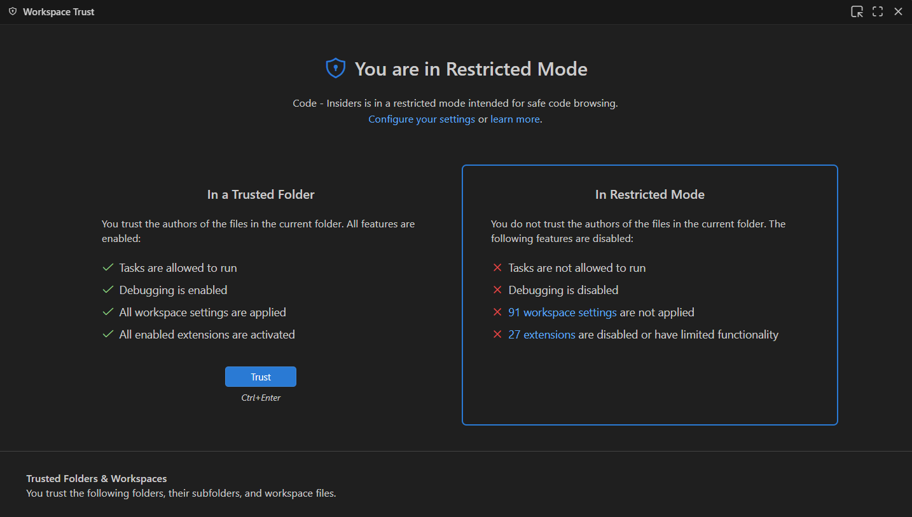

有多种方式打开工作区信任编辑器：

受限模式中：

* 受限模式横幅 **管理** 链接
* 受限模式状态栏项

随时可以使用：

* 命令面板（`Ctrl + Shift + P`，macOS：`Cmd + Shift + P`）中的 **Workspaces: Manage Workspace Trust** 命令

> **重要**：工作区信任在 VS Code 窗口和智能体窗口之间共享。如果工作区在 VS Code 中不受信任，在智能体窗口中也不受信任，两个位置都不会运行智能体。可以从任一界面管理工作区信任，信任状态在两者之间共享。

## 选择文件夹 {#selecting-folders}

　　信任文件夹后，它会添加到工作区信任编辑器显示的 **受信任文件夹和工作区** 列表。

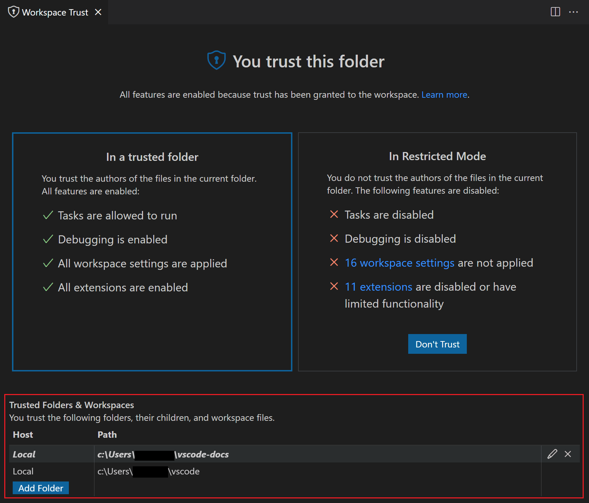

　　可以手动添加、编辑和移除列表中的文件夹，以启用或禁用工作区信任。活动文件夹在列表中加粗显示。

### 选择父文件夹 {#selecting-a-parent-folder}

　　也可以信任父文件夹，将信任应用于父文件夹及其所有子文件夹。要信任父文件夹，请将其路径添加到工作区信任编辑器的 **受信任文件夹和工作区** 列表。

　　如果许多受信任内容文件夹位于同一文件夹下，信任父文件夹会很有帮助。

　　打开受信任父文件夹下的子文件夹时，不会看到通常的 **不信任** 按钮将你放回受限模式。而是显示文本说明文件夹因另一个文件夹而受信任。

### 文件夹配置 {#folder-configurations}

　　信任父文件夹时，所有子文件夹都受信任，因此可以通过仓库在磁盘上的位置控制工作区信任。

例如，可以将所有受信任仓库放在一个“TrustedRepos”父文件夹下，将不熟悉仓库放在另一个父文件夹（如“ForEvaluation”）下。信任“TrustedRepos”，并有选择地信任“ForEvaluation”下的文件夹。

```text
├── TrustedRepos - Clone trusted repositories under this parent folder
└── ForEvaluation - Clone experimental or unfamiliar repositories under this parent folder
```

　　也可以按组织特定父文件夹分组仓库并设置信任。

```text
├── github/microsoft - Clone a specific organization's repositories under this parent folder
├── github/{myforks} - Place your forked repositories under this parent folder
└── local - Local un-published repositories
```

## 启用扩展 {#enabling-extensions}

　　如果想使用受限模式但最喜欢的扩展不支持工作区信任怎么办？这种情况可能发生在扩展虽然有用且功能正常，但没有积极维护且未声明工作区信任支持时。要处理此情况，可以使用 `extensions.supportUntrustedWorkspaces` 设置覆盖扩展信任状态。

> **重要**：覆盖扩展工作区信任支持时要小心。扩展作者可能有充分理由在受限模式中禁用扩展。如有疑问，请联系扩展作者或查看最近变更日志。

　　在设置编辑器（`Ctrl + ,`，macOS：`Cmd + ,`）中，可以通过 **Extensions: Support Untrusted Workspaces** 设置（`extensions.supportUntrustedWorkspaces`）覆盖单个扩展的工作区信任。

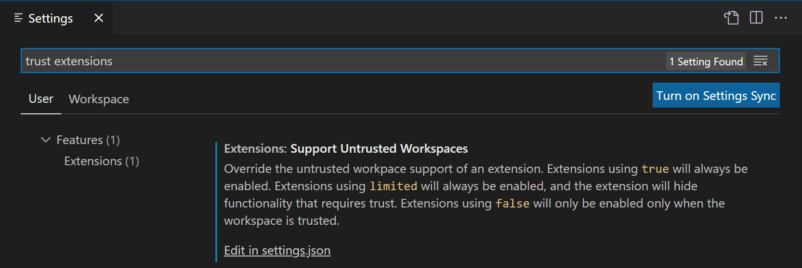

　　选择 **在 settings.json 中编辑** 链接，管理扩展 ID 列表及其支持状态和版本。可以通过 IntelliSense 建议选择任何已安装扩展。

以下是 Prettier 扩展的 `settings.json` 条目。

```json
  "extensions.supportUntrustedWorkspaces": {
    "esbenp.prettier-vscode": {
      "supported": true,
      "version": "6.4.0"
    },
  },
```

　　可以使用 `supported` 属性启用或禁用工作区信任支持。`version` 属性指定适用的确切扩展版本；如果要为所有版本设置状态，可以移除 version 字段。

　　如果想进一步了解扩展作者如何评估和确定在受限模式中限制哪些功能，请阅读[工作区信任扩展指南](https://code.visualstudio.com/api/extension-guides/workspace-trust)。

## 打开不受信任文件 {#opening-untrusted-files}

　　打开位于受信任文件夹之外的文件时，VS Code 会检测文件来自文件夹根之外，并提示继续打开文件或在受限模式中新窗口打开。受限模式打开是最安全选项，确定文件可信后可以随时在原始 VS Code 窗口重新打开。

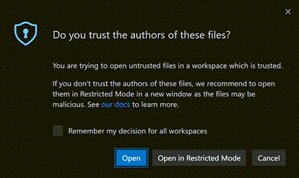

　　如果希望打开受信任工作区之外文件时不提示，可以将 `security.workspace.trust.untrustedFiles` 设置为 `open`。也可以设置为 `newWindow`，始终在受限模式新窗口打开。在不受信任文件对话框中勾选 **记住我对所有工作区的决定** 会将选择应用到 `security.workspace.trust.untrustedFiles` 用户设置。

### 打开不受信任文件夹 {#opening-untrusted-folders}

　　使用包含多个文件夹的[多根工作区](../3.2.8.2-MultiRootWorkspaces/)时，如果尝试向受信任多根工作区添加新文件夹，会提示决定是否信任该文件夹中的文件；如果不信任，整个工作区会切换到受限模式。

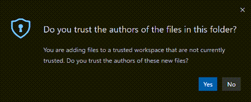

### 空窗口（没有打开文件夹） {#empty-windows-no-open-folder}

　　默认情况下，打开新 VS Code 窗口（实例）而不打开文件夹或工作区时，VS Code 以完全信任运行窗口。所有已安装扩展启用，可以无限制使用空窗口。

　　打开文件时，由于没有父文件夹，会提示是否打开[不受信任文件](#opening-untrusted-files)。

　　可以使用工作区信任编辑器（命令面板中的 **Workspaces: Manage Workspace Trust**）将空窗口切换到受限模式，然后选择 **不信任**。空窗口在当前会话保持受限模式，但重启或创建新窗口后会恢复为受信任。

　　如果希望所有空窗口都处于受限模式，请将 `security.workspace.trust.emptyWindow` 设置为 `false`。

## 设置 {#settings}

以下是可用工作区信任设置：

* `security.workspace.trust.enabled` - 启用工作区信任功能。默认 `true`。
* `security.workspace.trust.startupPrompt` - 是否在启动时显示工作区信任对话框。默认 `never`，因此新文件夹以[受限模式](#restricted-mode)和信任横幅打开，而不是预先对话框。设置为 `once` 可在首次打开不同文件夹或工作区时提示。
* `security.workspace.trust.emptyWindow` - 是否始终信任空窗口（没有打开文件夹）。默认 `true`。
* `security.workspace.trust.untrustedFiles` - 控制如何处理工作区中的松散文件。默认提示。
* `extensions.supportUntrustedWorkspaces` - 覆盖扩展工作区信任声明。`true` 或 `false`。
* `security.workspace.trust.banner` - 控制受限模式横幅显示时机。默认 `untilDismissed`。

## 命令行开关 {#command-line-switch}

　　可以通过 VS Code 命令行传递 `--disable-workspace-trust` 禁用工作区信任。该开关仅影响当前会话。

## 后续步骤 {#next-steps}

* [工作区信任扩展指南](https://code.visualstudio.com/api/extension-guides/workspace-trust) - 了解扩展作者如何支持工作区信任。
* [什么是 VS Code 工作区？](../3.2.8.1-Overview/) - 详细了解 VS Code 工作区概念。
* [GitHub Repositories 扩展](https://code.visualstudio.com/docs/sourcecontrol/github#_github-repositories-extension) - 无需克隆源代码即可直接在仓库上工作。

## 常见问题 {#common-questions}

### 仍可以在受限模式中编辑源代码吗？ {#can-i-still-edit-my-source-code-in-restricted-mode}

　　可以，仍可以在受限模式中浏览和编辑源代码。某些语言功能可能禁用，但始终支持文本编辑。

### 已安装扩展去哪了？ {#where-did-my-installed-extensions-go}

　　在受限模式中，不支持工作区信任的任何扩展都会被禁用，活动栏图标和命令等所有 UI 元素都不会显示。

　　可以使用 `extensions.supportUntrustedWorkspaces` 设置覆盖扩展工作区信任支持级别，但要小心。[启用扩展](#enabling-extensions)有更多详情。

### 可以禁用工作区信任功能吗？ {#can-i-disable-the-workspace-trust-feature}

　　可以，但不推荐。如果不想 VS Code 在打开新文件夹或仓库时检查工作区信任，可以将 `security.workspace.trust.enabled` 设置为 `false`。VS Code 随后会像 1.57 版之前一样行为。

### 如何取消信任文件夹/工作区？ {#how-do-i-untrust-a-folderworkspace}

　　打开工作区信任编辑器（命令面板中的 **Workspaces: Manage Workspace Trust**），选择 **不信任** 按钮。也可以从 **受信任文件夹和工作区** 列表移除文件夹。

### 为什么看不到“不信任”按钮？ {#why-dont-i-see-the-dont-trust-button}

　　如果工作区信任对话框中看不到 **不信任** 按钮，文件夹信任级别可能继承自父文件夹。请查看 **受信任文件夹和工作区** 列表，检查父文件夹是否启用了工作区信任。

　　某些工作流（例如连接 [GitHub Codespace](../../../../remote/8.8-GitHubCodespaces/)或[附加到运行中的 Docker 容器](../../../../remote/8.5-DevContainers/)）会自动受信任，因为这些都是你应已高度信任的受管理环境。

### 工作区信任防范什么？ {#what-does-workspace-trust-protect-against}

　　VS Code 的许多功能允许第三方工具和扩展自动运行，例如 linting 或保存时格式化，或在编译代码、调试等操作时运行。不道德的人可能构造看似无害的项目，在你不知情时运行恶意代码并损害本地机器。工作区信任通过在你评估不熟悉源代码安全性和完整性时尝试防止代码执行，提供额外安全层。
