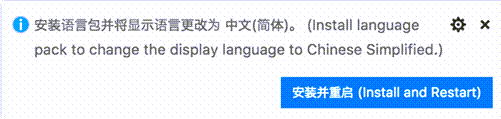
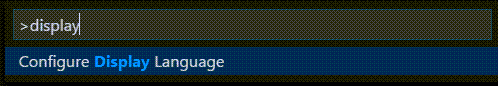
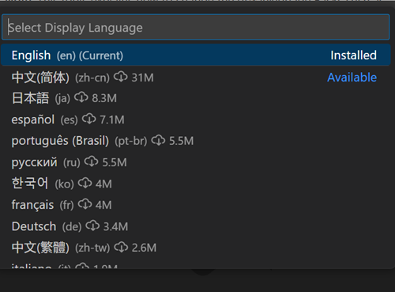
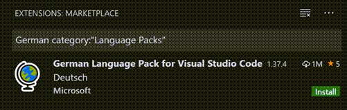

+++
title = "3.3.1 显示语言"
date = 2026-11-06T07:53:25+08:00
weight = 1
type = "docs"
description = ""
isCJKLanguage = true
draft = false
+++


> 原文链接: [https://code.visualstudio.com/docs/configure/locales](https://code.visualstudio.com/docs/configure/locales)

# 3.3.1 显示语言

　　Visual Studio Code 默认以英语作为显示语言，其他[语言](#available-locales)依赖 [Marketplace](https://marketplace.visualstudio.com/search?target=VSCode&category=Language%20Packs&sortBy=Installs)中提供的语言包[3.3.6.2 扩展市场](../3.3.6-Extensions/3.3.6.2-ExtensionMarketplace/)。

　　VS Code 会检测操作系统的 UI 语言，并在 Marketplace 中有相应语言包时提示安装。下图是推荐简体中文语言包的示例：



　　安装语言包扩展并按照提示重新启动后，VS Code 会使用与操作系统 UI 语言匹配的语言包。

> **注意**：本文介绍如何通过法语或中文等语言包更改 VS Code UI 的显示语言。如果要添加编程语言支持（例如 C++ 或 Java），请参阅文档中的[10 语言与运行时](../../../languages-and-runtimes/10.1-Overview/)部分。

## 更改显示语言 {#changing-the-display-language}

　　也可以通过 **Configure Display Language** 命令显式设置 VS Code 显示语言，以覆盖默认 UI 语言。按 `Ctrl + Shift + P` 打开**命令面板**，输入“display”筛选并显示 **Configure Display Language** 命令。



　　按 `Enter`，会按[区域设置](#available-locales)显示可用语言列表，当前活动语言会高亮显示。



　　选择另一种语言以更改显示语言。如果尚未安装语言包，VS Code 会安装它。选择不同的显示语言后，系统会提示重新启动。

　　**Configure Display Language** 命令会写入用户 VS Code 文件夹（`.vscode`）中的运行时配置参数文件 `argv.json`。也可以直接编辑 `argv.json`（**Preferences: Configure Runtime Arguments**）并重新启动 VS Code 来更改显示语言。

## 可用区域设置 {#available-locales}

| 显示语言 | 区域设置 |
|-----------------|-------
| 英语（美国） | `en` |
| 简体中文 | `zh-cn` |
| 繁体中文 | `zh-tw` |
| 法语 | `fr` |
| 德语 | `de` |
| 意大利语 | `it` |
| 西班牙语 | `es` |
| 日语 | `ja` |
| 韩语 | `ko` |
| 俄语 | `ru` |
| 葡萄牙语（巴西） | `pt-br` |
| 土耳其语 | `tr` |
| 波兰语 | `pl` |
| 捷克语 | `cs` |
| 匈牙利语 | `hu` |

## Marketplace 语言包 {#marketplace-language-packs}

　　VS Code 默认以英语发行，但可以通过 [Marketplace 语言包](https://marketplace.visualstudio.com/search?target=VSCode&category=Language%20Packs&sortBy=Installs)获得其他语言。也可以在扩展视图（`Ctrl + Shift + X`）中搜索语言包，输入所需语言以及 `category:"Language Packs"`。



　　可以安装多个语言包，并使用 **Configure Display Language** 命令选择当前显示语言。

## 设置语言 {#setting-the-language}

　　如果要为特定 VS Code 会话使用某种语言，可以在启动 VS Code 时使用命令行开关 `--locale` 指定区域设置。例如，将显示语言设置为法语：

```bash
code . --locale=fr
```

**注意**：必须安装与命令行开关指定语言对应的语言包。如果未安装匹配的语言包，VS Code 将显示英语。

## 常见问题 {#common-questions}

### 无法写入文件，因为文件是脏的 {#unable-to-write-to-file-because-the-file-is-dirty}

　　此通知可能表示上次更改后 `argv.json` 文件未保存。请检查文件是否有错误（**Preferences: Configure Runtime Arguments**），确保文件已保存，然后再次尝试安装语言包。

### 我可以为语言包的翻译做出贡献吗？ {#can-i-contribute-to-a-language-packs-translations}

　　可以。[VS Code 社区本地化项目](https://aka.ms/vscodeloc)对所有人开放，贡献者可以提供新翻译、对现有翻译投票或提出流程改进建议。

### 如何启用 Python 等编程语言？ {#how-can-i-enable-a-programming-language-like-python}

　　请参阅[10 语言与运行时](../../../languages-and-runtimes/10.1-Overview/)部分，了解如何安装 PHP、Python 和 Java 等编程语言支持。
