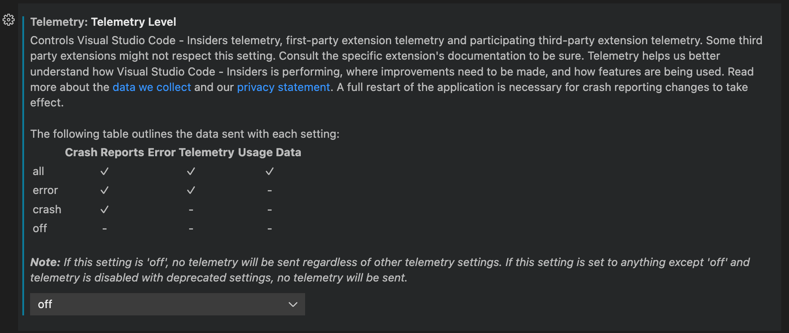
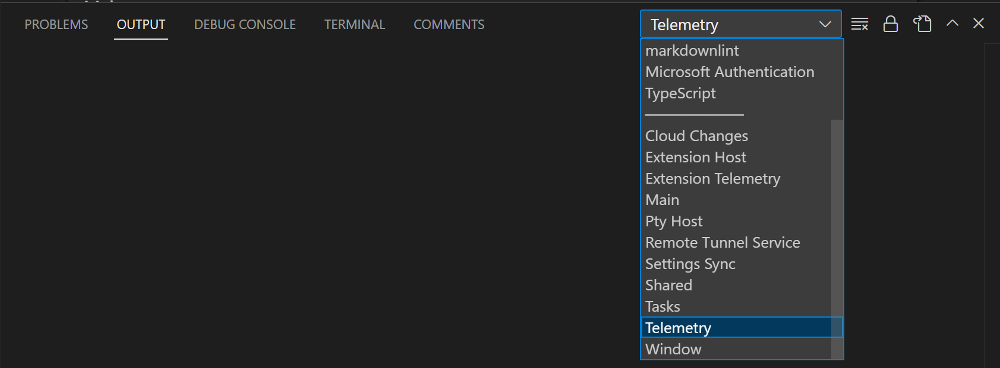
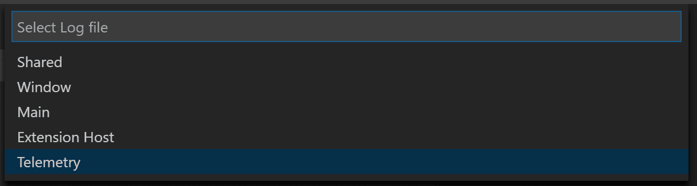
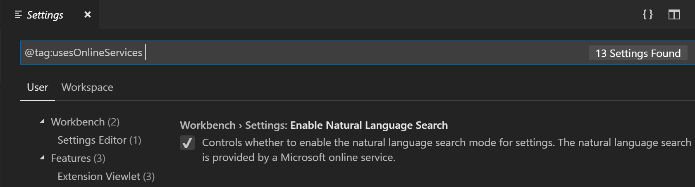
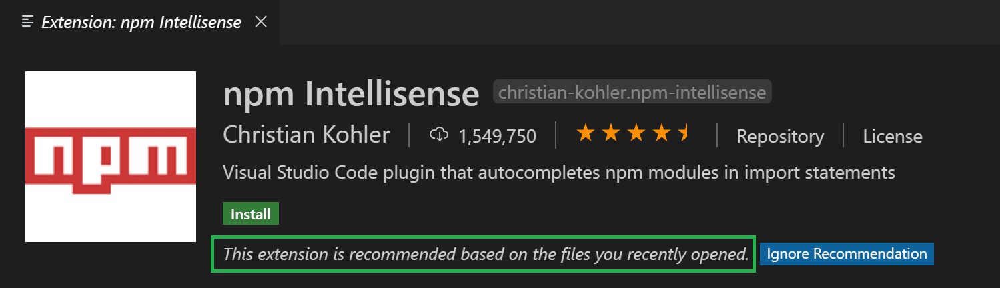

+++
title = "3.3.11 遥测"
date = 2026-11-06T07:53:25+08:00
weight = 11
type = "docs"
description = ""
isCJKLanguage = true
draft = false
+++


> 原文链接: [https://code.visualstudio.com/docs/configure/telemetry](https://code.visualstudio.com/docs/configure/telemetry)

# 3.3.11 遥测

　　Visual Studio Code 会收集遥测数据，用于帮助了解如何改进产品。例如，使用数据有助于调试启动缓慢等问题，并确定新功能的优先级。这些数据也用于在正式发布前向部分用户推出新功能。

　　你可以按[禁用遥测报告](#disable-telemetry-reporting)中的说明禁用遥测。更多信息请参阅[隐私声明](https://go.microsoft.com/fwlink/?LinkID=528096&clcid=0x409)。

## 遥测数据类型 {#types-of-telemetry-data}

* **崩溃报告**：VS Code 崩溃时收集诊断信息并发送给 Microsoft，帮助了解崩溃原因以及需要哪些更改来防止崩溃。
* **错误遥测**：收集不会导致应用程序崩溃但属于意外错误的信息。
* **使用情况数据**：收集功能使用情况和性能信息，帮助确定未来改进的优先级。

## 禁用遥测报告 {#disable-telemetry-reporting}

　　使用 `telemetry.telemetryLevel` 用户设置，可以通过一个设置控制发送的遥测类型：

|       | 崩溃报告 | 错误遥测 | 使用情况数据 |
|:------|:---------------------:|:---------------:|:--------------:|
| all   | ✓ | ✓ | ✓ |
| error | ✓ | ✓ | - |
| crash | ✓ | - | - |
| off   | - | - | - |

　　如果不希望向 Microsoft 发送任何遥测数据，请将 `telemetry.telemetryLevel` 设置为 `off`。这会从此刻起停止所有遥测事件。请注意，在禁用之前可能已经收集并发送了遥测信息。



```json
"telemetry.telemetryLevel": "off"
```

> **重要**：要参与 A/B 实验并提前获取新功能，必须通过将 `telemetry.telemetryLevel` 设置为 `all` 启用使用情况数据。

## 功能可用性和遥测 {#feature-availability-and-telemetry}

　　VS Code 使用 A/B 实验系统在正式发布前向部分用户推出新功能。该系统使用使用情况遥测数据确定哪些用户应获得新功能，并验证功能使用情况。如果将 `telemetry.telemetryLevel` 设置为 `error`、`crash` 或 `off`，实验将禁用，新功能可能会延迟到正式发布后才提供给你。

## 扩展和遥测 {#extensions-and-telemetry}

　　Microsoft 和第三方扩展可能收集自己的使用数据，不受 `telemetry.telemetryLevel` 设置控制。请查阅特定扩展的文档，了解其遥测报告方式以及是否可以禁用。

## 遥测事件的输出通道 {#output-channel-for-telemetry-events}

　　要在发送遥测事件时查看它们，请从命令面板运行 **Developer: Show Telemetry** 命令（`Ctrl + Shift + P`，macOS：`Cmd + Shift + P`）。这会启用遥测事件跟踪，并打开输出面板中的 **Telemetry** 输出通道。



　　跟踪时，事件也会记录到本地 `telemetry.log` 文件，可以使用 **Developer: Open Log...** 命令并选择 **Telemetry** 查看。

要禁用跟踪，请重新加载 VS Code 窗口（**Developer: Reload Window**）。

## 查看所有遥测事件 {#viewing-all-telemetry-events}

　　如果要查看 VS Code 可能发送的所有遥测事件，可以在 CLI 中使用 `--telemetry` 标志。这会生成可在 VS Code 中查看的 JSON 报告。例如：

```bash
code --telemetry > telemetry.json && code telemetry.json
```

　　由于报告较长，不能使用 `code --telemetry | code -` 管道。

### 事件分类 {#event-classification}

* `SystemMetaData`：由 VS Code 生成、不可识别个人身份的值。
* `CallstackOrException`：程序执行失败导致的错误，包含已清除用户路径的堆栈跟踪。
* `PublicNonPersonalData`：公开可用的用户生成数据，例如已发布的扩展 ID。
* `EndUserPseudonymizedInformation`：用于标识唯一用户但无法识别身份信息的哈希，例如哈希后的 MAC 地址。

### 事件目的 {#event-purpose}

* `PerformanceAndHealth`：确保 VS Code 产品和服务健康、快速。
* `FeatureInsight`：了解功能使用情况，确定后续开发投入。
* `BusinessInsight`：为 VS Code、Microsoft 和 GitHub 的业务决策提供依据。

### 事件终结点 {#event-endpoint}

* `GoogleAnalyticsId`：用于网站 Google Analytics 和页面浏览跟踪。
* `MacAddressHash`：用于标识 VS Code 用户。客户端先哈希一次，管道端再哈希一次，使其无法识别特定用户。Web 版会生成 UUID。
* `none`：数据不需要特殊处理。

## 智能体交互的 OpenTelemetry 支持 {#opentelemetry-support-for-agent-interactions}

　　VS Code 中的 Copilot Chat 可以通过 [OpenTelemetry](https://opentelemetry.io/)（OTel）导出跟踪、指标和事件，让你实时了解智能体交互、LLM 调用、工具执行和令牌使用情况。可以将数据与任何兼容 OTel 的后端配合使用。详见[使用 OpenTelemetry 监控智能体交互](https://github.com/microsoft/vscode-copilot-chat/blob/main/docs/monitoring/agent_monitoring.md)。

## GDPR 和 VS Code {#gdpr-and-vs-code}

　　VS Code 团队支持《通用数据保护条例》（GDPR），并重视隐私。为确保合规，VS Code 在产品和通知中简化了退出遥测的方式，审核并分类了发送的遥测数据，并为收集的数据建立了有效的数据保留策略。

　　VS Code 没有可唯一识别用户的“登录”体验，因此没有可靠方式提供“你的数据”。桌面版使用网卡哈希、Web 版使用随机 UUID 来近似识别单个用户以进行诊断，但不保证唯一。

## 管理在线服务 {#managing-online-services}

　　除崩溃报告和遥测外，VS Code 还使用在线服务下载更新、查找和安装扩展、设置同步以及在设置编辑器中提供自然语言搜索。你可以开启或关闭使用这些服务的功能。

　　关闭这些功能不会使 VS Code 进入离线模式。例如，在扩展视图中搜索时，VS Code 仍会搜索在线 Marketplace。在设置中搜索 `@tag:usesOnlineServices` 可显示所有控制在线服务的设置。



> **注意**：VS Code 扩展也可能使用在线服务，并且可能不提供配置设置。

### VS Code 使用的非 Microsoft 在线服务 {#non-microsoft-online-services-used-by-vs-code}

　　内置的 **npm 支持**扩展会向 `https://registry.npmjs.org` 和 `https://registry.bower.io` 发送请求。内置的 **TypeScript 和 JavaScript 语言功能**扩展会查询 `https://registry.npmjs.org` 上的 `@types` 域。使用 **Developer: Toggle Developer Tools** 时，VS Code 可能会联系 Google 服务器获取启动开发者工具所需的数据。

## 扩展推荐 {#extension-recommendations}

　　VS Code 根据文件类型、工作区和环境提供扩展推荐。文件类型推荐可以是预计算或动态的；工作区和环境推荐始终是预计算的。要了解推荐原因，请打开扩展详情页，在页面标题中查看推荐原因。



### 预计算推荐 {#precomputed-recommendations}

　　VS Code 收集关于哪些扩展针对哪些文件类型和工作区/文件夹激活的遥测数据。特定文件夹通过计算每个文件夹 Git 远程的哈希来标识。这些信息用于预计算匿名推荐，例如“如果用户安装了扩展 A 但未安装 B，则推荐 B”。部分推荐随产品提供，其他推荐在运行时从 Microsoft 在线服务获取。

### 动态推荐 {#dynamic-recommendations}

　　当打开没有预计算推荐的文件类型时，VS Code 会向扩展 Marketplace 查询声明支持该文件类型的扩展。如果查询返回未安装的扩展，VS Code 会显示通知。

## 相关资源 {#related-resources}

* [7.4 遥测](../../../enterprise/7.4-Telemetry/#configure-telemetry-level)
* [VS Code 常见问题](https://code.visualstudio.com/docs/supporting/faq)
* [3.3.4 设置](../3.3.4-Settings/)
