+++
title = "3.3.2 布局"
date = 2026-11-06T07:53:25+08:00
weight = 2
type = "docs"
description = ""
isCJKLanguage = true
draft = false
+++

> 原文链接: [https://code.visualstudio.com/docs/configure/custom-layout](https://code.visualstudio.com/docs/configure/custom-layout)

# 3.3.2 布局

　　Visual Studio Code 提供简洁的用户界面和方便的默认布局，同时也提供选项和设置，让你根据偏好和工作方式自定义 UI 布局。本主题介绍各种 UI 自定义方式，帮助你以最高效的方式显示视图、编辑器和面板。

> **注意**：如果你是 VS Code 新手，建议先阅读[3.1.2 用户界面](../../3.1-GettingStarted/3.1.2-UserInterface/)或[3.1.3 提示和技巧](../../3.1-GettingStarted/3.1.3-TipsAndTricks/)。

## 工作台 {#workbench}

### 布局密度 {#layout-density}

　　使用布局密度控制编辑器窗口主要部分周围的间距。首先启用 `workbench.experimental.modernUI`，然后选择标题栏中的 **自定义布局** 控件，在 **布局密度** 下选择：

* **默认**：使用面板之间和面板内的标准间距。
* **紧凑**：移除面板之间的间距，并减少面板内间距。

　　选择会立即应用，并在重新启动 VS Code 后保留。要恢复 **默认** 密度和其他布局设置，请选择 **自定义布局** 中的 **恢复默认值**。也可以使用 `window.density.layout` 设置配置。

### 主侧边栏 {#primary-side-bar}

　　默认情况下，主侧边栏位于工作台左侧，显示资源管理器、搜索和源代码管理等视图。可以通过活动栏图标快速切换视图。

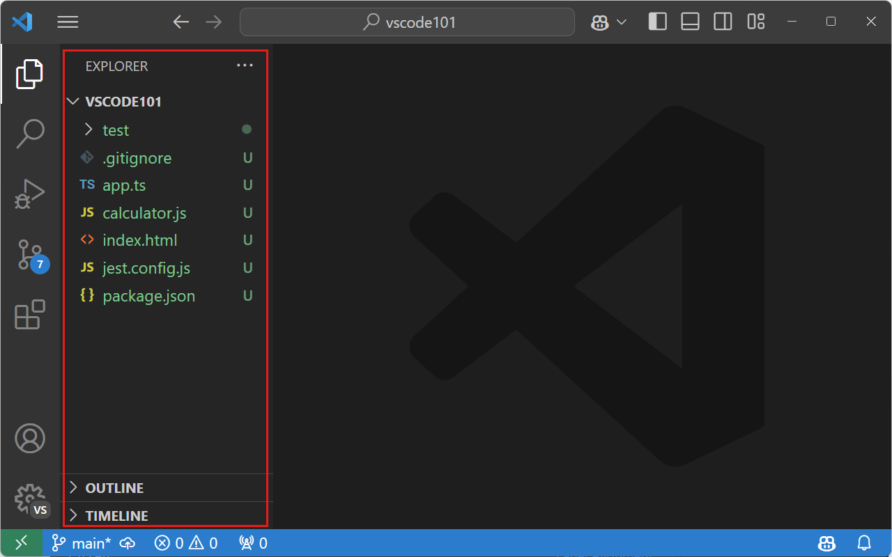

　　可以通过以下方式更改主侧边栏位置：

* 右键单击活动栏，选择 **将主侧边栏移到右侧**。
* 运行 **View: Toggle Primary Side Bar Position**，在主侧边栏左右位置之间切换。
* 使用 **视图** > **外观** > **将主侧边栏移到右侧** 菜单项。
* 在[3.3.4 设置](../3.3.4-Settings/)中将 **Workbench > Side Bar: Location**（`workbench.sideBar.location`）设置为 `right`。

### 辅助侧边栏 {#secondary-side-bar}

　　默认情况下，VS Code 在主侧边栏中显示视图。若想同时查看两个视图，可以使用**辅助侧边栏**在与主侧边栏相对的位置显示视图。无论主侧边栏位置如何切换，辅助侧边栏始终位于其对面。

　　首次打开文件夹或多根工作区时，辅助侧边栏默认显示；在空窗口中默认隐藏。可以使用 `workbench.secondarySideBar.defaultVisibility` 设置配置此行为。

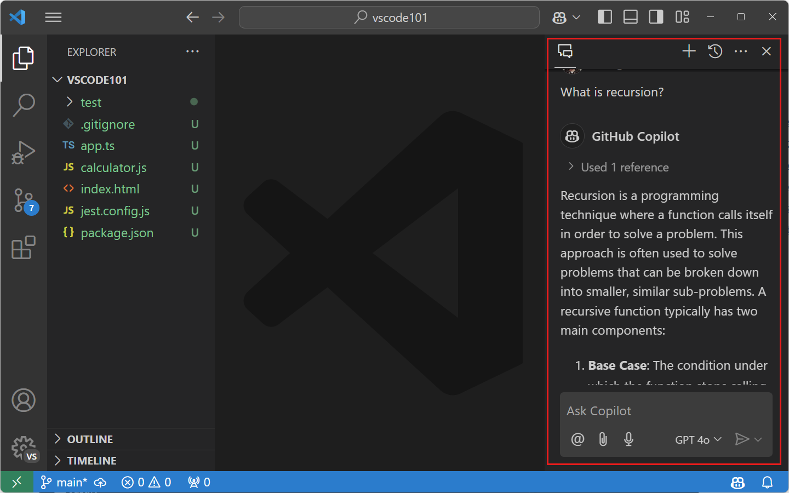

　　如果辅助侧边栏隐藏，可以使用标题栏中的布局控件显示它。如果布局控件不可见，请右键单击 VS Code 标题栏，选择 **布局控件**。

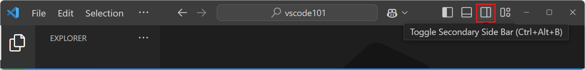

　　也可以运行 **View: Toggle Secondary Side Bar Visibility** 命令（`Ctrl + Alt + B`，macOS：`Cmd + Option + B`），或使用 **视图** > **外观** > **辅助侧边栏**。

　　可以随时将视图和面板拖放到主侧边栏或辅助侧边栏。VS Code 会跨会话记住视图和面板的布局。可以使用 **View: Reset View Locations** 命令将视图和面板恢复到默认位置。

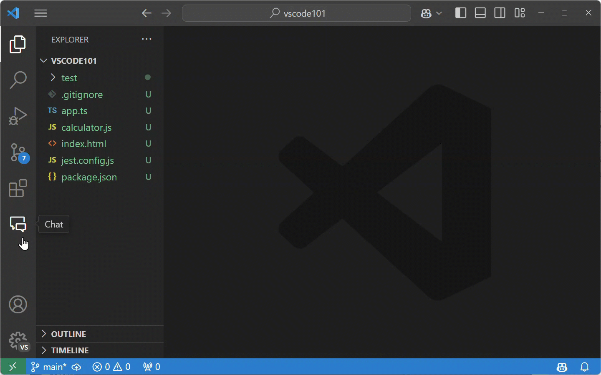

### 命令面板位置 {#command-palette-position}

　　可以通过抓住命令面板顶部边缘并拖动到其他位置来移动它。也可以选择标题栏中的 **自定义布局** 控件，然后选择预设的**快速输入位置**。

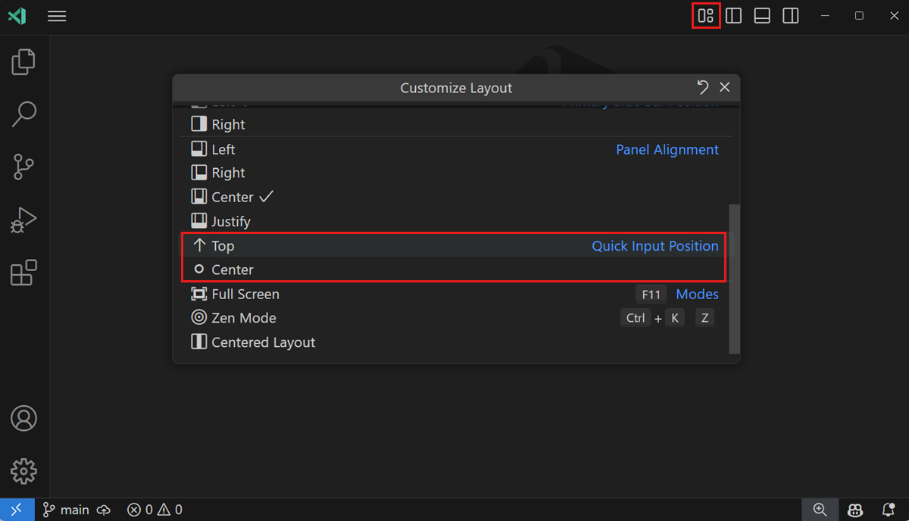

### 活动栏位置 {#activity-bar-position}

　　默认情况下，活动栏随主侧边栏移动，并位于工作台外边缘。也可以隐藏活动栏，或将其移到主侧边栏的顶部或底部。活动栏上下文菜单或 **视图** > **外观** > **活动栏位置** 提供 **默认**、**顶部**、**底部** 或 **隐藏** 选项。活动栏位于顶部或底部时，通常位于底部的**账户**和**管理**按钮会移到标题栏右侧。

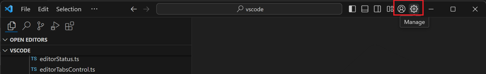

### 活动栏大小 {#activity-bar-size}

　　活动栏支持两种大小：较大的默认大小和与经典活动栏外观匹配的紧凑大小。将 `workbench.activityBar.compact` 设置为 `true` 可切换到紧凑模式。也可以右键单击活动栏，在 **活动栏大小** 子菜单中选择 **默认** 或 **紧凑**。

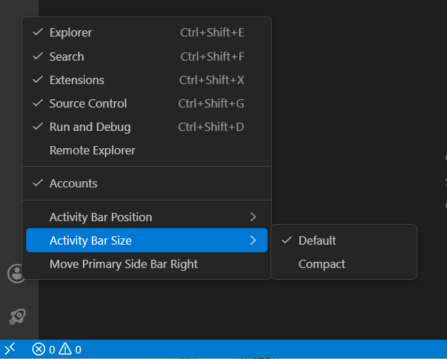

> **注意**：**活动栏大小** 子菜单仅在活动栏处于默认（侧边）位置时出现。

### 自定义布局控件 {#customize-layout-control}

　　VS Code 标题栏还有按钮，用于切换主要 UI 元素（侧边栏和面板区域）的可见性。

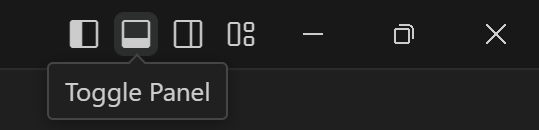

　　最右侧按钮打开 **自定义布局** 下拉菜单，可进一步更改 UI 元素的可见性和布局，包括以下布局模式：

* **全屏**：让编辑器填满整个显示屏。**View: Toggle Full Screen**（`F11`）。
* **禅模式**：除编辑器区域外隐藏所有 UI。**View: Toggle Zen Mode**（`Ctrl + K Z`，macOS：`Cmd + K Z`）。
* **居中布局**：在编辑器区域内居中显示编辑器。**View: Toggle Centered Layout**。

### 窗口和菜单样式 {#window-and-menu-style}

* `window.titleBarStyle`：将窗口标题栏外观调整为操作系统原生或自定义。更改需要完全重新启动。
* `window.title`：根据当前上下文（如打开的工作区或活动编辑器）配置窗口标题。支持变量，例如 `${activeEditorShort}`、`${dirty}`、`${rootName}`、`${profileName}`、`${appName}` 和 `${separator}`。
* `window.titleSeparator`：`window.title` 中使用的分隔符。
* `window.menuStyle`：将菜单样式调整为原生、自定义或继承标题栏样式。也会影响上下文菜单。更改需要完全重新启动。
* `window.menuBarVisibility`：配置菜单栏可见性：`classic`（顶部显示，全屏时隐藏）、`visible`（始终可见）、`toggle`（隐藏，按 Alt 显示）、`compact`（移到侧边栏）或 `hidden`（始终隐藏）。

## 面板 {#panel}

　　面板区域显示问题、终端和输出等 UI 元素，默认位于编辑器区域下方。

### 面板位置 {#panel-position}

　　可以将面板移到编辑器的左侧、右侧、底部或顶部。可以在 **视图** > **外观** > **面板位置** 菜单或面板标题栏上下文菜单中配置。

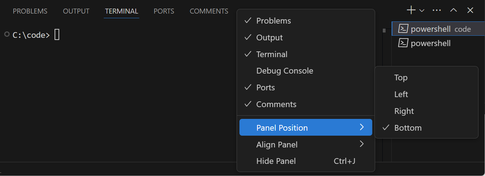

　　还可以使用命令面板中的 **View: Move Panel Left/Right/To Bottom/To Top** 命令。

### 面板对齐 {#panel-alignment}

　　此选项配置底部面板横跨窗口的距离：

* **居中**：默认行为，面板仅横跨编辑器区域宽度。
* **两端对齐**：面板横跨整个窗口宽度。
* **左**：面板从窗口左边缘延伸到编辑器区域右边缘。
* **右**：面板从窗口右边缘延伸到编辑器区域左边缘。

　　在 **视图** > **外观** > **对齐面板**、面板标题上下文菜单或 **Set Panel Alignment to...** 命令中配置。

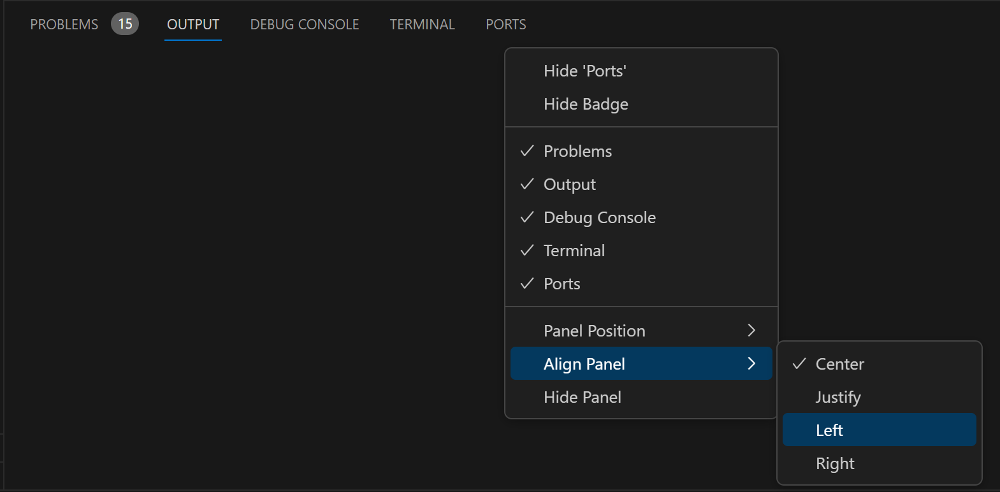

### 最大化面板大小 {#maximize-panel-size}

　　当面板对齐为 **居中** 时，可以使用面板区域右上角的**最大化面板大小**尖括号按钮，将面板切换为填满整个编辑器区域。最大化时按钮指向下方，用于恢复原大小。也可以通过 **View: Toggle Maximized Panel** 命令最大化。

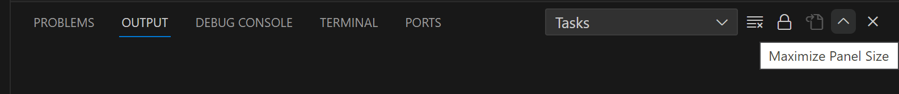

### 拖放视图和面板 {#drag-and-drop-views-and-panels}

　　VS Code 有默认的视图和面板布局，但可以在主侧边栏和面板区域之间拖放视图和面板。例如，将源代码管理视图拖到面板区域，或将问题面板放入主侧边栏：

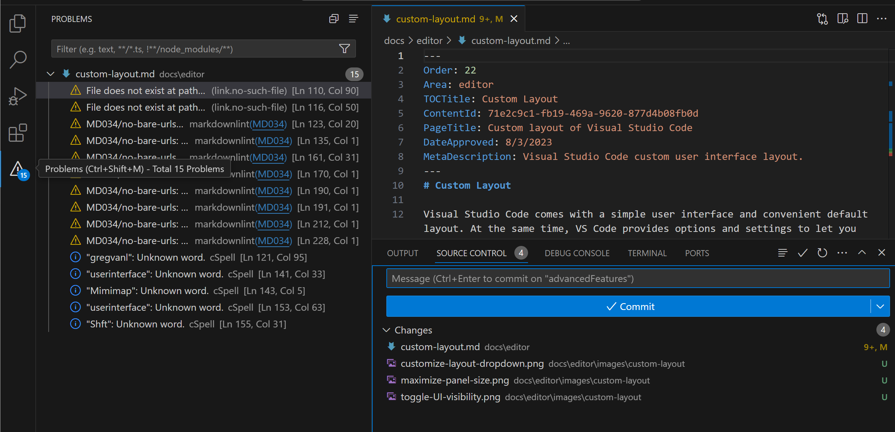

　　可以使用 **重置位置** 上下文菜单项重置单个视图，或使用 **View: Reset View Locations** 重置所有视图和面板。也可以将输出面板拖到资源管理器活动栏项上，放到视图中，以创建视图组。要使用键盘，请使用 **View: Move View** 和 **View: Move Focused View** 命令。

## 通知 {#notifications}

　　默认情况下，VS Code 在工作台右下角显示通知弹出窗口和通知中心。可以使用 `workbench.notifications.position` 设置（实验性）更改位置：`bottom-right`（默认）、`bottom-left` 或 `top-right`。也可以从通知中心选择位置图标更改。

## 工具栏 {#tool-bars}

　　大多数视图和面板的右上角都有工具栏。例如，搜索视图有 **刷新**、**清除搜索结果** 等操作。

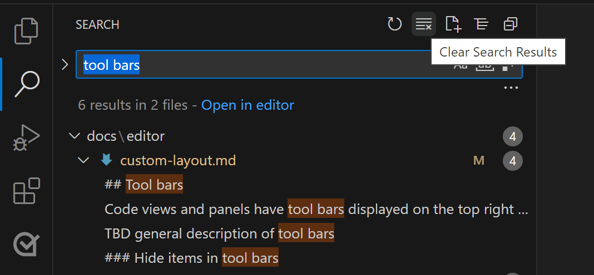

### 隐藏工具栏项 {#hide-items-in-tool-bars}

　　如果工具栏过于拥挤，可以右键单击任意操作并选择 **隐藏** 命令，或取消勾选操作。隐藏的操作会移到 `...` **更多操作** 菜单。要恢复操作，请右键单击工具栏按钮区域，选择 **重置菜单**，或重新勾选隐藏的操作。要恢复所有菜单，请从命令面板运行 **View: Reset All Menus**。

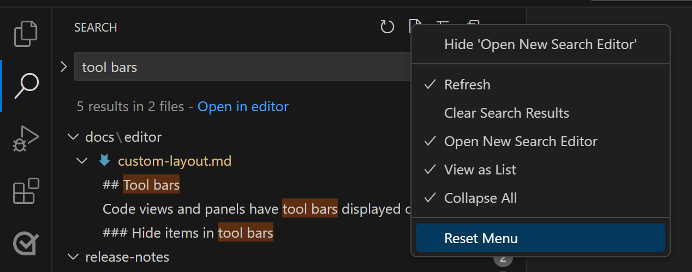

## 编辑器 {#editor}

　　可以独立于工作台 UI 自定义编辑器区域布局。默认情况下，编辑器区域显示小地图、面包屑、编辑器选项卡以及可选的粘性滚动等功能。

### 小地图和面包屑 {#minimap-and-breadcrumbs}

　　**视图** > **外观** 菜单提供以下切换：**小地图**（当前文件的视觉概览）、**面包屑**（文件夹、文件和当前符号信息）以及**粘性滚动**（嵌套符号范围）。

### 编辑器组 {#editor-groups}

　　默认情况下，每个打开的编辑器都进入同一**编辑器组**，并在右侧添加新选项卡。可以创建新的编辑器组来分组相似文件，或允许[3.1.2 用户界面](../../3.1-GettingStarted/3.1.2-UserInterface/#side-by-side-editing)。

　　将编辑器拖到侧面，或使用编辑器选项卡上下文菜单中的 **拆分** 命令，可以在左、右、上、下复制当前编辑器到新组。**拆分** 命令也可从 **视图** > **编辑器布局** 菜单和命令面板使用。使用 **Toggle Vertical/Horizontal Editor Layout** 命令（`Ctrl + K Ctrl + L`？请通过命令面板执行）可以在垂直和水平布局之间切换。

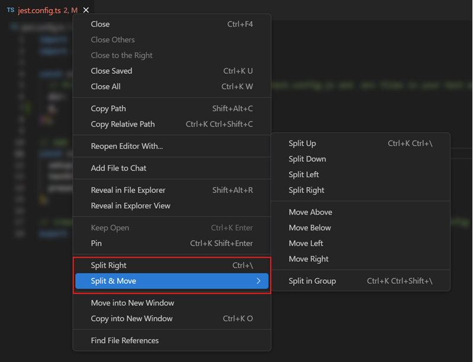

### 最大化和扩展编辑器组 {#maximize-and-expand-an-editor-group}

　　使用多个编辑器组时，可以双击编辑器选项卡切换其组大小，或使用 **View: Toggle Maximize Editor Group** 命令。`workbench.editor.doubleClickTabToToggleEditorGroupSizes` 设置控制双击行为：`expand`（默认，尽可能扩展）、`maximize`（隐藏其他组）或 `off`。

### 组内拆分 {#split-in-group}

　　使用 **View: Split Editor in Group** 命令（`Ctrl + K Ctrl + \`？请从命令面板执行）可以在同一组中拆分编辑器，实现并排编辑。相关命令包括切换拆分模式、合并、切换布局以及聚焦第一侧/第二侧。`workbench.editor.splitInGroupLayout` 设置可设置水平（默认）或垂直布局。

### 网格布局 {#grid-layout}

　　如果需要更精细地控制编辑器组布局，可以使用[3.1.2 用户界面](../../3.1-GettingStarted/3.1.2-UserInterface/#grid-editor-layout)。**视图** > **编辑器布局** 菜单列出多种布局选项，例如 **两列**、**三列**、**网格（2x2）**，可以拖动组之间的分隔条调整大小。

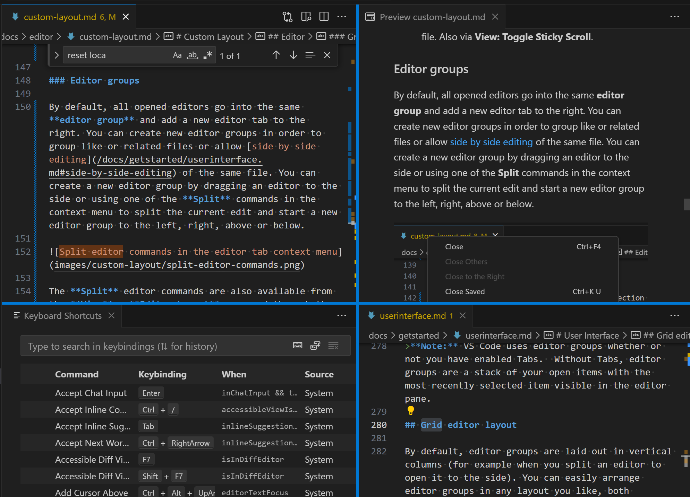

### 浮动窗口 {#floating-windows}

　　可以在浮动窗口中打开编辑器、终端或特定视图，适合多显示器设置。将编辑器拖出主窗口，放到当前 VS Code 窗口之外的任意位置即可。

<video src="https://code.visualstudio.com/assets/docs/configure/custom-layout/floating-windows.mp4" title="将编辑器选项卡拖出 VS Code 窗口以在浮动窗口中打开文件的视频。" autoplay loop controls muted></video>

　　浮动窗口可以按网格布局打开任意数量的编辑器，并在重新启动后恢复位置和内容。也可以右键单击编辑器选项卡，选择 **移到新窗口**（`workbench.action.moveEditorToNewWindow`）或 **复制到新窗口**。要移动整个编辑器组，请使用 **Move Editor Group into New Window** 或 **Copy Editor Group into New Window** 命令。

#### 紧凑模式 {#compact-mode}

　　选择浮动窗口标题栏中的 **设置紧凑模式**，移除不必要的 UI 元素，为内容腾出更多空间。再次选择可恢复。

#### 固定到顶部 {#pin-to-top}

　　选择浮动窗口标题栏中的 **设置始终置顶**，使浮动窗口保持可见。再次选择可取消。

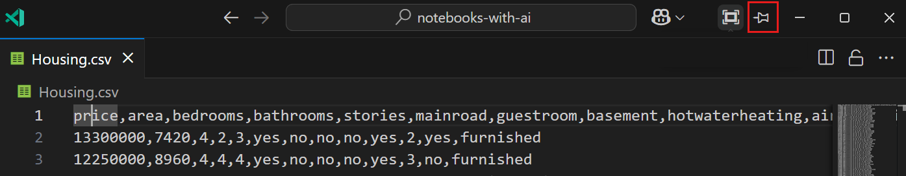

### 固定选项卡 {#pinned-tabs}

　　要使编辑器选项卡始终可见，可以将其固定到选项卡栏。可以通过上下文菜单或 **View: Pin Editor** 命令（`Ctrl + K Enter`？请从命令面板执行）固定。

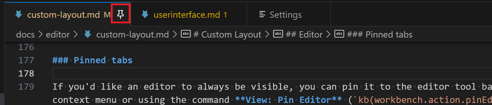

　　固定选项卡始终显示在未固定选项卡之前，不会滚动出视图，不会因 **关闭其他** 或 **关闭所有** 等命令关闭，也不会因超过编辑器限制而关闭。可以通过单击固定图标、上下文菜单中的 **取消固定** 或 **View: Unpin Editor** 取消固定。

　　使用 `workbench.editor.pinnedTabSizing` 设置选择 `normal`、`shrink` 或 `compact`。还可以通过 **Workbench > Editor: Pinned Tabs On Separate Row** 将固定选项卡显示在单独一行。

### 锁定的编辑器组 {#locked-editor-groups}

　　使用多个编辑器时，可以锁定整个编辑器组，使其始终保持可见；新编辑器会在其他组中打开。编辑器组工具栏中的锁图标表示已锁定。

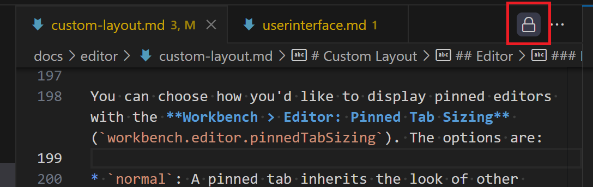

　　从编辑器工具栏 **更多操作** `...` 下拉菜单中选择 **锁定组**，或运行 **View: Lock Editor Group** 命令。通过单击锁图标或 **View: Unlock Editor Group** 解锁。

　　锁定组的行为：新编辑器不会在锁定组中打开，除非显式移动；新编辑器会在最近使用的未锁定组中打开，或在锁定组旁创建新组；锁定状态跨重启保留；也可以锁定空组。主要用例是[5.2 终端基础](../../../terminal/5.2-TerminalBasics/#terminals-in-editor-area)。使用 `workbench.editor.autoLockGroups` 设置配置自动锁定的编辑器类型，默认仅终端编辑器。

## 后续步骤 {#next-steps}

* [3.1.2 用户界面](../../3.1-GettingStarted/3.1.2-UserInterface/)：快速了解 VS Code。
* [3.2.1 基本编辑](../../3.2-WriteCode/3.2.1-BasicEditing/)：了解强大的 VS Code 编辑器。
* [3.2.5 代码导航](../../3.2-WriteCode/3.2.5-CodeNavigation/)：快速浏览源代码。
