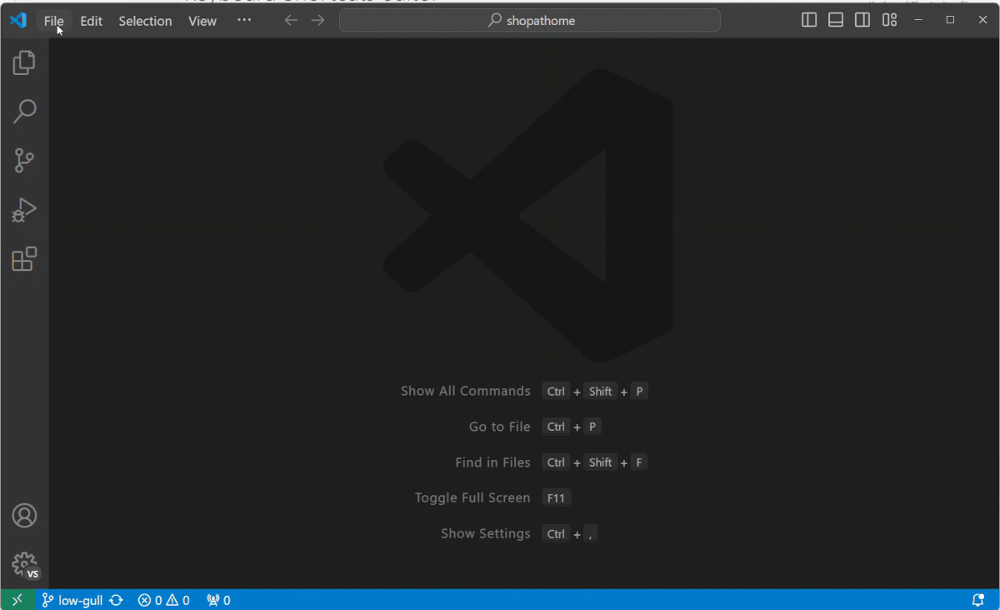
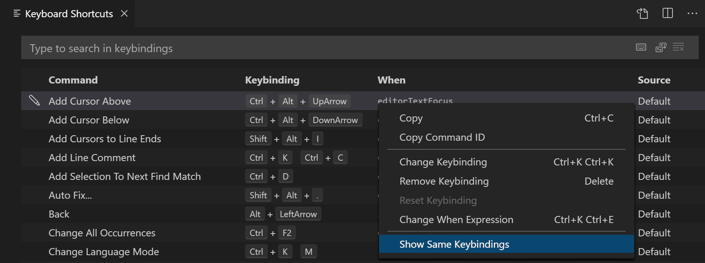
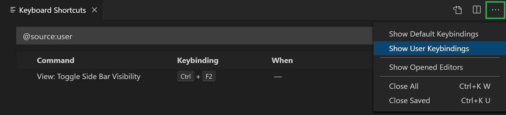
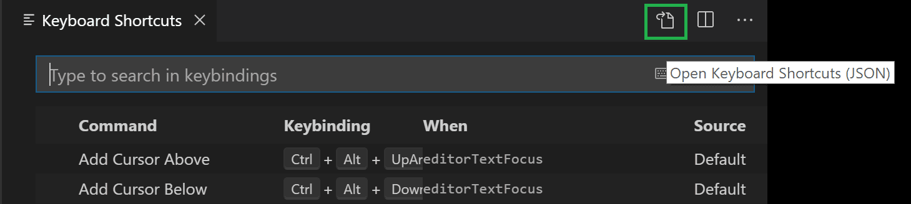
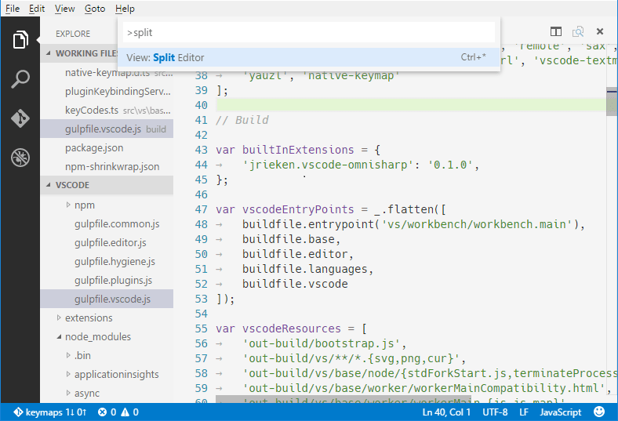
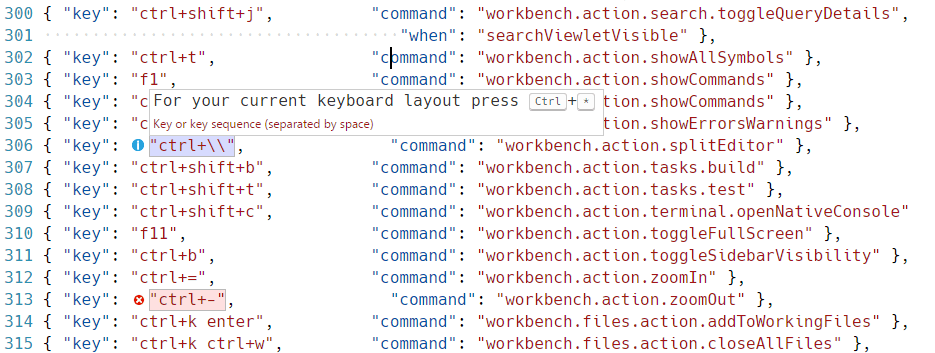
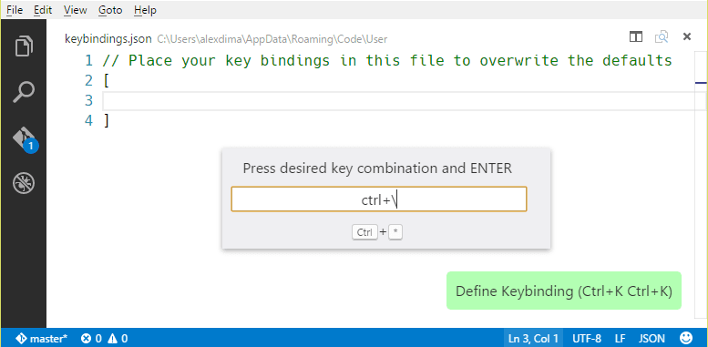
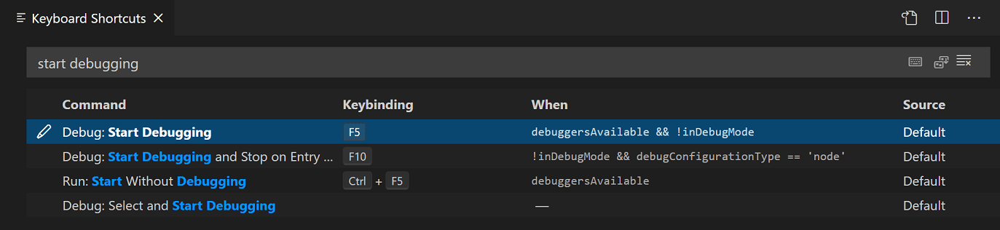
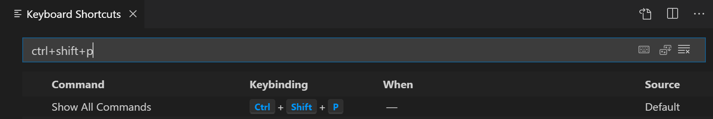

+++
title = "3.3.3 键盘快捷键"
date = 2026-11-06T07:53:25+08:00
weight = 3
type = "docs"
description = ""
isCJKLanguage = true
draft = false
+++


> 原文链接: [https://code.visualstudio.com/docs/configure/keybindings](https://code.visualstudio.com/docs/configure/keybindings)

# 3.3.3 键盘快捷键

　　VS Code 允许直接通过键盘执行大多数任务。本文介绍如何修改 VS Code 自带的默认键盘快捷键。

> **注意**：在 Mac 上访问此页面会看到 Mac 快捷键；使用 Windows 或 Linux 访问会看到该平台的按键。需要其他平台快捷键时，请将鼠标悬停在感兴趣的按键上。

## 键盘快捷键编辑器 {#keyboard-shortcuts-editor}

　　VS Code 提供丰富的键盘快捷键编辑体验。键盘快捷键编辑器列出所有可用命令（无论是否绑定快捷键），并允许通过可用操作更改、移除或重置快捷键。要查找命令或快捷键，请使用搜索框输入命令或快捷键筛选列表。

要打开键盘快捷键编辑器，请选择 **文件** > **首选项** > **键盘快捷键** 菜单，或在命令面板中使用 **Preferences: Open Keyboard Shortcuts** 命令（`Ctrl + K Ctrl + S`）。键盘快捷键编辑器默认以[模态覆盖层](../../3.1-GettingStarted/3.1.2-UserInterface/)形式打开在编辑器区域上方。



> **注意**：键盘快捷键匹配当前键盘布局。例如，美式键盘布局中的 `Cmd+\` 在切换为德语布局后会显示为 `Ctrl+Shift+Alt+Cmd+7`。更改快捷键的对话框会根据键盘布局分配正确且期望的快捷键。

## 自定义 UI 操作的快捷键 {#customize-shortcuts-for-ui-actions}

　　要自定义 UI 操作的键盘快捷键，请右键单击工作台中的任何操作项，选择 **配置键绑定**。这会打开键盘快捷键编辑器并筛选到相应命令。操作有 `when` 子句时会自动包含，便于按需设置快捷键。

## 键映射扩展 {#keymap-extensions}

　　键映射扩展修改 VS Code 快捷键以匹配其他编辑器，因此不需要学习新快捷键。

选择 **文件** > **首选项** > **从...迁移键盘快捷键** 菜单可获取流行键映射扩展列表。Marketplace 中还有[键映射类别](https://marketplace.visualstudio.com/search?target=VSCode&category=Keymaps&sortBy=Installs)扩展。

## 键盘快捷键参考 {#keyboard-shortcuts-reference}

　　我们提供默认键盘快捷键的可打印版本。选择 **帮助** > **键盘快捷键参考** 显示适合打印的精简 PDF。

以下链接提供三个平台特定版本（美式英语键盘）：

* [Windows](https://go.microsoft.com/fwlink/?linkid=832145)
* [macOS](https://go.microsoft.com/fwlink/?linkid=832143)
* [Linux](https://go.microsoft.com/fwlink/?linkid=832144)

## 检测键盘快捷键冲突 {#detecting-keyboard-shortcut-conflicts}

　　安装许多扩展或修改快捷键后，可能出现快捷键冲突，即同一快捷键映射到多个命令。尤其当不同快捷键在编辑器移动时进入和退出作用域，可能导致混乱行为。

右键单击快捷键列表中的项，选择 **显示相同键绑定** 查看具有相同快捷键的所有条目。



## 排查键盘快捷键问题 {#troubleshooting-keyboard-shortcuts}

　　要排查快捷键问题，可以执行 **Developer: Toggle Keyboard Shortcuts Troubleshooting** 命令。这会激活已分派快捷键的日志记录，并打开输出面板显示相应日志文件。

然后按下所需快捷键，检查 VS Code 检测到什么快捷键以及调用了什么命令。

例如，在 macOS 代码编辑器中按 `cmd+/` 时，日志输出为：

```
[KeybindingService]: / Received  keydown event - modifiers: [meta], code: MetaLeft, keyCode: 91, key: Meta
[KeybindingService]: | Converted keydown event - modifiers: [meta], code: MetaLeft, keyCode: 57 ('Meta')
[KeybindingService]: \ Keyboard event cannot be dispatched.
[KeybindingService]: / Received  keydown event - modifiers: [meta], code: Slash, keyCode: 191, key: /
[KeybindingService]: | Converted keydown event - modifiers: [meta], code: Slash, keyCode: 85 ('/')
[KeybindingService]: | Resolving meta+[Slash]
[KeybindingService]: \ From 2 keybinding entries, matched editor.action.commentLine, when: editorTextFocus && !editorReadonly, source: built-in.
```

　　示例日志中，第一个 keydown 事件对应 `MetaLeft` 键（`cmd`），无法分派。第二个 keydown 事件对应 `Slash` 键（`/`），分派为 `meta+[Slash]`。有两个快捷键条目映射自 `meta+[Slash]`，匹配的是 `editor.action.commentLine` 命令，其 `when` 条件为 `editorTextFocus && !editorReadonly`，并且是内置快捷键条目。

## 查看已修改的键盘快捷键 {#viewing-modified-keyboard-shortcuts}

　　要将列表筛选为仅显示已修改的快捷键，请在 **更多操作**（`...`）菜单中选择 **Show User Keybindings** 命令。这会对 **键盘快捷键** 编辑器应用 `@source:user` 筛选器（**来源** 为“用户”）。



## 高级自定义 {#advanced-customization}

　　VS Code 将自定义的键盘快捷键记录在 `keybindings.json` 文件中。高级自定义可以直接修改 `keybindings.json`。

打开 `keybindings.json` 文件：

* 打开 **键盘快捷键** 编辑器，然后选择编辑器标题栏右侧的 **打开键盘快捷键 (JSON)** 按钮。

  

* 或者，在命令面板（`Ctrl + Shift + P`）中使用 **Open Default Keyboard Shortcuts (JSON)** 命令。

### 系统级键盘快捷键 {#system-wide-keyboard-shortcuts}

　　即使 VS Code 不在焦点，也要运行 VS Code 命令时，请向用户快捷键添加 `"systemWide": true`。例如，以下快捷键在 macOS 上从任何应用打开智能体窗口：

```json
{
  "key": "cmd+shift+a",
  "command": "workbench.action.openAgentsWindow",
  "systemWide": true
}
```

系统级快捷键有以下限制：

* 仅在桌面版 VS Code 中可用。
* 仅适用于用户定义快捷键，不适用于默认或扩展贡献的快捷键。
* 支持单个组合键，不支持组合键序列。
* 系统级触发会忽略 `when` 子句，并在 VS Code 运行时保持活动。
* 操作系统或其他应用使用相同组合键时可能注册失败。注册失败时 VS Code 会显示通知。

> **注意**：系统级快捷键在 VS Code 运行时会从其他应用捕获其组合键。

　　命令决定是否将 VS Code 窗口带到前台。要在运行命令前显示当前窗口，请使用 `runCommands` 和 `workbench.action.focusWindow`。例如：

```json
{
  "key": "ctrl+cmd+p",
  "command": "runCommands",
  "args": {
    "commands": [
      "workbench.action.focusWindow",
      "workbench.action.quickOpen"
    ]
  },
  "systemWide": true
}
```

## 键盘规则 {#keyboard-rules}

　　VS Code 中的键盘快捷键配置也称为*键盘规则*。每条规则包含以下属性：

* `key`：描述按下的键，例如 `Ctrl + F`。
* `command`：要执行的 VS Code 命令标识符，例如 `workbench.view.explorer` 打开资源管理器视图。
* `when`：（可选）包含布尔表达式的子句，根据当前[上下文](#when-clause-contexts)求值。
* `systemWide`：（可选）布尔值，注册[系统级键盘快捷键](#system-wide-keyboard-shortcuts)。

　　组合键（两次独立按键操作）通过用空格分隔两次按键描述，例如 `Ctrl+K Ctrl+C`。

按下键时应用以下求值规则：

* 规则从**底部**向**顶部**求值。
* 第一个同时匹配 `key` 和 `when` 子句的规则被接受。
* 找到规则后不再处理其他规则。
* 找到规则并设置了 `command` 时执行该命令。

　　额外的 `keybindings.json` 规则在运行时追加到默认规则底部，从而可以覆盖默认规则。VS Code 监视 `keybindings.json`，运行期间编辑会在运行时更新规则。

　　快捷键分派通过分析 JSON 规则列表完成。示例：

```json
// 焦点在编辑器时活动的键盘快捷键
{ "key": "home",            "command": "cursorHome",                  "when": "editorTextFocus" },
{ "key": "shift+home",      "command": "cursorHomeSelect",            "when": "editorTextFocus" },

// 互补的键盘快捷键
{ "key": "f5",              "command": "workbench.action.debug.continue", "when": "inDebugMode" },
{ "key": "f5",              "command": "workbench.action.debug.start",    "when": "!inDebugMode" },

// 全局键盘快捷键
{ "key": "ctrl+f",          "command": "actions.find" },
{ "key": "alt+left",        "command": "workbench.action.navigateBack" },
{ "key": "alt+right",       "command": "workbench.action.navigateForward" },

// 使用组合键（两次独立按键）的全局快捷键
{ "key": "ctrl+k enter",    "command": "workbench.action.keepEditor" },
{ "key": "ctrl+k ctrl+w",   "command": "workbench.action.closeAllEditors" },
```

## 接受的按键 {#accepted-keys}

　　`key` 由修饰键和按键本身组成。

接受以下修饰键：

| 平台 | 修饰键 |
| -- | --------- |
| macOS | `Ctrl+`、`Shift+`、`Alt+`、`Cmd+` |
| Windows | `Ctrl+`、`Shift+`、`Alt+`、`Win+` |
| Linux | `Ctrl+`、`Shift+`、`Alt+`、`Meta+` |

接受以下按键：

* `f1-f19`、`a-z`、`0-9`
* `` ` ``、`-`、`=`、`[`、`]`、`\`、`;`、`'`、`,`、`.`、`/`
* `left`、`up`、`right`、`down`、`pageup`、`pagedown`、`end`、`home`
* `tab`、`enter`、`escape`、`space`、`backspace`、`delete`
* `pausebreak`、`capslock`、`insert`
* `numpad0-numpad9`、`numpad_multiply`、`numpad_add`、`numpad_separator`
* `numpad_subtract`、`numpad_decimal`、`numpad_divide`

## 命令参数 {#command-arguments}

　　可以带参数调用命令。经常对特定文件或文件夹执行相同操作时很有用，可以添加自定义快捷键精确执行所需操作。

以下示例覆盖 `Enter` 键以打印文本：

```json
  { "key": "enter", "command": "type",
                    "args": { "text": "Hello World" },
                    "when": "editorTextFocus" }
```

　　`type` 命令会将 `{"text": "Hello World"}` 作为第一个参数，并向文件添加“Hello World”，而不是执行默认命令。

　　带参数命令的更多信息请参阅[内置命令](https://code.visualstudio.com/api/references/commands)。

### 运行特定文档格式化程序 {#run-a-specific-document-formatter}

　　安装多个格式化扩展时，可以创建快捷键直接运行特定格式化程序，而不更改默认格式化程序。将命令设置为 `editor.action.formatDocument.multiple`，并在 `formatter` 参数中传递格式化扩展标识符：

```json
{
  "key": "ctrl+alt+f",
  "command": "editor.action.formatDocument.multiple",
  "args": {
    "formatter": "esbenp.prettier-vscode"
  },
  "when": "editorTextFocus && !editorReadonly"
}
```

　　将 `esbenp.prettier-vscode` 替换为格式化扩展标识符。标识符匹配不区分大小写。

　　与 `editor.defaultFormatter` 设置不同，此快捷键仅在运行快捷键时选择格式化程序。省略 `formatter` 参数时，命令打开格式化程序选择器。指定格式化程序对活动文档不可用时，命令不会格式化文档。

## 运行多个命令 {#running-multiple-commands}

　　可以使用 `runCommands` 命令配置快捷键按顺序运行多个命令。

* 运行多个无参数命令：

  以下示例向下复制当前行、将当前行标记为注释并将光标移到复制行。

  ```json
  {
    "key": "ctrl+alt+c",
    "command": "runCommands",
    "args": {
      "commands": [
        "editor.action.copyLinesDownAction",
        "cursorUp",
        "editor.action.addCommentLine",
        "cursorDown"
      ]
    }
  },
  ```

* 向命令传递参数：

  此示例创建新的未命名 TypeScript 文件并插入自定义代码片段。

  ```json
  {
    "key": "ctrl+n",
    "command": "runCommands",
    "args": {
      "commands": [
        {
          "command": "workbench.action.files.newUntitledFile",
          "args": {
            "languageId": "typescript"
          }
        },
        {
          "command": "editor.action.insertSnippet",
          "args": {
            "langId": "typescript",
            "snippet": "class ${1:ClassName} {\n\tconstructor() {\n\t\t$0\n\t}\n}"
          }
        }
      ]
    }
  },
  ```

　　注意 `runCommands` 运行的命令会将 `"args"` 值作为第一个参数。上例中，`workbench.action.files.newUntitledFile` 将 `{"languageId": "typescript" }` 作为第一个也是唯一参数。

要传递多个参数，需要将 `"args"` 设为数组：

```json
{
  "key": "ctrl+shift+e",
  "command": "runCommands",
  "args": {
    "commands": [
      {
        // 使用 2 个参数调用命令：vscode.executeCommand("myCommand", "arg1", "arg2")
        "command": "myCommand",
        "args": [
          "arg1",
          "arg2"
        ]
      }
    ]
  }
}
```

　　要将数组作为第一个参数，请将数组再包一层：`"args": [ [1, 2, 3] ]`。

## 移除键盘快捷键 {#removing-a-keyboard-shortcut}

　　要移除快捷键，请右键单击键盘快捷键编辑器中的条目，选择 **移除键绑定**。

　　使用 `keybindings.json` 移除快捷键时，在 `command` 前添加 `-`，该规则会成为移除规则。

示例：

```json
// 在默认键盘快捷键中
...
{ "key": "tab", "command": "tab", "when": ... },
{ "key": "tab", "command": "jumpToNextSnippetPlaceholder", "when": ... },
{ "key": "tab", "command": "acceptSelectedSuggestion", "when": ... },
...

// 要移除第二条规则，例如在 keybindings.json 中添加：
{ "key": "tab", "command": "-jumpToNextSnippetPlaceholder" }

```

　　要用空操作覆盖特定快捷键规则，可以指定空命令：

```json
// 要覆盖并禁用任何 `tab` 快捷键，例如在 keybindings.json 中添加：
{ "key": "tab", "command": "" }
```

## 键盘布局 {#keyboard-layouts}

> **注意**：本节仅涉及键盘快捷键，不涉及编辑器中的输入。

　　按键是虚拟键的字符串表示，不一定与按下时产生的字符相关。更准确地说：

* 参考：[虚拟键代码（Windows）](https://learn.microsoft.com/en-us/windows/win32/inputdev/virtual-key-codes)
* `tab` 对应 `VK_TAB`（`0x09`）
* `;` 对应 `VK_OEM_1`（`0xBA`）
* `=` 对应 `VK_OEM_PLUS`（`0xBB`）
* `,` 对应 `VK_OEM_COMMA`（`0xBC`）
* `-` 对应 `VK_OEM_MINUS`（`0xBD`）
* `.` 对应 `VK_OEM_PERIOD`（`0xBE`）
* `/` 对应 `VK_OEM_2`（`0xBF`）
* `` ` `` 对应 `VK_OEM_3`（`0xC0`）
* `[` 对应 `VK_OEM_4`（`0xDB`）
* `\` 对应 `VK_OEM_5`（`0xDC`）
* `]` 对应 `VK_OEM_6`（`0xDD`）
* `'` 对应 `VK_OEM_7`（`0xDE`）
* 等。

　　不同键盘布局通常会重新定位这些虚拟键或改变按下时产生的字符。使用非标准美式布局时，VS Code 会：

所有键盘快捷键在 UI 中使用当前系统键盘布局呈现。例如，法语（法国）键盘布局下 **拆分编辑器** 会呈现为 `Ctrl+*`：



　　编辑 `keybindings.json` 时，VS Code 会高亮误导性快捷键，即文件中以标准美式键盘产生字符表示，但当前系统布局下需要按不同标签键的快捷键。例如，法语（法国）布局下默认快捷键规则如下：



　　编辑 `keybindings.json` 时还有 UI 控件帮助输入快捷键规则。要启动 **定义键绑定** 控件，请按 `Ctrl + K Ctrl + K`。控件监听按键，并在文本框中呈现序列化 JSON 表示，下方显示 VS Code 在当前键盘布局下检测到的按键。输入所需组合键后，按 `Enter` 插入规则片段。



> **注意**：Linux 上 VS Code 在启动时检测当前键盘布局并缓存信息。更改键盘布局后建议重启 VS Code。

## 与键盘布局无关的绑定 {#keyboard-layout-independent-bindings}

　　使用扫描码可以定义不随键盘布局变化的快捷键。例如：

```json
{ "key": "cmd+[Slash]", "command": "editor.action.commentLine",
                           "when": "editorTextFocus" }
```

接受的扫描码：

* `[F1]-[F19]`、`[KeyA]-[KeyZ]`、`[Digit0]-[Digit9]`
* `[Backquote]`、`[Minus]`、`[Equal]`、`[BracketLeft]`、`[BracketRight]`、`[Backslash]`、`[Semicolon]`、`[Quote]`、`[Comma]`、`[Period]`、`[Slash]`
* `[ArrowLeft]`、`[ArrowUp]`、`[ArrowRight]`、`[ArrowDown]`、`[PageUp]`、`[PageDown]`、`[End]`、`[Home]`
* `[Tab]`、`[Enter]`、`[Escape]`、`[Space]`、`[Backspace]`、`[Delete]`
* `[Pause]`、`[CapsLock]`、`[Insert]`
* `[Numpad0]-[Numpad9]`、`[NumpadMultiply]`、`[NumpadAdd]`、`[NumpadComma]`
* `[NumpadSubtract]`、`[NumpadDecimal]`、`[NumpadDivide]`

## when 子句上下文 {#when-clause-contexts}

　　VS Code 通过可选 `when` 子句精确控制快捷键何时启用。快捷键没有 `when` 子句时，始终全局可用。`when` 子句求值为 true 或 false，决定是否启用快捷键。

　　VS Code 根据 UI 中可见和活动的元素设置各种上下文键和特定值。例如，内置 **开始调试** 命令的快捷键是 `F5`，仅在存在合适调试器（上下文 `debuggersAvailable` 为 true）且编辑器不处于调试模式（`inDebugMode` 为 false）时启用：



　　也可以直接在默认 `keybinding.json`（**Preferences: Open Default Keyboard Shortcuts (JSON)**）中查看快捷键的 when 子句：

```json
{ "key": "f5",  "command": "workbench.action.debug.start",
                   "when": "debuggersAvailable && !inDebugMode" },
```

### 条件运算符 {#conditional-operators}

`when` 子句条件表达式可使用以下条件运算符：

| 运算符 | 符号 | 示例 |
| -------- | ------ | ------- |
| 相等 | `==` | `"editorLangId == typescript"` |
| 不等 | `!=` | `"resourceExtname != .js"` |
| 或 | <code>\|\|</code> | `"isLinux`<code>\|\|</code>`isWindows"` |
| 与 | `&&` | `"textInputFocus && !editorReadonly"` |
| 匹配 | `=~` | `"resourceScheme =~ /^untitled$\|^file$/"` |

　　when 子句条件运算符完整列表请参阅 [when 子句上下文](https://code.visualstudio.com/api/references/when-clause-contexts#conditional-operators)参考。

### 可用上下文 {#available-contexts}

　　部分可用 `when` 子句上下文请参阅 [when 子句上下文参考](https://code.visualstudio.com/api/references/when-clause-contexts)。

　　该列表并不详尽，可以在键盘快捷键编辑器（**Preferences: Open Keyboard Shortcuts**）中搜索筛选，或查看默认 `keybindings.json`（**Preferences: Open Default Keyboard Shortcuts (JSON)**）找到其他上下文。

## 重构的自定义键盘快捷键 {#custom-keyboard-shortcuts-for-refactorings}

　　`editor.action.codeAction` 命令可以为特定[重构](../../3.2-WriteCode/3.2.6-Refactoring/)（代码操作）配置快捷键。例如，以下快捷键触发 **提取函数** 重构代码操作：

```json
{
  "key": "ctrl+shift+r ctrl+e",
  "command": "editor.action.codeAction",
  "args": {
    "kind": "refactor.extract.function"
  }
}
```

　　[重构](../../3.2-WriteCode/3.2.6-Refactoring/)文章深入介绍不同代码操作类型以及存在多个可能重构时如何确定优先级。

## 相关资源 {#related-resources}

* [VS Code 默认键盘快捷键参考](../../3.4-Reference/3.4.1-DefaultKeyboardShortcuts/)

## 常见问题 {#common-questions}

### 如何知道特定键绑定了什么命令？ {#how-can-i-find-out-what-command-is-bound-to-a-specific-key}

　　在键盘快捷键编辑器中，可以按特定按键筛选，查看哪些命令绑定到哪些键。以下截图中，`Ctrl+Shift+P` 绑定到 **显示所有命令**，用于打开命令面板。



### 如何为操作添加键盘快捷键，例如为删除行添加 Ctrl+D {#how-to-add-a-keyboard-shortcut-to-an-action-for-example-add-ctrld-to-delete-lines}

　　在 **默认键盘快捷键** 中找到触发该操作的规则，并在 `keybindings.json` 文件中写入修改版本：

```json
// 原始，在默认键盘快捷键中
{ "key": "ctrl+shift+k",          "command": "editor.action.deleteLines",
                                     "when": "editorTextFocus" },
// 修改后，在 User/keybindings.json 中，Ctrl+D 现在也会触发此操作
{ "key": "ctrl+d",                "command": "editor.action.deleteLines",
                                     "when": "editorTextFocus" },
```

### 如何仅为特定文件类型添加键盘快捷键？ {#how-can-i-add-a-keyboard-shortcut-for-only-certain-file-types}

　　在 `when` 子句中使用 `editorLangId` 上下文键：

```json
{ "key": "shift+alt+a",           "command": "editor.action.blockComment",
                                     "when": "editorTextFocus && editorLangId == csharp" },
```

### 已在 keybindings.json 中修改快捷键，为什么不工作？ {#i-have-modified-my-keyboard-shortcuts-in-keybindingsjson-why-dont-they-work}

　　最常见问题是文件语法错误。否则，请尝试移除 `when` 子句或选择不同 `key`。此时只能反复试验。
