+++
title = "3.3.4 用户和工作区设置"
date = 2026-11-06T07:53:25+08:00
weight = 4
type = "docs"
description = ""
isCJKLanguage = true
draft = false
+++


> 原文链接: [https://code.visualstudio.com/docs/configure/settings](https://code.visualstudio.com/docs/configure/settings)

# 3.3.4 用户和工作区设置

　　可以通过各种设置按喜好配置 VS Code。编辑器的几乎所有部分、用户界面和功能行为都有可修改选项。

　　VS Code 为设置提供不同作用域：

* **用户设置**：全局应用于打开的任何 VS Code 实例。
* **工作区设置**：存储在工作区中，仅在打开该工作区时应用。

　　VS Code 将设置值存储在 `settings.json` 文件中。可以通过编辑设置 JSON 文件或使用[设置编辑器](#settings-editor)更改值，后者提供管理设置的图形界面。

## 用户设置 {#user-settings}

　　用户设置是自定义 VS Code 的个人设置。这些设置全局应用于打开的任何 VS Code 实例。例如，在用户设置中将编辑器字号设置为 14，计算机上所有 VS Code 实例都会使用 14。

可以通过几种方式访问用户设置：

* 在命令面板（`Ctrl + Shift + P`）选择 **Preferences: Open User Settings** 命令。
* 在[设置编辑器](#settings-editor)（`Ctrl + ,`）中选择 **用户** 选项卡。
* 在命令面板选择 **Preferences: Open User Settings (JSON)** 命令。

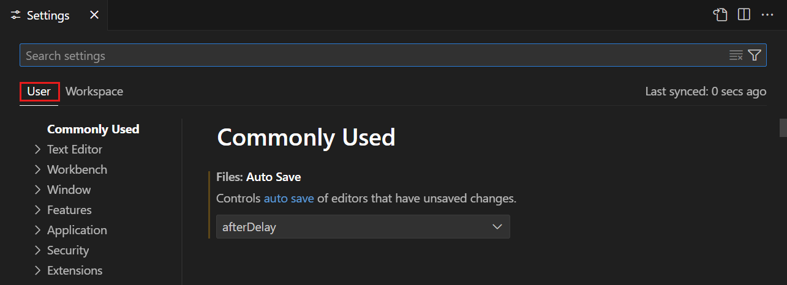

## 工作区设置 {#workspace-settings}

　　工作区设置特定于项目，并覆盖用户设置。如果希望特定设置应用于特定项目，可以使用工作区设置。例如，后端服务器项目可能希望设置 `files.exclude`，从文件资源管理器排除 `node_modules` 文件夹。

> **注意**：VS Code“工作区”通常只是项目根文件夹。也可以通过[多根工作区](../../3.2-WriteCode/3.2.8-Workspaces/3.2.8.2-MultiRootWorkspaces/)功能在一个 VS Code 工作区中拥有多个根文件夹。更多信息请参阅 [VS Code 工作区](../../3.2-WriteCode/3.2.8-Workspaces/3.2.8.1-Overview/)。

　　VS Code 将工作区设置存储在项目根目录 `.vscode` 文件夹中。这便于在版本控制（例如 Git）项目中与他人共享设置。

可以通过几种方式访问工作区设置：

* 在命令面板选择 **Preferences: Open Workspace Settings** 命令。
* 在[设置编辑器](#settings-editor)中选择 **工作区** 选项卡。
* 在命令面板选择 **Preferences: Open Workspace Settings (JSON)** 命令。

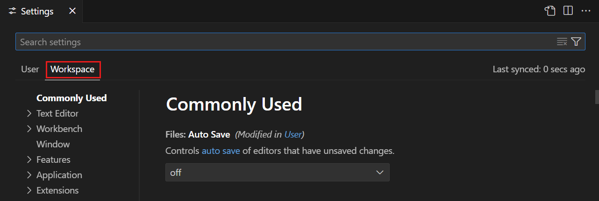

　　并非所有用户设置都可用作工作区设置。例如，与更新和安全相关的应用程序级设置不能被工作区设置覆盖。

## 设置编辑器 {#settings-editor}

　　设置编辑器提供管理用户和工作区设置的图形界面。要打开设置编辑器，请转到 **文件** > **首选项** > **设置**；也可以从 **命令面板**（`Ctrl + Shift + P`）使用 **Preferences: Open Settings** 打开，或使用快捷键 `Ctrl + ,`。

　　默认情况下，设置编辑器以[模态覆盖层](../../3.1-GettingStarted/3.1.2-UserInterface/)形式打开在编辑器区域上方。可以使用 `workbench.editor.useModal` 设置更改此行为。打开设置 JSON 文件时，它会作为普通编辑器选项卡在主窗口中打开。

　　打开设置编辑器后，可以搜索和发现设置。使用搜索栏时，设置编辑器只显示匹配条件的设置，便于快速查找。

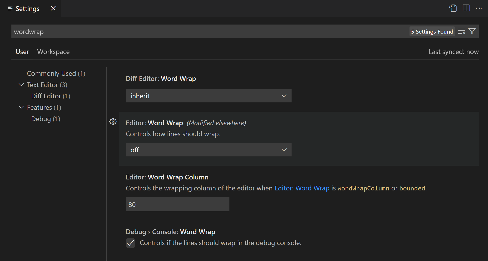

　　VS Code 会在更改设置时直接应用。可以通过设置左侧的彩色条识别已修改设置，类似编辑器中的已修改行。

以下示例更改了侧边栏位置和文件图标主题。

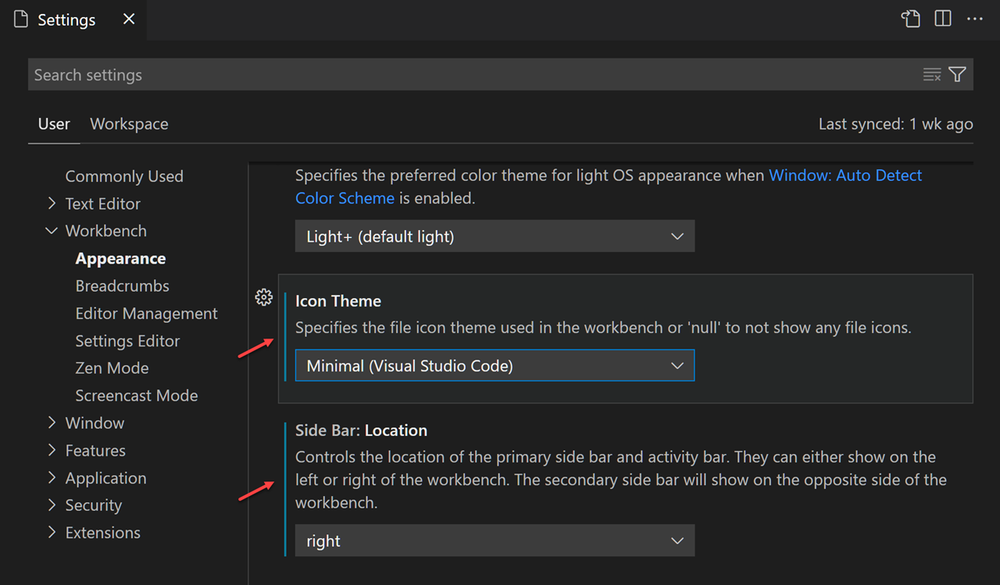

　　设置旁的齿轮图标（`Ctrl + Shift + ,`）打开上下文菜单，可以重置为默认值、复制设置 ID、复制 JSON 名称-值对或复制设置 URL。

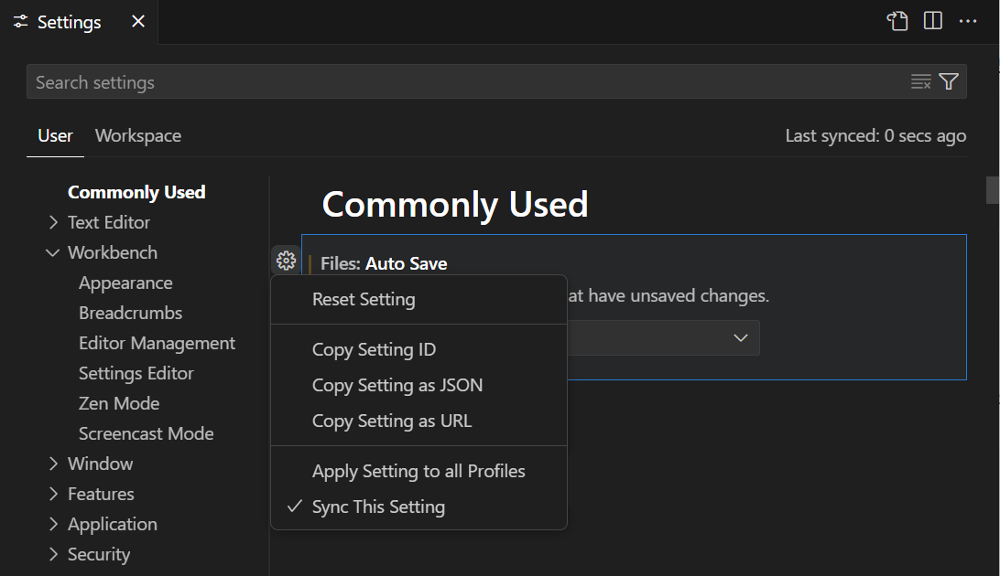

> **提示**：设置 URL 可以从浏览器直接导航到设置编辑器中的特定设置。URL 格式为 `vscode://settings/<settingName>`，其中 `<settingName>` 是设置 ID。例如，导航到 `workbench.colorTheme` 设置，请使用 `vscode://settings/workbench.colorTheme`。

### 设置组 {#settings-groups}

　　设置按组呈现，便于快速导航到相关设置。顶部有 **常用** 组，显示常用自定义设置。

以下示例通过在树视图中选择 **源代码管理** 聚焦源代码管理设置。

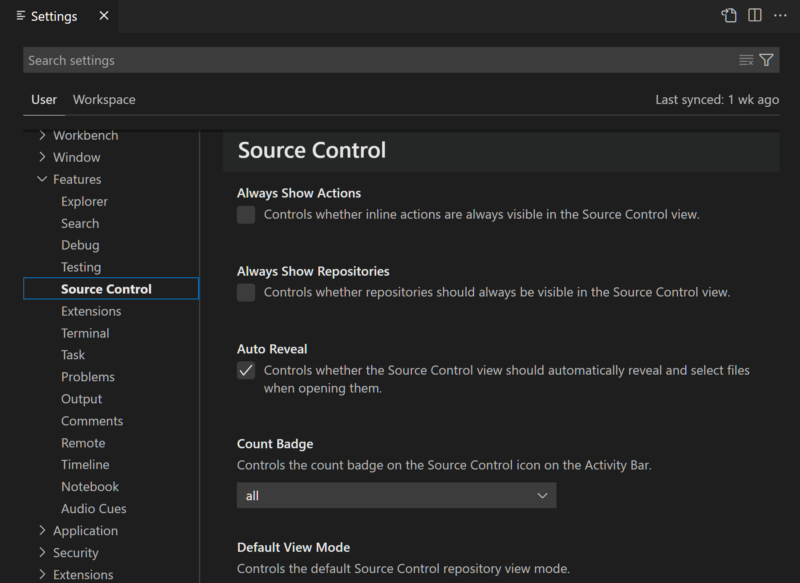

> **注意**：VS Code 扩展也可以添加自定义设置，这些设置显示在 **扩展** 部分。

### 设置编辑器筛选器 {#settings-editor-filters}

　　设置编辑器搜索栏有多个筛选器，便于管理设置。搜索栏右侧有漏斗图标筛选按钮，提供向搜索栏添加筛选器的选项。

#### 已修改设置 {#modified-settings}

　　要检查已配置的设置，可以使用搜索栏中的 `@modified` 筛选器。设置值与默认值不同或在相应设置 JSON 文件中显式设置时，会显示在此筛选器下。

　　忘记是否配置过某个设置，或编辑器因误配置而行为异常时，此筛选器很有用。

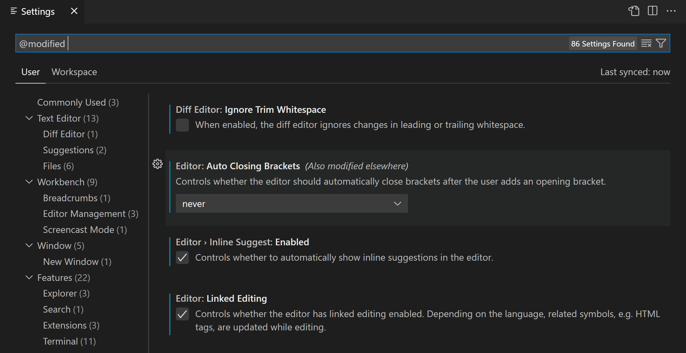

#### 其他筛选器 {#other-filters}

还有许多有用筛选器帮助搜索设置。在搜索栏输入 `@` 符号可以发现不同筛选器。

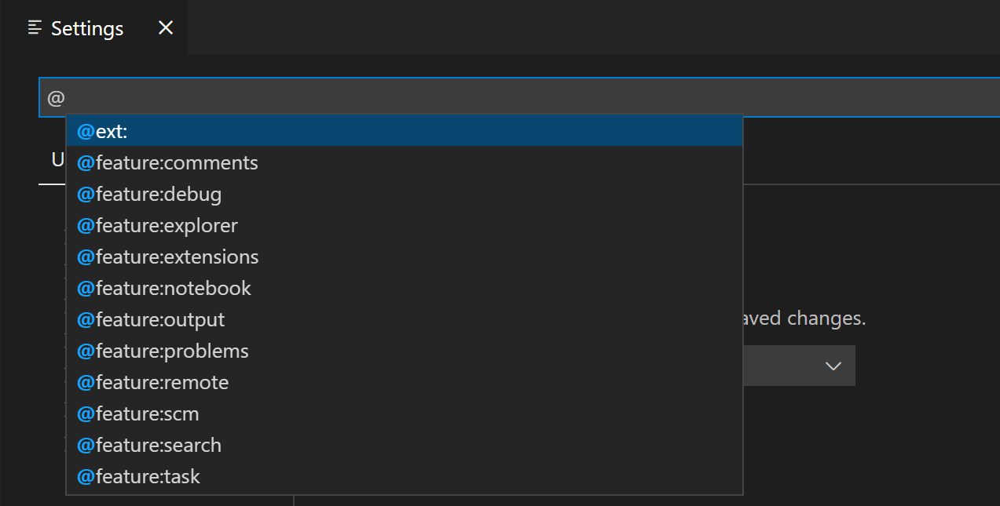

部分可用筛选器：

* `@ext`：扩展特定设置。提供扩展 ID，例如 `@ext:ms-python.python`。
* `@feature`：**功能** 子组特定设置。例如 `@feature:explorer` 显示文件资源管理器设置。
* `@haspolicy`：由[组织](../../../enterprise/7.1-Policies/)控制的设置。
* `@id`：按设置 ID 查找设置，例如 `@id:workbench.activityBar.visible`。
* `@lang`：按语言 ID 应用语言筛选器，例如 `@lang:typescript`。详情请参阅[语言特定编辑器设置](#language-specific-editor-settings)。
* `@tag`：VS Code 系统特定设置。例如 `@tag:workspaceTrust` 表示[工作区信任](../../3.2-WriteCode/3.2.8-Workspaces/3.2.8.3-WorkspaceTrust/)相关设置，`@tag:accessibility` 表示辅助功能设置，`@tag:advanced` 表示高级设置。高级设置面向专门场景，默认从搜索结果隐藏，除非使用 `@tag:advanced`。要始终显示高级设置，请启用 `workbench.settings.alwaysShowAdvancedSettings`。

　　搜索栏会记住设置搜索查询，并支持撤销/重做（`Ctrl + Z`/`Ctrl + Y`）。可以使用搜索栏右侧的 **清除设置搜索输入** 按钮快速清除搜索词或筛选器。

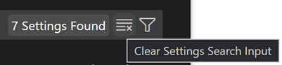

## 扩展设置 {#extension-settings}

　　已安装的 VS Code 扩展也可以贡献自己的设置，可在设置编辑器 **扩展** 部分查看。

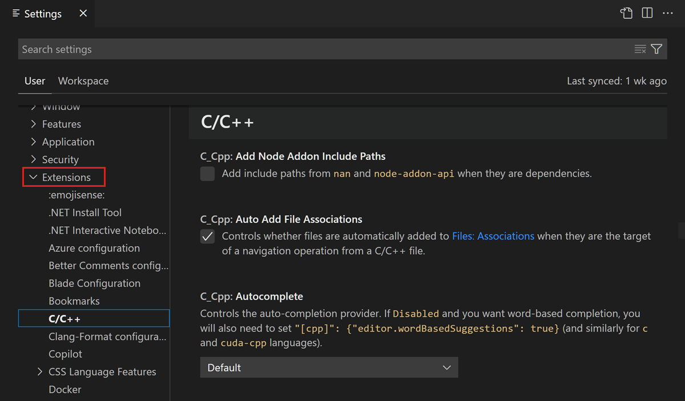

　　也可以在扩展视图（`Ctrl + Shift + X`）中选择扩展，查看 **功能贡献** 选项卡中的设置。

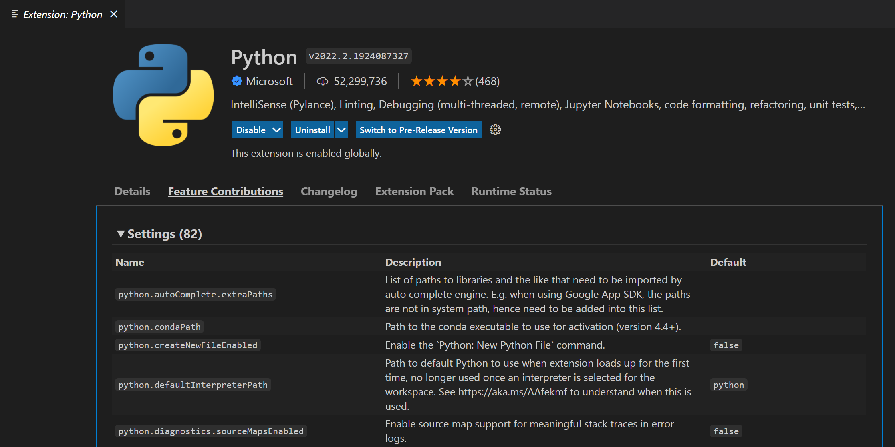

　　扩展作者可以在[配置贡献点文档](https://code.visualstudio.com/api/references/contribution-points#contributes.configuration)中了解如何添加自定义设置。

## 设置 JSON 文件 {#settings-json-file}

　　VS Code 将设置值存储在 `settings.json` 文件中。设置编辑器是查看和修改 `settings.json` 中设置值的用户界面。

　　也可以在编辑器中通过命令面板的 **Preferences: Open User Settings (JSON)** 或 **Preferences: Open Workspace Settings (JSON)** 命令直接查看和编辑 `settings.json`。

　　设置以 JSON 形式写入，指定设置 ID 和值。可以在设置编辑器中选择设置齿轮图标，然后选择 **复制设置为 JSON**，快速复制相应 JSON 名称-值对。

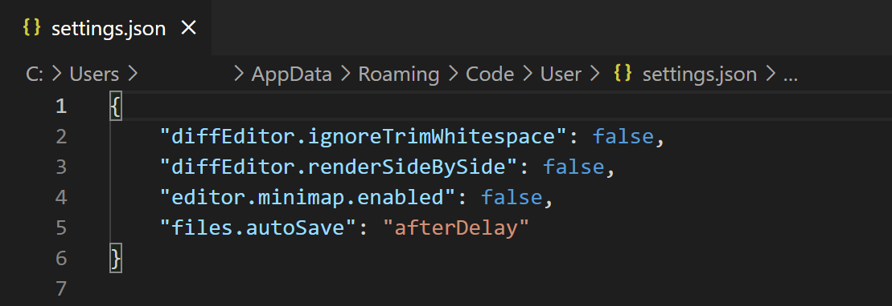

　　`settings.json` 文件有完整 IntelliSense，提供设置和值的智能补全以及描述悬停。设置名称错误或 JSON 格式错误也会高亮显示。

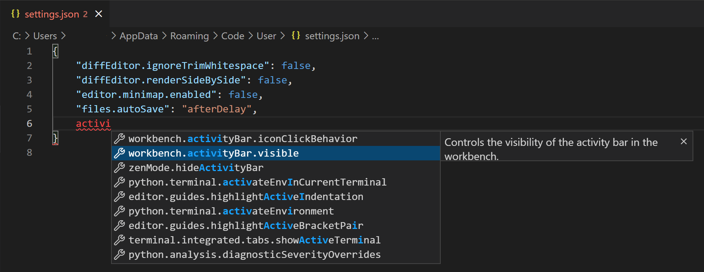

　　某些设置只能在 `settings.json` 中编辑，例如 **Workbench: Color Customizations**，设置编辑器中会显示 **在 settings.json 中编辑** 链接。

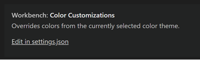

> **提示**：如果希望始终直接使用 `settings.json`，可以将 `workbench.settings.editor` 设置为 `json`。之后 **文件** > **首选项** > **设置** 和快捷键 `Ctrl + ,` 会始终打开 `settings.json`，而不是设置编辑器 UI。

### 设置文件位置 {#settings-file-locations}

#### 用户 settings.json 位置 {#user-settingsjson-location}

根据平台，用户设置文件位于：

* **Windows**：`%APPDATA%\Code\User\settings.json`
* **macOS**：`$HOME/Library/Application\ Support/Code/User/settings.json`
* **Linux**：`$HOME/.config/Code/User/settings.json`

#### 工作区 settings.json 位置 {#workspace-settingsjson-location}

　　工作区设置文件位于根文件夹 `.vscode` 文件夹下。将工作区设置 `settings.json` 添加到项目或源代码管理后，项目设置会被该项目所有用户共享。

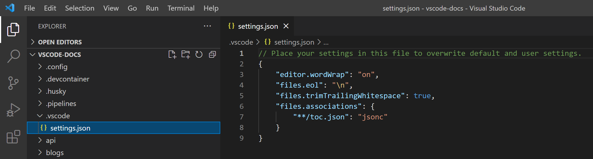

> **注意**：[多根工作区](../../3.2-WriteCode/3.2.8-Workspaces/3.2.8.2-MultiRootWorkspaces/)中，工作区设置位于工作区配置文件中。

## 重置设置 {#reset-settings}

　　始终可以通过悬停设置显示齿轮图标，单击齿轮图标，然后选择 **重置设置** 操作，将设置重置为默认值。

　　可以通过设置编辑器单独重置设置，也可以打开 `settings.json` 并删除花括号 `{}` 之间的条目来重置所有已更改设置。请小心，因为无法恢复以前的设置值。

## 语言特定编辑器设置 {#language-specific-editor-settings}

　　自定义语言特定设置的一种方法是打开设置编辑器，按下筛选按钮，选择语言选项添加语言筛选器。也可以直接在搜索组件中输入 `@lang:languageId` 形式的语言筛选器。显示的设置将针对该语言可配置，并显示该语言的特定设置值（如适用）。

　　有语言筛选器时修改设置，会在给定作用域中为该语言配置设置。例如，搜索组件有 `@lang:css` 筛选器时修改用户作用域 `diffEditor.codeLens` 设置，设置编辑器会将新值保存到用户设置文件的 CSS 特定部分。

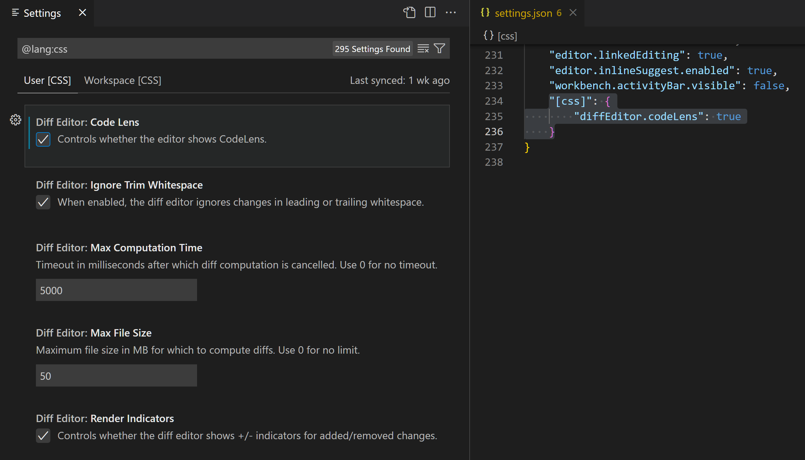

> **注意**：在搜索组件中输入多个语言筛选器时，当前行为是只使用第一个语言筛选器。

　　另一种按语言自定义编辑器的方式是从 **命令面板** 运行全局命令 **Preferences: Configure Language Specific Settings**（命令 ID：`workbench.action.configureLanguageBasedSettings`），打开语言选择器。选择语言后，设置编辑器会以所选语言筛选器打开，可以修改该语言特定设置。如果 `workbench.settings.editor` 设置为 `json`，则会打开 `settings.json` 并添加新的语言条目，可以在其中添加适用设置。

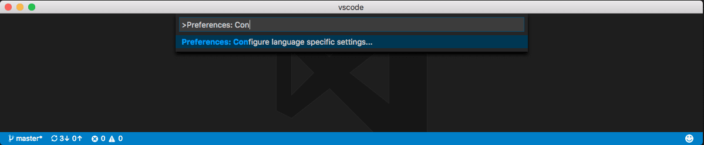

通过下拉列表选择语言：

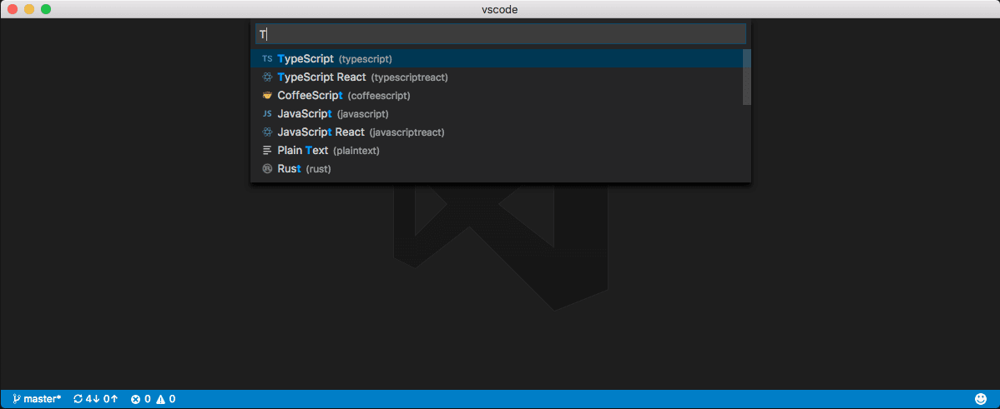

现在可以开始编辑该语言特定设置：

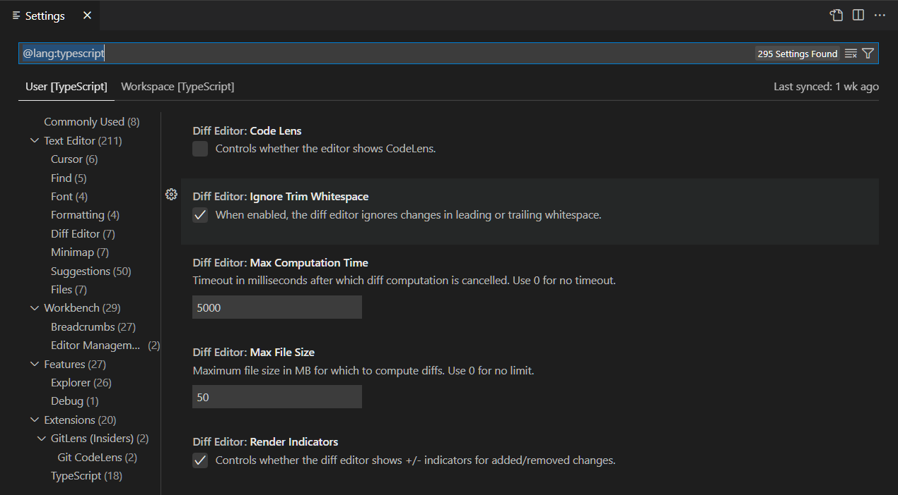

或者，如果 `workbench.settings.editor` 设置为 `json`，可以开始向用户设置添加语言特定设置：

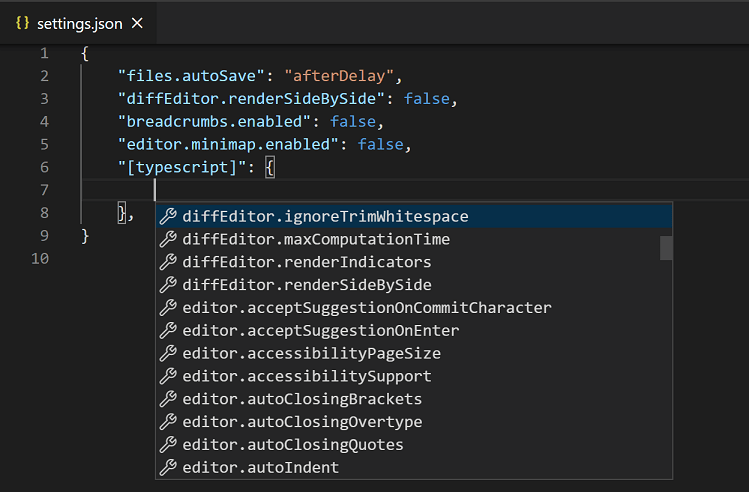

　　如果打开了文件并希望为此文件类型自定义编辑器，请选择 VS Code 窗口右下角状态栏中的语言模式。这会打开语言模式选择器，其中包含 **Configure 'language_name' language based settings** 选项。选择后会打开用户 `settings.json` 并添加语言条目，可以在其中添加适用设置。

　　语言特定编辑器设置始终覆盖非语言特定编辑器设置，即使非语言特定设置作用域更窄。例如，语言特定用户设置覆盖非语言特定工作区设置。

　　可以将语言特定设置放在工作区设置中，使其作用域为工作区。如果用户和工作区作用域中为同一语言定义了设置，则会合并，并优先使用工作区中定义的设置。

以下示例可以粘贴到设置 JSON 文件中，为 `typescript` 和 `markdown` 语言模式自定义编辑器设置：

```json
{
  "[typescript]": {
    "editor.formatOnSave": true,
    "editor.formatOnPaste": true
  },
  "[markdown]": {
    "editor.formatOnSave": true,
    "editor.wordWrap": "on",
    "editor.renderWhitespace": "all",
    "editor.acceptSuggestionOnEnter": "off"
  }
}
```

　　可以使用 `settings.json` 中的 IntelliSense 查找语言特定设置。支持所有编辑器设置和一些非编辑器设置。某些语言已有默认语言特定设置，可以运行 **Preferences: Open Default Settings** 命令在 `defaultSettings.json` 中查看。

### 多个语言特定编辑器设置 {#multiple-language-specific-editor-settings}

　　可以一次为多个语言配置语言特定编辑器设置。以下示例展示如何在 `settings.json` 中同时为 `javascript` 和 `typescript` 自定义设置：

```json
"[javascript][typescript]": {
  "editor.maxTokenizationLineLength": 2500
}
```

　　如果设置在单语言块和多语言块中都配置，单语言值优先。此优先级在正常设置作用域优先级规则之前应用。

## 配置文件设置 {#profile-settings}

　　可以使用 [VS Code 配置文件](../3.3.8-Profiles/)创建自定义集合并快速切换。例如，它们非常适合为特定编程语言自定义 VS Code。

　　切换到配置文件时，用户设置仅作用于该配置文件。切换到另一个配置文件时，应用该配置文件的用户设置。这样可以为不同配置文件使用不同设置。

配置文件的用户设置 JSON 文件位于以下目录：

* **Windows**：`%APPDATA%\Code\User\profiles\<profile ID>\settings.json`
* **macOS**：`$HOME/Library/Application\ Support/Code/User/profiles/<profile ID>/settings.json`
* **Linux**：`$HOME/.config/Code/User/profiles/<profile ID>/settings.json`

　　`<profile ID>` 是配置文件唯一标识符。每个覆盖设置的配置文件都有对应的配置文件设置文件。

> **注意**：配置文件的 `settings.json` 仅在修改该配置文件设置时创建。

　　使用非默认配置文件时，可以通过命令面板中的 **Preferences: Open Application Settings (JSON)** 命令访问与默认配置文件关联的 `settings.json`。

## 设置优先级 {#settings-precedence}

　　配置可以通过不同设置作用域在多个级别覆盖。以下列表中，**后面的作用域覆盖前面的作用域**：

* 默认设置：表示未配置的默认设置值。
* 用户设置：全局应用于所有 VS Code 实例。
* 远程设置：应用于用户打开的远程机器。
* 工作区设置：应用于打开的文件夹或工作区。
* 工作区文件夹设置：应用于[多根工作区](../../3.2-WriteCode/3.2.8-Workspaces/3.2.8.2-MultiRootWorkspaces/)的特定文件夹。
* 语言特定默认设置：扩展贡献的语言特定默认值。
* 语言特定用户设置：与用户设置相同，但特定于语言。
* 语言特定远程设置：与远程设置相同，但特定于语言。
* 语言特定工作区设置：与工作区设置相同，但特定于语言。
* 语言特定工作区文件夹设置：与工作区文件夹设置相同，但特定于语言。
* 策略设置：由系统管理员设置，始终覆盖其他设置值。

设置值可以是各种类型：

* 字符串：`"files.autoSave": "afterDelay"`
* 布尔值：`"editor.minimap.enabled": true`
* 数字：`"files.autoSaveDelay": 1000`
* 数组：`"editor.rulers": []`
* 对象：`"search.exclude": { "**/node_modules": true, "**/bower_components": true }`

> **注意**：`files.exclude` 和 `search.exclude` 等设置使用 [glob 模式](https://code.visualstudio.com/docs/editor/glob-patterns)，遵循操作系统文件系统大小写敏感性（Windows/macOS 不区分大小写，Linux 区分大小写）。`.gitignore` 文件模式（与 `explorer.excludeGitIgnore` 设置一起使用）也遵循平台特定大小写规则。

　　原始类型和数组类型的值会被覆盖，即优先作用域中配置的值会替代另一作用域的值。但对象类型的值会合并。

例如，`workbench.colorCustomizations` 接受指定一组 UI 元素及其所需颜色的对象。如果用户设置将编辑器背景设为蓝色和绿色：

```json
  "workbench.colorCustomizations": {
    "editor.background": "#000088",
    "editor.selectionBackground": "#008800"
  }
```

打开的工作区设置将编辑器前景设为红色：

```json
  "workbench.colorCustomizations": {
    "editor.foreground": "#880000",
    "editor.selectionBackground": "#00FF00"
  }
```

打开该工作区时，结果是两个颜色自定义项的组合，如同指定：

```json
  "workbench.colorCustomizations": {
    "editor.background": "#000088",
    "editor.selectionBackground": "#00FF00",
    "editor.foreground": "#880000"
  }
```

　　如果值冲突，例如上例中的 `editor.selectionBackground`，则发生通常的覆盖行为：工作区值优先于用户值，语言特定值优先于非语言特定值。

### 关于多个语言特定设置的说明 {#note-about-multiple-language-specific-settings}

　　使用[多个语言特定设置](#multiple-language-specific-editor-settings)时，请注意语言特定设置会合并，优先级基于完整语言字符串（例如 `"[typescript][javascript]"`）而不是单个语言 ID（`typescript` 和 `javascript`）。这意味着 `"[typescript][javascript]"` 工作区设置不会覆盖 `"[javascript]"` 用户设置。

## 设置和安全 {#settings-and-security}

　　某些设置允许指定 VS Code 运行以执行特定操作的可执行文件。例如，可以选择集成终端使用的 shell。为增强安全性，此类设置只能在用户设置中定义，不能在工作者作用域定义。

以下设置不支持工作区设置：

* `git.path`
* `terminal.external.windowsExec`
* `terminal.external.osxExec`
* `terminal.external.linuxExec`

　　首次打开定义这些设置的工作区时，VS Code 会警告，之后始终忽略这些值。

## 设置同步 {#settings-sync}

　　可以使用[设置同步](../3.3.5-SettingsSync/)功能跨 VS Code 实例共享用户设置。此功能可以跨不同机器上的 VS Code 安装共享设置、键盘快捷键和已安装扩展。可以通过设置编辑器右侧的 **备份和同步设置** 命令或 **账户** 活动栏上下文菜单启用设置同步。

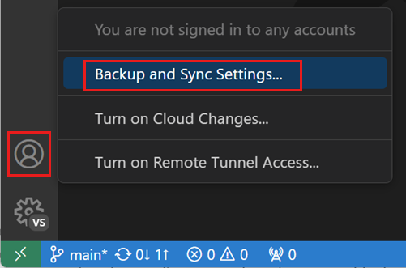

　　可以在[设置同步](../3.3.5-SettingsSync/)用户指南中了解启用和配置详情。

> **注意**：VS Code 不会将扩展同步到[远程](../../../remote/8.1-VSCodeForTheWeb/)窗口或从远程窗口同步，例如连接 SSH、开发容器（devcontainer）或 WSL 时。

## 功能生命周期 {#feature-lifecycle}

功能和对应设置可以处于以下状态。根据状态，在工作流中使用功能或设置时可能需要谨慎。

* **实验性**：面向早期采用者的探索性功能。这些功能可能更改或移除。设置编辑器中这些设置带 `Experimental` 标签。也可以在搜索框输入 `@tag:experimental` 搜索实验性设置。

    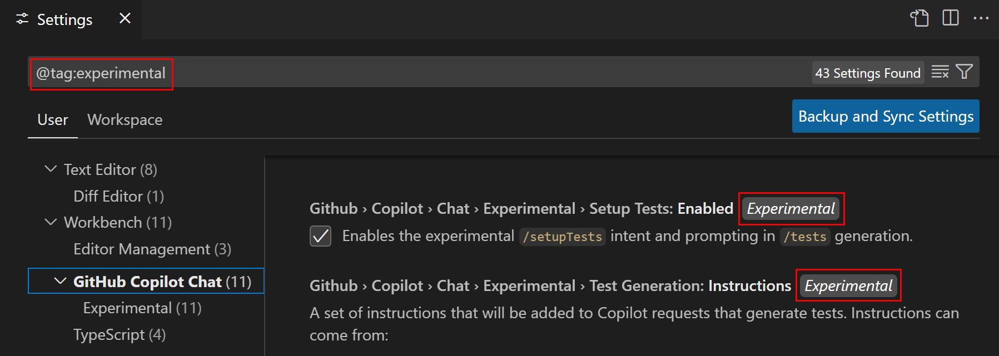

* **预览**：预览功能和设置具有最终功能，但可能仍会为稳定性和完善而迭代。通常预览功能默认禁用。设置编辑器中这些设置带 `Preview` 标签。也可以在搜索框输入 `@tag:preview` 搜索预览设置。

    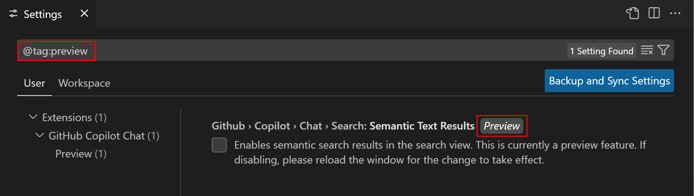

* **稳定**：功能在 VS Code 中稳定并完全支持。

　　实验性和预览功能让你试用新功能并提供反馈。请在 [VS Code 议题](https://github.com/microsoft/vscode/issues)中分享反馈。

## 相关资源 {#related-resources}

* [VS Code 默认设置参考](../../3.4-Reference/3.4.2-DefaultSettings/)
* [跨机器同步设置](../3.3.5-SettingsSync/)

## 常见问题 {#common-questions}

### VS Code 提示“无法写入设置” {#vs-code-says-unable-to-write-settings}

　　尝试更改设置（例如开启自动保存或选择新颜色主题）时看到“Unable to write into user settings. Please open user settings to correct errors/warnings in it and try again.”，表示 `settings.json` 文件格式错误或有错误。错误可能只是缺少逗号或设置值不正确。使用命令面板中的 **Preferences: Open User Settings (JSON)** 命令打开 `settings.json`，错误会以红色波浪线高亮。

### 如何重置用户设置？ {#how-can-i-reset-my-user-settings}

　　将 VS Code 重置为默认设置的最简单方法是清空用户 `settings.json` 文件。可以使用命令面板中的 **Preferences: Open User Settings (JSON)** 命令打开。文件在编辑器中打开后，删除两个花括号 `{}` 之间的所有内容，保存文件，VS Code 会恢复使用默认值。

### 什么时候适合使用工作区设置？ {#when-does-it-make-sense-to-use-workspace-settings}

　　使用需要自定义设置但不想应用到其他 VS Code 项目的工作区时。语言特定 lint 规则是一个好例子。

### 在哪里找到扩展设置？ {#where-can-i-find-extension-settings}

　　通常，VS Code 扩展将设置存储在用户或工作区设置文件中，可以通过设置编辑器 UI（**Preferences: Open Settings (UI)** 命令）或 `settings.json` 文件中的 IntelliSense（**Preferences: Open User Settings (JSON)** 命令）访问。按扩展名搜索（例如 `gitlens` 或 `python`）可以帮助筛选出扩展贡献的设置。
