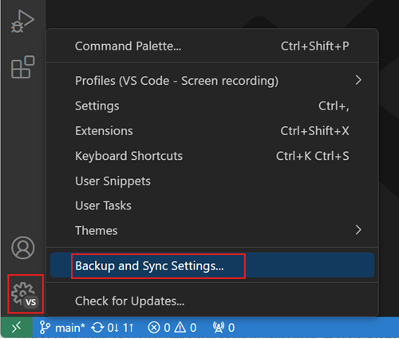
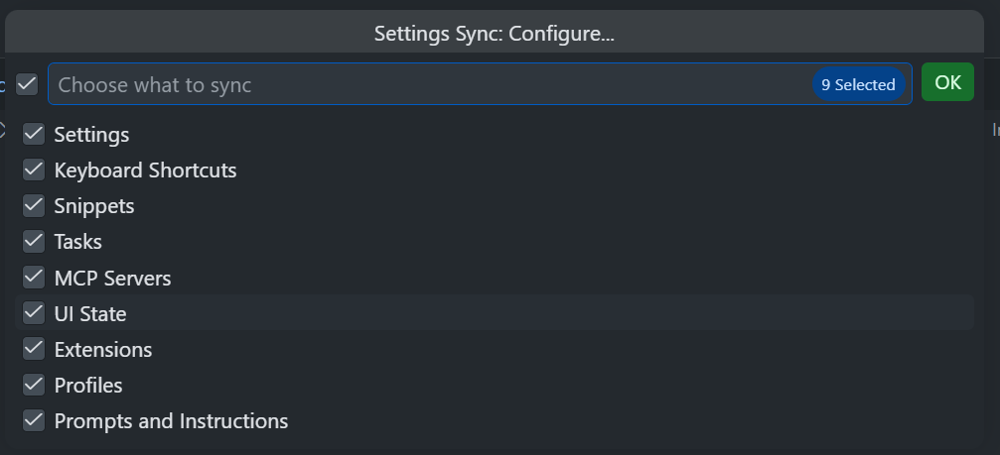
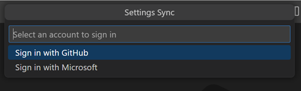
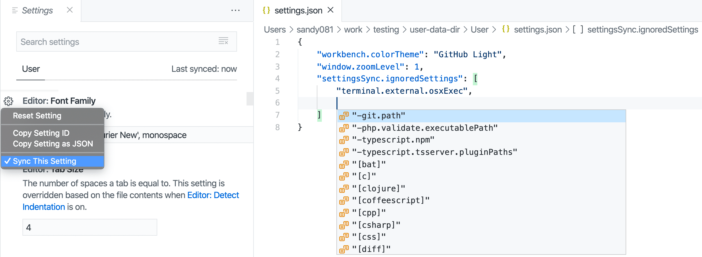
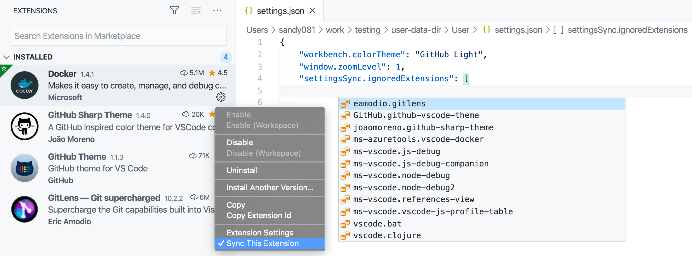
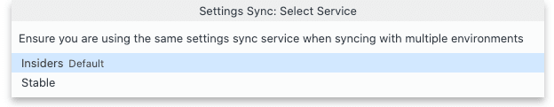
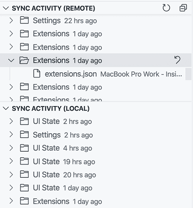
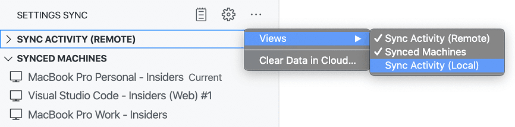

+++
title = "3.3.5 设置同步"
date = 2026-11-06T07:53:25+08:00
weight = 5
type = "docs"
description = ""
isCJKLanguage = true
draft = false
+++


> 原文链接: [https://code.visualstudio.com/docs/configure/settings-sync](https://code.visualstudio.com/docs/configure/settings-sync)

# 3.3.5 设置同步

　　设置同步（Settings Sync）可让你的 VS Code 偏好在不同设备之间保持一致。本文介绍如何开启同步、选择要同步的数据、恢复或删除同步数据，以及排查同步和凭据存储问题。

## 开启设置同步 {#turn-on-settings-sync}

1. 从活动栏底部的**管理**齿轮菜单或**账户**菜单中选择 **备份和同步设置...**。

    

2. 选择要同步的数据。

    

3. 选择 **登录**，然后选择 Microsoft 或 GitHub 账户。

    

4. 如果尚未使用所选账户登录，请在浏览器中完成身份验证。

　　登录后，设置同步会自动合并本地和云端数据，并在后台继续同步更改。如果无法合并数据，系统会提示你[解决冲突](#resolve-conflicts)。

## 配置同步数据 {#configure-synced-data}

　　运行 **Settings Sync: Configure...** 命令，或从**管理**齿轮菜单选择 **设置同步已开启** > **Settings Sync: Configure...**。

| 数据类别 | 同步的数据和行为 |
|---------------|--------------------------------|
| 设置 | 用户设置，但具有 `machine` 或 `machine-overridable` 作用域的设置以及排除的设置除外。 |
| 键盘快捷方式 | 用户定义的键盘快捷键。默认按操作系统分别同步。 |
| 代码片段 | 用户代码片段。 |
| 任务 | 用户级任务。工作区任务不同步。 |
| MCP 服务器 | 用户配置文件的 MCP 服务器配置。 |
| UI 状态 | 显示语言、活动栏和面板条目、视图布局和可见性、最近使用的命令以及“不再显示”通知选项。 |
| 扩展 | 已安装扩展以及内置和已安装扩展的全局启用状态。 |
| 配置文件 | 配置文件及其所选类别的数据，最多可同步 20 个配置文件。 |
| 提示词和指令 | 用户提示词文件以及用户配置文件中存储的 Local 智能体指令。 |

> **注意**：VS Code 不会将扩展同步到或从[8 远程](../../../remote/)窗口同步，例如 SSH、开发容器或 WSL 窗口。

### 排除设置和扩展 {#exclude-settings-and-extensions}

　　要排除用户设置，请使用设置编辑器中的操作，或将设置添加到 `settingsSync.ignoredSettings`。要排除扩展，请使用扩展视图中的操作，或将扩展添加到 `settingsSync.ignoredExtensions`。





### 在不同操作系统上使用相同快捷键 {#use-the-same-keyboard-shortcuts-across-operating-systems}

　　要在所有操作系统上使用相同快捷键，请清除 `settingsSync.keybindingsPerPlatform` 设置。

## 解决冲突 {#resolve-conflicts}

　　首次在设备上开启设置同步，或设备离线时更改数据，可能会产生冲突。同步会暂停，直到你解决冲突：

* **接受本地**或**替换远程**：使用本地数据并覆盖云端数据。
* **接受远程**或**替换本地**：使用云端数据并覆盖本地数据。
* **显示冲突**：打开差异编辑器比较本地和远程数据，编辑合并结果并选择 **完成合并**。

## 切换账户 {#switch-accounts}

　　要使用其他账户同步数据，请运行 **Settings Sync: Turn Off** 命令，然后使用其他账户重新开启设置同步。

## 同步 Stable 和 Insiders {#synchronize-stable-and-insiders}

　　默认情况下，VS Code Stable 和 [Insiders](https://code.visualstudio.com/insiders) 构建使用独立设置同步服务，不共享数据。要在构建之间共享数据，请在 Insiders 中开启设置同步时选择 Stable 同步服务。



> **注意**：同步 Stable 和 Insiders 可能导致数据不兼容，因为 Insiders 比 Stable 新。如果发生这种情况，Stable 中的设置同步会自动关闭。请将 Stable 更新到兼容版本后再重新开启同步。

## 恢复同步数据 {#restore-synced-data}

　　VS Code 会存储首选项的本地和远程备份，可用于恢复较早的数据版本。



　　运行 **Settings Sync: Show Synced Data** 命令查看远程备份。要在同一视图中查看本地备份，请打开设置同步视图溢出菜单中的**视图**子菜单，选择 **同步活动（本地）**。



　　要访问磁盘上的本地备份，请运行 **Settings Sync: Open Local Backups Folder** 命令。文件夹按数据类别组织，包含带时间戳的 JSON 文件版本。

> **注意**：本地备份在 30 天后删除。对于远程备份，每个数据类别保留最新 20 个版本。

## 管理已同步的计算机 {#manage-synced-machines}

　　VS Code 会跟踪同步数据的设备。运行 **Settings Sync: Show Synced Data** 命令，展开 **已同步的计算机** 查看。每台设备有一个基于操作系统以及 Stable/Insiders 的默认名称。可以使用设备操作重命名或远程关闭设置同步。

## 关闭并删除同步数据 {#turn-off-and-delete-synced-data}

　　要停止当前设备同步，请从**管理**齿轮菜单选择 **设置同步已开启** > **Settings Sync: Turn Off**，然后选择 **关闭**。

　　要关闭所有设备的同步并从服务中删除数据，请勾选 **在所有设备上关闭同步并清除云端数据**，然后选择 **关闭**。如果再次开启设置同步，会作为首次设置开始。

## 排查设置同步问题 {#troubleshoot-settings-sync}

### 解决数据限制 {#resolve-data-limits}

　　设置、键盘快捷键和用户任务必须各自不超过 100 KB。最多可同步 20 个配置文件。如果数据超过限制，设置同步会报告错误，并禁用已经同步的受影响类别。请减小文件大小或配置文件数量，然后重新开启设置同步，或运行 **Settings Sync: Configure...** 启用受影响类别。

### 排查凭据存储问题 {#troubleshoot-credential-store-issues}

　　在桌面版中，设置同步使用操作系统凭据存储保存身份验证信息。如果密钥链不可用或配置错误，请使用以下选项重新启动 VS Code 生成详细日志：

```bash
code --verbose --vmodule="*/components/os_crypt/*=1"
```

#### Windows 和 macOS {#windows-and-macos}

　　Windows 和 macOS 通常不需要额外的密钥链配置。如果问题持续，请[报告问题](#collect-logs-and-report-an-issue)并附上详细日志。

#### Linux {#linux}

　　VS Code 使用 Chromium 检测桌面环境并选择密钥环。在详细日志中搜索 `OSCrypt`、`password storage` 或 `selected backend` 消息。

##### GNOME 或 Unity {#gnome-or-unity}

　　如果日志包含 `Cannot create an item in a locked collection`，请解锁默认密钥环（通常名为 `Login`）。可以使用 [Seahorse](https://wiki.gnome.org/Apps/Seahorse) 等密钥环管理器。登录操作系统时必须解锁密钥环。

##### KDE {#kde}

　　打开 [KWalletManager](https://apps.kde.org/kwalletmanager5/)，确保默认 `kdewallet` 钱包已打开。如果 VS Code 无法连接 KWallet，请尝试实现 Secret Service API 的密钥环。

##### 配置密钥环后端 {#configure-a-keyring-backend}

　　要手动选择密钥环后端，请使用 `password-store` 选项启动 VS Code。例如：

```bash
code --password-store="gnome-libsecret"
```

　　如果所选后端可用，请运行 **Preferences: Configure Runtime Arguments**，在 `argv.json` 中添加 `"password-store": "gnome-libsecret"`。

　　`password-store` 支持：`kwallet5`（KWallet 5）、`gnome-libsecret`（Secret Service API，例如 GNOME Keyring、KWallet、KeePassXC）、`kwallet`（旧版 KWallet）和 `basic`（基本文本加密，不推荐）。

##### 配置基本文本加密 {#configure-basic-text-encryption}

> **警告**：基本文本加密使用 Chromium 中硬编码的值派生密钥，只提供混淆而非安全加密，系统中的进程可能解密存储的数据。

　　如果接受此风险，请在 `argv.json` 中添加 `"password-store": "basic"`。

### 收集日志并报告问题 {#collect-logs-and-report-an-issue}

　　设置同步活动记录在 **Log (Settings Sync)** 输出通道中，身份验证活动记录在 **Account** 输出通道中。报告问题时请包含相关输出通道；凭据存储问题还需包含上一节的详细日志。

## 常见问题 {#common-questions}

### 设置同步与 Settings Sync 扩展相同吗？ {#is-settings-sync-the-same-as-the-settings-sync-extension}

　　不同。Shan Khan 的 [Settings Sync 扩展](https://marketplace.visualstudio.com/items?itemName=Shan.code-settings-sync)使用私有 GitHub Gist 共享设置，与内置设置同步功能无关。

### 可以使用哪些账户？ {#what-accounts-can-i-use}

　　设置同步支持 Microsoft 和 GitHub 账户，不支持 GitHub Enterprise Server 账户，也不支持 Microsoft Sovereign Cloud 账户。

### 可以使用其他后端或服务吗？ {#can-i-use-a-different-backend-or-service}

　　不可以。设置同步使用专用服务存储数据并协调更新，不支持自定义后端。

## 相关资源 {#related-resources}

* [3.3.4 设置](../3.3.4-Settings/)
* [3.3.8 配置文件](../3.3.8-Profiles/)
* [同步扩展全局状态](https://code.visualstudio.com/api/extension-capabilities/common-capabilities#data-storage)
