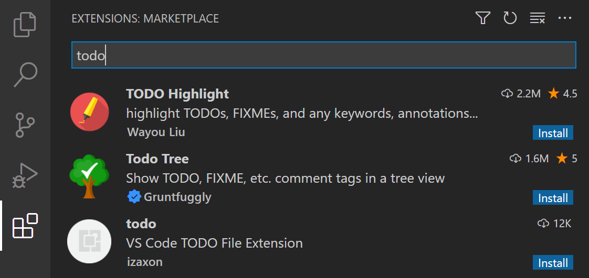
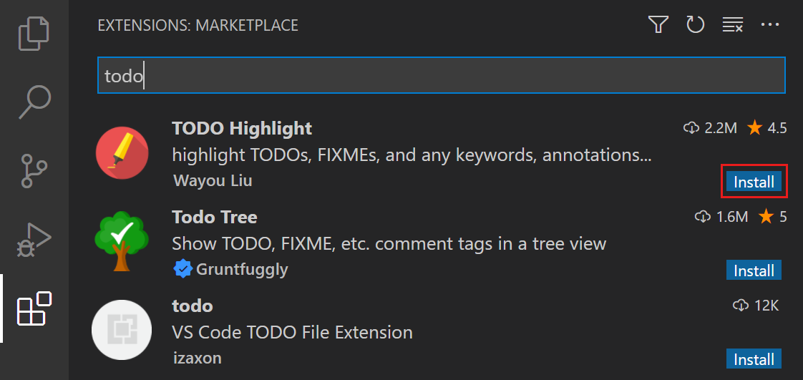
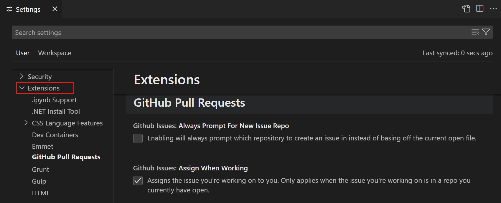

+++
title = "3.3.6.1 扩展概述"
date = 2026-11-06T07:53:25+08:00
weight = 1
type = "docs"
description = ""
isCJKLanguage = true
draft = false
+++

> 原文链接: [https://code.visualstudio.com/docs/configure/extensions/extensions](https://code.visualstudio.com/docs/configure/extensions/extensions)

# 3.3.6.1 扩展概述

　　Visual Studio Code 扩展可以为安装添加语言、调试器和工具，以支持你的开发工作流。可以直接从 [Visual Studio Marketplace](https://marketplace.visualstudio.com/vscode)安装扩展，并享受自动更新，始终使用最新功能。

　　Marketplace 托管着涵盖广泛类别的数千个扩展。为防止恶意扩展，它采用了发布者信任、恶意软件扫描等多种机制。详细了解[3.3.6.3 扩展运行时安全](../3.3.6.3-ExtensionRuntimeSecurity/)。

## 浏览扩展 {#browse-extensions}

1. 选择活动栏中的扩展图标，或按 `Ctrl + Shift + X`（macOS：`Cmd + Shift + X`） 打开扩展视图。

    

2. 可选：使用搜索框或筛选器查找扩展，例如按扩展类别筛选。
3. 选择一个扩展，查看其说明、发布者、安装量、用户评分等详情。

## 安装扩展 {#install-a-vs-code-extension}

1. 打开扩展视图（`Ctrl + Shift + X`，macOS：`Cmd + Shift + X`）。
2. 在扩展磁贴上选择 **安装** 按钮，也可以在扩展详情视图中选择 **安装**。

    

> **提示**：如果需要在不同技术栈之间切换，可以使用 [3.3.8 配置文件](../../3.3.8-Profiles/)，仅安装特定工作负载所需的扩展。

## 打开扩展设置 {#open-extension-settings}

　　扩展可以为 VS Code 贡献设置。使用设置编辑器查看和修改这些设置：

1. 通过 **文件** > **首选项** > **设置** 菜单或 `Ctrl + ,`（macOS：`Cmd + ,`） 打开设置编辑器。
2. 在设置树视图中选择 **扩展**，然后选择特定扩展以查看其设置。

    

## 卸载扩展 {#uninstall-a-vs-code-extension}

1. 打开扩展视图（`Ctrl + Shift + X`，macOS：`Cmd + Shift + X`）。
2. 选择齿轮图标，或右键单击扩展磁贴，然后选择 **卸载**。如果只想临时禁用扩展，可以选择 **禁用** 而不是卸载。

## 后续步骤 {#next-steps}

* [3.3.6.2 扩展市场](../3.3.6.2-ExtensionMarketplace/)：了解推荐扩展、预发布扩展或从命令行安装扩展。
* [3.3.6.3 扩展运行时安全](../3.3.6.3-ExtensionRuntimeSecurity/)：了解 VS Code 如何保护你免受恶意扩展侵害。
* [VS Code 扩展开发](https://code.visualstudio.com/api/get-started/your-first-extension)：创建并发布自己的扩展。
* [1 快速开始](../../../../get-started/)：通过分步指南了解关键功能。
* [4 源代码管理](../../../../source-control/)：了解如何使用 Git 设置版本控制。
* [6.1 调试代码](../../../../debugging-and-testing/6.1-Debugging/)：为项目配置调试。
