+++
title = "3.3.6.2 扩展 Marketplace"
date = 2026-11-06T07:53:25+08:00
weight = 2
type = "docs"
description = ""
isCJKLanguage = true
draft = false
+++


> 原文链接: [https://code.visualstudio.com/docs/configure/extensions/extension-marketplace](https://code.visualstudio.com/docs/configure/extensions/extension-marketplace)

# 3.3.6.2 扩展 Marketplace

　　扩展为 VS Code 添加语言、调试器和工具，支持开发工作流。本页介绍如何从 [Visual Studio Marketplace](https://marketplace.visualstudio.com/VSCode)查找、安装和管理扩展。

## 浏览扩展 {#browse-for-extensions}

　　可以在 VS Code 内浏览和安装扩展。选择 **活动栏** 中的扩展图标，或运行 **View: Extensions** 命令（`Ctrl + Shift + X`，macOS：`Cmd + Shift + X`）打开扩展视图。


扩展视图显示 [Visual Studio Marketplace](https://marketplace.visualstudio.com/VSCode) 上最热门的 VS Code 扩展列表。

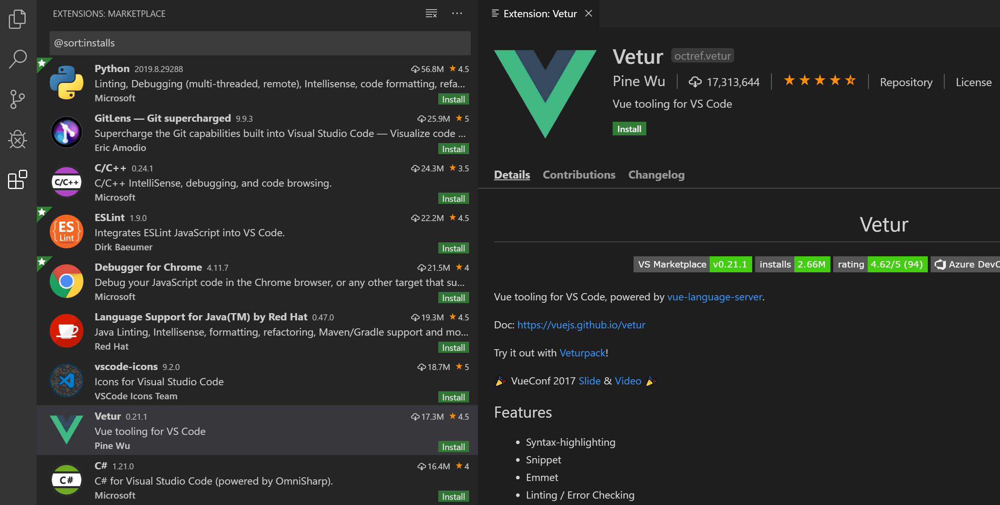

列表中每个扩展包含简短说明、发布者、下载量和五星评分。选择扩展条目显示详情页，可以了解更多。

> **注意**：如果计算机通过代理服务器访问 Internet，需要配置代理服务器。详情请参阅[代理服务器支持](../../../../advanced-setup/9.6-Network/)。

### 搜索扩展 {#search-for-an-extension}

　　清空扩展视图顶部搜索框，输入扩展、工具或编程语言名称。

例如，输入“python”会列出 Python 语言扩展：

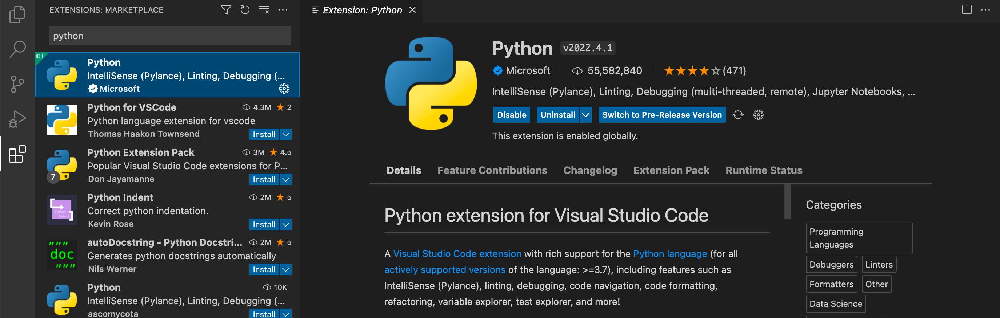

　　如果知道扩展的确切标识符，可以使用 `@id:` 前缀，例如 `@id:vue.volar`。也可以使用[筛选](#extensions-view-filters)和[排序](#sorting)命令缩小或排序结果。

### 扩展详情 {#extension-details}

　　在扩展详情页可以阅读 README，并查看扩展的：

* **功能贡献**：扩展对 VS Code 的添加，例如设置、命令和键盘快捷键、语言语法和调试器。
* **变更日志**：扩展仓库的 CHANGELOG（如果可用）。
* **依赖项**：扩展是否依赖其他扩展。

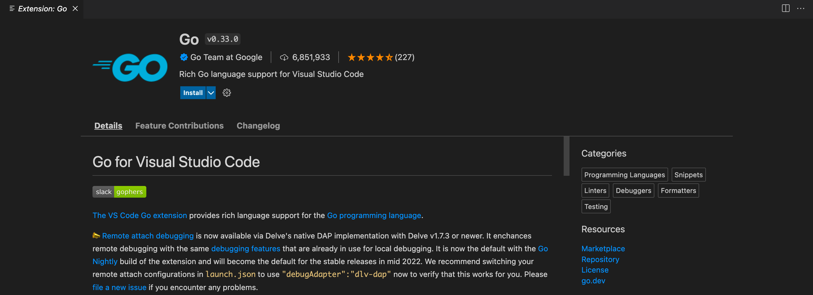

　　如果扩展是扩展包，**扩展包** 部分会显示安装该包时安装哪些扩展。[扩展包](https://code.visualstudio.com/api/references/extension-manifest#extension-packs)将独立扩展捆绑在一起，便于一次安装。

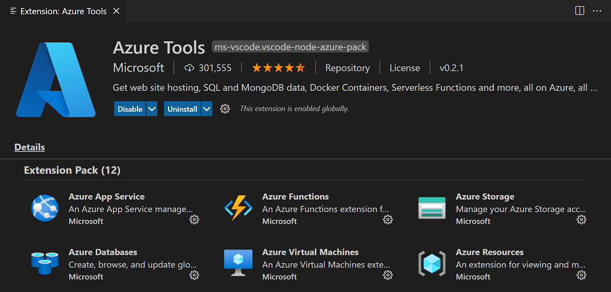

## 安装扩展 {#install-an-extension}

　　选择 **安装** 按钮安装扩展。安装完成后，**安装** 按钮变为 **管理** 齿轮按钮。

> **重要**：扩展拥有与 VS Code 本身相同的权限。从 VS Code 1.97 开始，首次安装第三方发布者的扩展时，VS Code 会显示对话框，要求确认信任该扩展发布者。更多信息请参阅[扩展运行时安全](../3.3.6.3-ExtensionRuntimeSecurity/)，了解如何保护自己免受恶意扩展影响。

　　要安装特定版本，请右键单击扩展并选择 **安装其他版本**，然后从可用列表选择版本。

　　启用[设置同步](../../3.3.5-SettingsSync/)时，可以跨机器共享扩展等 VS Code 配置。要安装扩展但不跨机器同步，请右键单击扩展并选择 **安装（不同步）**。

### 查找并安装扩展 {#find-and-install-an-extension}

例如，安装流行的 [TODO Highlight](https://marketplace.visualstudio.com/items?itemName=wayou.vscode-todo-highlight) 扩展。该扩展高亮源代码中的“TODO:”和“FIXME:”等文本，便于快速找到未完成部分。

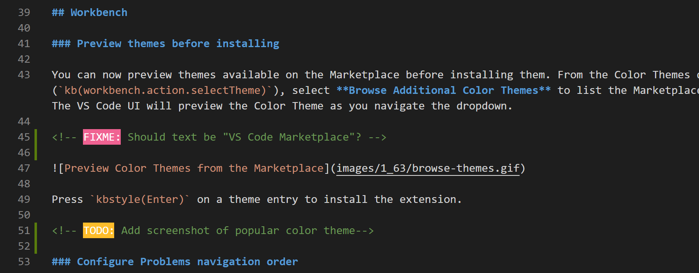

在扩展视图（`Ctrl + Shift + X`，macOS：`Cmd + Shift + X`）搜索框输入“todo”，将 Marketplace 结果筛选为标题或元数据包含“todo”的扩展。**TODO Highlight** 会出现在列表中。

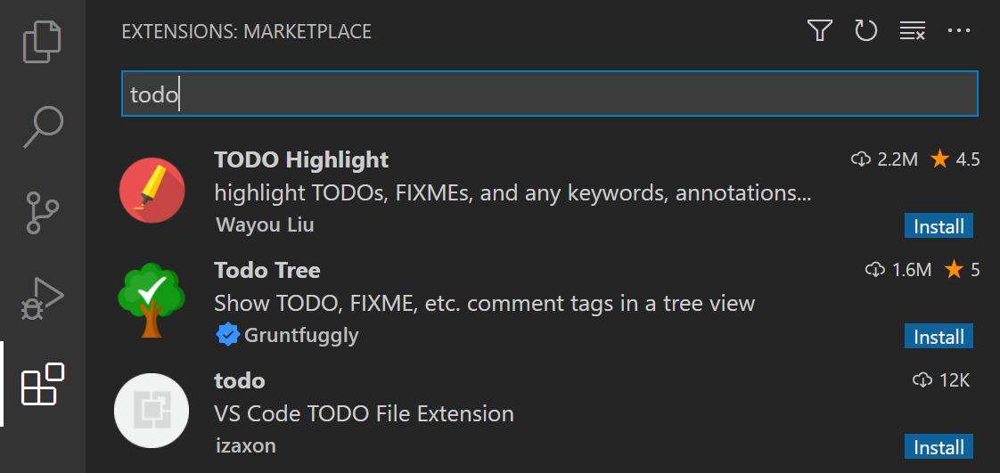

　　扩展由发布者和扩展 ID 唯一标识。选择 **TODO Highlight** 打开详情页，可以找到扩展 ID，本例为 `wayou.vscode-todo-highlight`。存在多个同名扩展时，知道扩展 ID 很有帮助。

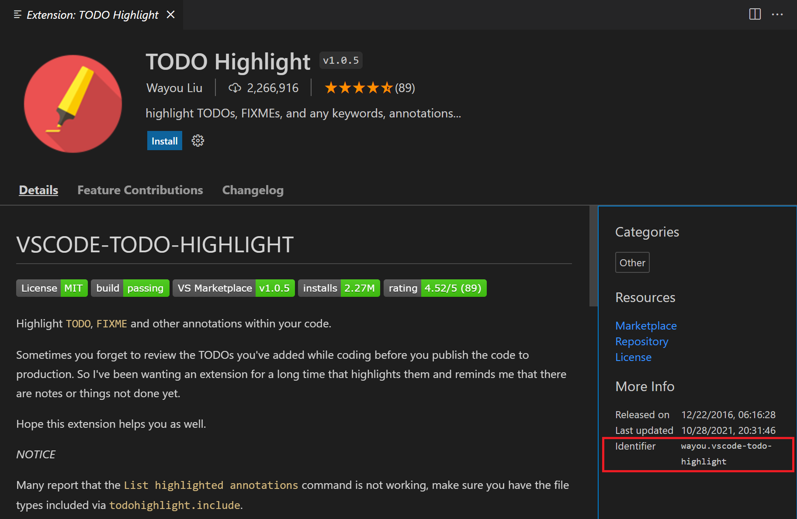

　　选择 **安装**，VS Code 会从 Marketplace 下载并安装扩展。安装完成后，**安装** 按钮替换为 **管理** 齿轮按钮。

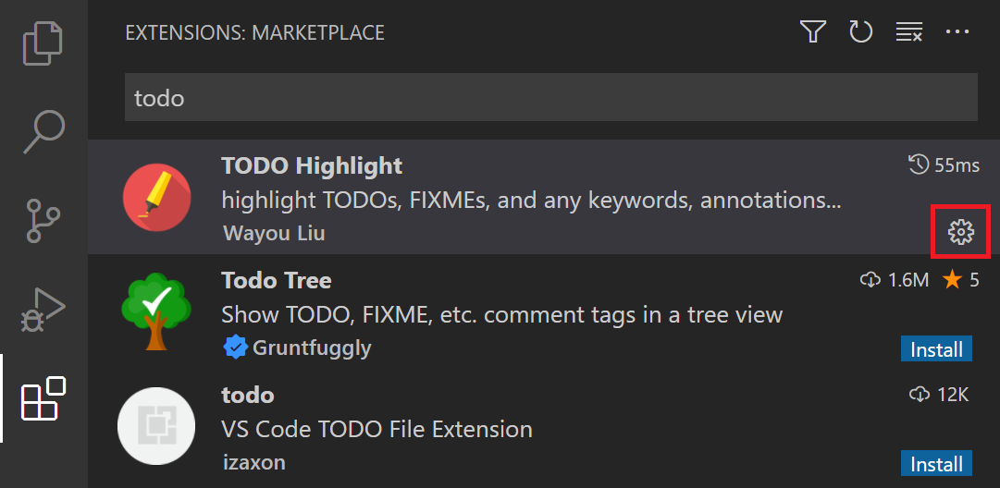

　　要查看 TODO Highlight 的实际效果，请打开任意源代码文件并添加文本“TODO:”，编辑器会高亮该文本。

　　TODO Highlight 贡献了 **TODO-Highlight: List highlighted annotations** 和 **TODO-Highlight: Toggle highlight** 命令，可在命令面板（`Ctrl + Shift + P`，macOS：`Cmd + Shift + P`）中找到。**TODO-Highlight: Toggle highlight** 命令可快速禁用或启用高亮。

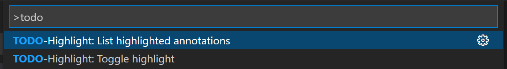

　　扩展还提供调整行为的设置，可在设置编辑器（`Ctrl + ,`，macOS：`Cmd + ,`）中找到。例如，如果希望文本搜索不区分大小写，可以取消选中 **Todohighlight: Is Case Sensitive** 设置。

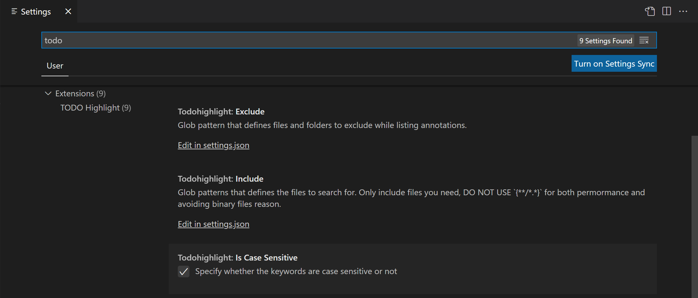

　　如果扩展未提供所需功能，可以从 **管理** 按钮上下文菜单 **卸载** 扩展。

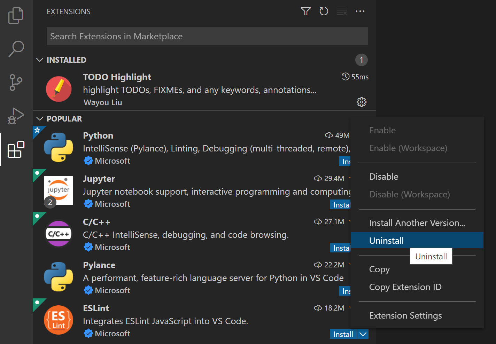

　　本演练展示安装和使用扩展的一个示例。Marketplace 有数千个扩展，支持数百种编程语言和任务。选项从完整的 [Java](https://marketplace.visualstudio.com/items?itemName=redhat.java)、[Python](https://marketplace.visualstudio.com/items?itemName=ms-python.python)、[Go](https://marketplace.visualstudio.com/items?itemName=golang.Go) 和 [C++](https://marketplace.visualstudio.com/items?itemName=ms-vscode.cpptools) 语言支持，到[生成 GUID](https://marketplace.visualstudio.com/items?itemName=nwallace.createGUID)、更改[颜色主题](https://marketplace.visualstudio.com/items?itemName=PKief.material-icon-theme)或添加[虚拟宠物](https://marketplace.visualstudio.com/items?itemName=tonybaloney.vscode-pets)等简单扩展。

### 安装预发布扩展版本 {#install-a-pre-release-extension-version}

　　扩展发布者可能提供预发布版本。要安装预发布版本，请选择 **安装** 按钮下拉菜单中的 **安装预发布版本**。

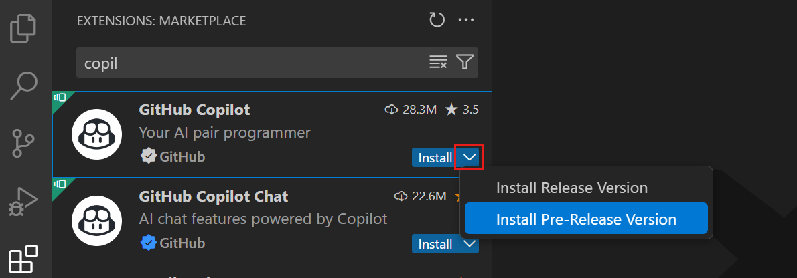

### 从 VSIX 安装 {#install-from-a-vsix}

　　可以手动安装打包为 `.vsix` 文件的 VS Code 扩展。在扩展视图命令下拉菜单中选择 **从 VSIX 安装**，或在 **命令面板** 运行 **Extensions: Install from VSIX**，然后选择 `.vsix` 文件。

也可以使用 VS Code `--install-extension` 命令行开关，提供 `.vsix` 文件路径：

```bash
code --install-extension myextension.vsix
```

　　可以在命令行多次提供 `--install-extension`，一次安装多个扩展。

> **注意**：通过 VSIX 安装扩展时，该扩展的[自动更新](#extension-auto-update)默认禁用。

　　扩展打包和发布详情请参阅扩展 API 中的[发布扩展](https://code.visualstudio.com/api/working-with-extensions/publishing-extension)。

## 管理扩展 {#manage-extensions}

　　VS Code 使扩展管理变得简单。可以通过扩展视图、**命令面板**（命令带 **Extensions:** 前缀）或命令行开关安装、禁用、更新和卸载扩展。

### 列出已安装扩展 {#list-installed-extensions}

　　默认情况下，扩展视图显示当前已安装的扩展以及推荐扩展。可以使用 **Extensions: Focus on Installed View** 命令（命令面板或 **更多操作**（`...`）下拉菜单 > **视图** > **已安装**）清空搜索框并显示所有已安装扩展，包括已禁用扩展。

### 卸载扩展 {#uninstall-an-extension}

　　要卸载扩展，请选择扩展条目右侧的 **管理** 齿轮按钮，然后从下拉菜单选择 **卸载**。这会卸载扩展并提示重启扩展宿主（**重启扩展**）。

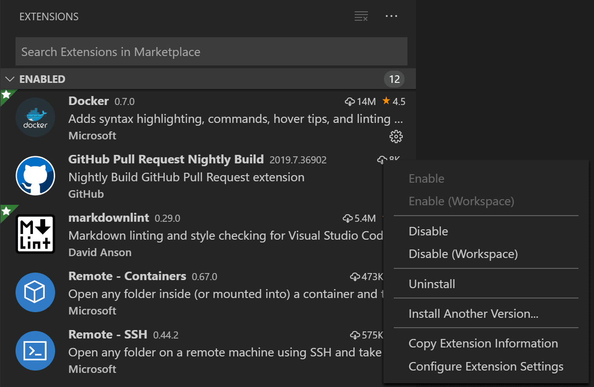

### 禁用扩展 {#disable-an-extension}

　　如果不想永久移除扩展，可以临时禁用。选择扩展条目右侧齿轮按钮，可以全局禁用或仅对当前工作区禁用。禁用后提示重启扩展宿主（**重启扩展**）。

　　要快速禁用所有已安装扩展，**命令面板** 和 **更多操作**（`...`）下拉菜单中有 **Disable All Installed Extensions** 命令。

　　扩展会在所有 VS Code 会话中保持禁用，直到重新启用。

### 启用扩展 {#enable-an-extension}

　　已禁用扩展位于列表 **已禁用** 部分并标记为 ***已禁用***。可以通过下拉菜单中的 **启用** 或 **启用（工作区）** 命令重新启用。

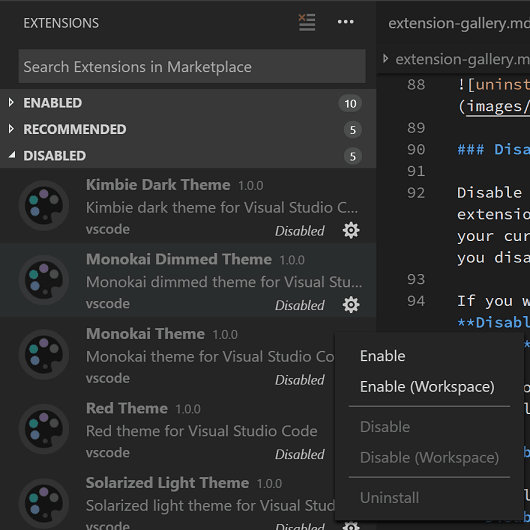

　　**更多操作**（`...`）下拉菜单中还有 **Enable All Extensions** 命令。

### 扩展自动更新 {#extension-auto-update}

　　VS Code 检查扩展更新并自动安装。更新后提示重启扩展宿主（**重启扩展**）。

　　如果希望手动更新，可以使用 **Disable Auto Update for Extensions** 命令或扩展视图中的相应操作禁用自动更新。也可以配置 `extensions.autoUpdate` 设置。使用 **Enable Auto Update for Extensions** 命令重新启用。

　　启用自动更新时，VS Code 只更新已启用的扩展。已禁用扩展不会自动更新，下次启用时更新。

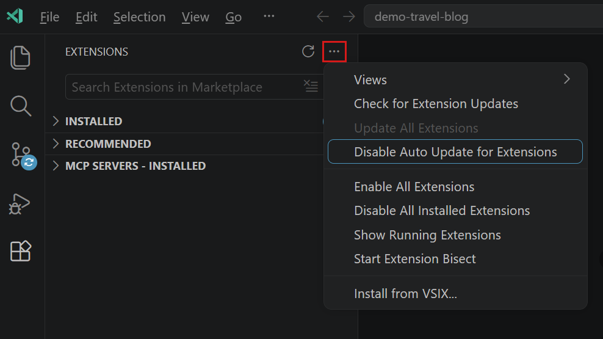

　　也可以右键单击单个扩展并切换 **自动更新** 项，配置其自动更新。

　　默认情况下，VS Code 在更新发布后等待一小段时间再自动安装。使用 `extensions.autoUpdateDelay` 设置配置延迟小时数，默认 `12` 小时。设置为 `0` 可在发布后立即安装。延迟仅在自动更新为 `on` 时适用。要立即更新扩展，请选择扩展的 **更新** 按钮，绕过延迟。

　　如果不想 VS Code 检查更新，可以将 `extensions.autoCheckUpdates` 设置为 `false`。

> **注意**：管理员可以通过[企业策略](../../../../enterprise/7.1-Policies/)集中管理 `extensions.autoUpdate` 和 `extensions.autoUpdateDelay` 设置。

### 手动更新扩展 {#update-an-extension-manually}

　　如果扩展自动更新已禁用，可以使用 **Show Extension Updates** 命令快速查找更新，它使用 `@updates` 筛选器，显示当前已安装扩展的可用更新。

选择过期扩展的 **更新** 按钮。更新安装后提示重启扩展宿主（**重启扩展**）。也可以使用 **Update All Extensions** 命令一次更新所有过期扩展。

　　如果自动检查更新也已禁用，可以使用 **Check for Extension Updates** 命令检查哪些扩展可更新。

## 扩展视图筛选器 {#extensions-view-filters}

　　扩展视图搜索框支持筛选器，帮助查找和管理扩展。使用 **Show Installed Extensions** 和 **Show Recommended Extensions** 命令时，可能已看到 `@installed` 和 `@recommended` 等筛选器。筛选器还可以按热度或评分排序，按类别（例如“Linters”）和标签（例如“node”）搜索。在扩展搜索框输入 `@` 并按照建议查看所有筛选器和排序命令。

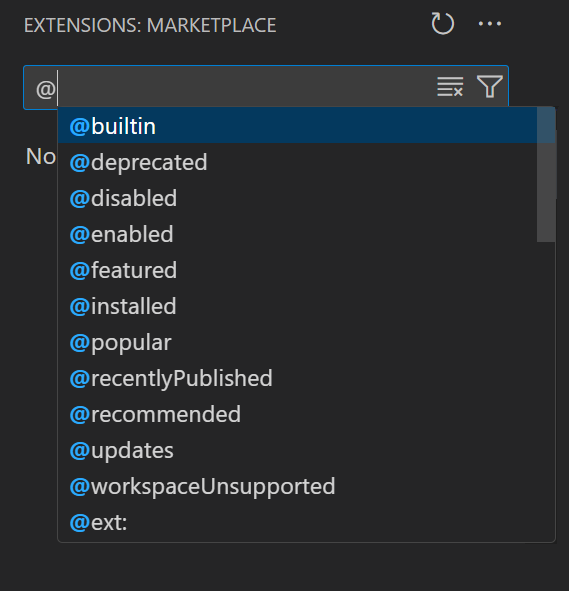

　　也可以从 **筛选扩展** 上下文菜单打开筛选器列表。

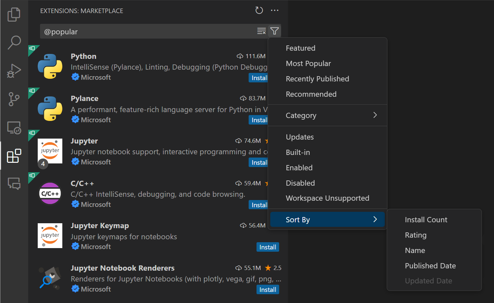

以下是部分扩展视图筛选器：

* `@builtin`：显示 VS Code 自带扩展，按类型分组（编程语言、主题等）。
* `@deprecated`：显示已弃用扩展。
* `@disabled`：显示已禁用的已安装扩展。
* `@enabled`：显示已启用的已安装扩展。扩展可以单独启用或禁用。
* `@featured`：显示精选扩展。
* `@installed`：显示已安装扩展。
* `@popular`：显示热门扩展。
* `@recentlyPublished`：显示最近在 Marketplace 发布的扩展。
* `@recommended`：显示推荐扩展，按工作区特定或一般用途分组。
* `@updates`：显示过期的已安装扩展。Marketplace 有更新版本。
* `@workspaceUnsupported`：显示此工作区不支持的扩展。
* `@category`：显示指定类别的扩展。输入 `@category` 并按建议列表选择。部分支持类别：
  * `@category:themes`
  * `@category:formatters`
  * `@category:linters`
  * `@category:snippets`

　　可以组合筛选器。例如，使用 `@installed @category:themes` 查看所有已安装主题。

　　未提供筛选器时，扩展视图显示当前已安装和推荐扩展。

　　可以通过 `...` **视图和更多操作** 按钮运行其他扩展视图命令。

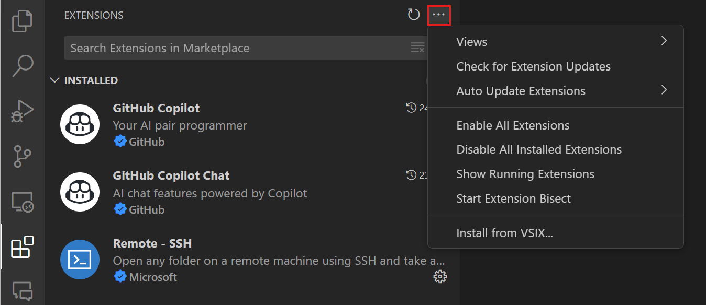

　　通过此菜单可以控制扩展更新、启用或禁用所有扩展，并使用[扩展二分](https://code.visualstudio.com/blogs/2021/02/16/extension-bisect)工具隔离有问题的扩展行为。

### 排序 {#sorting}

　　可以使用 `@sort` 筛选器排序扩展，值包括：

* `installs`：按 Marketplace 安装量降序排序。
* `name`：按扩展名称字母顺序排序。
* `publishedDate`：按扩展发布日期排序。
* `rating`：按 Marketplace 评分（1-5 星）降序排序。
* `updateDate`：按扩展最后更新日期排序。

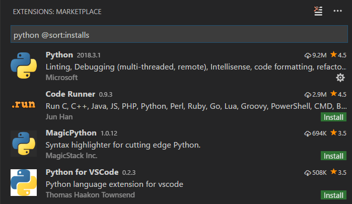

### 类别和标签 {#categories-and-tags}

　　扩展可以设置描述功能的 **类别** 和 **标签**。

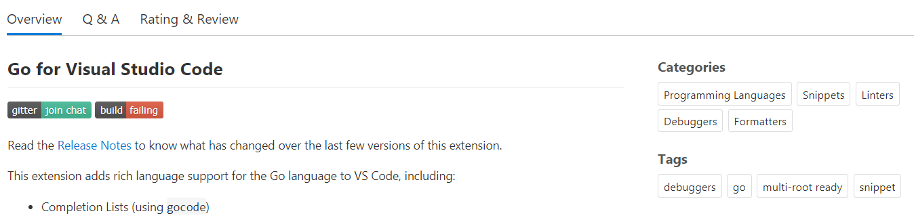

　　可以使用 `category:` 和 `tag:` 按类别和标签筛选。

支持类别为：`[AI, Azure, Chat, Data Science, Debuggers, Extension Packs, Education, Formatters, Keymaps, Language Packs, Linters, Machine Learning, Notebooks, Programming Languages, SCM Providers, Snippets, Testing, Themes, Visualization, Other]`。扩展搜索框的 IntelliSense 提供这些类别。

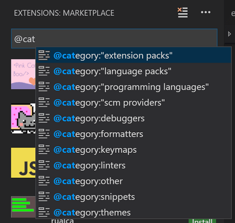

　　类别名超过一个单词时请加引号，例如 `category:"SCM Providers"`。

　　标签可以包含任意字符串，且不由 IntelliSense 提供，请在 Marketplace 中查找有用标签。

## 推荐扩展 {#recommended-extensions}

　　可以使用 **Show Recommended Extensions** 查看推荐扩展列表，它会设置 `@recommended` [筛选器](#extensions-view-filters)。扩展推荐可以是：

* **工作区推荐**：当前工作区其他用户推荐。
* **其他推荐**：基于最近打开文件推荐。

　　为项目贡献推荐的方法请参阅[工作区推荐扩展](#workspace-recommended-extensions)。

### 忽略推荐 {#ignoring-recommendations}

　　要忽略推荐，请选择扩展条目打开详情页，然后选择 **管理** 齿轮按钮显示上下文菜单，选择 **忽略推荐**。已忽略的推荐不再显示。

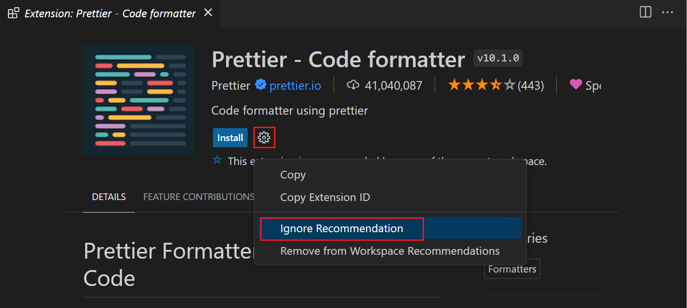

### 工作区推荐扩展 {#workspace-recommended-extensions}

　　一组好的扩展可以提升特定工作区或编程语言的生产力，可能希望与团队或同事共享列表。可以使用 **Extensions: Configure Recommended Extensions (Workspace Folder)** 命令为工作区创建推荐扩展列表。

　　单文件夹工作区中，命令会在工作区 `.vscode` 文件夹创建 `extensions.json` 文件，可以在其中添加 `publisher.extension` 形式的扩展标识符列表。

　　[多根工作区](../../../3.2-WriteCode/3.2.8-Workspaces/3.2.8.2-MultiRootWorkspaces/)中，命令会打开 `.code-workspace` 文件，可以在 `extensions.recommendations` 下列出扩展。仍可以使用 **Extensions: Configure Recommended Extensions (Workspace Folder)** 命令为多根工作区中的单个文件夹添加推荐。

例如，`extensions.json` 文件可以包含：

```json
{
    "recommendations": [
        "dbaeumer.vscode-eslint",
        "esbenp.prettier-vscode"
    ]
}
```

　　此示例推荐一个 linter 扩展和一个代码格式化扩展。

　　扩展使用发布者标识符和扩展标识符 `publisher.extension` 标识。可以在扩展详情页看到名称。VS Code 会在这些文件中为已安装扩展提供自动补全。

　　VS Code 在首次打开工作区时提示安装推荐扩展。用户也可以使用 **Extensions: Show Recommended Extensions** 命令查看列表。

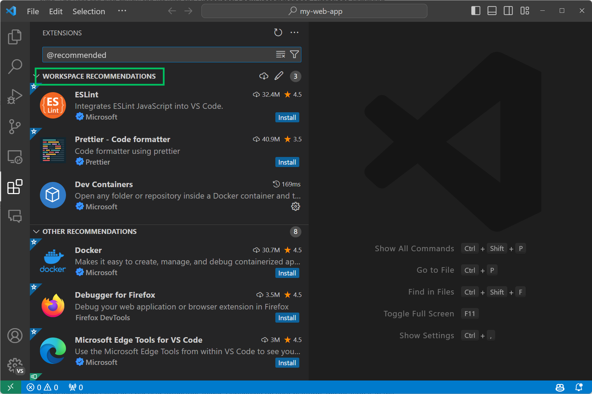

## 配置扩展 {#configuring-extensions}

　　VS Code 扩展可能有非常不同的配置和要求。某些扩展向 VS Code 贡献[设置](../../3.3.4-Settings/)，可以在设置编辑器中修改。其他扩展可能有自己的配置文件，也可能需要安装和设置编译器、调试器和命令行工具等额外组件。请查阅扩展 README（扩展视图详情页可见），或在详情页选择扩展名称前往 [Marketplace](https://marketplace.visualstudio.com/VSCode) 页面。许多扩展是开源的，Marketplace 页面有仓库链接。

## 命令行扩展管理 {#command-line-extension-management}

　　为便于自动化和配置 VS Code，可以从[命令行](../../3.3.10-CommandLineInterface/)列出、安装和卸载扩展。标识扩展时请提供 `publisher.extension` 形式的完整名称，例如 `ms-python.python`。

例如，使用以下命令：

* `code --list-extensions`：列出已安装扩展。
* `code --list-extensions --show-versions`：包含每个已安装扩展的版本。
* `code --install-extension ms-python.python`：按 ID 安装扩展。
* `code --uninstall-extension ms-python.python`：按 ID 卸载扩展。
* `code --extensions-dir <directory>`：设置扩展根路径。

　　可以在扩展详情页的 Marketplace 信息下看到扩展 ID。

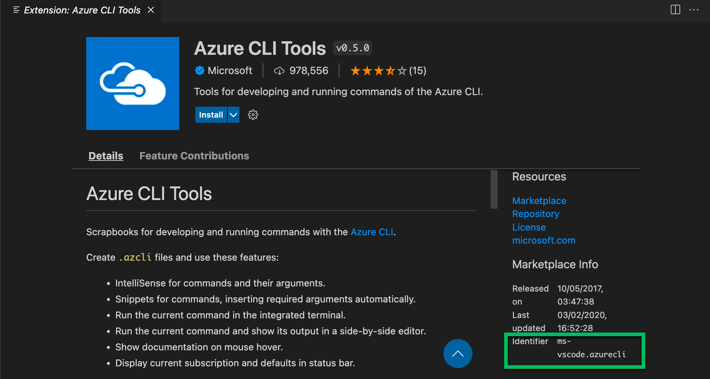

## 常见问题 {#common-questions}

### 扩展安装在哪里？ {#where-are-extensions-installed}

　　扩展安装在每用户扩展文件夹中。根据平台，位置如下：

* **Windows**：`%USERPROFILE%\.vscode\extensions`
* **macOS**：`~/.vscode/extensions`
* **Linux**：`~/.vscode/extensions`

　　可以使用 `--extensions-dir <dir>` 命令行[选项](../../3.3.10-CommandLineInterface/)启动 VS Code 更改位置。

　　也可以设置 `VSCODE_EXTENSIONS` 环境变量指定扩展安装位置。这在需要集中管理用户机器扩展安装位置的企业环境中很有用。

### 安装任何扩展时都收到 connect ETIMEDOUT 错误 {#whenever-i-try-to-install-any-extension-i-get-a-connect-etimedout-error}

　　如果机器通过代理服务器访问 Internet，可能看到此错误。详情请参阅设置主题中的[代理服务器支持](../../../../advanced-setup/9.6-Network/)。

### 可以直接从 Marketplace 下载扩展吗？ {#can-i-download-an-extension-directly-from-the-marketplace}

　　某些用户希望从 Marketplace 下载一次扩展，然后从本地共享安装到多个 VS Code 实例。存在连接问题或开发团队希望使用固定扩展集时很有用。

　　要下载扩展，请在扩展视图中搜索，右键单击结果中的扩展，选择 **Download VSIX** 或 **Download Specific Version VSIX**。

### 可以阻止 VS Code 提供扩展推荐吗？ {#can-i-stop-vs-code-from-providing-extension-recommendations}

　　要隐藏 **推荐** 视图，请打开扩展视图 **更多操作**（`...`）菜单，在 **视图** 下关闭 **推荐**。要停止推荐通知，请将 `extensions.ignoreRecommendations` 设置为 `true`。

　　仍可以使用 **Show Recommended Extensions** 命令查看推荐。

### 可以信任 Marketplace 中的扩展吗？ {#can-i-trust-extensions-from-the-marketplace}

　　Marketplace 采用多种措施保护你免受恶意扩展影响，也可以在安装前采取多种步骤判断扩展是否可靠。请参阅[扩展运行时安全](../3.3.6.3-ExtensionRuntimeSecurity/)，了解 VS Code 如何在安装前确认信任扩展发布者，以及如何保护自己免受恶意扩展影响。

### 可以为组织内部托管扩展吗？ {#can-i-host-extensions-internally-for-my-organization}

　　可以，请参阅[扩展私有 Marketplace](../../../../enterprise/7.3-Extensions/)。

### VS Code 无法验证扩展签名 {#the-extension-signature-cannot-be-verified-by-vs-code}

　　Marketplace 在扩展发布时对所有扩展签名。VS Code 在安装扩展时验证签名，检查扩展包的完整性和来源。

> **重要**：安装扩展时可能看到以下错误：`Cannot install extension because VS Code cannot verify the extension signature`。此错误可能有多种原因。遇到时请谨慎决定是否仍然安装。可以使用 `extensions.verifySignature` 设置禁用扩展签名验证。

#### 包完整性问题 {#package-integrity-issues}

　　包完整性问题请联系 [Marketplace 团队](mailto:vsmarketplace@microsoft.com?subject=Extension%20Signature%20Verification%20Issue)报告，并确保包含扩展 ID。以下是与包完整性问题相关的错误代码：

```text
PackageIntegrityCheckFailed
SignatureIsInvalid
SignatureManifestIsInvalid
SignatureIntegrityCheckFailed
EntryIsMissing
EntryIsTampered
Untrusted
CertificateRevoked
SignatureIsNotValid
SignatureArchiveHasTooManyEntries
NotSigned
```

#### 其他问题 {#other-issues}

　　对于不支持环境或未知原因等其他问题，请向 VS Code [报告问题](https://github.com/microsoft/vscode/issues/new)，提供所有必要信息并包含共享日志：`Ctrl + Shift + P`（macOS：`Cmd + Shift + P`） > **Open View...** > **Shared**。

### 连接远程窗口时扩展不同步 {#my-extensions-dont-synchronize-when-connected-to-a-remote-window}

　　[设置同步](../../3.3.5-SettingsSync/)可以跨机器共享设置、键盘快捷键和已安装扩展等 VS Code 配置，始终使用喜欢的设置。

　　VS Code 不会将扩展同步到[远程](../../../../remote/8.2-SSH/)窗口或从远程窗口同步，例如连接 SSH、开发容器（devcontainer）或 WSL 时。

### 可以在组织中允许或阻止特定扩展吗？ {#can-i-allow-or-block-specific-extensions-in-my-organization}

　　可以通过配置 `extensions.allowed` 应用程序设置控制组织中可安装的扩展。未配置时允许所有扩展；配置后，未列出的扩展会被阻止安装。

更多详情请参阅[配置允许的扩展](../../../../enterprise/7.3-Extensions/)。

## 后续步骤 {#next-steps}

* [VS Code 配置文件](../../3.3.8-Profiles/)：为不同项目或工作流使用不同扩展集。
* [扩展运行时安全](../3.3.6.3-ExtensionRuntimeSecurity/)：安装前评估扩展。
* [第一个扩展](https://code.visualstudio.com/api/get-started/your-first-extension)：Marketplace 没有所需功能时创建扩展。
