+++
title = "3.3.7 主题"
date = 2026-11-06T07:53:25+08:00
weight = 7
type = "docs"
description = ""
isCJKLanguage = true
draft = false
+++


> 原文链接: [https://code.visualstudio.com/docs/configure/themes](https://code.visualstudio.com/docs/configure/themes)

# 3.3.7 主题

## 颜色主题 {#color-themes}

　　颜色主题可以修改 VS Code 用户界面颜色，以匹配偏好和工作环境。颜色主题同时影响 VS Code UI 元素和编辑器高亮颜色。

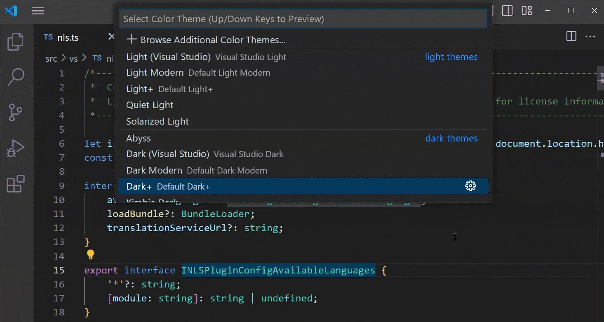

选择其他颜色主题：

1. 选择 **文件** > **首选项** > **主题** > **颜色主题** 菜单项，或使用 **Preferences: Color Theme** 命令（`Ctrl + K Ctrl + T`，macOS：`Cmd + K Cmd + T`）显示颜色主题选择器。
2. 使用 `↑` 和 `↓` 键浏览列表并预览主题颜色。
3. 选择所需主题并按 `Enter`。

　　活动颜色主题存储在用户[设置](../3.3.4-Settings/)中（快捷键 `Ctrl + ,`（macOS：`Cmd + ,`））。

```json
  // 指定工作台使用的颜色主题。
  "workbench.colorTheme": "Solarized Dark"
```

> **提示**：默认情况下，主题存储在用户设置中，全局应用于所有工作区。也可以配置工作区特定主题：在工作区[设置](../3.3.4-Settings/)中设置主题。

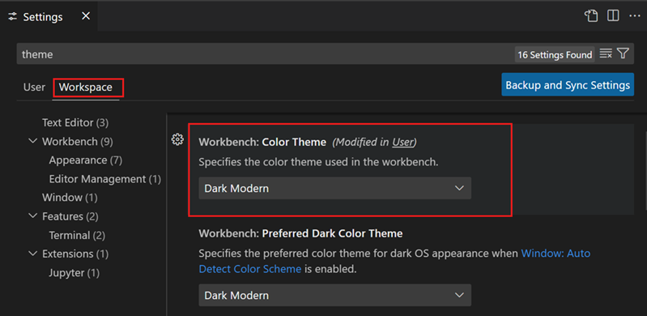

## Marketplace 中的颜色主题 {#color-themes-from-the-marketplace}

　　VS Code 自带多个开箱即用的颜色主题。社区还在 VS Code [扩展 Marketplace](../3.3.6-Extensions/3.3.6.2-ExtensionMarketplace/)上传了更多主题。

可以直接从颜色主题选择器选择 Marketplace 中的颜色主题，选择 **浏览其他颜色主题...**。

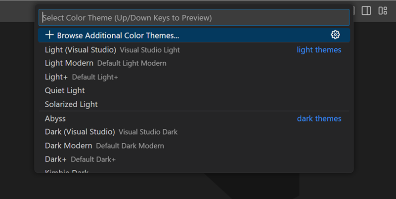

　　也可以在扩展视图（`Ctrl + Shift + X`，macOS：`Cmd + Shift + X`）搜索框使用 `@category:"themes"` 筛选器搜索主题。

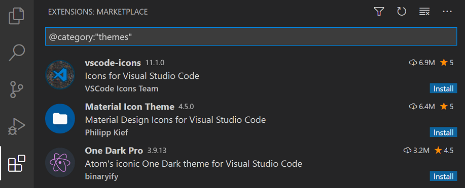

## 根据操作系统配色方案自动切换 {#automatically-switch-based-on-os-color-scheme}

　　Windows 和 macOS 支持浅色和深色配色方案。`window.autoDetectColorScheme` 设置让 VS Code 监听操作系统配色方案变化并切换到匹配主题。

　　同样，可以使用 `window.autoDetectHighContrast` 设置自动检测操作系统是否切换到高对比度配色方案。

　　要自定义配色方案变化时使用的主题，可以在设置编辑器中设置首选浅色、深色和高对比度主题：

* **Workbench: Preferred Dark Color Theme**：默认 Dark Modern
* **Workbench: Preferred Light Color Theme**：默认 Light Modern
* **Workbench: Preferred High Contrast Color Theme**：默认 Dark High Contrast
* **Workbench: Preferred High Contrast Light Color Theme**：默认 Light High Contrast

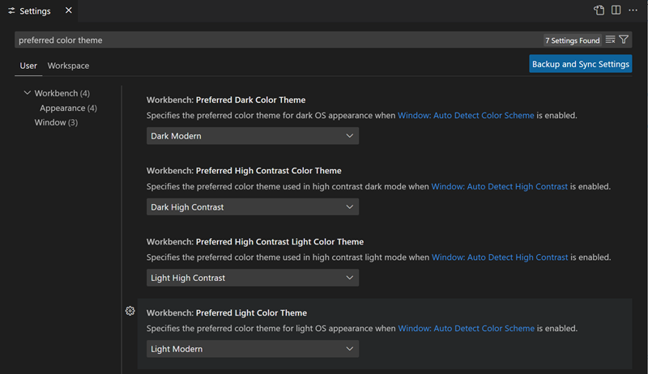

## 自定义颜色主题 {#customize-a-color-theme}

### 工作台颜色 {#workbench-colors}

　　可以使用 `workbench.colorCustomizations` 和 `editor.tokenColorCustomizations` 用户[设置](../3.3.4-Settings/)自定义活动颜色主题。

　　要设置 VS Code UI 元素颜色，例如列表和树（文件资源管理器、建议组件）、差异编辑器、活动栏、通知、滚动条、拆分视图、按钮等，请使用 `workbench.colorCustomizations`。

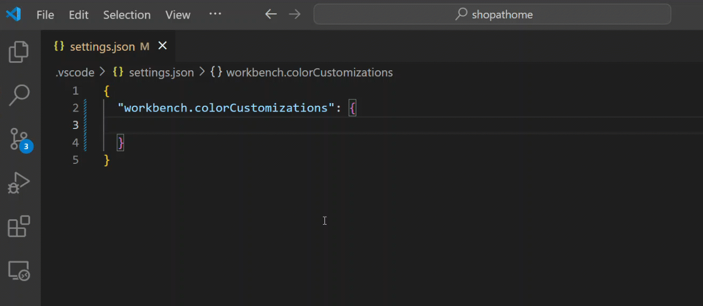

　　设置 `workbench.colorCustomizations` 值时可以使用 IntelliSense，所有可自定义颜色列表请参阅[主题颜色参考](https://code.visualstudio.com/api/references/theme-color)。

要对特定主题自定义，请使用以下语法：

```json
"workbench.colorCustomizations": {
    "[Monokai]": {
        "sideBar.background": "#347890"
    }
}
```

　　自定义项应用于多个主题时，可以命名多个主题，或在名称开头和末尾使用 `*` 通配符：

```json
"workbench.colorCustomizations": {
    "[Abyss][Red]": {
        "activityBar.background": "#ff0000"
    },
    "[Monokai*]": {
        "activityBar.background": "#ff0000"
    }
}
```

　　主题设置的颜色或边框不喜欢时，可以使用 `default` 恢复原始值：

```json
  "workbench.colorCustomizations": {
      "diffEditor.removedTextBorder": "default"
  }
```

### 编辑器语法高亮 {#editor-syntax-highlighting}

　　要调整编辑器语法高亮颜色，请在用户[设置](../3.3.4-Settings/) `settings.json` 中使用 `editor.tokenColorCustomizations`：

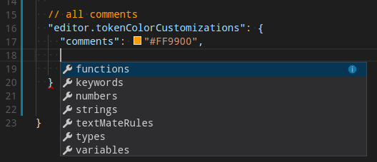

　　为最常见结构提供预配置语法标记集（“comments”、“strings”等）。需要更多标记时，可以直接指定 TextMate 主题颜色规则：

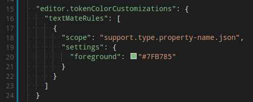

> **注意**：直接配置 TextMate 规则是高级技能，需要了解 TextMate 语法工作原理。详情请参阅[颜色主题指南](https://code.visualstudio.com/api/extension-guides/color-theme)。

自定义特定主题可以使用以下方式之一：

```json
"editor.tokenColorCustomizations": {
    "[Monokai]": {
        "comments": "#229977"
    },
    "[*Dark*]": {
        "variables": "#229977"
    },
    "[Abyss][Red]": {
        "keywords": "#f00"
    }
}
```

### 编辑器语义高亮 {#editor-semantic-highlighting}

　　某些语言（目前为 TypeScript、JavaScript、Java）提供语义标记。语义标记基于语言服务的符号理解，比由正则表达式驱动的 TextMate 语法标记更准确。基于语义标记计算的语义高亮叠加在语法高亮上，可以修正和丰富高亮，如以下示例：

　　“Tomorrow Night Blue”颜色主题，未启用语义高亮：

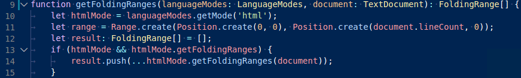

　　“Tomorrow Night Blue”颜色主题，启用语义高亮：

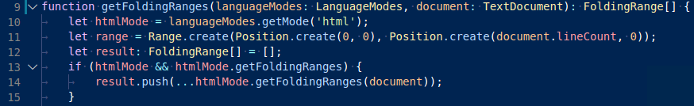

注意基于语言服务符号理解的颜色差异：

* 第 10 行：`languageModes` 着色为参数。
* 第 11 行：`Range` 和 `Position` 着色为类，`document` 着色为参数。
* 第 13 行：`getFoldingRanges` 着色为函数。

　　`editor.semanticHighlighting.enabled` 设置是是否应用语义高亮的主要控制。值可以是 `true`、`false` 和 `configuredByTheme`。

* `true` 和 `false` 为所有主题开启或关闭语义高亮。
* `configuredByTheme` 是默认值，让每个主题控制是否启用语义高亮。VS Code 自带的所有主题（例如默认“Dark+”）默认启用语义高亮。

可以覆盖主题设置：

```json
"editor.semanticTokenColorCustomizations": {
    "[Rouge]": {
        "enabled": true
    }
}
```

　　语义高亮启用且语言支持时，由主题配置是否以及如何为语义标记着色。某些语义标记是标准化的，映射到既定 TextMate 作用域。主题为这些 TextMate 作用域设置了着色规则时，语义标记会使用该颜色呈现，无需额外着色规则。

可以在 `editor.semanticTokenColorCustomizations` 中配置额外样式规则：

```json
"editor.semanticTokenColorCustomizations": {
    "[Rouge]": {
        "enabled": true,
        "rules": {
            "*.declaration": { "bold": true }
        }
    }
}
```

　　要查看计算出的语义标记及其样式，可以使用作用域检查器（**Developer: Inspect Editor Tokens and Scopes**），它显示当前光标位置文本的信息。

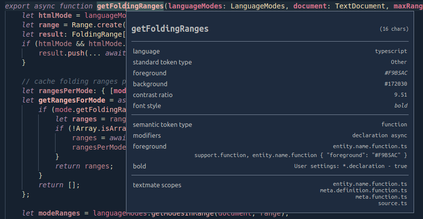

　　给定位置语言有语义标记且主题启用时，检查工具显示 **语义标记类型** 部分，展示语义标记信息（类型和任意数量修饰符）以及适用样式规则。

　　语义标记和样式规则语法详情请参阅[语义高亮指南](https://code.visualstudio.com/api/language-extensions/semantic-highlight-guide)。

## 创建自己的颜色主题 {#create-your-own-color-theme}

　　创建和发布主题扩展很简单。在用户设置中自定义颜色，然后使用 **Developer: Generate Color Theme From Current Settings** 命令生成主题定义文件。

　　VS Code 的 Yeoman [扩展生成器](https://code.visualstudio.com/api/get-started/your-first-extension)帮助生成扩展其余部分。

　　详情请参阅扩展 API 部分的[创建新颜色主题](https://code.visualstudio.com/api/extension-guides/color-theme#create-a-new-color-theme)。

## 移除默认颜色主题 {#remove-default-color-themes}

　　要从颜色主题选择器移除 VS Code 自带的某些默认主题，可以在扩展视图（`Ctrl + Shift + X`，macOS：`Cmd + Shift + X`）中禁用它们。选择扩展视图顶部的 **筛选扩展** 按钮，选择 **内置** 选项，会看到列出默认主题的 **主题** 部分。

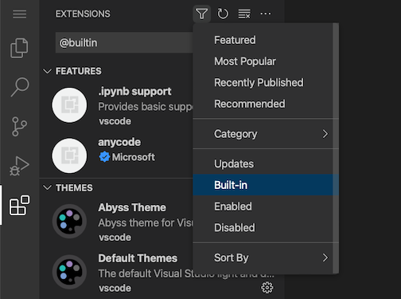

　　可以像禁用其他 VS Code [扩展](../3.3.6-Extensions/3.3.6.2-ExtensionMarketplace/)一样，通过齿轮上下文菜单的 **禁用** 命令禁用内置主题扩展。

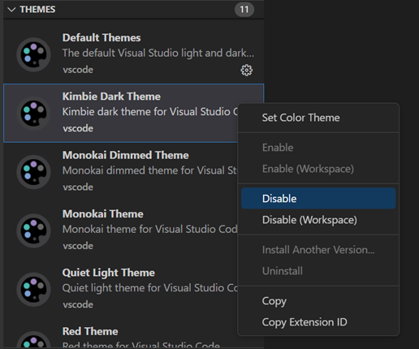

## 文件图标主题 {#file-icon-themes}

　　文件图标指示特定文件类型。这些图标显示在资源管理器视图和选项卡标题中的文件名旁。文件图标主题可以由扩展贡献。

选择其他文件图标主题：

1. 选择 **文件** > **首选项** > **主题** > **文件图标主题** 菜单项，或使用 **Preferences: File Icon Theme** 命令显示文件图标主题选择器。
2. 使用 `↑` 和 `↓` 键浏览列表并预览主题图标。
3. 选择所需主题并按 `Enter`。

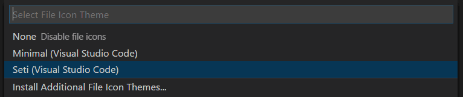

　　默认使用 **Seti** 文件图标主题，资源管理器视图中显示这些图标。VS Code 会跨重启记住文件图标主题选择。选择 **无** 可以禁用文件图标。

　　VS Code 自带两个文件图标主题：**Minimal** 和 **Seti**。要安装更多文件图标主题，请在文件图标主题选择器中选择 **安装其他文件图标主题**，打开按图标主题筛选的扩展视图。

　　也可以直接浏览 [Marketplace](https://marketplace.visualstudio.com/vscode/Themes)网站查找可用主题。

　　活动文件图标主题保存在用户[设置](../3.3.4-Settings/)中（快捷键 `Ctrl + ,`（macOS：`Cmd + ,`））。

```json
  // 指定工作台使用的文件图标主题。
  "workbench.iconTheme": "vs-seti"
```

## 创建自己的文件图标主题 {#create-your-own-file-icon-theme}

　　可以使用图标（最好是 SVG）创建自己的文件图标主题，详情请参阅扩展 API 部分的[文件图标主题](https://code.visualstudio.com/api/extension-guides/file-icon-theme)文章。

## 适用于 Web 的 VS Code {#vs-code-for-the-web}

　　VS Code for the Web 在 [https://vscode.dev](https://vscode.dev) 提供免费、零安装、完全在浏览器中运行的 VS Code 体验。

　　可以通过 URL 架构在 VS Code for the Web 中共享和体验颜色主题：`https://vscode.dev/editor/theme/<extensionId>`。

例如，可以访问 [https://vscode.dev/editor/theme/sdras.night-owl](https://vscode.dev/editor/theme/sdras.night-owl)，无需下载安装即可体验 [Night Owl 主题](https://marketplace.visualstudio.com/items?itemName=sdras.night-owl)。

　　在 [VS Code for the Web 文档](../../../remote/8.1-VSCodeForTheWeb/)中了解更多预览和共享主题。

## 产品图标主题 {#product-icon-themes}

　　产品图标主题可以更改 VS Code 用户界面中除特定文件类型图标之外的图标。例如，可以修改活动栏视图图标或标题栏布局图标。

注意下图中选择不同产品图标主题时活动栏图标的变化。

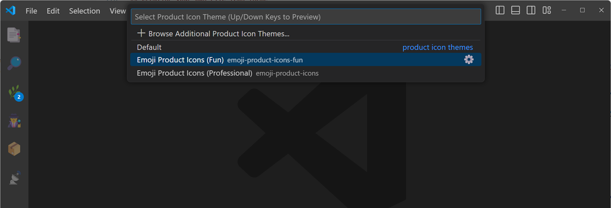

选择其他产品图标主题：

1. 选择 **文件** > **首选项** > **主题** > **产品图标主题** 菜单项，或使用 **Preferences: Product Icon Theme** 命令显示产品图标主题选择器。
2. 使用 `↑` 和 `↓` 键浏览列表并预览主题图标。
3. 选择所需主题并按 `Enter`。

　　默认情况下，VS Code 自带一个产品图标主题 **Default**。可以从产品图标主题选择器选择 **浏览其他产品图标主题...**，从 Marketplace 选择更多主题。

## 后续步骤 {#next-steps}

　　主题只是自定义 VS Code 的一种方式。想了解更多 VS Code 自定义和扩展性，请尝试：

* [设置](../3.3.4-Settings/)：通过用户和工作区设置按偏好配置 VS Code。
* [代码片段](../../3.2-WriteCode/3.2.7-Snippets/)：为喜欢的语言添加额外代码片段。
* [扩展 API](https://code.visualstudio.com/api)：了解扩展 VS Code 的其他方式。
* [颜色主题](https://code.visualstudio.com/api/extension-guides/color-theme)：颜色主题扩展 API。
* [文件图标主题](https://code.visualstudio.com/api/extension-guides/file-icon-theme)：文件图标主题扩展 API。
