+++
title = "3.3.8 配置文件"
date = 2026-11-06T07:53:25+08:00
weight = 8
type = "docs"
description = ""
isCJKLanguage = true
draft = false
+++


> 原文链接: [https://code.visualstudio.com/docs/configure/profiles](https://code.visualstudio.com/docs/configure/profiles)

# 3.3.8 配置文件

　　VS Code 有数百项[设置](../3.3.4-Settings/)、数千个[扩展](../3.3.6-Extensions/3.3.6.2-ExtensionMarketplace/)以及无数调整 UI 布局来自定义编辑器的方式。VS Code **配置文件**让你创建自定义项集合，快速切换或与他人共享。本主题说明如何使用**配置文件编辑器**创建、修改、导出和导入配置文件。

## 访问配置文件编辑器 {#access-the-profiles-editor}

　　**配置文件编辑器**让你在一个地方创建和管理 VS Code 配置文件。配置文件编辑器默认在编辑器区域上方的[模态覆盖层](../../3.1-GettingStarted/3.1.2-UserInterface/#modal-editors)中打开。

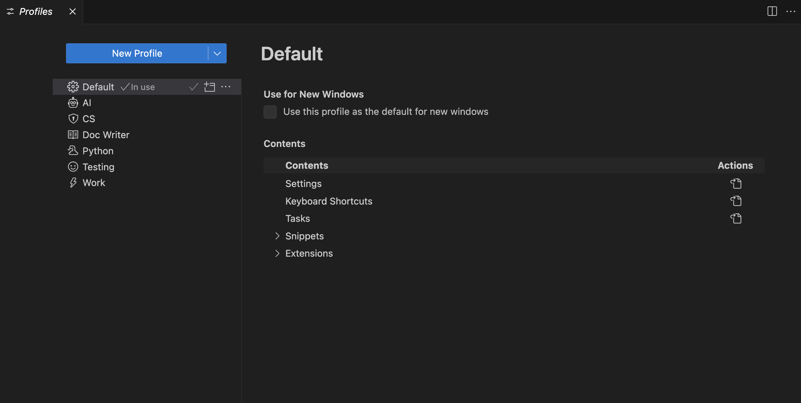

可以通过以下任一方式访问配置文件编辑器：

* 从 **文件** > **首选项** > **配置文件** 菜单项。

    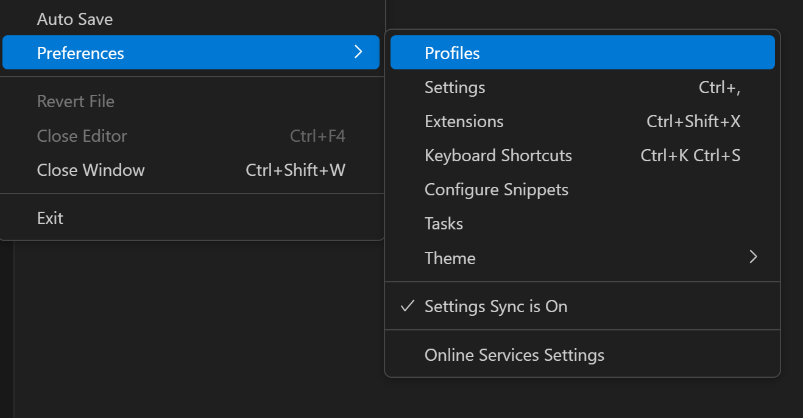

* 从活动栏底部的 **管理** 齿轮按钮。

    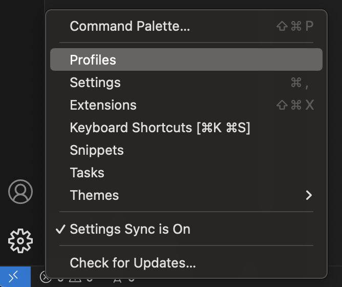

## 创建配置文件 {#create-a-profile}

　　VS Code 将当前配置视为**默认配置文件**。当你修改设置、安装扩展或通过移动视图更改 UI 布局时，这些自定义项会记录在默认配置文件中。

要创建新配置文件，请打开配置文件编辑器并选择 **新建配置文件** 按钮。这会打开新建配置文件表单，可以输入名称、选择图标并配置新配置文件包含的内容。

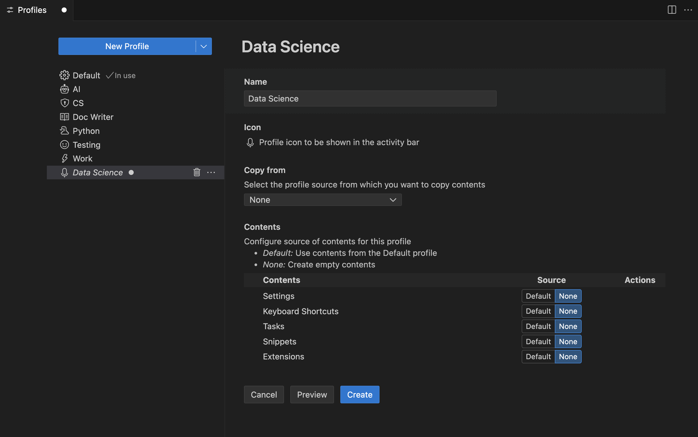

　　可以选择从配置文件模板或现有配置文件复制内容来创建新配置文件，或创建**空配置文件**。空配置文件不包含任何用户自定义项，例如设置、扩展、代码片段等。

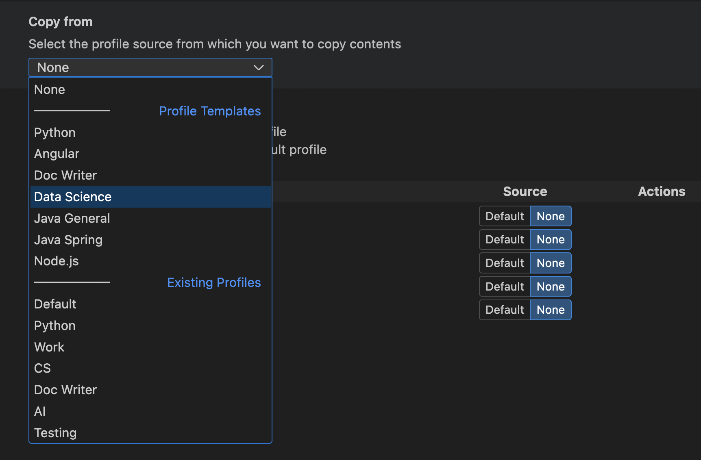

　　可以将新配置文件限制为只包含部分配置（设置、键盘快捷键、MCP 服务器、代码片段、任务和扩展），其余配置使用默认配置文件。例如，可以创建一个包含所有配置但排除键盘快捷键的配置文件，该配置文件激活时，VS Code 会应用默认配置文件的键盘快捷键。

　　可以在 **内容** 部分浏览要复制的模板或配置文件内容。每个部分旁有 **打开** 按钮，可以选择查看其内容。

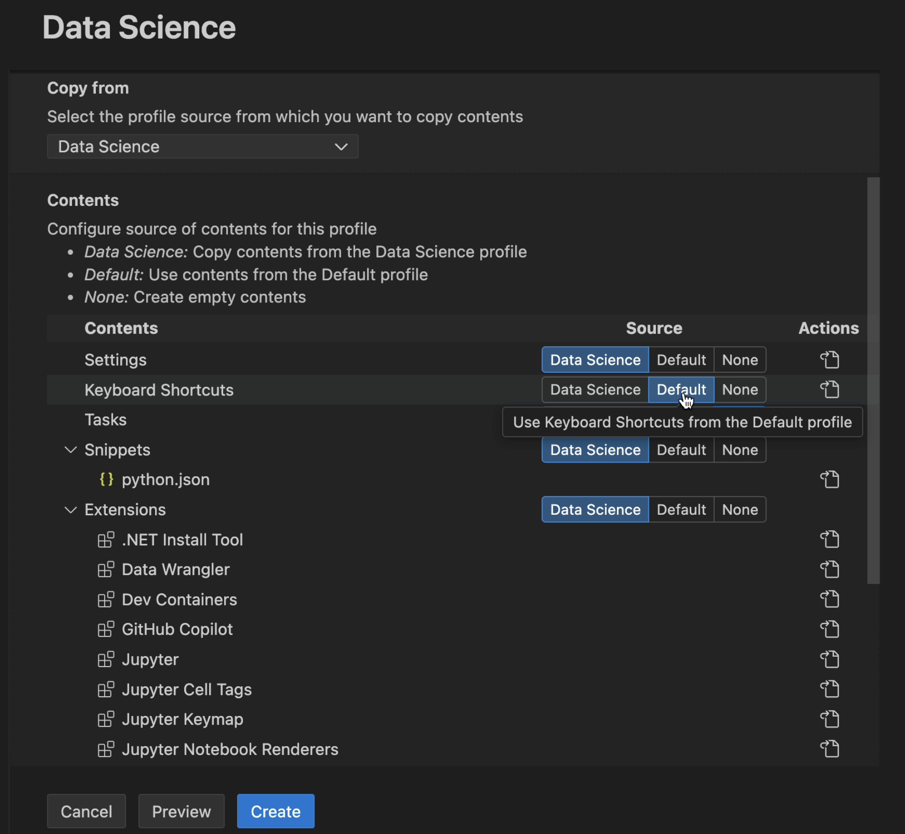

　　创建前选择 **预览** 按钮预览新配置文件。这会在应用了新配置文件的新 VS Code 窗口中打开。满意后选择 **创建** 创建配置文件。

### 检查当前配置文件 {#check-the-current-profile}

可以在 VS Code UI 的多个位置找到当前窗口使用的配置文件：

* VS Code 标题栏。

* 将鼠标悬停在活动栏 **管理** 按钮上时的悬停文本。

    如果为配置文件配置了图标，该图标会用作活动栏中的 **管理** 按钮。下图中管理按钮有麦克风图标，表示配置文件处于活动状态。

    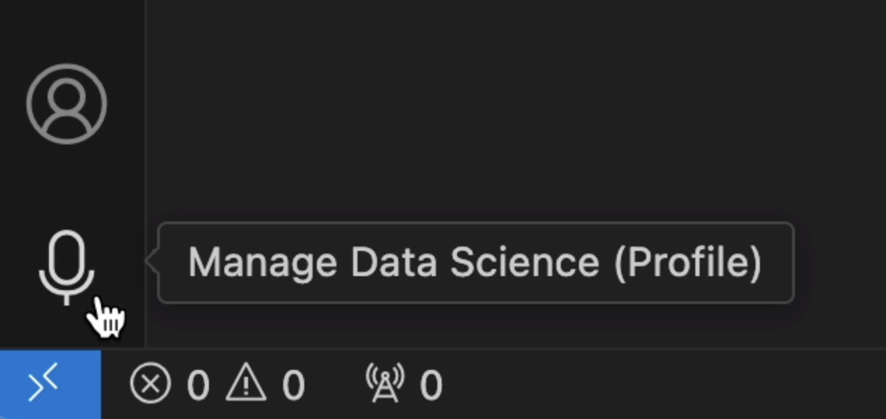

    如果未配置图标，**管理** 齿轮按钮会显示活动配置文件前两个字母的徽章，便于快速检查正在运行的配置文件。

    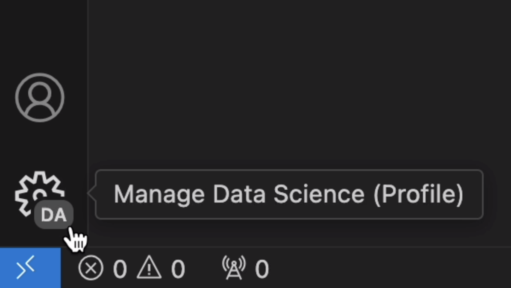

* 配置文件编辑器中。

    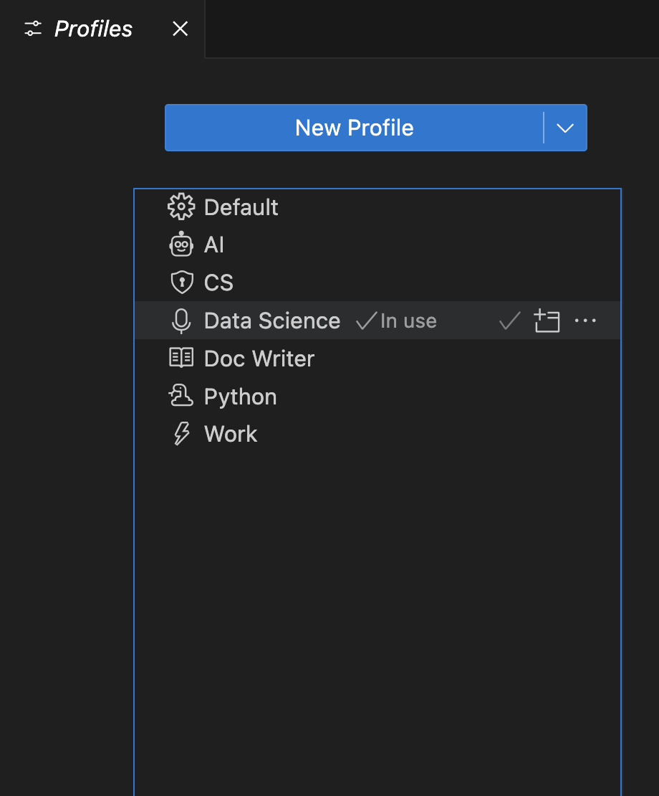

> **注意**：如果使用默认配置文件，则不显示配置文件名称。

### 配置配置文件 {#configure-a-profile}

　　可以像更改任何 VS Code 配置一样配置配置文件。可以安装/卸载/禁用扩展、更改设置并调整编辑器 UI 布局（例如移动和隐藏视图）。应用这些更改时，它们会存储在活动配置文件中。

### 文件夹和工作区关联 {#folder--workspace-associations}

　　创建或选择配置文件时，它会与当前文件夹或工作区关联。打开该文件夹时，工作区的配置文件会激活。如果打开另一个文件夹，配置文件会切换为该文件夹的配置文件（如果已设置）。

　　可以在**配置文件编辑器**的 **文件夹和工作区** 部分查看与配置文件关联的文件夹列表。

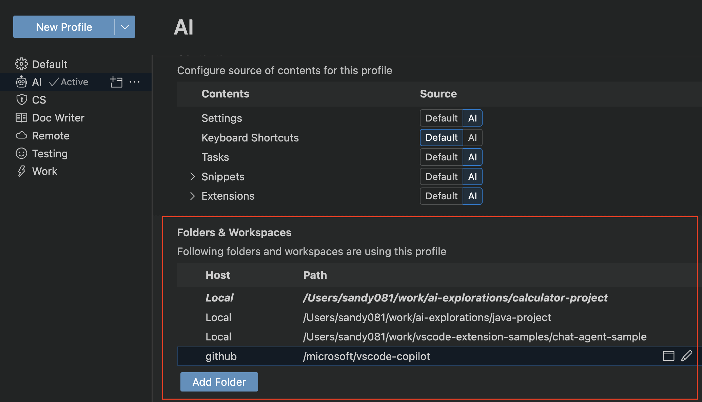

## 管理配置文件 {#manage-profiles}

### 切换配置文件 {#switch-profiles}

　　可以使用命令面板中的 **Profiles: Switch Profile** 命令快速切换配置文件，该命令会显示可用配置文件的下拉列表。

　　也可以在**配置文件编辑器**中，选择目标配置文件旁的 **将此配置文件用于当前窗口** 按钮切换。

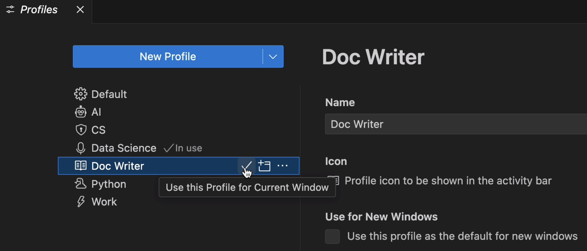

### 编辑配置文件 {#edit-a-profile}

　　可以在**配置文件编辑器**中编辑现有配置文件的名称、图标和其他配置。

### 删除配置文件 {#delete-a-profile}

　　可以在**配置文件编辑器**中，打开目标配置文件的溢出操作，选择 **删除配置文件**。

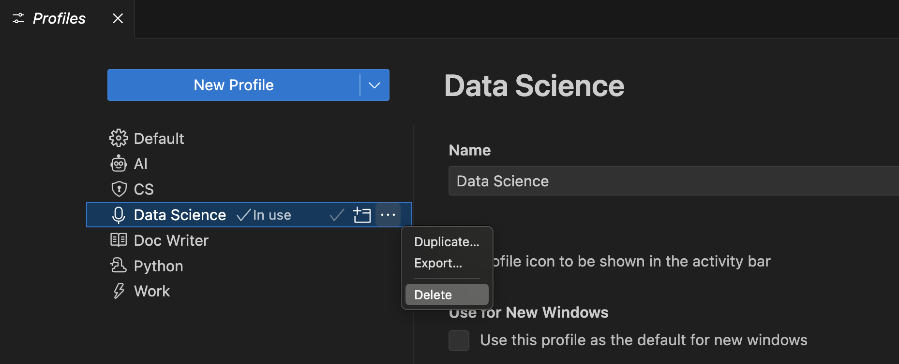

　　也可以通过 **Delete Profile** 命令删除配置文件。**Delete Profile** 下拉列表允许选择要删除的配置文件。

### 使用配置文件打开新窗口 {#open-a-new-window-with-a-profile}

　　可以使用配置文件编辑器“配置文件内容”视图中的 **用于新窗口** 选项，选择打开新 VS Code 窗口时使用的配置文件。

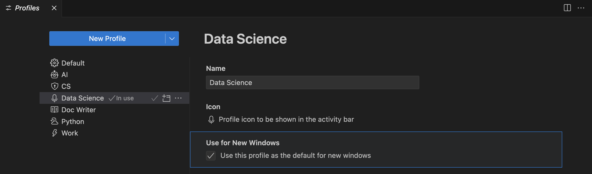

　　可以通过 **文件** > **使用配置文件新建窗口** 菜单直接为特定配置文件打开新 VS Code 窗口，并选择要使用的配置文件。

### 将设置应用到所有配置文件 {#apply-a-setting-to-all-profiles}

　　要将设置应用到所有配置文件，请使用设置编辑器中的 **将设置应用到所有配置文件** 操作。

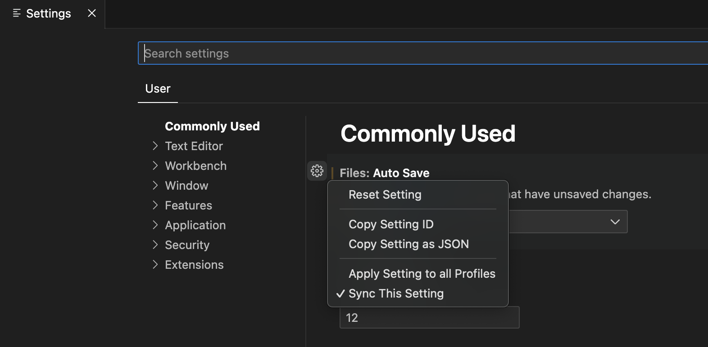

　　在任何配置文件中更新此设置也会应用到所有其他配置文件。取消选中 **将设置应用到所有配置文件** 可随时恢复此行为。

### 将扩展应用到所有配置文件 {#apply-an-extension-to-all-profiles}

　　要将扩展应用到所有配置文件，请在扩展视图中选择 **将扩展应用到所有配置文件** 操作。

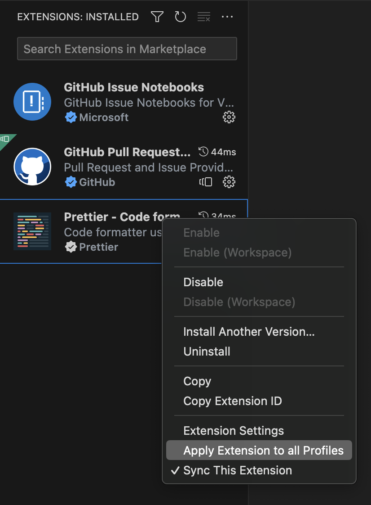

　　这会使扩展在所有配置文件中可用。取消选中 **将扩展应用到所有配置文件** 可随时恢复此行为。

## 跨机器同步配置文件 {#synchronize-profiles-across-machines}

　　可以使用[设置同步](../3.3.5-SettingsSync/)在多台机器之间移动配置文件。启用设置同步并在 **Settings Sync: Configure** 下拉列表中选中 **配置文件** 后，所有配置文件都会在已同步机器上可用。

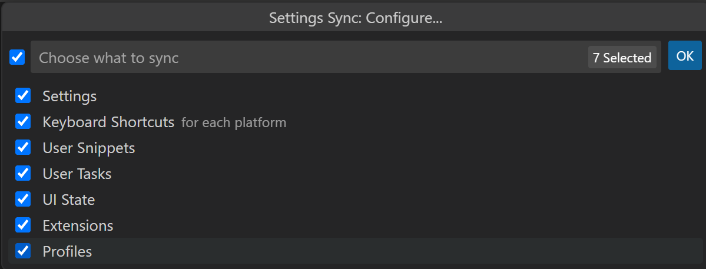

> **注意**：VS Code 不会将扩展同步到[远程](../../../remote/)窗口或从远程窗口同步，例如连接 SSH、开发容器（devcontainer）或 WSL 时。

## 共享配置文件 {#share-profiles}

### 导出 {#export}

　　可以使用目标配置文件的溢出操作中的 **导出...** 按钮导出配置文件，以保存或与他人共享。

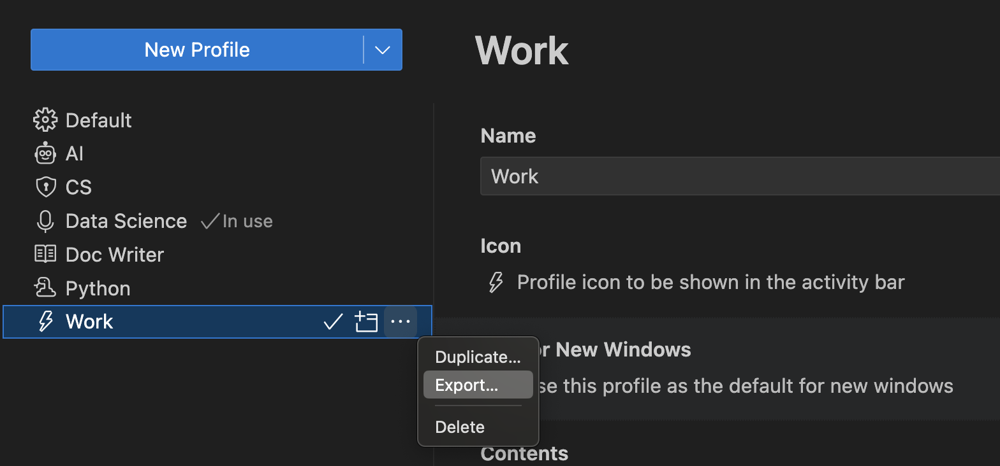

　　选择 **导出...** 时，会提示输入配置文件名称，并选择导出到 [GitHub gist](https://docs.github.com/get-started/writing-on-github/editing-and-sharing-content-with-gists/creating-gists)或本地文件系统。

#### 保存为 GitHub gist {#save-as-a-github-gist}

　　将配置文件保存到 GitHub 后（会提示登录 GitHub），对话框会提供 **复制链接** 选项，以便与他人共享配置文件 gist URL。URL 包含自动生成的 GUID，格式为 `https://vscode.dev/editor/profile/github/{GUID}`。GitHub gist 标记为 **Secret**，因此只有拥有链接的人才能查看。

　　启动配置文件 URL 会打开 [VS Code for the Web](https://vscode.dev)，并打开配置文件编辑器显示导入的配置文件内容。可以取消选择配置文件元素，如果希望在 VS Code for the Web 中继续使用该配置文件，需要手动 **安装扩展**（通过下载云按钮）。

　　也可以选择 **在 VS Code 中导入配置文件**，打开 VS Code 桌面版并显示配置文件内容及 **导入配置文件** 按钮。

　　可以在 `https://gist.github.com/{username}` 查看 gist。从 GitHub gist 页面可以重命名、删除或复制 gist 的 GUID。

#### 保存为本地文件 {#save-as-a-local-file}

　　如果选择将配置文件保存为本地文件，**保存配置文件** 对话框允许将文件放在本地计算机上。配置文件保存为 `.code-profile` 扩展名的文件。

### 导入 {#import}

　　可以从**配置文件编辑器**的 **新建配置文件** 按钮下拉操作中选择 **导入配置文件...** 导入现有配置文件。

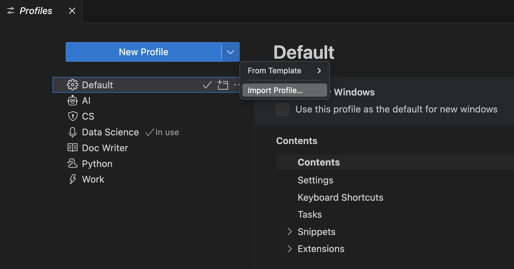

　　选择 **导入配置文件...** 时，会提示输入 GitHub gist URL 或配置文件位置。选择配置文件后，会打开[配置文件创建表单](#create-a-profile)，并预选要导入的配置文件。可以继续修改配置文件并选择 **创建** 导入。

## 配置文件的用途 {#uses-for-profiles}

　　配置文件是自定义 VS Code 以满足需求的绝佳方式。本节介绍一些常见用例。

　　由于配置文件按工作区记忆，它们非常适合为特定编程语言自定义 VS Code。例如，可以创建一个 JavaScript 前端配置文件，在一个工作区中包含 JavaScript 开发使用的扩展、设置和自定义项；再创建一个 Python 后端配置文件，在另一个工作区中包含 Python 开发使用的扩展、设置和自定义项。这样可以在工作区之间切换，并始终以正确方式配置 VS Code。

### 演示 {#demos}

　　演示时，可以使用配置文件为演示设置特定配置。例如，创建包含特定扩展集和缩放级别、字号、颜色主题等设置的配置文件。这样演示不会打乱正常的 VS Code 设置，并可以为演示提高可见性。

### 教育 {#education}

　　配置文件可以让学生使用自定义 VS Code，方便课堂环境。教育工作者可以快速与学生共享自定义 VS Code 设置。例如，为计算机科学课程创建包含所需扩展和设置的配置文件，然后与学生共享。

### 报告 VS Code 问题 {#report-vs-code-issues}

　　空配置文件的一个用途是在报告 VS Code 问题时重置编辑器。空配置文件禁用所有扩展和修改的设置，可以快速判断问题是扩展、设置还是 VS Code 核心导致的。

## 配置文件模板 {#profile-templates}

　　VS Code 提供一组预定义配置文件模板，可以用于为特定工作流自定义 VS Code。要基于模板创建新配置文件，请在 **创建配置文件** 流程中选择配置文件模板。

### Python 配置文件模板 {#python-profile-template}

　　Python 配置文件是 Python 开发的良好起点。它包含 Python 特定代码片段以及以下扩展：

* [autoDocstring](https://marketplace.visualstudio.com/items?itemName=njpwerner.autodocstring) - 自动生成 Python 文档字符串。
* [Container Tools](https://marketplace.visualstudio.com/items?itemName=ms-azuretools.vscode-containers) - 创建、管理和调试容器化应用。
* [Even Better TOML](https://marketplace.visualstudio.com/items?itemName=tamasfe.even-better-toml) - 为 `pyproject.toml` 等文件提供完整 TOML 支持。
* [Python](https://marketplace.visualstudio.com/items?itemName=ms-python.python) - IntelliSense、环境管理、调试、重构。
* [Python Environments](https://marketplace.visualstudio.com/items?itemName=ms-python.vscode-python-envs) - 使用首选环境管理器管理 Python 环境和包。
* [Remote Development](https://marketplace.visualstudio.com/items?itemName=ms-vscode-remote.vscode-remote-extensionpack) 扩展包 - 支持 SSH、WSL 和 Dev Containers。
* [Ruff](https://marketplace.visualstudio.com/items?itemName=charliermarsh.ruff) - 集成 [Ruff](https://github.com/charliermarsh/ruff) Python linter 和格式化程序。

此配置文件还设置以下内容：

```json
    "python.analysis.autoImportCompletions": true,
    "python.analysis.fixAll": ["source.unusedImports"],
    "editor.defaultFormatter": "charliermarsh.ruff"
```

### 数据科学配置文件模板 {#data-science-profile-template}

　　数据科学配置文件是所有数据和笔记本工作的良好起点。它包含特定代码片段以及以下扩展：

* [Data Wrangler](https://marketplace.visualstudio.com/items?itemName=ms-toolsai.datawrangler) - 查看、清理和准备表格数据集及 Excel/CSV/Parquet 文件。
* [Jupyter](https://marketplace.visualstudio.com/items?itemName=ms-toolsai.jupyter) - 在 VS Code 中使用 Jupyter 笔记本。
* [Python](https://marketplace.visualstudio.com/items?itemName=ms-python.python) - IntelliSense、环境管理、调试、重构。
* [Remote Development](https://marketplace.visualstudio.com/items?itemName=ms-vscode-remote.vscode-remote-extensionpack) 扩展包 - 支持 SSH、WSL 和 Dev Containers。
* [Ruff](https://marketplace.visualstudio.com/items?itemName=charliermarsh.ruff) - 集成 [Ruff](https://github.com/charliermarsh/ruff) Python linter 和格式化程序。

此配置文件还设置以下内容：

```json
    "[python]": {
        "editor.defaultFormatter": "charliermarsh.ruff",
        "editor.formatOnType": true,
        "editor.formatOnSave": true
    },
    "editor.inlineSuggest.enabled": true,
    "editor.lineHeight": 17,
    "breadcrumbs.enabled": false,
    "files.autoSave": "afterDelay",
    "notebook.output.scrolling": true,
    "jupyter.themeMatplotlibPlots": true,
    "jupyter.widgetScriptSources": [
        "unpkg.com",
        "jsdelivr.com"
    ],
    "files.exclude": {
        "**/.csv": true,
        "**/.parquet": true,
        "**/.pkl": true,
        "**/.xls": true
    }
```

### 文档编写配置文件模板 {#doc-writer-profile-template}

　　文档编写配置文件是编写文档的轻量设置。它包含以下扩展：

* [Code Spell Checker](https://marketplace.visualstudio.com/items?itemName=streetsidesoftware.code-spell-checker) - 源代码拼写检查。
* [Markdown Checkboxes](https://marketplace.visualstudio.com/items?itemName=bierner.markdown-checkbox) - 为 VS Code 内置 Markdown 预览添加复选框支持。
* [Markdown Emoji](https://marketplace.visualstudio.com/items?itemName=bierner.markdown-emoji) - 为 Markdown 预览和笔记本 Markdown 单元格添加 emoji 语法。
* [Markdown Footnotes](https://marketplace.visualstudio.com/items?itemName=bierner.markdown-footnotes) - 为 Markdown 预览添加脚注语法。
* [Markdown Preview GitHub Styling](https://marketplace.visualstudio.com/items?itemName=bierner.markdown-preview-github-styles) - 在 Markdown 预览中使用 GitHub 样式。
* [Markdown Preview Mermaid Support](https://marketplace.visualstudio.com/items?itemName=bierner.markdown-mermaid) - Mermaid 图和流程图。
* [Markdown yaml Preamble](https://marketplace.visualstudio.com/items?itemName=bierner.markdown-yaml-preamble) - 将 YAML front matter 渲染为表格。
* [markdownlint](https://marketplace.visualstudio.com/items?itemName=DavidAnson.vscode-markdownlint) - Markdown lint 和样式检查。
* [Word Count](https://marketplace.visualstudio.com/items?itemName=ms-vscode.wordcount) - 在状态栏查看 Markdown 文档字数。
* [Read Time](https://marketplace.visualstudio.com/items?itemName=johnpapa.read-time) - 估算 Markdown 阅读时间。

此配置文件还设置以下内容：

```json
    "workbench.colorTheme": "Default Light Modern",
    "editor.minimap.enabled": false,
    "breadcrumbs.enabled": false,
    "editor.glyphMargin": false,
    "explorer.decorations.badges": false,
    "explorer.decorations.colors": false,
    "editor.fontLigatures": true,
    "files.autoSave": "afterDelay",
    "git.enableSmartCommit": true,
    "window.commandCenter": true,
    "editor.renderWhitespace": "none",
    "workbench.editor.untitled.hint": "hidden",
    "markdown.validate.enabled": true,
    "markdown.updateLinksOnFileMove.enabled": "prompt",
    "workbench.startupEditor": "none"
```

### Node.js 配置文件模板 {#nodejs-profile-template}

　　Node.js 配置文件是所有 Node.js 工作的良好起点。它包含以下扩展：

* [Container Tools](https://marketplace.visualstudio.com/items?itemName=ms-azuretools.vscode-containers) - 创建、管理和调试容器化应用。
* [Dev Containers](https://marketplace.visualstudio.com/items?itemName=ms-vscode-remote.remote-containers) - 在 Docker 容器中创建自定义开发环境。
* [DotENV](https://marketplace.visualstudio.com/items?itemName=mikestead.dotenv) - 支持 dotenv 文件语法。
* [EditorConfig for VS Code](https://marketplace.visualstudio.com/items?itemName=EditorConfig.EditorConfig) - 支持 EditorConfig。
* [ESLint](https://marketplace.visualstudio.com/items?itemName=dbaeumer.vscode-eslint) - 将 ESLint JavaScript 集成到 VS Code。
* [JavaScript (ES6) code snippets](https://marketplace.visualstudio.com/items?itemName=xabikos.JavaScriptSnippets) - ES6 语法 JavaScript 代码片段。
* [Jest](https://marketplace.visualstudio.com/items?itemName=Orta.vscode-jest) - 使用 Facebook 的 [jest](https://jestjs.io) 测试框架。
* [Microsoft Edge Tools for VS Code](https://marketplace.visualstudio.com/items?itemName=ms-edgedevtools.vscode-edge-devtools) - 在 VS Code 中使用 Microsoft Edge 工具。
* [npm Intellisense](https://marketplace.visualstudio.com/items?itemName=christian-kohler.npm-intellisense) - 在 import 语句中自动补全 npm 模块。
* [Prettier - Code formatter](https://marketplace.visualstudio.com/items?itemName=esbenp.prettier-vscode) - 使用 [Prettier](https://prettier.io) 格式化代码。
* [Rest Client](https://marketplace.visualstudio.com/items?itemName=humao.rest-client) - REST 客户端。
* [YAML](https://marketplace.visualstudio.com/items?itemName=redhat.vscode-yaml) - YAML 语言支持，内置 Kubernetes 语法。

此配置文件包含以下设置：

```json
    "editor.formatOnPaste": true,
    "git.autofetch": true,
    "[markdown]":  {
        "editor.wordWrap": "on"
    },
    "[json]": {
        "editor.defaultFormatter": "esbenp.prettier-vscode"
    },
    "[jsonc]": {
        "editor.defaultFormatter": "vscode.json-language-features"
    },
    "[html]": {
        "editor.defaultFormatter": "esbenp.prettier-vscode"
    },
    "[javascript]": {
        "editor.defaultFormatter": "esbenp.prettier-vscode"
    },
    "[typescript]": {
        "editor.defaultFormatter": "esbenp.prettier-vscode"
    }
```

### Angular 配置文件模板 {#angular-profile-template}

　　Angular 配置文件是所有 Angular 工作的良好起点。它包含以下扩展：

* [Angular Language Service](https://marketplace.visualstudio.com/items?itemName=Angular.ng-template) - Angular 模板编辑器服务。
* [Angular Schematics](https://marketplace.visualstudio.com/items?itemName=cyrilletuzi.angular-schematics) - 集成 Angular schematics（CLI 命令）。
* [angular2-switcher](https://marketplace.visualstudio.com/items?itemName=infinity1207.angular2-switcher) - 轻松导航到 Angular2 项目中的 `typescript`、`template` 或 `style`。
* [Dev Containers](https://marketplace.visualstudio.com/items?itemName=ms-vscode-remote.remote-containers) - 在 Docker 容器中创建自定义开发环境。
* [EditorConfig for VS Code](https://marketplace.visualstudio.com/items?itemName=EditorConfig.EditorConfig) - 支持 EditorConfig。
* [ESLint](https://marketplace.visualstudio.com/items?itemName=dbaeumer.vscode-eslint) - 将 ESLint 集成到 VS Code。
* [JavaScript (ES6) code snippets](https://marketplace.visualstudio.com/items?itemName=xabikos.JavaScriptSnippets) - ES6 代码片段。
* [Jest](https://marketplace.visualstudio.com/items?itemName=Orta.vscode-jest) - Jest 测试框架。
* [Material Icon Theme](https://marketplace.visualstudio.com/items?itemName=PKief.material-icon-theme) - Material Design 图标。
* [Microsoft Edge Tools for VS Code](https://marketplace.visualstudio.com/items?itemName=ms-edgedevtools.vscode-edge-devtools) - Microsoft Edge 工具。
* [Playwright Test for VSCode](https://marketplace.visualstudio.com/items?itemName=ms-playwright.playwright) - 在 VS Code 中运行 [Playwright](https://playwright.dev) 测试。
* [Prettier - Code formatter](https://marketplace.visualstudio.com/items?itemName=esbenp.prettier-vscode) - Prettier 格式化。
* [Rest Client](https://marketplace.visualstudio.com/items?itemName=humao.rest-client) - REST 客户端。
* [YAML](https://marketplace.visualstudio.com/items?itemName=redhat.vscode-yaml) - YAML 支持。

此配置文件设置以下内容：

```json
    "editor.formatOnPaste": true,
    "git.autofetch": true,
    "[markdown]":  {
        "editor.wordWrap": "on"
    },
    "[json]": {
        "editor.defaultFormatter": "esbenp.prettier-vscode"
    },
    "[jsonc]": {
        "editor.defaultFormatter": "vscode.json-language-features"
    },
    "[html]": {
        "editor.defaultFormatter": "esbenp.prettier-vscode"
    },
    "[javascript]": {
        "editor.defaultFormatter": "esbenp.prettier-vscode"
    },
    "[typescript]": {
        "editor.defaultFormatter": "esbenp.prettier-vscode"
    },
    "workbench.iconTheme": "material-icon-theme"
```

### Java General 配置文件模板 {#java-general-profile-template}

　　Java General 配置文件是所有 Java 工作的良好起点。它自定义布局以改善 Java 体验，并包含 [Extension Pack for Java](https://marketplace.visualstudio.com/items?itemName=vscjava.vscode-java-pack) 中的以下扩展：

* [Debugger for Java](https://marketplace.visualstudio.com/items?itemName=vscjava.vscode-java-debug) - 轻量 Java 调试器。
* [IntelliCode](https://marketplace.visualstudio.com/items?itemName=VisualStudioExptTeam.vscodeintellicode) - AI 辅助开发。
* [IntelliCode API Usage Examples](https://marketplace.visualstudio.com/items?itemName=VisualStudioExptTeam.intellicode-api-usage-examples) - 为超过 10 万个 API 提供代码示例。
* [Language Support for Java(TM) by Red Hat](https://marketplace.visualstudio.com/items?itemName=redhat.java) - 基础 Java 语言支持、lint、IntelliSense、格式化和重构。
* [Maven for Java](https://marketplace.visualstudio.com/items?itemName=vscjava.vscode-maven) - 管理 [Maven](https://maven.apache.org) 项目和构建。
* [Project Manager for Java](https://marketplace.visualstudio.com/items?itemName=vscjava.vscode-java-dependency) - 在 VS Code 中管理 Java 项目。
* [Test Runner for Java](https://marketplace.visualstudio.com/items?itemName=vscjava.vscode-java-test) - 运行和调试 JUnit 或 TestNG 测试。

### Java Spring 配置文件模板 {#java-spring-profile-template}

　　Java Spring 配置文件是所有 Java 和 Spring 开发者的良好起点。它基于 Java General 配置文件，并添加 [Spring Boot Extension Pack](https://marketplace.visualstudio.com/items?itemName=vmware.vscode-boot-dev-pack) 中的以下扩展：

* [Spring Boot Dashboard](https://marketplace.visualstudio.com/items?itemName=vscjava.vscode-spring-boot-dashboard) - 在运行的 Spring 应用中提供 Spring Boot 实时数据可视化和观察。
* [Spring Boot Tools](https://marketplace.visualstudio.com/items?itemName=vmware.vscode-spring-boot) - 为 Spring Boot 文件提供丰富语言支持。
* [Spring Initializr Java Support](https://marketplace.visualstudio.com/items?itemName=vscjava.vscode-spring-initializr) - 搭建和生成 Spring Boot Java 项目。

此配置文件设置以下内容：

```json
    "[java]": {
        "editor.defaultFormatter": "redhat.java"
    },
    "boot-java.rewrite.reconcile": true
```

## 命令行 {#command-line}

　　可以通过 `--profile` 命令行选项使用特定配置文件启动 VS Code。在 `--profile` 后传入配置文件名称，并使用该配置文件打开文件夹或工作区。以下命令使用“Web Development”配置文件打开 `web-sample` 文件夹：

`code ~/projects/web-sample --profile "Web Development"`

　　如果指定的配置文件不存在，会创建具有该名称的新空配置文件。

## 常见问题 {#common-questions}

### 配置文件保存在哪里？ {#where-are-profiles-kept}

　　配置文件与用户设置和键盘快捷键一样，存储在用户配置下。

* **Windows** `%APPDATA%\Code\User\profiles`
* **macOS** `$HOME/Library/Application\ Support/Code/User/profiles`
* **Linux** `$HOME/.config/Code/User/profiles`

　　如果使用 [Insiders](../../../get-started/) 版本，中间文件夹名为 `Code - Insiders`。

### 什么是临时配置文件？ {#what-is-a-temporary-profile}

　　临时配置文件不会跨 VS Code 会话保存。可以通过命令面板中的 **Profiles: Create a Temporary Profile** 命令创建。临时配置文件从空配置文件开始，并自动生成名称（例如 **Temp 1**）。可以修改其设置和扩展，在 VS Code 会话期间使用，但关闭 VS Code 后会被删除。

　　临时配置文件适合尝试新配置或测试扩展，而不修改默认或现有配置文件。重启 VS Code 会为工作区重新启用当前配置文件。

### 可以从另一个配置文件继承设置吗？ {#can-i-inherit-settings-from-another-profile}

　　目前不能从另一个配置文件继承设置，即覆盖特定设置并保留其他设置。我们在 vscode 仓库中跟踪此[功能请求](https://github.com/microsoft/vscode/issues/188612)。

　　创建新配置文件时，可以选择从另一个配置文件或默认配置文件复制设置。这会创建设置副本，但不会保持与源配置文件的链接。

### 如何从项目中移除配置文件？ {#how-can-i-remove-the-profile-from-my-project}

　　可以将项目恢复为默认配置文件。如果要移除所有配置文件工作区关联，请使用 **Developer: Reset Workspace Profiles Associations**，这会将所有分配了配置文件的本地文件夹恢复为默认配置文件。**Reset Workspace Profiles Associations** 不会删除任何现有配置文件。

### 为什么导出配置文件时有些设置未导出？ {#why-are-some-settings-not-exported-when-exporting-a-profile}

　　导出配置文件时不会包含机器特定设置，因为这些设置在另一台机器上不适用。例如，指向本地路径的设置不会被包含。

### 为什么创建新配置文件时模板不可用？ {#why-are-templates-not-available-when-creating-a-new-profile}

　　配置文件模板由 VS Code 外部托管，只有连接 Internet 时才能下载和应用模板。如果配置文件模板不可用，请检查 Internet 连接。
