+++
title = "3.3.9.1 辅助功能"
date = 2026-11-06T07:53:25+08:00
weight = 1
type = "docs"
description = ""
isCJKLanguage = true
draft = false
+++


> 原文链接: [https://code.visualstudio.com/docs/configure/accessibility/accessibility](https://code.visualstudio.com/docs/configure/accessibility/accessibility)

# 3.3.9.1 辅助功能

　　VS Code 提供许多功能帮助所有用户使用编辑器。缩放级别和高对比度颜色改善可见性，仅键盘导航支持无鼠标使用，编辑器还针对屏幕阅读器优化。

## 缩放 {#zoom}

　　可以通过 **视图** > **外观** > **缩放** 命令调整 VS Code 缩放级别。每个 **缩放** 命令将缩放级别增加或减少 20%。

* **视图** > **外观** > **放大**（`Ctrl + =`）：增加缩放级别。
* **视图** > **外观** > **缩小**（`Ctrl + -`）：减少缩放级别。
* **视图** > **外观** > **重置缩放**（`Ctrl + 数字键盘 0`）：将缩放级别重置为 0。

> **注意**：使用放大镜时，按住 `Alt` 键并将光标移到悬停内容上。

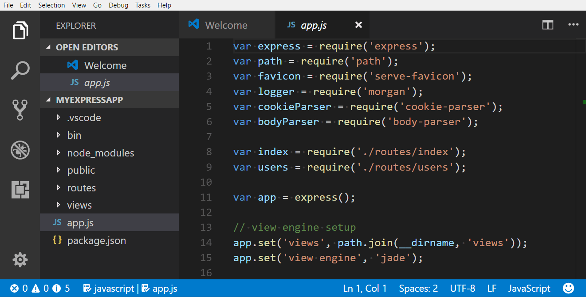

### 持久化缩放级别 {#persisted-zoom-level}

　　使用 **视图** > **外观** > **放大/缩小** 命令调整缩放级别时，级别保存在 `window.zoomLevel` [设置](../../3.3.4-Settings/)中。默认值 0。高于或低于 0 的每个增量表示放大或缩小 20%。也可以输入小数，以更细粒度调整缩放级别。

## 辅助功能帮助 {#accessibility-help}

　　命令 **打开辅助功能帮助**（`Alt + F1`）根据当前上下文打开帮助菜单。目前适用于编辑器、终端、笔记本、聊天视图和内联聊天功能。

可以从帮助菜单关闭辅助功能帮助或打开其他文档。

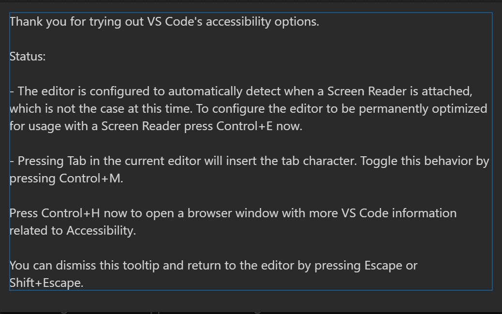

## 高对比度主题 {#high-contrast-theme}

　　VS Code 在所有平台支持高对比度颜色主题。使用 **文件** > **首选项** > **主题** > **颜色主题**（`Ctrl + K Ctrl + T`）显示 **选择颜色主题** 下拉列表，选择 **高对比度** 主题。

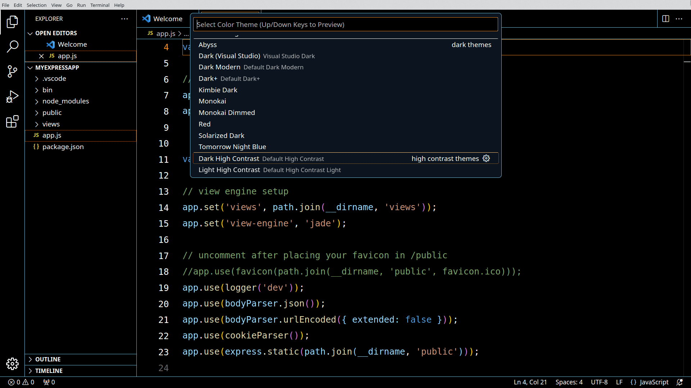

## 色觉辅助功能 {#color-vision-accessibility}

　　可以在 **Visual Studio Marketplace** 中搜索适合色觉缺陷的扩展。使用扩展视图（`Ctrl + Shift + X`）搜索“color blind”以显示相关选项。

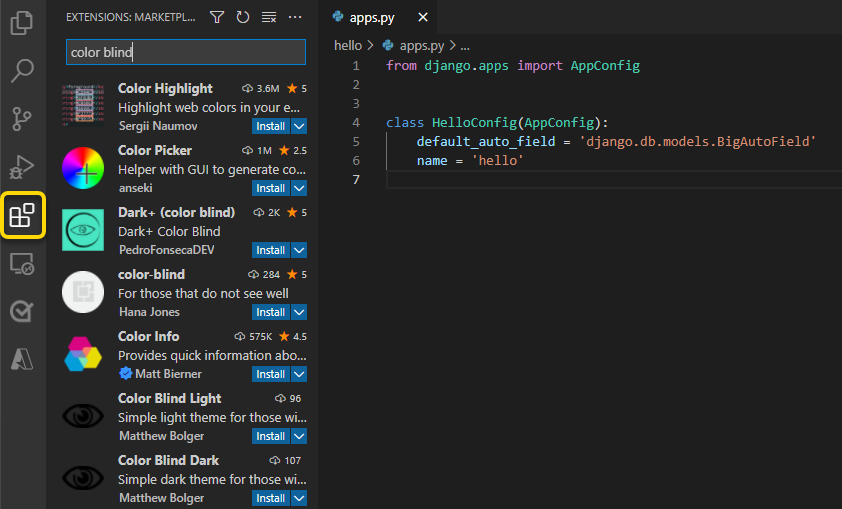

　　从 Marketplace 安装颜色主题后，可以通过 **文件** > **首选项** > **主题** > **颜色主题**（`Ctrl + K Ctrl + T`）更改[颜色主题](../../3.3.7-Themes/)。

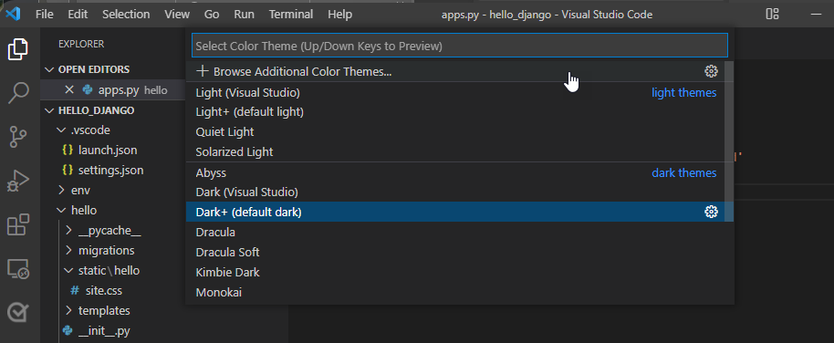

### 推荐色觉辅助功能主题 {#recommended-themes-for-color-vision-accessibility}

* [GitHub](https://marketplace.visualstudio.com/items?itemName=GitHub.github-vscode-theme)：适合大多数色盲类型，与 GitHub 设置中的主题匹配。
* [Gotthard](https://marketplace.visualstudio.com/items?itemName=janbiasi.gotthard-theme)：针对约 20 种编程语言优化。
* [Blinds](https://marketplace.visualstudio.com/items?itemName=tankashing.blinds-theme)：为绿色盲设计，具有高对比度色彩比例。
* [Greative](https://marketplace.visualstudio.com/items?itemName=Greative.greative)：兼顾色盲和光敏感。
* [Pitaya Smoothie](https://marketplace.visualstudio.com/items?itemName=trallard.pitaya-smoothie)：适合大多数色盲类型，符合 [WCAG 2.1 颜色对比度标准](https://www.w3.org/TR/UNDERSTANDING-WCAG20/visual-audio-contrast-contrast.html)。

## 自定义警告颜色 {#customizing-warning-colors}

　　VS Code 默认颜色主题为 **Dark+**，但可以自定义主题和用户界面属性颜色。

> **注意**：覆盖当前主题颜色的详情请参阅[自定义颜色主题](../../3.3.7-Themes/)。

要自定义错误和警告波浪线，请转到 **文件** > **首选项** > **设置** 打开用户设置。搜索“color customizations”找到 **Workbench: Color Customizations** 设置，选择 **在 settings.json 中编辑** 打开用户 `settings.json` 文件。

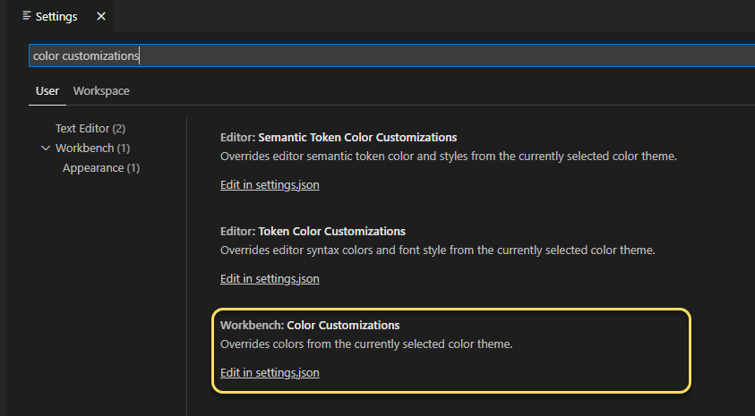

在 `settings.json` 文件中，将以下代码嵌套在最外层花括号内。可以为每个对象分配十六进制颜色代码：

```json
"workbench.colorCustomizations": {
    "editorError.foreground": "#ffef0f",
    "editorWarning.foreground": "#3777ff"
}
```

以下示例在 JSON 项后缺少逗号时应用警告颜色：

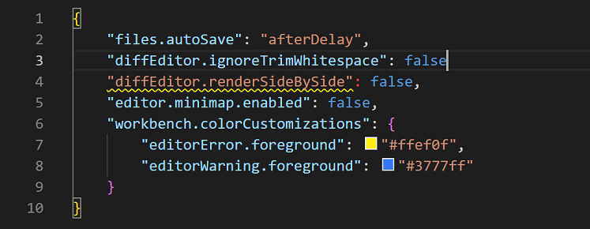

* `editorError.foreground`：覆盖错误下方波浪线。
* `editorWarning.foreground`：覆盖警告下方波浪线。
* `editorError.background`：覆盖错误高亮颜色。
* `editorWarning.background`：覆盖警告高亮颜色。

　　为 `editorError` 和 `editorWarning` 背景分配颜色也有助于识别潜在问题。所选颜色会高亮相应错误或警告。上例颜色 `#ffef0f`（黄色）和 `#3777ff`（蓝色）对常见色觉缺陷人群更易访问。

### 选择可访问颜色 {#selecting-accessible-colors}

　　颜色可访问性因异常三色觉（色盲）类型而异。严重程度因人而异，可分为四种情况：

| 情况 | 类型 |
| --- | --- |
| 绿色盲 | 对绿光敏感度降低，是最常见的色盲类型。 |
| 红色盲 | 对红光敏感度降低。 |
| 蓝色盲 | 对蓝光敏感度降低，较为罕见。 |
| 全色盲 | 无法看到所有颜色，也称为 achromatopsia。关于最罕见色盲类型的更多信息：[Foundation for Fighting Blindness](https://www.fightingblindness.org/diseases/achromatopsia)。 |

　　为特定情况选择最佳颜色的最佳方法之一是使用互补色，即色轮上相对的颜色。

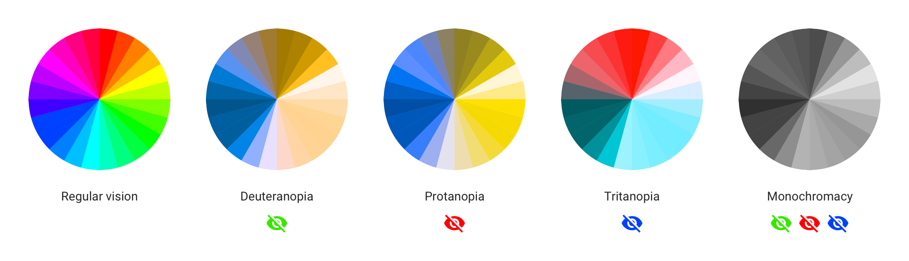

> **注意**：查找互补色的更多信息，请访问 [Adobe Color](https://color.adobe.com/create/color-accessibility) 的色盲模拟器和交互式色轮。

## 淡化未聚焦编辑器和终端 {#dim-unfocused-editors-and-terminals}

　　可以淡化未聚焦视图，更清楚地显示输入将进入的位置。使用多个编辑器组或终端时尤其有用。将 `accessibility.dimUnfocused.enabled` 设置为 `true` 开启。可以使用 `accessibility.dimUnfocused.opacity` 控制淡化程度，取 0.2 到 1 的不透明度小数（默认 0.75）。

## 键盘导航 {#keyboard-navigation}

　　VS Code 在 **命令面板**（`Ctrl + Shift + P`）中提供详尽命令列表，可以不用鼠标使用。按 `Ctrl + Shift + P`，输入命令名（例如“git”）筛选命令列表。

　　VS Code 还为命令提供许多预设键盘快捷键。

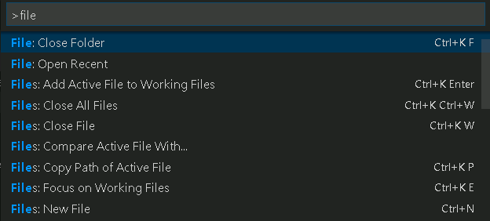

　　也可以设置自己的键盘快捷键。**文件** > **首选项** > **键盘快捷键**（`Ctrl + K Ctrl + S`）打开键盘快捷键编辑器，可以发现和修改 VS Code 操作的快捷键。自定义或添加快捷键详情请参阅[键绑定](../../3.3.3-KeyboardShortcuts/)。

　　在工作台中快速导航，建议使用 **聚焦下一部分**（`F6`）和 **聚焦上一部分**（`Shift + F6`）命令。

### 锚点选择 {#anchor-selection}

　　为方便使用键盘开始和结束选择，提供四个命令：**设置选择锚点**（`Ctrl + K Ctrl + B`）、**从锚点选择到光标**（`Ctrl + K Ctrl + K`）、**取消选择锚点**（`Ctrl + K Ctrl + U`）和 **转到选择锚点**。

## Tab 导航 {#tab-navigation}

　　可以使用 `Tab` 键在 VS Code UI 控件之间导航。使用 `Shift + Tab` 反向导航。在 UI 控件之间切换时，获得焦点的元素周围会显示指示器。

　　工作台中所有元素支持 Tab 导航。为避免过多 Tab 停靠点，工作台工具栏和选项卡列表各只有一个。工具栏或选项卡列表获得焦点后，可以使用箭头键在其中导航。

> **注意**：Tab 导航按视觉自然顺序进行，WebView（例如 Markdown 预览）除外。对于 WebView，建议使用 `F6` 和 `Shift + F6` 命令在 WebView 和工作台其他部分之间导航。也可以使用众多聚焦编辑器命令之一。

## Tab 捕获 {#tab-trapping}

　　默认情况下，在源代码文件中按 `Tab` 会插入 Tab 字符（或空格，取决于缩进设置），不会离开打开的文件。可以使用 `Ctrl + M` 切换 `Tab` 捕获，之后的 `Tab` 键会将焦点移出文件。默认 `Tab` 捕获关闭时，状态栏会显示 **Tab 移动焦点** 指示器。

　　集成终端也有 Tab 捕获。默认行为可以通过 `editor.tabFocusMode` 设置配置。

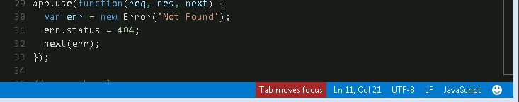

　　也可以从 **命令面板**（`Ctrl + Shift + P`）使用 **切换 Tab 键移动焦点** 操作打开或关闭 `Tab` 捕获。

　　只读文件从不捕获 `Tab` 键。**集成终端** 面板遵循 `Tab` 捕获模式，可以使用 `Ctrl + M` 切换。

## 屏幕阅读器 {#screen-readers}

　　VS Code 使用基于文本分页的策略在编辑器中支持屏幕阅读器。已测试以下屏幕阅读器：

* Windows：[NVDA](https://www.nvaccess.org) 和 [JAWS](https://www.freedomscientific.com/products/software/jaws)
* macOS：[VoiceOver](https://support.apple.com/guide/voiceover/welcome/mac)
* Linux：[Orca](https://help.gnome.org/users/orca/stable/)

> NVDA 建议保持在焦点模式并使用热键导航，而不是使用浏览模式。

　　**转到下一个/上一个错误或警告** 操作（`F8` 和 `Shift + F8`）允许屏幕阅读器播报错误和警告消息。

　　建议弹出时，会向屏幕阅读器播报。使用 `Ctrl + ↑` 和 `Ctrl + ↓` 导航建议，使用 `Shift + Escape` 关闭。建议妨碍操作时，可以使用 `editor.quickSuggestions` 设置关闭。

　　差异视图窗格中，**转到下一个/上一个差异** 操作（`Alt + F2` 和 `Shift + Alt + F2`）会显示可访问差异查看器，以统一补丁格式呈现差异。使用 `↑` 和 `↓` 导航未更改、插入或删除的行。按 `Enter` 将焦点返回到差异编辑器中所选行号（如果选中删除行，则最接近的仍存在行号）。使用 `Escape` 或 `Shift + Escape` 关闭可访问差异查看器。

## 屏幕阅读器模式 {#screen-reader-mode}

　　VS Code 检测到使用屏幕阅读器时，会为编辑器和集成终端等 UI 进入优化的屏幕阅读器模式。状态栏右下角显示 **屏幕阅读器已优化**。智能体窗口中，标题栏显示 **屏幕阅读器已优化** 徽章。选择任一指示器或运行 **切换屏幕阅读器辅助功能模式** 命令关闭屏幕阅读器模式。

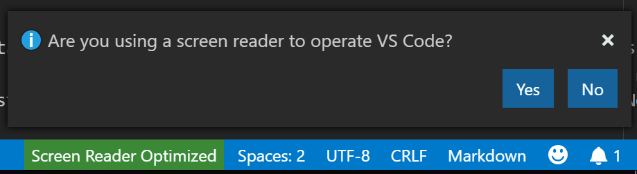

　　屏幕阅读器模式中，折叠和 minimap（代码概览）等功能会禁用。可以使用 **Editor: Accessibility Support** 设置（`editor.accessibilitySupport`）控制 VS Code 是否使用屏幕阅读器模式，值为 `on`、`off` 或默认 `auto`（通过查询平台自动检测屏幕阅读器）。

## 通过键盘调整表格列宽 {#resize-table-columns-via-the-keyboard}

　　`list.resizeColumn` 命令可以使用键盘调整列宽。可以为该命令[分配键盘快捷键](#keyboard-navigation)。

　　触发命令后，选择要调整的列，并提供要设置的宽度百分比。以下视频展示如何在键盘快捷键编辑器中调整列宽。

## 可访问视图 {#accessible-view}

　　运行 **打开可访问视图** 命令（`Alt + F2`）显示可访问视图，逐字符、逐行检查内容。可访问视图目前适用于悬停、通知、评论、笔记本输出、终端输出、聊天响应、内联补全、调试控制台输出等。

## 输入控件和结果导航 {#input-control-and-result-navigation}

　　在输入控件（例如搜索或筛选输入）及其结果之间导航，在扩展视图、键盘快捷键编辑器以及评论、问题和调试控制台面板中保持一致，使用 `Ctrl + ↓` 和 `Ctrl + ↑`。

## 终端辅助功能 {#terminal-accessibility}

　　可以通过 `Alt + F1` 显示终端辅助功能帮助，其中描述使用屏幕阅读器的有用提示。一个提示是使用 `Ctrl + Alt + PageUp` 访问终端缓冲区。根据屏幕阅读器，这会自动进入浏览模式，提供整个终端缓冲区的可访问视图。

　　使用 `editor.tabFocusMode` 控制终端是否接收 `Tab` 键而不是工作台，与编辑器类似。

### Shell 集成 {#shell-integration}

　　终端有 [shell 集成](../../../../terminal/5.4-ShellIntegration/)功能，提供其他终端没有的许多额外功能。使用屏幕阅读器时，[运行最近命令](../../../../terminal/5.4-ShellIntegration/)和[转到最近目录](../../../../terminal/5.4-ShellIntegration/)功能特别有用。

　　另一个 shell 集成驱动命令 **在可访问视图中转到符号**（`Ctrl + Shift + O`）可以在终端命令之间导航，类似编辑器的 **转到编辑器中的符号**。

### 最小对比度 {#minimum-contrast-ratio}

　　将 `terminal.integrated.minimumContrastRatio` 设置为 1 到 21 之间的数字，调整文本颜色亮度，直到达到所需对比度或纯白（`#FFFFFF`）/纯黑（`#000000`）。

　　注意 `terminal.integrated.minimumContrastRatio` 设置不适用于 `powerline` 字符。

## 状态栏辅助功能 {#status-bar-accessibility}

　　使用 **聚焦下一部分**（`F6`）将焦点移到状态栏后，可以使用箭头导航在状态栏条目之间移动焦点。

### 差异编辑器辅助功能 {#diff-editor-accessibility}

　　差异编辑器中有可访问差异查看器，以统一补丁格式呈现更改。可以使用 **转到下一个差异**（`Alt + F2`）和 **转到上一个差异**（`Shift + Alt + F2`）在更改之间导航。使用箭头键导航行，按 `Enter` 跳回差异编辑器和选中行。

## 调试器辅助功能 {#debugger-accessibility}

　　VS Code 调试器 UI 可访问，具有以下功能：

* 调试状态变化会播报（例如“已启动”、“断点命中”、“已终止”等）。
* 所有调试操作均可通过键盘访问。
* 运行和调试视图及调试控制台支持 Tab 导航。
* 调试悬停可通过键盘访问（`Ctrl + K Ctrl + I`）。
* 可以创建键盘快捷键将焦点设置到每个调试器区域。
* 调试期间焦点在编辑器中时，调用 **Debug: Add to Watch** 命令会播报变量值。

## 辅助功能信号 {#accessibility-signals}

　　辅助功能信号指示当前行是否有某些标记，例如错误、警告、断点、折叠文本区域或内联建议。

　　主光标更改行或首次向当前行添加标记时播放。附加屏幕阅读器时，辅助功能信号声音和播报可能自动启用，并可通过 `accessibility.signals.*` 设置控制。

　　命令 **Help: List Signal Sounds** 列出所有可用声音，在列表中移动时试听，并配置启用/禁用状态。

　　**Confetti** 信号在聊天点赞反馈显示彩带或在智能体窗口将会话标记为完成时提供音频提示。使用 `accessibility.signals.confetti` 配置。

　　Aria 播报还会通知屏幕阅读器和盲文用户命中了某些标记。命令 **Help: List Signal Announcements** 告知用户哪些可用，并允许配置启用/禁用状态。

## 悬停辅助功能 {#hover-accessibility}

　　某些悬停不能正常悬停，使用屏幕放大镜时难以操作。解决方法是在悬停活动时按住 `Alt` 或 `Option` 键“锁定”悬停，使其在悬停时不隐藏。松开键解锁悬停。

## 当前已知问题 {#current-known-issues}

　　VS Code 有一些平台相关的已知辅助功能问题。完整列表请参阅 [VS Code 辅助功能问题](https://github.com/microsoft/vscode/issues?q=is%3Aopen+is%3Aissue+label%3Aaccessibility)。

### macOS {#macos}

　　编辑器包含 VoiceOver 屏幕阅读器支持。

### Linux {#linux}

　　VS Code 与 Orca 屏幕阅读器配合良好。如果 Linux 发行版中的 Orca 不读取编辑器内容：

* 确保 VS Code 中有 `"editor.accessibilitySupport": "on"` 设置。可以通过设置完成，或运行 **Show Accessibility Help** 命令并按 `Ctrl + E` 开启 accessibilitySupport。
* 如果 Orca 仍然静默，请尝试设置环境变量 `ACCESSIBILITY_ENABLED=1`。

启用该设置后，VS Code 应该可以与 Orca 屏幕阅读器配合工作。

## 后续步骤 {#next-steps}

继续了解：

* [语音交互](../3.3.9.2-Voice/)：学习如何在 VS Code 中使用语音命令。
* [VS Code 用户界面](../../../3.1-GettingStarted/3.1.2-UserInterface/)：快速了解 VS Code。
* [基本编辑](../../../3.2-WriteCode/3.2.1-BasicEditing/)：了解强大的 VS Code 编辑器。
* [代码导航](../../../3.2-WriteCode/3.2.5-CodeNavigation/)：快速浏览源代码。
