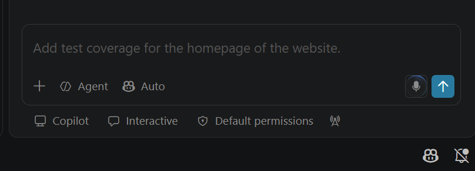
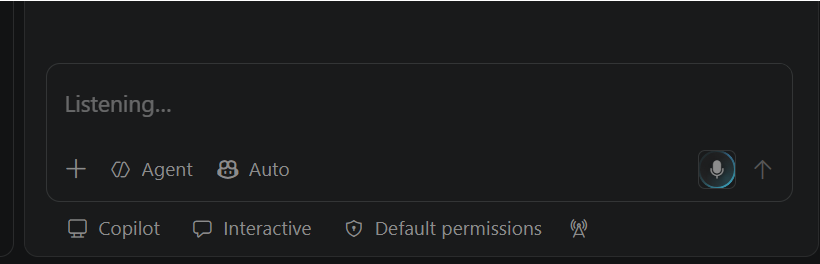

+++
title = "3.3.9.2 语音支持"
date = 2026-11-06T07:53:25+08:00
weight = 2
type = "docs"
description = ""
isCJKLanguage = true
draft = false
+++

> 原文链接: [https://code.visualstudio.com/docs/configure/accessibility/voice](https://code.visualstudio.com/docs/configure/accessibility/voice)

# 3.3.9.2 语音支持

　　Visual Studio Code 支持通过语音模式与智能体进行语音对话，也支持内置听写，在聊天、智能体窗口、编辑器和终端中将语音转换为文本。

## 使用语音模式 {#use-voice-mode}

　　语音模式让你在智能体处理代码时进行免提交谈。与仅将语音转换为文本的听写不同，语音模式还会朗读智能体的响应并监听后续请求。

　　要开始语音对话，请启用 `agents.voice.enabled`，打开聊天视图或智能体窗口，然后选择聊天输入框中的 **语音模式** 按钮。也可以聚焦聊天输入框并按 `Ctrl + Shift + A`（请以实际键绑定为准）。

　　首次使用时，请允许麦克风访问，并按照介绍选择麦克风和预览可用语音。语音模式会将请求发送到启动它的聊天或智能体会话，并使用该会话选择的模型和附加文件。要在另一个会话中继续对话，请打开目标会话并在那里显式启动语音模式。

　　启用 `agents.voice.handsFree` 后，智能体完成朗读后语音模式会再次开始监听。智能体说话时，可以开始说话或按 `Ctrl + Shift + X`（请以实际键绑定为准）打断响应并继续对话。

> **注意**：语音模式正在逐步推出，可能并非所有符合条件的账户立即可用。托管语音模式需要符合条件的个人 GitHub Copilot 套餐，不适用于 Copilot Business 或 Copilot Enterprise。当客户端 BYOK 被允许时，可以使用 OpenAI 自带密钥选项。组织可以通过策略关闭 Copilot 预览功能或限制客户端 BYOK。

### 使用自己的 OpenAI 密钥 {#use-your-own-openai-key}

1. [2.3.1 选择和配置模型](../../../../ai-in-vs-code/choose-models-and-agents/2.3.1-ChooseAndConfigureModels/#add-a-model-from-a-built-in-provider)，并输入 OpenAI API 密钥。
2. 将 `agents.voice.useBYOKVoiceModel` 设置为密钥可访问的 OpenAI Live 模型 ID，例如 `gpt-live-1`。
3. 从要使用的聊天或智能体会话启动语音模式。

　　将 `agents.voice.useBYOKVoiceModel` 留空以使用托管语音模式。如果配置了 BYOK 模型但密钥、模型或策略检查失败，语音模式会报告错误，不会静默切换到托管服务。OpenAI Live 模型处理语音对话，聊天或智能体会话中选择的模型仍是处理请求的编码模型。

### 询问会话情况（实验性） {#ask-about-your-sessions-experimental}

　　配置 OpenAI Live 模型后，语音模式可以回答有关已跟踪智能体会话的只读问题，而不会提交编码请求。例如“我们刚才做到哪里了？”或“哪个会话需要输入？”。

　　`agents.voice.sessionAwareness` 设置默认开启，仅适用于 OpenAI BYOK 语音模式。启用后，语音模型会收到会话标题、状态和响应摘要的有限简报，以及活动聊天最近的对话、待处理提示、所选编码模型和附件名称。简报不包含附件内容或其他会话的对话历史。

### 响应审批和问题 {#respond-to-approvals-and-questions}

　　语音模式使用英语时，可以说“approve”或“reject”来响应当前工具确认。使用 OpenAI BYOK 语音模式时，也可以用当前语音语言批准或拒绝。英语批准和拒绝短语在所有语言中仍然可用。请使用完整、明确的回复；带条件的回复不会授权操作。如果无法识别回复，请使用聊天输入框中的控件。

　　对于问题表单，请说出准确显示的选项标签或其编号（例如 `1`）。问题允许时也可以语音输入自由文本答案。更改语音语言不会翻译问题或选项。

### 配置语音模式 {#configure-voice-mode}

　　语音模式连接时，可以使用聊天输入框中的控件静音或取消静音，而无需结束语音会话。蓝色动画在语音模式连接期间保持可见，表示连接状态，而不是麦克风是否取消静音。

* 启用 `agents.voice.showTranscript` 在聊天输入框中显示对话转录。使用语音模式控件显示/隐藏转录以及静音/取消静音。
* 从命令面板运行 **Chat: Dictate: Select Microphone** 选择输入设备。
* 使用 `agents.voice.voice` 选择朗读响应的语音。
* 使用 `agents.voice.language` 选择语言，`Automatic` 会根据显示语言或系统语言选择。
* 使用 `agents.voice.speakResponses` 控制是否朗读响应。
* 运行 **Voice Mode: Show Introduction** 重新打开介绍。

## 使用内置听写 {#use-built-in-dictation}

　　在桌面版上，听写默认使用设备上的语音识别模型，因此无需将音频发送到在线服务。在 VS Code for the Web 中，听写会将音频流式传输到 Microsoft AI 语音服务进行云转录，需要网络连接和 GitHub 登录。

　　内置听写默认通过 `dictation.enabled` 设置启用。首次在受支持的桌面平台使用时，VS Code 会下载默认的 `nemotron-3.5-asr-streaming-0.6b` 语音识别模型。下载完成后，语音识别可在本地离线工作。

　　设备上模型支持 Windows x64/Arm64、Apple 芯片 macOS、glibc 2.34+ 的 Linux x64/Arm64 以及远程工作区（识别在本地客户端运行）。听写一次只能有一个活动会话，达到 20 分钟时会自动停止并保留已转写文本。

### 在聊天或智能体窗口中听写 {#dictate-in-chat-or-the-agents-window}

　　选择聊天输入框中的麦克风按钮，或按 `Ctrl + Alt + D`（请以实际键绑定为准）。再次选择或按快捷键可停止听写并保留文本。听写会将文本插入输入框，但不会提交请求。按 `Ctrl + Shift + D`（请以实际键绑定为准）可以取消听写并删除当前会话文本。

### 在编辑器中听写 {#dictate-in-an-editor}

　　在可写编辑器中运行 **Voice: Start Dictation in Editor**，或按 `Ctrl + Alt + V`（请以实际键绑定为准）。听写活动时，光标处会显示麦克风控件。运行 **Voice: Stop Dictation in Editor** 或使用控件停止。编辑器听写也适用于源代码管理提交输入框和拉取请求评论字段等富编辑器输入。

> **注意**：按住听写快捷键可使用按键说话；松开按键前语音识别保持活动。

### 在终端中听写 {#dictate-in-a-terminal}

　　从命令面板运行 **Voice: Start Dictation in Terminal**。运行 **Voice: Stop Dictation in Terminal** 或使用麦克风控件停止并插入最终文本。终端听写会针对命令行输入调整语音，移除普通标点、转换符号名称并调整首字母大写。将 `accessibility.voice.speechTimeout` 设置为大于零的值，可在指定静音时间后自动停止听写。

## 配置听写 {#configure-dictation}

| 设置 | 说明 | 默认值 |
|---------|-------------|---------|
| `dictation.enabled` | 控制内置听写是否可用。 | `true` |
| `dictation.model` | 选择语音识别模型。 | 桌面：`"nemotron-3.5-asr-streaming-0.6b"`；Web：`"mai"` |
| `dictation.showTranscript` | 说话时显示临时转录。 | `true` |
| `dictation.experimental.llmCleanup` | 使用语言模型改进标点、大小写、段落、列表和数字格式。 | `true` |
| `agents.voice.language` | 为听写提供语言提示，`auto` 使用系统语言。 | `"auto"` |
| `accessibility.voice.speechTimeout` | 指定静音毫秒数后停止终端听写，`0` 表示持续监听。 | `0` |

### 添加听写指令 {#add-dictation-instructions}

　　可以指定语言模型清理转录的方式，例如首选术语或格式。从命令面板运行 **Voice: Configure Dictation Instructions** 创建指令文件：用户指令存储在 `~/.copilot/dictation.md`；工作区指令存储在 `.github/dictation.md`，仅在受信任工作区中应用。指令在 `dictation.experimental.llmCleanup` 启用时生效。

### 从本地包安装模型 {#install-the-model-from-a-local-package}

　　如果网络限制导致 VS Code 无法下载设备上模型，请单独下载官方 CPU 模型包，运行 **Chat: Install Dictation Model from Local Package...** 并选择 ZIP 文件或准备好的模型文件夹。

## 了解听写隐私 {#understand-dictation-privacy}

　　桌面版默认模型在设备上处理麦克风音频，初始下载后无需互联网连接。Web 版听写会将音频流式传输到 Microsoft AI 语音服务。启用 `dictation.experimental.llmCleanup` 时，VS Code 会单独将转录文本发送到 Copilot 语言模型进行清理。关闭该设置可阻止文本发送，但不控制 Web 听写发送的音频。

　　组织可以通过企业策略强制执行隐私选择：`DictationModel` 控制使用设备上模型还是云转录；`DictationLLMCleanup` 控制最终转录是否发送到 Copilot 语言模型进行清理。

## VS Code Speech 扩展 {#vs-code-speech-extension}

　　内置听写不适用于 Intel Mac、32 位和 Arm32 系统以及使用 musl 的 Linux 发行版（例如 Alpine Linux）。在这些平台上，请安装 [VS Code Speech 扩展](https://marketplace.visualstudio.com/items?itemName=ms-vscode.vscode-speech)。该扩展还提供语音聊天、聊天响应文本转语音以及“Hey Code”关键字激活功能。

## 后续步骤 {#next-steps}

* [3.3.9.1 辅助功能](../3.3.9.1-Accessibility/)
* [3.1.2 用户界面](../../../3.1-GettingStarted/3.1.2-UserInterface/)
* [3.2.1 基本编辑](../../../3.2-WriteCode/3.2.1-BasicEditing/)
* [3.2.5 代码导航](../../../3.2-WriteCode/3.2.5-CodeNavigation/)
