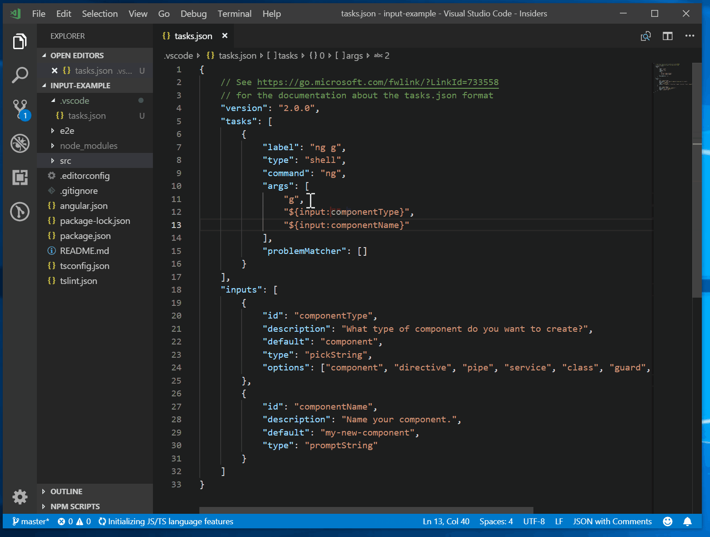

+++
title = "3.4.3 变量替换"
date = 2026-11-06T07:53:25+08:00
weight = 3
type = "docs"
description = ""
isCJKLanguage = true
draft = false
+++


> 原文链接: [https://code.visualstudio.com/docs/reference/variables-reference](https://code.visualstudio.com/docs/reference/variables-reference)

# 3.4.3 变量替换

　　VS Code 支持在[调试](../../../debugging-and-testing/6.1-Debugging/)和[任务](../../../debugging-and-testing/6.3-Tasks/)配置文件中以及部分设置中进行变量替换。`launch.json` 和 `tasks.json` 文件中的某些键和值字符串支持使用 **${variableName}** 语法进行变量替换。

## 预定义变量 {#predefined-variables}

支持以下预定义变量：

| 变量 | 说明 |
|--------------------------------|-----------------------------------------------------------------------------|
| **${userHome}** | 用户主文件夹路径 |
| **${workspaceFolder}** | 在 VS Code 中打开的文件夹路径 |
| **${workspaceFolderBasename}** | 在 VS Code 中打开的文件夹名称，不含斜杠（/） |
| **${file}** | 当前打开的文件 |
| **${fileWorkspaceFolder}** | 当前打开文件的工作区文件夹 |
| **${relativeFile}** | 当前打开文件相对于 `workspaceFolder` 的路径 |
| **${relativeFileDirname}** | 当前打开文件的目录相对于 `workspaceFolder` 的路径 |
| **${fileBasename}** | 当前打开文件的基名 |
| **${fileBasenameNoExtension}** | 当前打开文件不含扩展名的基名 |
| **${fileExtname}** | 当前打开文件的扩展名 |
| **${fileDirname}** | 当前打开文件的文件夹路径 |
| **${fileDirnameBasename}** | 当前打开文件的文件夹名称 |
| **${cwd}** | VS Code 启动时任务运行器的当前工作目录 |
| **${lineNumber}** | 活动文件中当前选中行号 |
| **${columnNumber}** | 活动文件中当前选中列号 |
| **${selectedText}** | 活动文件中当前选中文本 |
| **${execPath}** | 正在运行的 VS Code 可执行文件路径 |
| **${defaultBuildTask}** | 默认生成任务名称 |
| **${pathSeparator}** | 操作系统用于分隔文件路径组件的字符 |
| **${/}** | **${pathSeparator}** 的简写 |

### 预定义变量示例 {#predefined-variables-example}

假设有以下条件：

1. 编辑器中打开文件 `/home/your-username/your-project/folder/file.ext`。
2. 根工作区为目录 `/home/your-username/your-project`。

各变量值如下：

- **${userHome}**：`/home/your-username`
- **${workspaceFolder}**：`/home/your-username/your-project`
- **${workspaceFolderBasename}**：`your-project`
- **${file}**：`/home/your-username/your-project/folder/file.ext`
- **${fileWorkspaceFolder}**：`/home/your-username/your-project`
- **${relativeFile}**：`folder/file.ext`
- **${relativeFileDirname}**：`folder`
- **${fileBasename}**：`file.ext`
- **${fileBasenameNoExtension}**：`file`
- **${fileExtname}**：`.ext`
- **${fileDirname}**：`/home/your-username/your-project/folder`
- **${fileDirnameBasename}**：`folder`
- **${lineNumber}**：光标所在行号
- **${columnNumber}**：光标所在列号
- **${selectedText}**：代码编辑器中选中的文本
- **${execPath}**：Code.exe 位置
- **${pathSeparator}**：macOS/Linux 上为 `/`，Windows 上为 `\`

> **提示**：在 `tasks.json` 和 `launch.json` 的字符串值中使用 IntelliSense 可获取完整预定义变量列表。

## 平台和工作区注意事项 {#platform-and-workspace-considerations}

### 平台特定行为 {#platform-specific-behavior}

某些预定义变量可能根据操作系统解析不同：

- **Windows** 上文件路径使用反斜杠（`\`）。在 `tasks.json` 或 `launch.json` 等 JSON 文件中组合路径时，请确保正确转义反斜杠（例如 `"${workspaceFolder}\\subdir"`）。
- **macOS** 和 **Linux** 上文件路径使用正斜杠（`/`）。

建议使用 `${pathSeparator}` 或 `${/}`，使配置跨平台可移植。

### 包含空格的变量 {#variables-that-contain-spaces}

变量替换会用字符串值替换变量，不会添加引号或按空格拆分结果。包含变量的配置属性决定解析值如何解释。

对于许多 `launch.json` 配置中的 `args` 等数组属性，请将每个参数定义为单独数组元素。包含空格的变量路径在其数组元素中仍是一个字符串：

```json
{
    "type": "node",
    "request": "launch",
    "name": "Launch Program",
    "program": "${workspaceFolder}/app.js",
    "args": [
        "--input",
        "${workspaceFolder}/data folder/input.txt"
    ]
}
```

　　对于 `tasks.json` 中的 shell 任务，还适用 shell 特定引号规则。详细了解[在自定义任务中处理空格和特殊字符](https://code.visualstudio.com/docs/debugtest/tasks#_custom-tasks)。

### 按工作区文件夹限定变量 {#variables-scoped-per-workspace-folder}

　　在变量后附加根文件夹名（用冒号分隔），可以访问工作区中的同级根文件夹。没有根文件夹名时，变量作用域为使用它的同一文件夹。

例如，在包含 `Server` 和 `Client` 文件夹的多根工作区中，`${workspaceFolder:Client}` 指向 `Client` 根的路径。

## 环境变量 {#environment-variables}

　　可以使用 **${env:Name}** 语法引用环境变量。例如，**${env:USERNAME}** 引用 `USERNAME` 环境变量。

```json
{
    "type": "node",
    "request": "launch",
    "name": "Launch Program",
    "program": "${workspaceFolder}/app.js",
    "cwd": "${workspaceFolder}",
    "args": [ "${env:USERNAME}" ]
}
```

## 配置变量 {#configuration-variables}

　　要引用 VS Code 设置（*配置*），请使用 **${config:Name}** 语法。例如，**${config:editor.fontSize}** 引用 `editor.fontSize` 设置。

## 命令变量 {#command-variables}

　　任何 VS Code 命令都可以使用 **${command:commandID}** 语法作为变量。

　　命令变量会替换为命令求值返回的字符串结果。命令实现范围从没有 UI 的简单计算到基于 VS Code 扩展 API UI 功能的复杂功能。如果命令返回字符串以外的内容，变量替换不会完成。命令变量**必须**返回字符串。

　　此功能示例见 VS Code Node.js 调试器扩展：它提供交互式命令 `extension.pickNodeProcess`，从所有运行中的 Node.js 进程中选择一个。命令返回所选进程 ID。因此可以在 **Attach by Process ID** 启动配置中这样使用：

```json
{
    "configurations": [
        {
            "type": "node",
            "request": "attach",
            "name": "Attach by Process ID",
            "processId": "${command:extension.pickNodeProcess}"
        }
    ]
}
```

　　在 `launch.json` 配置中使用命令变量时，外层 `launch.json` 配置会作为对象参数传递给命令。这让命令在调用时知道特定 `launch.json` 配置的上下文和参数。

## 输入变量 {#input-variables}

　　命令变量已经很强，但缺少为特定用例配置所运行命令的机制。例如，无法向通用“用户输入提示”传递**提示消息**或**默认值**。

　　输入变量通过 **${input:variableID}** 语法解决此限制。`variableID` 引用 `launch.json` 和 `tasks.json` 的 `inputs` 节中的条目，其中指定额外配置属性。不支持嵌套输入变量。

以下示例展示使用输入变量的 `tasks.json` 整体结构：

```json
{
    "version": "2.0.0",
    "tasks": [
        {
            "label": "task name",
            "command": "${input:variableID}",
            // ...
        }
    ],
    "inputs": [
        {
            "id": "variableID",
            "type": "type of input variable",
            // type specific configuration attributes
        }
    ]
}
```

目前 VS Code 支持三种输入变量：

- **promptString**：显示输入框获取用户字符串。
- **pickString**：显示快速选择下拉列表，让用户从多个选项中选择。
- **command**：运行任意命令。

每种类型需要额外配置属性：

`promptString`：

- **description**：显示在快速输入中，提供输入上下文。
- **default**：用户未输入其他内容时使用的默认值。
- **password**：设置为 `true` 时使用不显示输入值的密码提示。

`pickString`：

- **description**：显示在快速选择中，提供输入上下文。
- **options**：用户可选的选项数组。
- **default**：用户未输入其他内容时使用的默认值，必须是选项值之一。

选项可以是字符串值，或同时包含标签和值的对象。下拉列表显示 **label: value**。

`command`：

- **command**：变量插值时运行的命令。
- **args**：传递给命令实现的可选参数包。

以下是使用 Angular CLI 展示 `inputs` 用法的 `tasks.json` 示例：

```json
{
    "version": "2.0.0",
    "tasks": [
        {
            "label": "ng g",
            "type": "shell",
            "command": "ng",
            "args": [
                "g",
                "${input:componentType}",
                "${input:componentName}"
            ],
        }
    ],
    "inputs": [
        {
            "type": "pickString",
            "id": "componentType",
            "description": "What type of component do you want to create?",
            "options": ["component", "directive", "pipe", "service", "class", "guard", "interface", "enum"],
            "default": "component"
        },
        {
            "type": "promptString",
            "id": "componentName",
            "description": "Name your component.",
            "default": "my-new-component"
        }
    ]
}
```

运行示例：



以下示例展示如何在调试配置中使用 `command` 类型用户输入变量，让用户从特定文件夹中找到的所有测试用例中选择一个。假设某个扩展提供 `extension.mochaSupport.testPicker` 命令，它在可配置位置定位所有测试用例并显示选择 UI。命令输入的参数由命令自身定义。

```json
{
    "configurations": [
        {
            "type": "node",
            "request": "launch",
            "name": "Run specific test",
            "program": "${workspaceFolder}/${input:pickTest}"
        }
    ],
    "inputs": [
        {
            "id": "pickTest",
            "type": "command",
            "command": "extension.mochaSupport.testPicker",
            "args": {
                "testFolder": "/out/tests",
            }
        }
    ]
}
```

　　命令输入也可用于任务。以下示例使用内置 Terminate Task 命令，它可以接受参数终止所有任务。

```json
{
    "version": "2.0.0",
    "tasks": [
        {
            "label": "Terminate All Tasks",
            "command": "echo ${input:terminate}",
            "type": "shell",
            "problemMatcher": []
        }
    ],
     "inputs": [
        {
            "id": "terminate",
            "type": "command",
            "command": "workbench.action.tasks.terminate",
            "args": "terminateAll"
        }
    ]
}
```

## 常见问题 {#common-questions}

### 调试配置或任务中的变量替换细节 {#details-of-variable-substitution-in-a-debug-configuration-or-task}

　　调试配置或任务中的变量替换是两遍过程：

- 第一遍，所有变量求值为字符串结果。变量出现多次时只求值一次。
- 第二遍，所有变量替换为第一遍结果。

　　因此，变量求值（例如扩展实现的基于命令的变量）**无法访问**调试配置或任务中其他已替换变量，只能看到原始变量。这意味着变量不能相互依赖（确保隔离，并使替换对求值顺序更健壮）。

### 用户和工作区设置支持变量替换吗？ {#is-variable-substitution-supported-in-user-and-workspace-settings}

　　`settings.json` 文件中的部分设置键支持预定义变量，例如终端 `cwd`、`env`、`shell` 和 `shellArgs` 值。某些设置（例如 `window.title`）有自己的变量：

```json
  "window.title": "${dirty}${activeEditorShort}${separator}${rootName}${separator}${appName}"
```

　　请参阅设置编辑器（`Ctrl + ,`）中的注释了解设置特定变量。

### 为什么没有记录 ${workspaceRoot}？ {#why-isnt-workspaceroot-documented}

　　变量 `${workspaceRoot}` 已弃用，改用 `${workspaceFolder}`，以更好地与[多根工作区](../../3.2-WriteCode/3.2.8-Workspaces/3.2.8.2-MultiRootWorkspaces/)支持保持一致。

### 为什么 tasks.json 中的变量未解析？ {#why-arent-variables-in-tasksjson-being-resolved}

　　并非 `tasks.json` 中所有值都支持变量替换。具体来说，只有 `command`、`args` 和 `options` 支持变量替换。`inputs` 节中的输入变量不会解析，因为不支持输入变量嵌套。

### 如何知道变量的实际值？ {#how-can-i-know-a-variables-actual-value}

　　检查变量运行时值的简单方法是创建一个 VS Code [任务](../../../debugging-and-testing/6.3-Tasks/)将变量值输出到控制台。例如，要查看 `${workspaceFolder}` 的解析值，可以在 `tasks.json` 中创建并运行（**终端** > **运行任务**）以下简单 `echo` 任务：

```json
{
    "version": "2.0.0",
    "tasks": [
        {
            "label": "echo",
            "type": "shell",
            "command": "echo ${workspaceFolder}"
        }
    ]
}
```

## 相关资源 {#related-resources}

- [调试](../../../debugging-and-testing/6.1-Debugging/)
- [任务](../../../debugging-and-testing/6.3-Tasks/)
