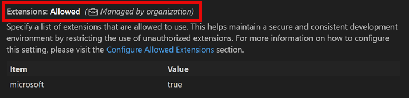

+++
title = "7.1 企业策略"
date = 2026-11-06T07:53:25+08:00
weight = 1
type = "docs"
description = ""
isCJKLanguage = true
draft = false
+++


> 原文链接: [https://code.visualstudio.com/docs/enterprise/policies](https://code.visualstudio.com/docs/enterprise/policies)

# 7.1 企业策略

　　Visual Studio Code 企业策略让组织集中管理开发团队的 VS Code 设置，确保组织内的一致性和兼容性。设置策略值后，该值会覆盖任何级别（默认、用户和工作区）配置的 VS Code 设置。

　　IT 管理员可以通过不同设备管理解决方案在用户设备上部署和执行特定 VS Code 配置。VS Code 支持在 Windows、macOS 和 Linux 上应用策略。



　　本文介绍 VS Code 中可用的企业策略以及如何在不同操作系统上配置。

## Windows 组策略 {#windows-group-policies}

　　VS Code 支持[基于 Windows 注册表的组策略](https://learn.microsoft.com/previous-versions/windows/desktop/policy/implementing-registry-based-policy)。

　　这些配置文件可以通过移动设备管理（MDM）解决方案部署，或手动安装到单个设备。

### 第 1 步：获取示例 ADMX 和 ADML 文件 {#step-1-obtain-the-sample-admx-and-adml-files}

　　从 VS Code 1.69 开始，每个版本都在 `policies` 目录中附带定义可用策略的 ADMX 模板文件。

可以从现有安装获取 ADMX 和 ADML 文件，或下载并解压 VS Code zip 存档：

1. 下载适用于你的 VS Code 版本的 [VS Code zip 存档](https://code.visualstudio.com/download)。
2. 将 zip 文件解压到临时位置。
3. 导航到解压文件的 `policies` 文件夹。该文件夹包含 ADMX 模板文件（例如 `vscode.admx`）以及包含不同语言 ADML 文件的 `locales` 子文件夹。

### 第 2 步：配置策略值 {#step-2-configure-policy-values}

安装 ADMX 和 ADML 文件后，通过管理工具配置策略值：

* Active Directory 环境使用组策略编辑器（`gpedit.msc`），导航到 **计算机配置** > **管理模板** > **Visual Studio Code**。
* 云管理设备使用 MDM 解决方案（例如 Microsoft Intune）配置导入的 VS Code 管理模板策略。
* 打开每个策略，设置为 **已启用** 或 **已禁用**，并在策略 UI 中提供所需值。
* 不想执行的策略保持 **未配置** 状态。

配置的策略值写入注册表 `Software\Policies\Microsoft\VSCode` 下。

每个策略接受的值和行为请参阅下面的[策略参考](#vs-code-enterprise-policy-reference)。

### 第 3 步：部署策略 {#step-3-deploy-the-policies}

　　现在可以使用设备管理解决方案将配置的策略大规模部署到组织中的所有相关设备。在大规模部署前，可以使用本地组策略编辑器在本地 Windows 机器上手动测试策略。

**大规模部署策略**

　　[Microsoft Intune](https://learn.microsoft.com/en-us/intune/intune-service/fundamentals/what-is-intune) 或 Active Directory 组策略等产品可以跨组织集中管理设备策略。这些解决方案允许管理员从中央位置将 ADMX/ADML 文件和策略配置部署到多台设备。

　　Active Directory 环境请将 ADMX 和 ADML 文件复制到[中央存储](https://learn.microsoft.com/troubleshoot/windows-client/group-policy/create-and-manage-central-store)，使策略在域中可用。

**在本地机器上手动测试策略**

在大规模部署前，可以手动安装 ADMX/ADML 文件，并使用本地组策略编辑器配置策略：

#### 第 1 步：安装策略定义文件

1. 将 `vscode.admx` 文件复制到 `C:\Windows\PolicyDefinitions`。
2. 将 `locales` 子文件夹中的相应 ADML 文件（例如 `en-US\vscode.adml`）复制到 `C:\Windows\PolicyDefinitions\<your-locale>`（例如 `C:\Windows\PolicyDefinitions\en-US`）。

> **注意**：复制文件到 `PolicyDefinitions` 目录需要管理员权限。

#### 第 2 步：打开本地组策略编辑器

1. 按 `Windows+R` 打开运行对话框。
2. 输入 `gpedit.msc` 并按 Enter 打开本地组策略编辑器。
3. 用户账户控制提示时选择 **是** 允许应用更改。

#### 第 3 步：导航到 VS Code 策略

VS Code 策略在计算机配置和用户配置下都可用：

* **计算机配置** > **管理模板** > **Microsoft VS Code**
* **用户配置** > **管理模板** > **Microsoft VS Code**

> **提示**：两者都配置时，计算机级策略优先于用户级策略。

#### 第 4 步：配置策略

1. 选择策略类别（计算机配置或用户配置）。
2. 导航到 **管理模板** > **Microsoft VS Code**。
3. 双击要配置的策略（例如 **Update Mode**）。
4. 在策略设置对话框中选择 **已启用** 执行策略。
5. 使用可用选项或文本字段配置策略值。
6. 选择 **确定** 保存更改。
7. 关闭本地组策略编辑器。

　　策略在下次启动 VS Code 时生效。某些策略可能需要重启 Windows 才能生效。

## macOS 配置描述文件 {#macos-configuration-profiles}

　　配置描述文件管理 macOS 设备设置。描述文件是包含与可用策略对应的键值对的 XML 文件（`.mobileconfig`）。

　　这些描述文件可以通过移动设备管理（MDM）解决方案部署，或手动安装到单个设备。

### 第 1 步：获取示例配置描述文件 {#step-1-obtain-the-sample-configuration-profile}

　　从 VS Code 1.99 开始，每个版本都附带示例 `.mobileconfig` 文件。在安装了 VS Code 的 macOS 设备上：

1. 打开 Finder，导航到 `/Applications`。
2. 右键单击 **Visual Studio Code.app**（或 VS Code 变体），选择 **显示包内容**。
3. 导航到 `Contents/Resources/app/policies`。
4. 找到示例 `.mobileconfig` 文件（例如 `vscode-sample.mobileconfig`）。

### 第 2 步：配置策略值 {#step-2-configure-policy-values-1}

1. 将示例 `.mobileconfig` 文件复制到工作位置（例如桌面或文稿文件夹）。
2. 在文本编辑器（例如 TextEdit、VS Code 或任意 XML 编辑器）中打开副本。
3. 根据需要编辑策略值：

    示例 `policy.json` 配置：

    ```json
    {
      "AllowedExtensions": {"microsoft": true, "github": true},
      "UpdateMode": "start",
      "EnableFeedback": true,
      "EnableTelemetry": false
    }
    ```

    > **重要**：策略值存在语法错误时，设置不会应用。可以在 VS Code 中检查窗口日志（按 `Ctrl + Shift + P` 并输入 **Show Window Log**）。

    **移除不需要的策略**：删除不想执行的策略对应的 JSON 属性。

每个策略接受的值和行为请参阅[策略参考](#vs-code-enterprise-policy-reference)。

### 第 3 步：部署策略 {#step-3-deploy-the-policies-1}

　　现在可以使用 MDM 解决方案将配置的策略大规模部署到组织中的所有相关设备。在大规模部署前，可以在本地机器上手动测试策略。

**大规模部署描述文件**

跨多台设备的企业部署请使用移动设备管理（MDM）解决方案，例如：

* [Microsoft Intune](https://learn.microsoft.com/mem/intune/configuration/device-profiles)
* Apple Business Manager 配合 MDM

配置描述文件详情请参阅 [Apple 文档](https://support.apple.com/guide/mac-help/configuration-profiles-standardize-settings-mh35561/mac)。

**在本地机器上手动测试策略**

#### 手动配置策略

在大规模部署前，按以下步骤在 macOS 设备上手动测试 VS Code 策略配置：

##### 第 1 步：安装配置描述文件

1. 保存编辑后的 `.mobileconfig` 文件。
2. 在 Finder 中双击 `.mobileconfig` 文件。
3. 系统设置（或旧版 macOS 的系统偏好设置）打开。
4. 审查描述文件详情并选择 **安装**（或根据 macOS 版本选择 **继续**）。
5. 提示时使用管理员凭据进行身份验证。
6. 提示时确认安装。

##### 第 2 步：验证描述文件安装

1. 打开 **系统设置**（macOS Ventura 及更高版本）或 **系统偏好设置**（更早版本）。
2. 导航到 **隐私与安全性** > **描述文件**（或旧版本的 **通用** > **设备管理**）。
3. 确认 VS Code 配置描述文件出现在列表中。
4. 启动 VS Code 查看策略是否生效。

> **注意**：策略对新 VS Code 实例立即生效。VS Code 已在运行时可能需要重启。

#### 移除配置描述文件

要移除策略并恢复默认设置：

1. 打开 **系统设置** > **隐私与安全性** > **描述文件**。
2. 选择 VS Code 配置描述文件。
3. 选择 **移除**（或 **-**）按钮。
4. 使用管理员凭据确认移除。

## Linux JSON 策略 {#linux-json-policies}

　　从 VS Code 1.106 开始，可以将 JSON 策略文件放在 `/etc/vscode/policy.json`，在 Linux 设备上配置 VS Code 设置策略。此方法使用简单 JSON 格式定义策略值。

　　这些配置文件可以通过移动设备管理（MDM）解决方案部署，或手动安装到单个设备。

### 第 1 步：获取示例策略文件 {#step-1-obtain-the-sample-policy-file}

　　从 VS Code 1.106 开始，每个版本都附带示例 `.policy.json` 文件。可以从现有安装获取，或下载并解压 VS Code 存档。文件位于 `resources/app/policies` 目录。

### 第 2 步：配置策略值 {#step-2-configure-policy-values-2}

1. 将示例 `policy.json` 文件复制到工作位置：

    ```bash
    sudo cp /usr/share/code/resources/app/policies/policy.json /tmp/policy.json
    ```

2. 使用首选文本编辑器编辑文件：

    ```bash
    sudo nano /tmp/policy.json
    # 或
    sudo vim /tmp/policy.json
    # 或
    code /tmp/policy.json
    ```

3. 根据需要编辑策略值：

    示例 `policy.json` 配置：

    ```json
    {
      "AllowedExtensions": {"microsoft": true, "github": true},
      "UpdateMode": "start",
      "EnableFeedback": true,
      "EnableTelemetry": false
    }
    ```

    > **重要**：策略值存在语法错误时，设置不会应用。可以在 VS Code 中检查窗口日志（按 `Ctrl + Shift + P` 并输入 **Show Window Log**）。

    **移除不需要的策略**：删除不想执行的策略对应的 JSON 属性。

每个策略接受的值和行为请参阅[策略参考](#vs-code-enterprise-policy-reference)。

### 第 3 步：部署策略 {#step-3-deploy-the-policies-2}

　　现在可以使用 MDM 解决方案将配置的策略大规模部署到组织中的所有相关设备。在大规模部署前，可以在本地机器上手动测试策略。

**大规模部署策略**

企业 Linux 多设备部署请使用 Ansible、Puppet、Chef 或 Salt 等配置管理工具部署 `policy.json` 文件。

这些工具允许管理员远程部署、更新和移除组织内所有受管理 Linux 设备上的策略。

**在本地机器上手动测试策略**

#### 第 1 步：复制策略文件

1. 确保 `/etc/vscode` 目录存在：

    ```bash
    sudo mkdir -p /etc/vscode
    ```

    > **注意**：创建目录和管理 `/etc/vscode` 中的策略文件需要 root 或 sudo 权限。

2. 将编辑后的策略文件复制到 `/etc/vscode/` 系统位置：

    ```bash
    sudo cp /tmp/policy.json /etc/vscode/policy.json
    ```

    设置适当权限：

    ```bash
    sudo chmod 644 /etc/vscode/policy.json
    sudo chown root:root /etc/vscode/policy.json
    ```

#### 第 2 步：验证策略安装

1. 启动 VS Code（已在运行时重启）。
2. 打开 **文件** > **首选项** > **设置**（或按 `Ctrl+,`）。
3. 查找与配置策略对应的设置，它们应显示“由组织管理”或锁图标。
4. 悬停受管理设置，确认由策略控制。

> **提示**：可以检查 VS Code 日志或尝试更改受管理设置（更改会被阻止）来验证策略文件正在被读取。

#### 移除策略

要移除所有策略并恢复默认设置，请删除 `/etc/vscode/policy.json` 文件并重启 VS Code。

## 验证策略强制执行 {#verify-policy-enforcement}

　　将企业策略部署到设备后，可以使用 **Developer: Policy Diagnostics** 命令确认 VS Code 正在读取和执行策略。该命令打开新的未命名 Markdown 文档，报告设备当前策略状态。在 Windows、macOS 和 Linux 上工作方式相同。

报告包含以下部分：

* **系统信息**：VS Code 产品名称、版本和提交，用于将报告匹配到特定构建。
* **账户信息**：已登录默认账户的详情，包括账户提供程序返回的原始账户级策略数据。
* **账户策略门**：控制 AI 功能的[已批准 GitHub 组织门](../../enterprise/7.2-ManageAISettings/)状态。可能状态为 `inactive`、`satisfied` 和 `restricted`。状态为 `restricted` 时，报告还会列出原因，例如 `noAccount`、`wrongProvider`、`orgNotApproved` 或 `policyNotResolved`。
* **策略控制设置**：两个列出每个已注册设置策略状态的表：
    * **已应用策略**：当前被策略覆盖的设置，包含设置键、策略名称、策略源、默认值、当前值和策略强制执行值。
    * **未应用策略**：当前未执行的已注册策略。使用此表检测部署错误，例如拼写错误的键或未被读取的策略文件。
* **身份验证信息**：已注册身份验证提供程序、会话、账户以及有权访问每个账户的扩展。

> **警告**：报告可能包含账户标识符、会话详情以及有权访问每个账户的扩展列表等敏感信息。共享前请审查内容。

> **提示**：**账户策略门** 状态为 `policyNotResolved` 时，请运行 **Developer: Sync Account Policy** 命令强制刷新账户侧策略数据，然后重新生成报告。

## VS Code 企业策略参考 {#vs-code-enterprise-policy-reference}

下表列出 VS Code 中所有可用企业策略。

| 策略<br>设置 ID | 说明 |
|:--|:--|
| `ChatAgentAllowedNetworkDomains`<br>`chat.agent.allowedNetworkDomains` | 智能体工具（fetch 工具、集成浏览器）允许访问的域。在 `chat.agent.networkFilter` 或 `chat.agent.sandbox.enabled` 启用时适用。启用 `chat.agent.sandbox.allowNetwork` 时允许所有域。支持 `*.example.com` 等通配符。允许和拒绝列表都为空时阻止所有域。拒绝域优先。 |
| `ChatAgentDeniedNetworkDomains`<br>`chat.agent.deniedNetworkDomains` | 智能体工具拒绝访问的域。在 `chat.agent.networkFilter` 或 `chat.agent.sandbox.enabled` 启用时适用。启用 `chat.agent.sandbox.allowNetwork` 时不适用。优先于允许域。支持通配符。 |
| `ChatAgentMode`<br>`chat.agent.enabled` | 启用后，可以从聊天激活智能体模式，并可在有副作用的智能体上下文中使用工具。 |
| `ChatAgentNetworkFilter`<br>`chat.agent.networkFilter` | 启用后，根据允许和拒绝域限制智能体工具网络访问。启用 `chat.agent.sandbox.enabled` 时也会对这些工具应用域筛选。 |
| `ChatAgentSandboxAllowAutoApprove`<br>`chat.agent.sandbox.allowAutoApprove` | 控制沙盒内运行的智能体终端命令是否自动批准。禁用时，在终端运行工具使用现有审批流。仅在沙盒启用时适用。 |
| `ChatAgentSandboxAllowNetwork`<br>`chat.agent.sandbox.allowNetwork` | 沙盒启用时，控制是否允许所有网络域。启用后保留文件系统限制，但放宽所有网络限制。 |
| `ChatAgentSandboxAllowUnsandboxedCommands`<br>`chat.agent.sandbox.allowUnsandboxedCommands` | 控制沙盒命令失败或沙盒限制阻止命令时，用户确认后是否可在沙盒外运行终端命令。仅在沙盒启用时适用。 |
| `ChatAgentSandboxEnabled`<br>`chat.agent.sandbox.enabled` | 控制智能体模式是否使用沙盒限制工具操作。启用后终端等工具在沙盒环境中运行。使用 `chat.agent.sandbox.allowNetwork` 允许所有网络域。 |
| `Claude3PIntegration`<br>`chat.agentHost.claudeAgent.enabled`<br>`github.copilot.chat.claudeAgent.enabled` | 在 VS Code 中启用 Claude Agent 会话，使用 Anthropic Claude Agent SDK 在编辑器中启动和恢复智能体会话，使用现有 Copilot 订阅。 |
| `Codex3PIntegration`<br>`chat.agentHost.codexAgent.enabled` | 在 VS Code 中启用 Codex Agent 会话，使用 OpenAI Codex，可通过 GitHub Copilot 路由或直接用 OpenAI 账户身份验证。 |
| `CopilotOtelCaptureContent`<br>`chat.agentHost.otel.captureContent`<br>`github.copilot.chat.otel.captureContent` | 控制 Copilot OpenTelemetry 导出是否捕获提示词、响应和工具内容。 |
| `CopilotOtelEnabled`<br>`chat.agentHost.otel.enabled`<br>`github.copilot.chat.otel.enabled` | 控制是否启用 Copilot OpenTelemetry 导出。受管理时用户不能覆盖企业值。 |
| `CopilotOtelProtocol`<br>`chat.agentHost.otel.exporterType`<br>`github.copilot.chat.otel.exporterType` | 控制 Copilot OpenTelemetry 导出的企业托管 OTLP 协议。 |
| `CopilotOtelHeaders`<br>`github.copilot.chat.otel.headers` | 控制 Copilot OpenTelemetry 导出的企业托管 OTLP 导出器标头。 |
| `CopilotOtelEndpoint`<br>`chat.agentHost.otel.otlpEndpoint`<br>`github.copilot.chat.otel.otlpEndpoint` | 控制 Copilot OpenTelemetry 导出的企业托管 OTLP 收集器终结点。 |
| `CopilotOtelOtlpProtocol`<br>`github.copilot.chat.otel.protocol` | 控制 Copilot OpenTelemetry 导出的企业托管 OTLP 线路协议（protobuf 与 JSON）。 |
| `CopilotOtelOutfile`<br>`chat.agentHost.otel.outfile`<br>`github.copilot.chat.otel.outfile` | 配置企业托管 Copilot OpenTelemetry 导出时阻止本地文件导出。 |
| `CopilotOtelResourceAttributes`<br>`github.copilot.chat.otel.resourceAttributes` | 控制 Copilot OpenTelemetry 导出的企业托管 OTel 资源属性。 |
| `CopilotOtelServiceName`<br>`github.copilot.chat.otel.serviceName` | 控制 Copilot OpenTelemetry 导出的企业托管 OTel `service.name` 资源属性。 |
| `ChatApprovedAccountOrganizations` | 设置为非空列表时激活“已批准账户”门：用户登录的 GitHub 账户所属组织与该列表相交且账户侧策略数据解析完成前，所有 AI 功能禁用。比较不区分大小写。使用 `*` 通配符接受任何已登录 GitHub 或 GHE 账户。 |
| `ChatStrictPluginOnlyCustomization` | 阻止独立的用户和工作区技能、智能体、钩子、指令和 MCP 服务器，同时保留符合条件的插件自定义项。 |
| `ChatDefaultModel`<br>`chat.defaultModel` | 设置新对话的默认聊天模型。接受 `auto`、模型系列名称（如 `opus` 或 `gemini`）或完整模型 ID。用户仍可在对话中切换模型。 |
| `ChatEditorPreferCopilotHarness`<br>`chat.editor.preferCopilotHarness` | 配置新编辑器聊天会话是否使用 Agent Host Copilot SDK 而不是本地运行框架。 |
| `ChatAgentExtensionTools`<br>`chat.extensionTools.enabled` | 启用第三方扩展贡献的工具。 |
| `ChatAllowManagedHooksOnly` | 仅允许来自企业托管源和策略强制启用插件的钩子。 |
| `ChatMCP`<br>`chat.mcp.access` | 控制对已安装 Model Context Protocol 服务器的访问。 |
| `ChatAllowedMcpServers` | Model Context Protocol 服务器允许列表。设置后，只有匹配条目的服务器可安装或运行；完全省略则允许所有服务器（受拒绝列表约束）。 |
| `ChatAllowManagedMcpServersOnly` | 决定哪些服务器可运行时仅使用企业托管 MCP 允许列表。 |
| `ChatDeniedMcpServers` | Model Context Protocol 服务器拒绝列表。匹配任何条目的服务器被阻止安装或运行，即使也在允许列表中；拒绝规则总是优先。 |
| `McpGalleryServiceUrl` | 配置要连接的 MCP Gallery 服务 URL。 |
| `ChatPluginsEnabled`<br>`chat.plugins.enabled` | 在聊天中启用智能体插件集成。 |
| `ChatEnabledPlugins`<br>`chat.plugins.enabledPlugins` | 插件启用状态。键为 `{plugin}@{marketplace}` 形式的插件 ID，值为启用或禁用。 |
| `ChatExtraMarketplaces` | 要查询的额外插件 Marketplace。键为 Marketplace 名称，值为 GitHub 简写（`owner/repo[#ref]`）或 Git URI（`{url}[#ref]`），可选企业托管自动更新覆盖。 |
| `ChatStrictMarketplaces`<br>`chat.plugins.strictMarketplaces` | 插件 Marketplace 源允许列表。设置后仅信任匹配条目的 Marketplace；空数组阻止所有 Marketplace。 |
| `CopilotSessionSync`<br>`chat.sessionSync.enabled` | 启用会话同步到 GitHub.com，实现跨设备 Copilot 会话历史。组织策略禁用时会话数据仅保留在本地。 |
| `ChatToolsEligibleForAutoApproval`<br>`chat.tools.eligibleForAutoApproval` | 控制哪些工具可自动批准。设置为 `false` 的工具总是显示确认，且永不提供自动批准选项。默认行为或设置为 `true` 可能提供自动批准选项。 |
| `ChatToolsAutoApprove`<br>`chat.tools.global.autoApprove` | 全局自动批准（“YOLO 模式”）完全禁用所有工作区所有工具的手动批准，允许智能体完全自主行动。极其危险，绝不推荐；即使 Codespaces 和 Dev Containers 等容器环境也会转发用户密钥，可能被破坏。此功能禁用关键安全保护，使攻击者更容易破坏机器。此设置仅控制工具批准，不阻止智能体提问；要自动回答智能体问题，请使用 `chat.autoReply`。 |
| `ChatToolsTerminalEnableAutoApprove`<br>`chat.tools.terminal.enableAutoApprove` | 控制是否允许在终端运行工具中自动批准。 |
| `ChatHooks`<br>`chat.useHooks` | 控制智能体工作流关键点是否执行聊天钩子。钩子从 `chat.hookFilesLocations` 配置的文件加载。此设置仅由 Local 运行框架使用。 |
| `DictationEnabled`<br>`dictation.enabled` | 控制产品中（聊天输入、编辑器、终端）是否可用听写。 |
| `DictationLLMCleanup`<br>`dictation.experimental.llmCleanup` | 控制最终听写转录是否发送给语言模型清理。 |
| `DictationModel`<br>`dictation.model` | 控制听写使用的转录模型。 |
| `AllowedExtensions`<br>`extensions.allowed` | 指定允许使用的扩展列表，通过限制未授权扩展维护安全一致的开发环境。详情请参阅 <https://aka.ms/vscode/enterprise/extensions/allowed>。 |
| `ExtensionsAutoUpdate`<br>`extensions.autoUpdate` | 控制扩展自动更新行为。更新从 Microsoft 在线服务获取。 |
| `ExtensionsAutoUpdateDelay`<br>`extensions.autoUpdateDelay` | 控制扩展更新发布后自动安装的延迟小时数。仅在 `extensions.autoUpdate` 为 `on` 时适用。 |
| `ExtensionGalleryServiceUrl` | 配置要连接的 Marketplace 服务 URL。 |
| `CopilotReviewAgent`<br>`github.copilot.chat.reviewAgent.enabled` | 启用代码审查智能体。 |
| `CopilotReviewSelection`<br>`github.copilot.chat.reviewSelection.enabled` | 对当前选择启用代码审查。 |
| `CopilotNextEditSuggestions`<br>`github.copilot.nextEditSuggestions.enabled` | 是否启用下一次编辑建议（NES）。NES 可以根据最近更改建议下一次编辑。 |
| `McpEnterpriseManagedAuthIdp` | 企业托管 Model Context Protocol 服务器身份验证使用的 OAuth/OIDC IdP 配置。 |
| `EnableFeedback`<br>`telemetry.feedback.enabled` | 启用问题报告器、调查和其他反馈机制。 |
| `TelemetryLevel`<br>`telemetry.telemetryLevel` | 控制遥测级别。 |
| `UpdateMode`<br>`update.mode` | 配置是否接收自动更新。更新从 Microsoft 在线服务获取。 |
| `BrowserChatTools`<br>`workbench.browser.enableChatTools` | 启用后，聊天智能体可以使用浏览器工具在集成浏览器中打开和交互页面。 |

> **注意**：希望制定更多策略，请在 [VS Code GitHub 仓库](https://github.com/microsoft/vscode/issues)创建议题。团队会判断现有行为是否已有对应设置，或是否应创建新设置和策略。
