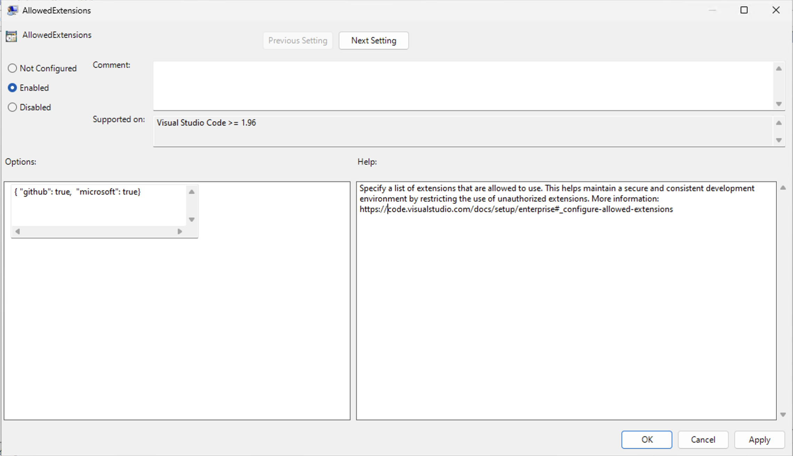

+++
title = "7.3 扩展管理"
date = 2026-11-06T07:53:25+08:00
weight = 3
type = "docs"
description = ""
isCJKLanguage = true
draft = false
+++


> 原文链接: [https://code.visualstudio.com/docs/enterprise/extensions](https://code.visualstudio.com/docs/enterprise/extensions)

# 7.3 扩展管理

　　作为 IT 管理员，你可以配置 Visual Studio Code 中的扩展安装和启用、托管私有市场，并为开发团队预装扩展。

## 配置允许的扩展 {#configure-allowed-extensions}

> **注意**：从 VS Code 1.96 版本开始支持允许的扩展。

　　使用应用程序范围的 `extensions.allowed` 设置控制 VS Code 允许用户安装和启用的扩展。你可以按发布者、扩展 ID、版本和平台允许或阻止扩展。

　　默认允许所有扩展。使用允许列表时，不匹配允许规则的扩展会被阻止。如果阻止已安装的扩展或版本，VS Code 会将其禁用。

> **注意**：对于本地提供的 VSIX 包，这些规则使用包中声明的标识符。它们不会验证包的来源、阻止本地扩展文件的更改，也不会限制扩展的[3.3.6.3 扩展运行时安全](../../editor/3.3-ConfigureTheEditor/3.3.6-Extensions/3.3.6.3-ExtensionRuntimeSecurity/#about-extension-runtime-permissions)。

### 按发布者允许或阻止 {#allow-or-block-by-publisher}

　　使用发布者 ID 允许或阻止某个发布者的所有扩展。不带句点（`.`）的键会被视为发布者 ID。

```jsonc
"extensions.allowed": {
    "microsoft": true,
    "github": true
}
```

> **提示**：使用 `microsoft` 作为发布者 ID 可表示 Microsoft 发布的所有扩展，即使它们可能具有不同的发布者 ID。

### 按扩展允许或阻止 {#allow-or-block-by-extension}

　　使用完整扩展 ID（`<publisher>.<extension>`）允许或阻止特定扩展。带句点的键会被视为扩展 ID。

```jsonc
"extensions.allowed": {
    "esbenp.prettier-vscode": true,
    "ms-azuretools.vscode-containers": false
}
```

### 允许特定版本或平台 {#allow-specific-versions-or-platforms}

　　将扩展固定到一个或多个已批准的版本。不支持版本范围，因此必须逐一列出版本。要进一步按平台限制，请在版本后附加 `@<platform>`。

```jsonc
"extensions.allowed": {
    "dbaeumer.vscode-eslint": ["3.0.0"],
    "figma.figma-vscode-extension": ["3.0.0", "4.2.3", "4.1.2"],
    "rust-lang.rust-analyzer": ["5.0.0@win32-x64", "5.0.0@darwin-x64"]
}
```

### 仅允许稳定版本 {#allow-only-stable-versions}

　　使用 `"stable"` 作为值，允许扩展的所有稳定版本或发布者的所有扩展，同时阻止预发布版本。

```jsonc
"extensions.allowed": {
    "github.vscode-pull-request-github": "stable",
    "redhat": "stable"
}
```

### 优先级和规则 {#precedence-and-rules}

* 更具体的选择器优先。例如，`"microsoft": true` 和 `"microsoft.cplusplus": false` 会允许所有 Microsoft 扩展，但 C++ 扩展除外。
* 不支持重复的键值。同时包含 `"microsoft": true` 和 `"microsoft": false` 会导致配置无效。
* 扩展或发布者 ID 中不支持通配符，但 `"*"` 除外，可用于允许或阻止所有扩展。例如，`"*": false` 会阻止所有扩展。

### 使用组织策略部署 {#deploy-with-organization-policy}

　　组织可以使用 `AllowedExtensions` [7.1 企业策略](../7.1-Policies/)集中管理允许的扩展。通过设备管理解决方案，管理员可以在所有受管理设备上部署并强制执行该策略，这会覆盖单个设备上用户配置的 `extensions.allowed` 设置。



> **重要**：如果策略值存在语法错误，则不会应用 `extensions.allowed` 设置。请检查 VS Code 中的窗口日志以查找错误（按 `Ctrl + Shift + P`（macOS：`Cmd + Shift + P`），输入 **Show Window Log**）。

## 预装扩展 {#preinstall-extensions}

　　可以为 VS Code 设置一组预装扩展（*引导安装*）。当你准备计算机映像、虚拟机或云工作站，并且希望用户立即使用特定扩展时，此功能很有用。

> **注意**：目前仅在 Windows 上支持预装扩展。

1. 在 VS Code 安装目录中创建文件夹 `bootstrap\extensions`。

2. 下载要预装扩展的 [3.3.6.2 扩展市场](../../editor/3.3-ConfigureTheEditor/3.3.6-Extensions/3.3.6.2-ExtensionMarketplace/#can-i-download-an-extension-directly-from-the-marketplace)，并将其放入 `bootstrap\extensions` 文件夹。

3. 用户首次启动 VS Code 时，`bootstrap\extensions` 文件夹中的所有扩展会在后台静默安装。

　　用户仍可以卸载预装的扩展。卸载扩展后重新启动 VS Code 不会重新安装该扩展。

## 托管私有扩展市场 {#host-a-private-extension-marketplace}

　　使用私有市场在组织内部托管和分发扩展。它与 VS Code 扩展体验集成，让用户可以发现私有扩展并自动更新。

　　私有市场的主要功能：

* **自托管**：在自有基础设施（例如 Azure 或 Kubernetes）上托管内部扩展。
* **上游集成**：即使在互联网连接受限的环境中，也能自动包含 [Visual Studio Marketplace](https://marketplace.visualstudio.com) 中的公共扩展。通过设置[允许列表](#configure-allowed-extensions)允许或拒绝特定扩展。
* **重新托管**：下载公共扩展并托管在自有基础设施上，包括气隙环境。
* **简单部署**：以无状态 Docker 容器部署，无需外部数据库。
* **灵活存储**：使用任意文件系统或 Azure Artifacts 发布和管理扩展。
* **集中部署**：在 Windows 和 macOS 上使用组策略向团队部署私有市场。
* **集成安装和更新**：直接从 VS Code 搜索和安装扩展，并自动更新到新版本。
* **跨平台支持**：兼容 Windows、macOS 和 Linux 上的 VS Code 桌面版。

> **注意**：不支持从 VS Code Server 或 VS Code for the Web 连接私有市场。

　　私有市场目前面向 GitHub Enterprise 客户提供。VS Code 用户必须使用 GitHub Enterprise 或 Copilot Enterprise/Business 账户登录才能访问私有市场。

　　请从[部署和功能指南](https://aka.ms/private-marketplace/readme)开始，其中包含部署说明、脚本和开发环境配置。如有问题或需要帮助，请联系[私有市场支持](https://aka.ms/vspm/support)。

## 相关资源 {#related-resources}

* [3.3.6.2 扩展市场](../../editor/3.3-ConfigureTheEditor/3.3.6-Extensions/3.3.6.2-ExtensionMarketplace/)：了解在 VS Code 中安装和管理扩展。
* [3.3.6.3 扩展运行时安全](../../editor/3.3-ConfigureTheEditor/3.3.6-Extensions/3.3.6.3-ExtensionRuntimeSecurity/)：了解 VS Code 中的扩展安全性。
* [7.1 企业策略](../7.1-Policies/)：VS Code 所有企业策略的参考。
