+++
title = "1.1 智能体快速入门"
date = 2026-11-06T07:53:25+08:00
weight = 1
type = "docs"
description = ""
isCJKLanguage = true
draft = false
+++


> 原文链接: [https://code.visualstudio.com/docs/agents/quickstart](https://code.visualstudio.com/docs/agents/quickstart)

# 1.1 智能体快速入门

　　在本快速入门中，你将使用 Visual Studio Code 中的 AI 智能体，根据自然语言提示构建一个小型 Web 应用。然后审查生成的代码，让智能体使用浏览器工具验证应用，并亲自验证结果。

　　如果想通过动手教程构建并完善应用，请参阅[2.1.4 智能体教程](../../ai-in-vs-code/getting-started/2.1.4-AgentsTutorial/)。

## 前提条件 {#prerequisites}

* [下载并安装 Visual Studio Code](https://code.visualstudio.com/download)。

* [9.1 设置 GitHub Copilot](../../advanced-setup/9.1-GitHubCopilotSetup/)。

    请从 [2.3.2 选择智能体运行框架](../../ai-in-vs-code/choose-models-and-agents/2.3.2-ChooseAnAgentHarness/#copilot)开始完成本快速入门。它将模型连接到用于构建和测试应用的工具。

> **注意**：本快速入门中的请求会消耗 Copilot 套餐中的 AI 点数。Copilot Free 包含每月额度。请从状态栏打开 Copilot 状态仪表板，监控每月用量。详细了解 [2.7.2 模型如何工作](../../ai-in-vs-code/concepts/2.7.2-HowModelsWork/#ai-credits-and-model-costs)以及[2.8.2.4 常见问题](../../ai-in-vs-code/reference-and-help/troubleshooting/2.8.2.4-FAQ/#i-reached-my-inline-suggestions-or-ai-credits-limit)。

## 1. 创建项目文件夹 {#1-create-a-project-folder}

　　首先为快速入门应用创建一个空文件夹。在下一节中，你将在 VS Code 中打开这个文件夹，并让智能体构建应用。

　　在终端中运行以下命令创建文件夹：

```bash
mkdir agent-quickstart
```

## 2. 构建应用 {#2-build-the-app}

　　VS Code 提供了多种使用智能体的方式：

* **聊天视图**：在编辑器中围绕代码与智能体协作，专注于当前项目。
* **智能体窗口**：向智能体分配高层任务，并在不同项目之间切换，无需重新加载窗口。

　　选择最适合你的方式，并按照下方相应选项卡中的步骤操作。

**聊天视图**

1. 在 VS Code 中，从菜单中选择 **文件** > **打开文件夹**，然后打开 `agent-quickstart` 文件夹。

    如果 VS Code 询问是否信任该文件夹，请在通知中选择 **管理**，然后选择 **信任**。

    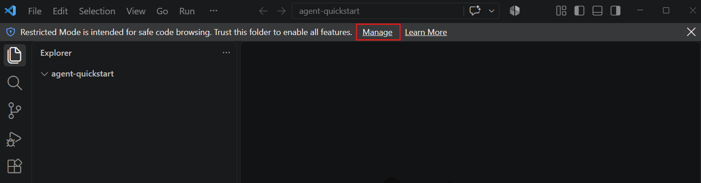

2. 使用 `Ctrl + Alt + I` 打开聊天视图，然后选择 `+` 开始新聊天。

    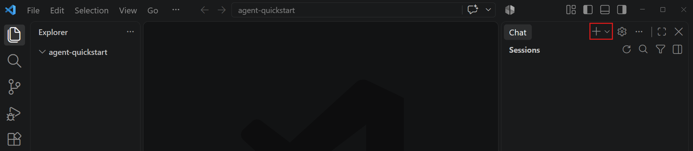

    如果你已经有活动聊天，开始新聊天不会关闭之前的聊天。之前的聊天仍可通过会话列表访问。

3. 为聊天会话配置以下设置。其他选项保留默认值。

    | 控件 | 值 | 简短说明 |
    |---------|-------|-------------------|
    | **会话目标** | **Copilot** | 为会话选择 GitHub Copilot 运行框架及其工具和工作流。 |
    | **智能体** | **智能体** | 使用工具进行规划、编辑文件、运行命令并验证结果。 |
    | **语言模型** | **自动** | 根据任务复杂度和可用性自动选择模型。 |
    | **权限** | **手动审批** | 运行工具或访问资源时请求你批准。智能体可以在你的项目文件夹中编辑文件。 |

    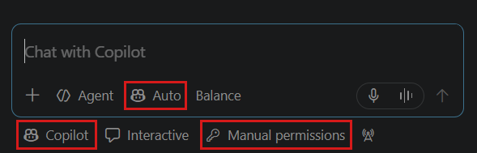

4. 输入以下提示词，然后按 `Enter`：

    ```text
    在一个包含内嵌 CSS 和 JavaScript 的 index.html 文件中，创建一个任务清单 Web 应用。让我可以添加、完成和删除任务。将任务保存在本地存储中，以便页面重新加载后仍然存在。不要使用外部库。
    ```

5. 关注智能体的执行进度，并在接受每个审批请求之前进行审查。

    智能体会创建 `index.html` 文件，并在执行过程中保存更新。对于审批设置未覆盖的操作，会出现审批提示。

    > **提示**：你可以随时选择聊天输入框中的 **停止** 按钮来停止智能体，或发送新提示词引导它改变方向。

6. 如果智能体请求在集成浏览器中打开 `index.html` 文件，请选择 **允许本次会话**。你可以直接在 VS Code 的集成浏览器中与应用交互。

    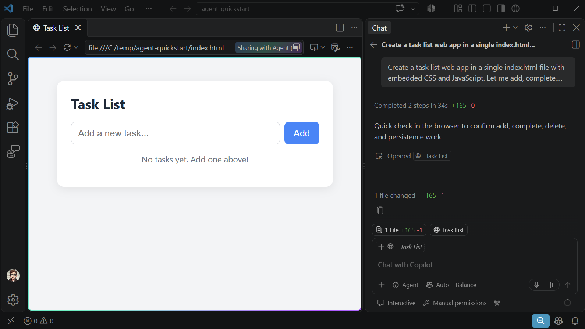

**智能体窗口**

　　智能体窗口是一个专用窗口，用于跨不同项目与智能体交互。

1. 要打开智能体窗口，请在 VS Code 标题栏中选择 **在智能体中打开**，或从命令面板（`Ctrl + Shift + P`）运行 **Chat: Open Agents Window**。

    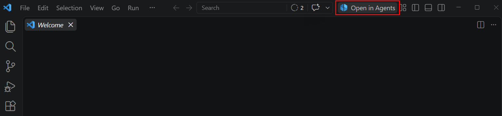

2. 在左侧边栏顶部选择 **新建**，开始新的智能体会话。

    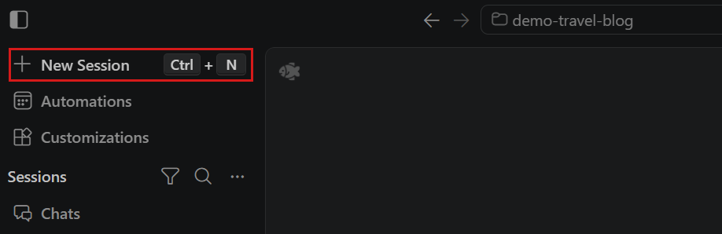

3. 从环境下拉列表中选择 **这台计算机**。VS Code 允许你连接到不同环境中的智能体，但本快速入门将使用本地环境。

    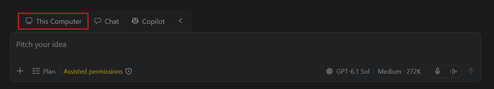

4. 由于智能体窗口可以跨不同项目运行，请从下拉列表中选择你之前创建的 `agent-quickstart` 文件夹。

    如果 VS Code 询问是否信任该文件夹，请选择 **信任**。

5. 为会话配置以下设置。其他选项保留默认值。

    | 控件 | 值 | 简短说明 |
    |---------|-------|-------------------|
    | **会话目标** | **Copilot** | 为会话选择 GitHub Copilot 运行框架及其工具和工作流。 |
    | **智能体** | **智能体** | 使用工具进行规划、编辑文件、运行命令并验证结果。 |
    | **语言模型** | **Copilot Fusion** / **自动** | 根据任务复杂度和可用性自动选择模型。 |
    | **权限** | **手动审批** | 运行工具或访问资源时请求你批准。智能体可以在你的项目文件夹中编辑文件。 |

    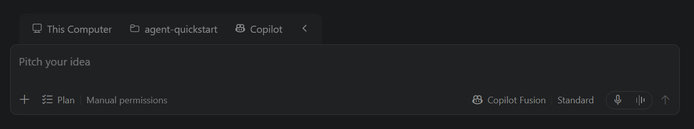

6. 输入以下提示词，然后按 `Enter`：

    ```text
    在一个包含内嵌 CSS 和 JavaScript 的 index.html 文件中，创建一个任务清单 Web 应用。让我可以添加、完成和删除任务。将任务保存在本地存储中，以便页面重新加载后仍然存在。不要使用外部库。
    ```

7. 关注智能体的执行进度，并在接受每个审批请求之前进行审查。

    智能体会创建 `index.html` 文件，并在执行过程中保存更新。对于审批设置未覆盖的操作，会出现审批提示。

    > **提示**：你可以随时选择聊天输入框中的 **停止** 按钮来停止智能体，或发送新提示词引导它改变方向。

8. 如果智能体请求在集成浏览器中打开 `index.html` 文件，请选择 **允许本次会话**。你可以直接在 VS Code 的集成浏览器中与应用交互。

    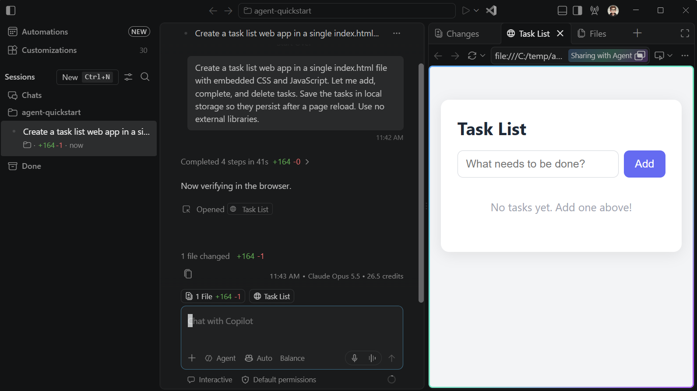

## 3. 审查并验证结果 {#3-review-and-validate-the-result}

　　仔细审查生成的代码和结果非常重要。你可以让智能体在集成浏览器中运行应用并观察其行为，从而验证关键场景和边界情况。

　　在上一步创建任务清单 Web 应用时，智能体可能已经启动集成浏览器来验证应用能否正确运行。

　　在以下步骤中，你将要求智能体验证任务清单 Web 应用的基本功能。

**聊天视图**

1. 聊天视图会提示它更改了一个文件并显示差异统计信息。选择该提示，审查生成的代码及其差异。

2. 输入以下提示词，让智能体在集成浏览器中打开应用并验证其功能。

    ```text
    在集成浏览器中打开 index.html 并验证应用。
    添加一个任务，将其标记为完成，然后删除它。再添加另一个任务，
    重新加载页面，并确认该任务仍然存在。如果任何步骤失败，
    请修复问题并重复完整流程。
    ```

3. 注意智能体如何与集成浏览器交互，并自主验证不同的用户场景。

    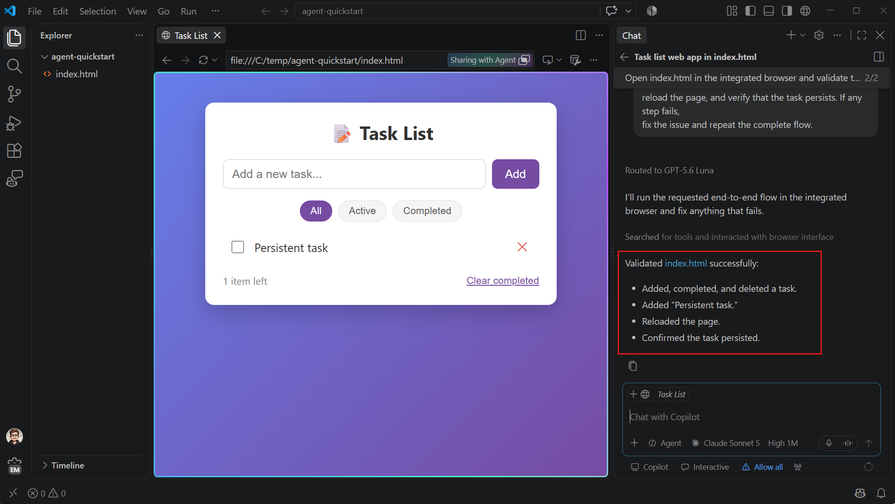

**智能体窗口**

1. 打开右侧边栏中的 **更改** 面板，然后选择 `index.html` 审查生成的代码。

    如果对结果的某个部分不满意，请在差异视图中选中该部分并输入反馈，将其发送给智能体。

    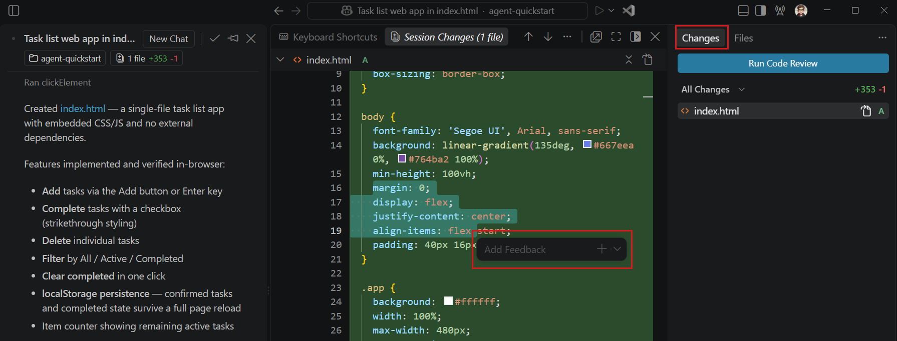

2. 输入以下提示词，让智能体在集成浏览器中打开应用并验证其功能。

    ```text
    在集成浏览器中打开 index.html 并验证应用。
    添加一个任务，将其标记为完成，然后删除它。再添加另一个任务，
    重新加载页面，并确认该任务仍然存在。如果任何步骤失败，
    请修复问题并重复完整流程。
    ```

3. 注意智能体如何与集成浏览器交互，并自主验证不同的用户场景。

    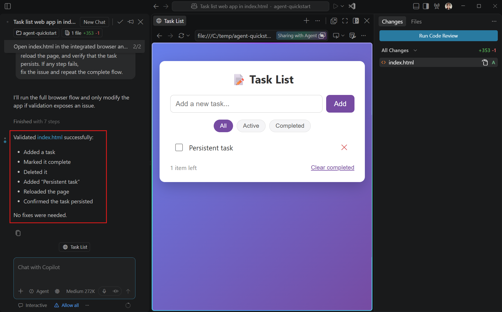

　　如需通过键盘和屏幕阅读器访问生成的差异，请使用[3.3.9.1 辅助功能](../../editor/3.3-ConfigureTheEditor/3.3.9-Accessibility/3.3.9.1-Accessibility/#diff-editor-accessibility)。

## 4. 亲自验证结果 {#4-verify-the-result-yourself}

　　智能体的验证报告有助于发现问题，但不能取代你亲自审查。请在集成浏览器中：

1. 添加一个任务，并将其标记为完成。
2. 重新加载页面，确认该任务及其完成状态仍然存在。
3. 删除该任务，再次重新加载后确认它没有重新出现。

　　如果某项检查失败，请在聊天中描述你观察到的现象，并要求智能体修复并重新测试。提交更改之前，请审查生成的差异。

　　你已经使用智能体完成了第一个任务。智能体理解了你的目标、创建了代码、在浏览器中运行了应用，并修复了它发现的问题。你也审查了代码和结果。

## 停止、修改或撤销工作 {#stop-revise-or-undo-the-work}

　　如果你对智能体的操作或结果不满意，有以下几种选择：

* **停止或重定向当前请求**：请求运行期间，使用 **发送** 下拉列表选择 **通过消息引导** 或 **停止并发送**。停止不会撤销已经完成的操作。

* **修改结果**：发送后续提示词。在差异视图中，你可以选择代码，并在界面提供相应操作时给出有针对性的反馈。

* **撤销某个请求中的文件更改**：将鼠标悬停在较早的请求上，选择 **恢复检查点**。这会恢复受影响的工作区文件和聊天历史记录，但不会撤销终端命令、网络请求、部署或对外部服务所做的更改。详细了解[2.2.8 审查和还原更改](../../ai-in-vs-code/work-with-ai/2.2.8-ReviewAndRevertChanges/)。

　　如果后续提示词仍无法解决问题，请使用[2.6.9 让智能体回到正轨](../../ai-in-vs-code/tutorials-and-guides/2.6.9-GetBackOnTrack/)选择下一步恢复操作。

## 如果你的屏幕看起来不同 {#if-your-screen-looks-different}

* 如果 **Copilot** 运行框架或 **智能体** 不可用，请验证登录状态，并查看[2.3.2 选择智能体运行框架](../../ai-in-vs-code/choose-models-and-agents/2.3.2-ChooseAnAgentHarness/#requirements-and-setup)。你的组织策略可能会限制特定智能体、模型或工具。

* 如果达到 AI 点数限制，请查看[2.8.2.4 常见问题](../../ai-in-vs-code/reference-and-help/troubleshooting/2.8.2.4-FAQ/#i-reached-my-inline-suggestions-or-ai-credits-limit)。

## 在其他界面或应用程序中继续 {#optional-continue-in-the-other-surface}

　　智能体窗口和聊天视图共享同一个 GitHub Copilot 会话，因此你可以在两者之间切换而不会丢失对话。

* 在智能体窗口中，选择标题栏中的 **在编辑器中打开**。VS Code 会在编辑器窗口中打开项目，并可在聊天视图中使用该会话。

* 在应用程序标题栏中选择 **在智能体中打开**，然后从会话列表中选择现有的 GitHub Copilot 会话。

　　如需使用其他应用程序、终端选项或从另一台设备访问，请参阅[2.2.11.1 管理会话](../../ai-in-vs-code/work-with-ai/sessions/2.2.11.1-ManageSessions/#continue-an-existing-session)。该指南介绍了受支持的途径及其要求。

## 清理资源 {#clean-up-resources}

　　当你不再需要该应用时，请执行以下步骤清理本地资源：

* 在 VS Code 中关闭 `agent-quickstart` 文件夹。
* 从计算机中删除 `agent-quickstart` 文件夹。

## 后续步骤 {#next-steps}

* [2.1.6 最佳实践](../../ai-in-vs-code/getting-started/2.1.6-BestPractices/#apply-the-workflow-to-your-project)。
* [2.6.2 探索代码库](../../ai-in-vs-code/tutorials-and-guides/2.6.2-ExploreACodebase/)。
* [2.1.4 智能体教程](../../ai-in-vs-code/getting-started/2.1.4-AgentsTutorial/)。
* [2.2.12.3 AI 安全](../../ai-in-vs-code/work-with-ai/permissions-and-security/2.2.12.3-AISecurity/#recommended-security-baseline)。
