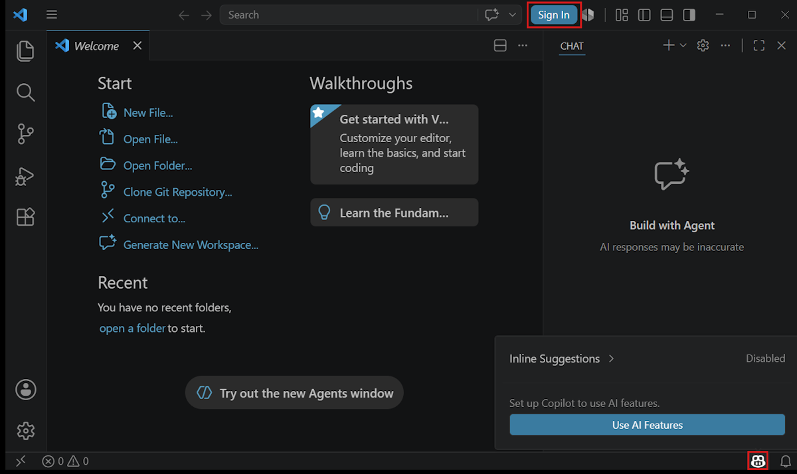
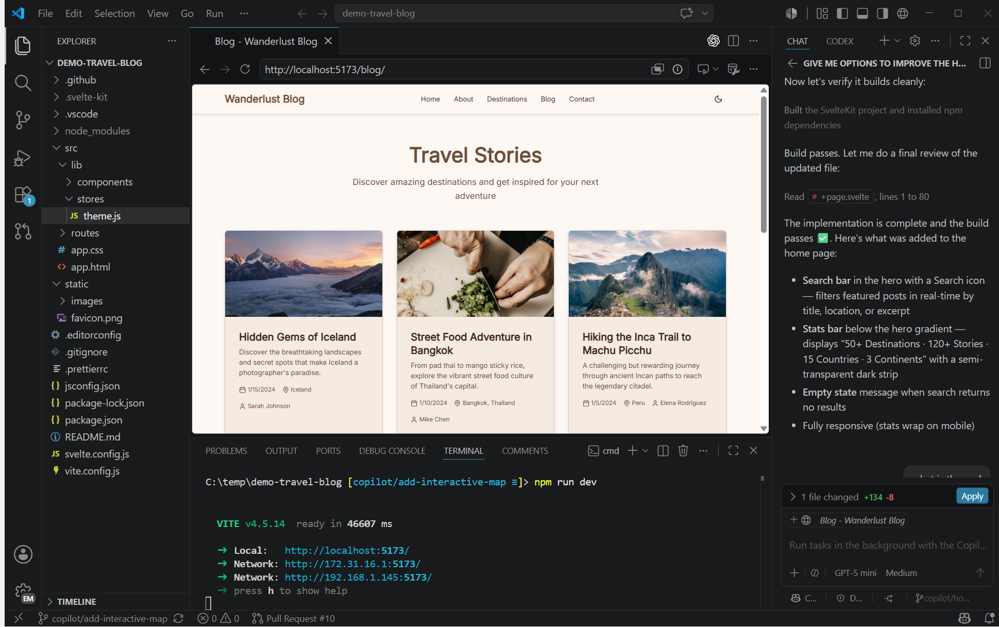

+++
title = "1 快速开始"
date = 2026-11-06T07:53:25+08:00
weight = 1
type = "docs"
description = ""
isCJKLanguage = true
draft = false
+++

> 原文链接: [https://code.visualstudio.com/docs/getstarted/overview](https://code.visualstudio.com/docs/getstarted/overview)

# 1 快速开始

　　本指南介绍如何安装 Visual Studio Code、打开代码，并为第一个任务选择一条动手实践路径。你可以学习编辑器并自行编写代码，也可以使用 AI 智能体，或将两者结合使用。

　　AI 功能是可选的。使用核心编辑器不需要账户。

## 分三步开始 {#get-started-in-three-steps}

1. **安装 VS Code。** 下载适用于你的平台的安装程序，并按照[安装步骤](#install-vs-code)操作。

2. **打开代码。** 打开现有文件夹、克隆仓库，或为新项目创建一个文件夹。

3. **完成第一个任务。** 按照[3.1.1 编辑器教程](../editor/3.1-GettingStarted/3.1.1-EditorTutorial/)学习基础知识，[2 VS Code 中的 AI](../ai-in-vs-code/#choose-how-you-work)，或使用[1.1 智能体快速入门](1.1-AgentsQuickstart/)根据自然语言提示构建应用。

## 安装 VS Code {#install-vs-code}

**Windows**

1. 下载 [User Setup 安装程序](https://code.visualstudio.com/download)（`.exe`）。
2. 运行安装程序并按照提示操作。
3. 打开 VS Code。安装程序会将 `code` 添加到 PATH，因此你也可以在终端中使用 `code .` 打开文件夹。

　　如需 System Setup、ZIP 压缩包或其他选项，请参阅[9.4 在 Windows 上安装](../advanced-setup/9.4-Windows/)。

**macOS**

1. 下载 [`.dmg` 安装程序](https://code.visualstudio.com/download)。
2. 打开 `.dmg` 文件，将 **Visual Studio Code.app** 拖到 **Applications** 文件夹。
3. 从 Applications 文件夹或 Spotlight 打开 VS Code。

　　要在终端中使用 `code` 命令，请打开命令面板（`Cmd + Shift + P`），运行 **Shell Command: Install 'code' and optionally 'copilot' commands in PATH**。安装 GitHub Copilot CLI 是可选的。有关这两个选项的详细信息，请参阅 [9.3 在 macOS 上安装](../advanced-setup/9.3-macOS/#configure-path-with-vs-code)。

**Linux**

　　选择你的发行版以获取安装说明。安装软件包会设置 apt 或 dnf 仓库，以便自动更新。有关 Snap、Arch、Nix 和其他选项，请参阅[9.2 在 Linux 上安装](../advanced-setup/9.2-Linux/)。

* **Debian 或 Ubuntu**
    1. 从 [VS Code 下载页面](https://code.visualstudio.com/download)下载 `.deb` 软件包。
    2. 使用 `sudo apt install ./<file>.deb` 安装。

* **Fedora 或 RHEL**
    1. 从 [VS Code 下载页面](https://code.visualstudio.com/download)下载 `.rpm` 软件包。
    2. 使用 `sudo dnf install ./<file>.rpm` 安装。

　　在旧设备或受管理的设备上安装 VS Code 之前，请查看[系统要求](https://code.visualstudio.com/docs/supporting/requirements)。

　　在受管理的设备上，你的组织可能会控制安装和可用的 AI 功能。开发者应查看组织策略或联系管理员。管理员可以[7.2 管理 AI 设置](../enterprise/7.2-ManageAISettings/)。

## 打开你的代码 {#open-your-code}

　　在 VS Code 中，包含项目文件的文件夹称为*工作区*。打开文件夹后，编辑器、终端、源代码管理、调试器和 AI 智能体都可以访问同一个项目上下文。

1. 打开 VS Code，选择 **文件** > **打开文件夹...**。

2. 选择现有的项目文件夹。要开始新项目，请在对话框中创建一个文件夹，然后打开它。

3. 如果出现工作区信任对话框，请检查文件夹内容，并选择是否信任其作者。

    只应信任来自已知来源的代码。你可以在受限模式下安全地浏览不熟悉的代码。详细了解[3.2.8.3 工作区信任](../editor/3.2-WriteCode/3.2.8-Workspaces/3.2.8.3-WorkspaceTrust/)。

　　当文件夹名称和文件显示在资源管理器视图中时，你就可以开始工作了。你也可以直接从 VS Code 中[4.8 CollaborateOnGitHub](../source-control/4.7-CollaborateOnGitHub/#cloning-a-repository)。

## 选择你的第一个任务 {#choose-your-first-task}

　　从编辑器基础开始，探索使用 AI 的方式，或使用智能体完成第一个任务。

* [3.1.1 编辑器教程](../editor/3.1-GettingStarted/3.1.1-EditorTutorial/)：创建和编辑文件，使用扩展和源代码管理，并运行和调试代码。
* [2 VS Code 中的 AI](../ai-in-vs-code/)：获取建议、与代码协作，或在多个项目中管理智能体任务。
* [1.1 智能体快速入门](1.1-AgentsQuickstart/)：构建并验证一个小型 Web 应用，然后审查生成的更改。

　　如果你是代码编辑器的新手，请从编辑器教程开始。如果你已经在其他工具中使用智能体，可以跳过示例应用，在自己的仓库中按照[2.1.1 查找指南](../ai-in-vs-code/getting-started/2.1.1-FindAGuide/#experienced-agent-fast-track)操作。

## 启用 AI 功能 {#enable-ai-features}

　　我们建议使用 GitHub Copilot 开始在 VS Code 中使用 AI。它提供内联建议并支持多种语言模型，也是智能体快速入门中使用的选项。你也可以[在没有 Copilot 订阅的情况下使用 AI](#use-ai-without-a-copilot-subscription)。

　　要比较模型、智能体运行框架，以及使用现有提供商账户或 API 密钥的方式，请[2 VS Code 中的 AI](../ai-in-vs-code/#choose-your-models-agents-and-tools)。

　　要开始使用 GitHub Copilot：

1. 在 VS Code 标题栏中选择 **登录**，或将鼠标悬停在状态栏中的 Copilot 图标上，然后选择 **启用 AI 功能**。

    

2. 选择一种登录方式，并按照提示操作。

    * 如果你的账户拥有 Copilot 订阅，VS Code 将使用该订阅。

    * 如果你没有 Copilot 订阅，可以注册 [Copilot Free 套餐](https://github.com/github-copilot/signup)，其中包含每月一定额度的内联建议和 AI 点数。

　　如果登录后没有显示智能体，请查看[2.8.2.4 常见问题](../ai-in-vs-code/reference-and-help/troubleshooting/2.8.2.4-FAQ/#agents-are-not-available-in-chat)。

### 在没有 Copilot 订阅的情况下使用 AI {#use-ai-without-a-copilot-subscription}

　　在 VS Code 中使用 AI 不需要 GitHub Copilot 订阅。你可以自带模型，或使用其他提供商的智能体：

* **自带密钥（BYOK）：** [2.3.1 选择和配置模型](../ai-in-vs-code/choose-models-and-agents/2.3.1-ChooseAndConfigureModels/#bring-your-own-language-model-key)，或[2.3.2 选择智能体运行框架](../ai-in-vs-code/choose-models-and-agents/2.3.2-ChooseAnAgentHarness/#use-claude-without-github-sign-in)。
* **提供商订阅：** 使用[2.3.2 选择智能体运行框架](../ai-in-vs-code/choose-models-and-agents/2.3.2-ChooseAnAgentHarness/#codex)。
* **本地模型：** [2.3.1 选择和配置模型](../ai-in-vs-code/choose-models-and-agents/2.3.1-ChooseAndConfigureModels/#bring-your-own-language-model-key)，包括离线运行。

> **注意**：当 [7.2 管理 AI 设置](../enterprise/7.2-ManageAISettings/#claude-and-codex-availability)时，即使使用自己的 API 密钥或提供商账户，Claude 和 Codex 运行框架也会被禁用。请联系部署这些设置的 IT 团队，讨论访问权限。

　　设置、可用功能和使用费用取决于提供商和集成方式。API 密钥模型和本地模型不提供依赖 GitHub Copilot 服务的功能，例如内联建议、语义搜索和嵌入。

　　对于智能体工作流，请[2.3.2 选择智能体运行框架](../ai-in-vs-code/choose-models-and-agents/2.3.2-ChooseAnAgentHarness/#choose-a-session-target)。

### 我可以在不登录的情况下使用 VS Code 吗？ {#can-i-use-vs-code-without-signing-in}

　　可以。使用编辑器、终端、调试器、源代码管理、扩展或其他核心功能都不需要账户。

　　AI 也不一定需要 GitHub 登录。你可以在没有 GitHub 账户的情况下使用 API 密钥模型或本地模型。你也可以[使用受支持的 BYOK 配置运行 Claude，或使用 ChatGPT 账户运行 Codex](#use-ai-without-a-copilot-subscription)。在不登录 GitHub 的情况下，在智能体窗口中运行这些智能体仍处于实验阶段。请按照所选选项的链接设置说明操作。

　　要隐藏内置 AI 功能，请参阅[9.1 设置 GitHub Copilot](../advanced-setup/9.1-GitHubCopilotSetup/#remove-ai-features-from-vs-code)。

## 探索 VS Code 的主要部分 {#explore-the-main-parts-of-vs-code}

　　VS Code 界面将项目文件、编辑工具、终端、源代码管理和 AI 聊天整合到同一个工作区中。

　　对于键盘、屏幕阅读器和低视力工作流，请了解如何使用[3.3.9.1 辅助功能](../editor/3.3-ConfigureTheEditor/3.3.9-Accessibility/3.3.9.1-Accessibility/#accessible-view)。

* **资源管理器和编辑器：** 浏览项目文件，并使用 IntelliSense、重构和多光标支持编辑代码。

* **运行、调试和测试：** 运行应用程序、设置断点、检查程序状态并运行测试，无需离开编辑器。

* **源代码管理：** 通过内置源代码管理界面查看更改并使用 Git 仓库。

* **扩展和设置：** 添加对编程语言和工具的支持，然后个性化界面和编辑器行为。

* **AI 聊天和智能体：** 提出编程问题，或将任务委派给能够编辑文件、运行命令并验证其工作的智能体。

## 后续步骤 {#next-steps}

* [10 语言与运行时](../languages-and-runtimes/10.1-Overview/)：为你的编程语言设置编辑、运行和调试。
* [3.3 ConfigureTheEditor](../editor/3.3-ConfigureTheEditor/)：配置设置、键盘快捷键、主题和显示语言。
* [4 源代码管理](../source-control/)：使用内置 Git 支持跟踪更改并协作。

## 常见问题 {#common-questions}

如何创建并运行一个新项目？

　　VS Code 不包含 **文件** > **新建项目** 对话框或预装的项目模板。请安装[9.8 其他组件](../advanced-setup/9.8-AdditionalComponents/)，然后使用你的编程语言或框架的工具来创建和运行项目。

我应该使用 Stable 还是 Insiders？

　　Stable 版本每周发布并自动更新。安装 [Insiders 版本](https://code.visualstudio.com/insiders)，即可在每晚构建中预览即将推出的功能，它可以与 Stable 并行运行。

我可以在浏览器中或远程机器上使用 VS Code 吗？

　　可以。在浏览器中使用 [8.1 VS Code for the Web](../remote/8.1-VSCodeForTheWeb/)，或将桌面编辑器连接到[8 远程](../remote/)。对于受支持的智能体工作流，你还可以[2.2.11.1 管理会话](../ai-in-vs-code/work-with-ai/sessions/2.2.11.1-ManageSessions/#view-sessions-from-other-applications)。

　　有关安装和更新故障排除，请参阅 [VS Code 常见问题](https://code.visualstudio.com/docs/supporting/faq)。
