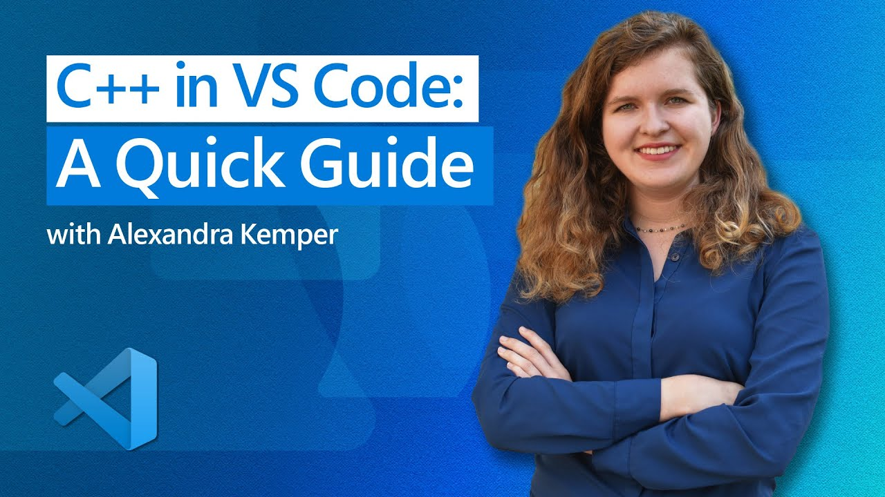
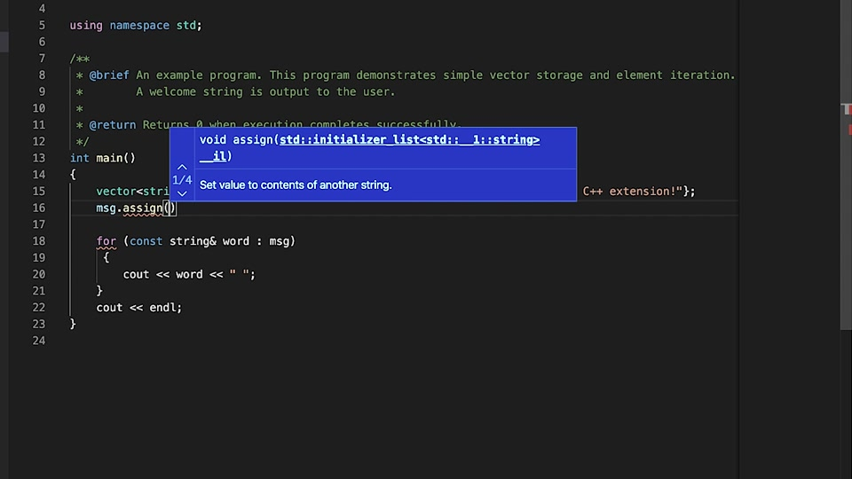
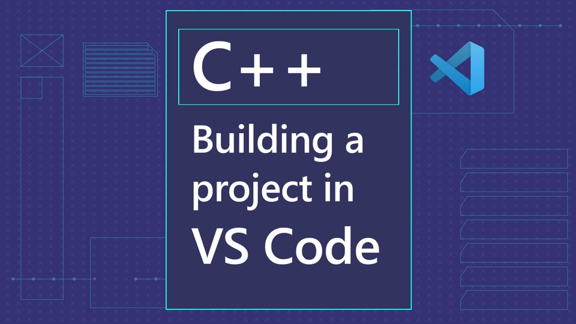
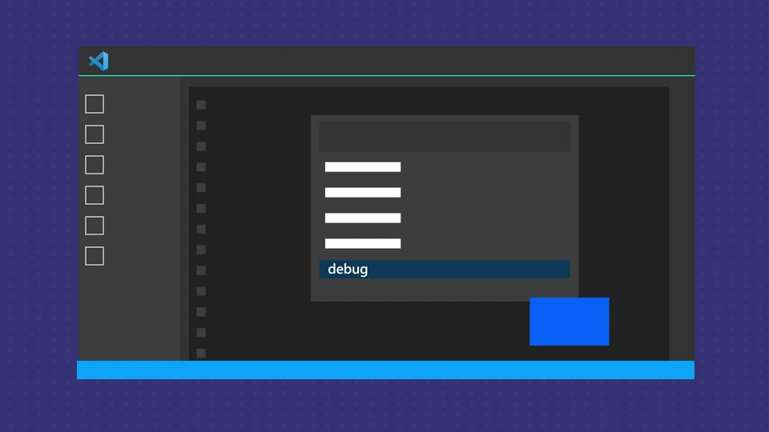

+++
title = "10.7.1 C++ 入门视频"
date = 2026-11-06T07:53:25+08:00
weight = 1
type = "docs"
description = ""
isCJKLanguage = true
draft = false
+++

> 原文链接: [https://code.visualstudio.com/docs/cpp/introvideos-cpp](https://code.visualstudio.com/docs/cpp/introvideos-cpp)

# 10.7.1 C++ 入门视频

　　观看这些入门视频开始使用 VS Code 中的 C++。视频帮助设置 C++ IntelliSense，并在 VS Code 中构建和调试 C++ 项目。观看后即可使用 VS Code 丰富的 C++ 功能。

## 5 分钟开始使用 C++ {#getting-started-with-cpp-in-5-minutes}

视频演示如何安装 C/C++ 扩展和 C++ 编译器，然后使用运行或调试播放按钮运行和调试代码。

## 配置 C++ IntelliSense {#configure-c-intellisense}

视频介绍为项目配置 C++ IntelliSense 的步骤。

## 构建 C++ 项目 {#build-a-cpp-project}

通过自定义 C++ 生成任务，学习在 VS Code 中构建 C++ 项目。

## 调试 C++ 项目 {#debug-a-cpp-project}

视频演示如何自定义 C++ 调试配置并启动调试会话。

## 使用 Copilot Chat 开始 C++ {#getting-started-using-copilot-chat-for-cpp-in-vs-code}

视频介绍在 VS Code 中使用 Copilot Chat 处理 C++ 代码的一些用例。

## 后续步骤 {#next-steps}

* 了解 VS Code 中的全部 [C++ 编辑功能](10.7.11-CppIDE/)。
* 查看适用于不同工具集和平台的 Hello World 教程：
  * [Windows 上的 GCC](10.7.3-ConfigMinGW/)
  * [Windows 上的 Microsoft C++](10.7.6-ConfigMSVC/)
  * [Linux 上的 GCC](10.7.2-ConfigLinux/)
  * [Windows Subsystem for Linux 上的 GCC](10.7.4-ConfigWSL/)
  * [macOS 上的 Clang/LLVM](10.7.5-ConfigClangMac/)
