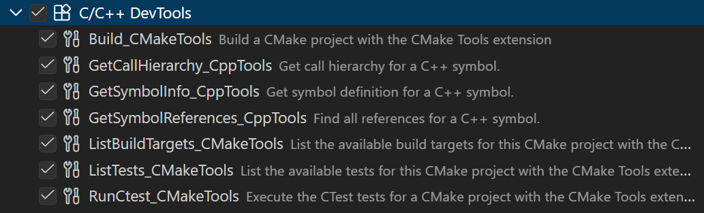
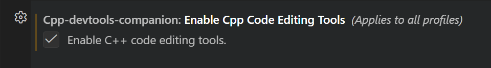
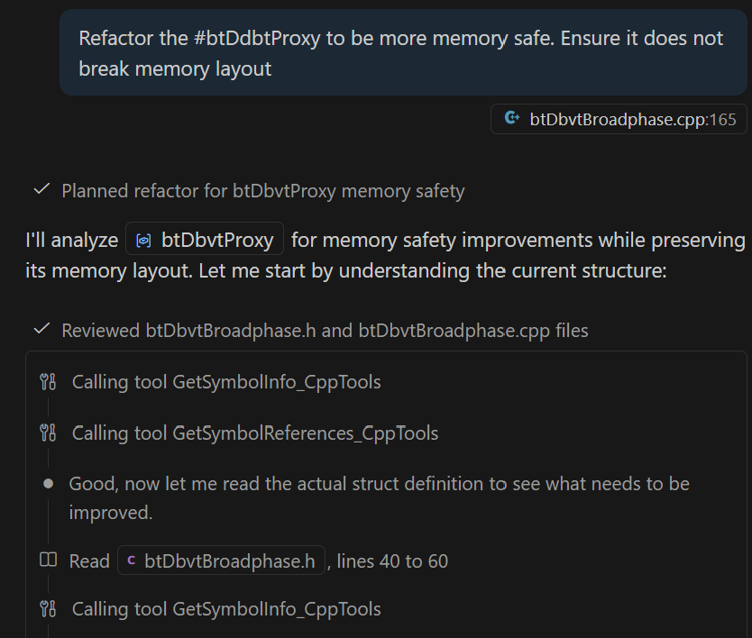
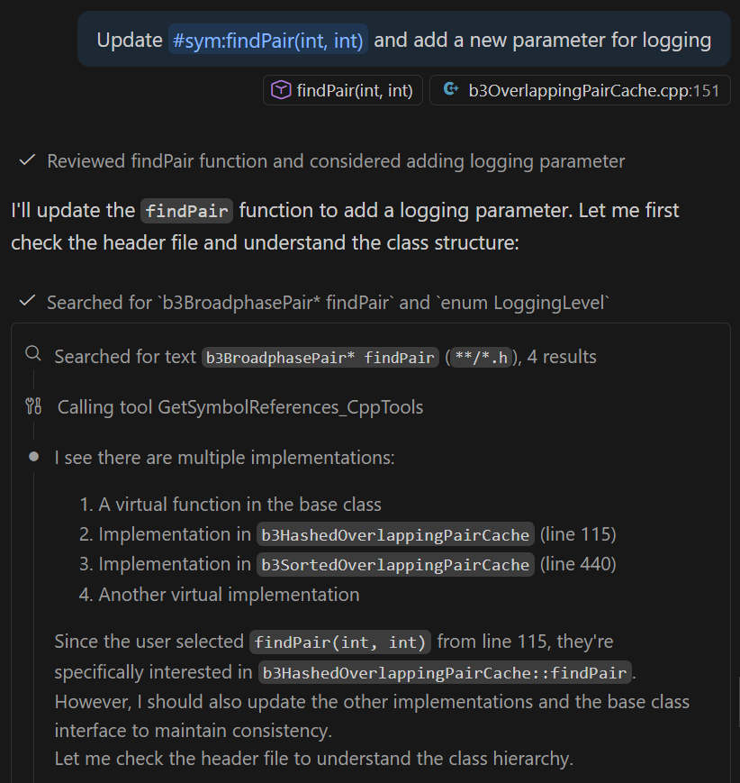
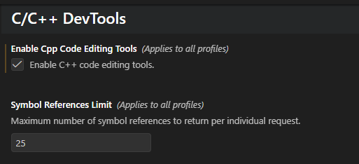
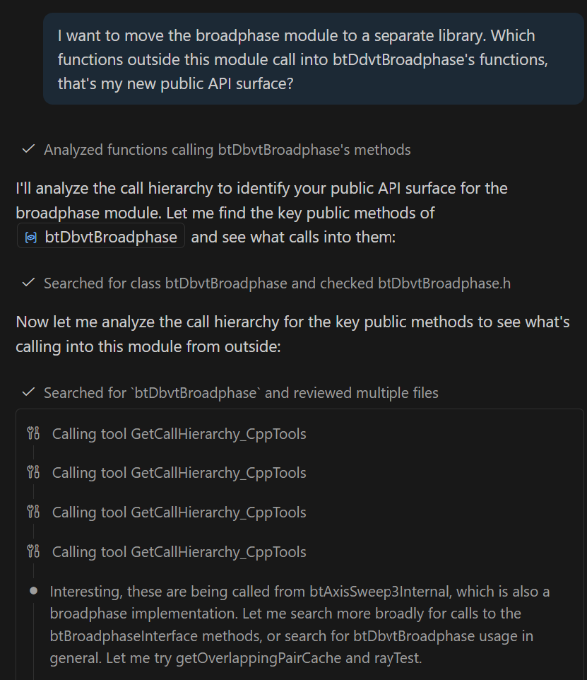
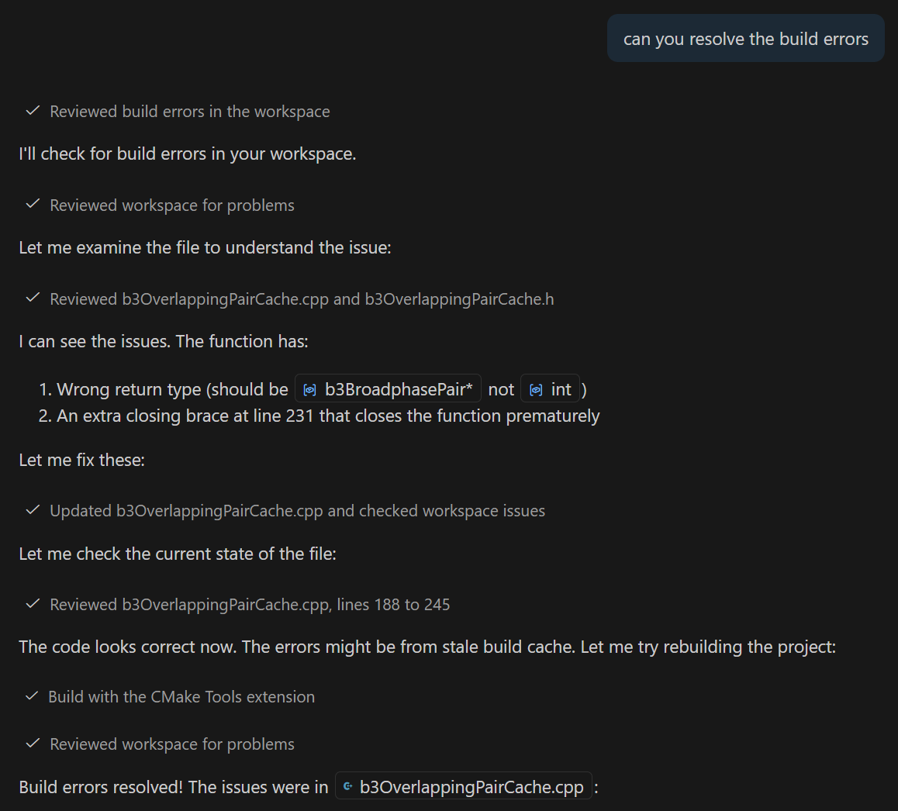
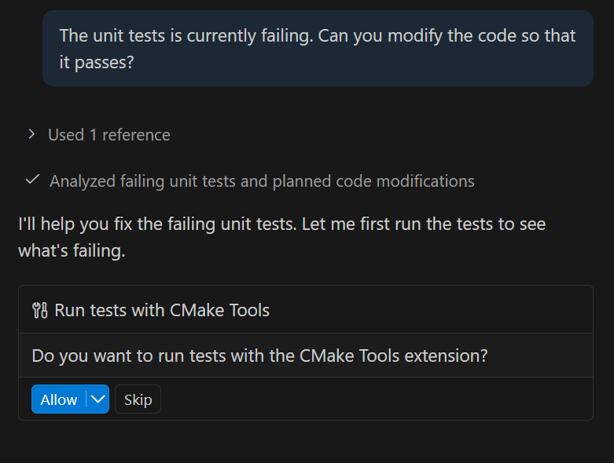

+++
title = "10.7.10 C++ 开发工具与 Copilot"
date = "2026-11-06T07:53:25+08:00"
weight = 10
type = "docs"
description = ""
isCJKLanguage = true
draft = false
+++

> 原文链接: [https://code.visualstudio.com/docs/cpp/cpp-devtools](https://code.visualstudio.com/docs/cpp/cpp-devtools)

# 10.7.10 C++ 开发工具与 Copilot

　　重构和修改 C++ 代码通常需要跨多个文件跟踪编辑，并了解构建配置。

　　GitHub Copilot Chat 可以使用 VS Code 内置的 C++ 工具，为 C++ 项目提供上下文感知帮助。通过代码理解和 CMake 工具，Copilot 可以了解代码库结构、依赖和构建配置，给出更准确、有用和快速的回答。

本指南介绍可用工具以及如何与 AI 代理配合完成：

* 浏览和理解复杂 C++ 代码库
* 在完整上下文感知下重构代码
* 高效配置和构建项目

## 前提条件 {#prerequisites}

* [C/C++ DevTools](https://marketplace.visualstudio.com/items?itemName=ms-vscode.cpp-devtools)扩展
* [C/C++](https://marketplace.visualstudio.com/items?itemName=ms-vscode.cpptools)扩展
* [CMake Tools](https://marketplace.visualstudio.com/items?itemName=ms-vscode.cmake-tools)扩展

这些扩展包含在 [C/C++ Extension Pack](https://marketplace.visualstudio.com/items?itemName=ms-vscode.cpptools-extension-pack)中。

可以随时在聊天 **Tools** 选项中启用/禁用工具：

> **注意**：只启用与工作流相关的工具，避免上下文膨胀。也可以通过同一对话框禁用 MCP 等工具。

## C++ 代码理解工具 {#c-code-understanding-tools}

　　C++ 扩展提供使用语言服务的工具，让 Copilot Chat 深入理解代码结构、符号和关系。请确保已[配置 IntelliSense](10.7.16-ConfigureIntelliSense/)。

在用户设置中启用 **Enable Cpp Code Editing Tools**：

### 获取符号信息（`GetSymbolInfo_CppTools`） {#get-symbol-information-getsymbolinfo_cpptools}

**功能**：获取代码库中符号（函数、类、变量等）的详细信息，包括定义、类型和文档。

**用例**：优化内存性能并确保无破坏性更改。

### 获取符号引用（`GetSymbolReferences_CppTools`） {#get-symbol-references-getsymbolreferences_cpptools}

**功能**：查找代码库中特定符号的所有引用，显示函数、类或变量的使用位置。

**用例**：向现有函数添加功能。

> **注意**：可以通过 VS Code 中的符号引用限制设置控制返回的最大引用数。

### 获取符号调用层次结构（`GetSymbolCallHierarchy_CppTools`） {#get-symbol-call-hierarchy-getsymbolcallhierarchy_cpptools}

**功能**：显示函数的调用层次结构，包括传入调用（谁调用此函数）和传出调用（此函数调用什么）。

**用例**：模块迁移的依赖分析。

## CMake Tools 集成 {#cmake-tools-integration}

　　CMake 工具让 Copilot Chat 了解构建配置、目标和依赖，提供构建感知帮助。

### CMake 构建（`Build_CMakeTools`） {#cmake-build-build_cmaketools}

**功能**：使用当前配置和所选目标构建 CMake 项目。

**用例**：解决构建错误。

### 运行 CTest（`RunCTest_CMakeTools`） {#run-ctest-runctest_cmaketools}

**功能**：运行项目中的 CTest 测试套件。

**用例**：根据单元测试修复代码。

### 有效提示技巧 {#tips-for-effective-prompts}

* **具体明确**：指出确切的符号、文件或组件（例如“重构 `getConfig()` 函数”而不是“让它更快”）。
* **引用上下文**：要求 Copilot Chat 在分析更改时考虑特定文件、函数或模块。
* **直接引用工具**：在聊天中使用 `#` 直接引用相关工具。
* **使用自定义指令**：设置[自定义指令](https://code.visualstudio.com/docs/agent-customization/custom-instructions)指导 Copilot Chat。
* **使用最新模型**：选择支持工具调用的最新 AI 模型。
* **优化工具性能**：只启用相关工作流工具，避免上下文膨胀。

### 各工具使用时机 {#when-to-use-each-tool}

**符号信息**：需要了解现有代码结构或在修改前验证属性时。

**符号引用**：重构时识别所有用法，确保更改不破坏现有代码。

**调用层次结构**：分析依赖、理解调用链或规划模块迁移时。

**CMake 构建**：排查构建问题或验证更改可以编译时。

**CTest**：根据测试套件验证更改或调试测试失败时。
