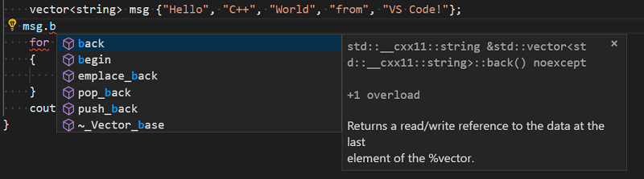
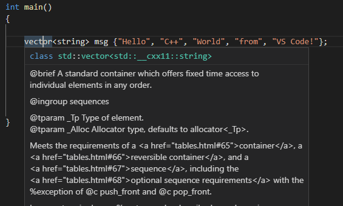
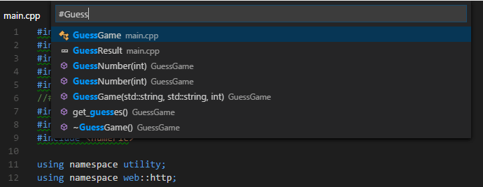
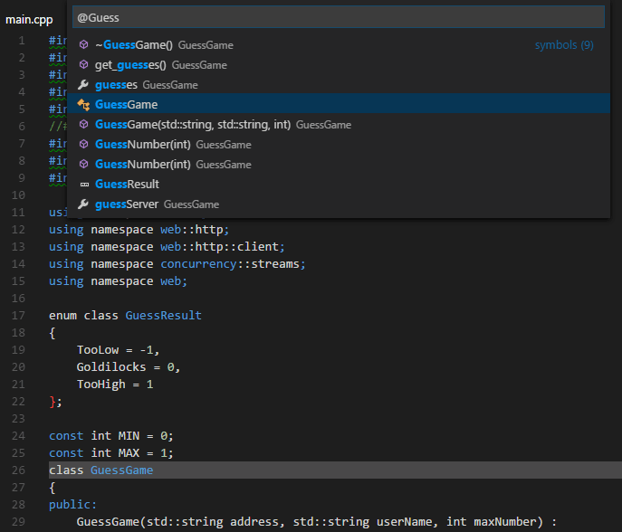
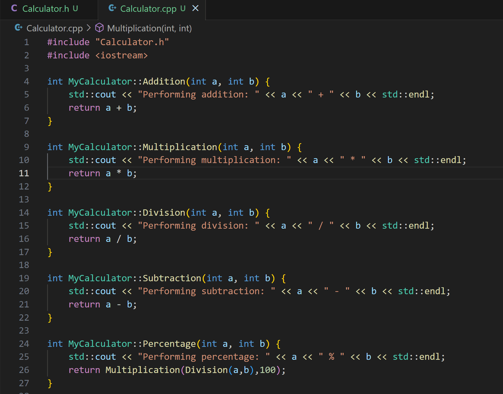
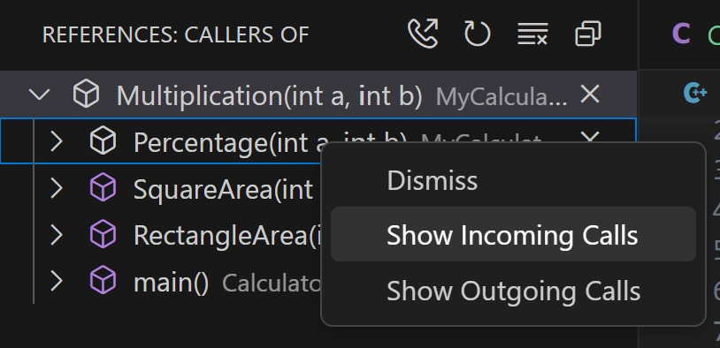
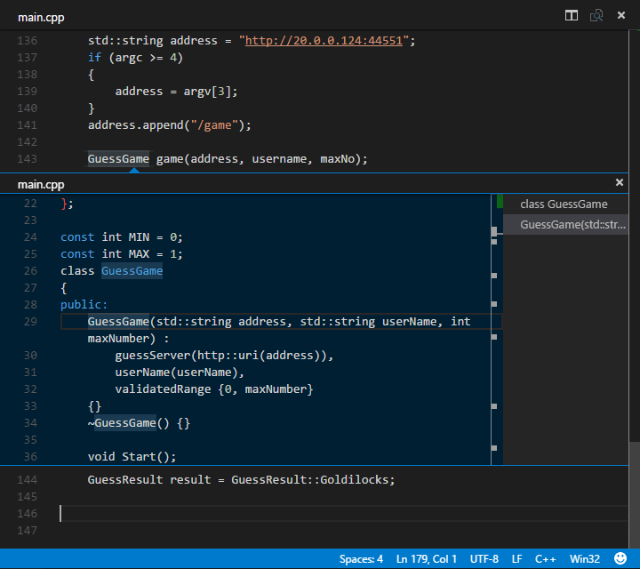

+++
title = "10.7.11 编辑 C++"
date = "2026-11-06T07:53:25+08:00"
weight = 11
type = "docs"
description = ""
isCJKLanguage = true
draft = false
+++


> 原文链接: [https://code.visualstudio.com/docs/cpp/cpp-ide](https://code.visualstudio.com/docs/cpp/cpp-ide)

# 10.7.11 编辑 C++

　　C/C++ 扩展为 VS Code 添加丰富的 C++ 编辑功能，包括 IntelliSense、代码导航、格式化和语义着色。

## 编辑 C++ 代码 {#editing-c-code}

### 识别头文件 {#identifying-header-files}

　　扩展根据文件扩展名识别 C++ 文件。`.h` 默认作为 C 头文件，但可以通过 `files.associations` 将 `.h` 关联为 `cpp`：

```json
"files.associations": {
    "*.h": "cpp"
}
```

### 列出成员 {#list-members}

输入对象名和 `.` 或 `->` 时，IntelliSense 会列出成员：



### 代码格式化 {#code-formatting}

　　C/C++ 扩展支持 [clang-format](https://clang.llvm.org/docs/ClangFormat.html)和 VC 格式。默认使用 clang-format。

### clang-format {#clang-format}

安装 clang-format 后，扩展会自动使用。可以通过 `C_Cpp.formatting` 设置：

* `default`：使用 clang-format。
* `disabled`：禁用格式化。
* `vcFormat`：使用 Visual C++ 格式。

配置 clang-format 样式：

```json
"C_Cpp.clang_format_style": "{ BasedOnStyle: Google, IndentWidth: 4 }"
```

也可以使用 `.clang-format` 文件。`C_Cpp.clang_format_fallbackStyle` 指定找不到配置文件时的回退样式。

格式化文档：`Shift + Alt + F`。格式化选择：`Ctrl + K Ctrl + F`。

### vc_format {#vc_format}

设置 `"C_Cpp.formatting": "vcFormat"` 使用 Visual C++ 格式化规则，并通过 `C_Cpp.vcFormat.*` 设置自定义。

### 增强语义着色 {#enhanced-semantic-colorization}

　　C/C++ 扩展提供语义着色，根据符号类型（类、函数、变量、宏等）着色，比纯语法着色更精确。可以通过 `C_Cpp.enhancedColorization` 设置启用或禁用。

### 快速信息 {#quick-info}

将鼠标悬停在符号上会显示类型、声明和文档：



### Doxygen 注释 {#doxygen-comments}

输入 `/**` 后按 `Enter` 会自动生成 Doxygen 注释模板：

```cpp
/**
 * @brief 计算两个数的和
 *
 * @param a 第一个数
 * @param b 第二个数
 * @return 两个数的和
 */
int add(int a, int b);
```

扩展会根据函数签名填充 `@param` 和 `@return`。

### Markdown 注释 {#markdown-comments}

　　快速信息和悬停支持 Markdown 格式注释，可以使用 `**粗体**`、列表和代码块提高文档可读性。

## 导航源代码 {#navigate-source-code}

### 搜索符号 {#search-for-symbols}

* **转到工作区中的符号**（`Ctrl + T`）：搜索整个工作区符号。

  

* **转到文件中的符号**（`Ctrl + Shift + O`）：搜索当前文件符号。

  

### 调用层次结构 {#call-hierarchy}

右键单击函数，选择 **显示调用层次结构**，查看调用者和被调用者：



嵌套调用：



### 速览 {#peek}

**速览定义**（`Alt + F12`）在编辑器中显示定义，不离开当前位置：



### 转到定义 {#go-to-definition}

`F12` 跳转到符号定义。多个定义时显示选择列表。

### 转到声明 {#go-to-declaration}

`Ctrl + F12` 跳转到声明（头文件中的函数原型）。

### 转到引用 {#go-to-references}

`Shift + F12` 查找符号的所有引用。

### 转到类型定义 {#go-to-type-definition}

跳转到变量或表达式的类型定义。

## 后续步骤 {#next-steps}

* [配置 IntelliSense](10.7.16-ConfigureIntelliSense/)
* [自定义 C++ 设置](10.7.15-CustomizeCppSettings/)
* [调试 C++](10.7.12-CppDebug/)
* [C++ 扩展概述](../../language-support/10.2.9-C++/)
