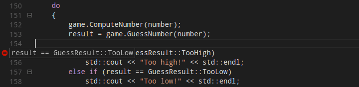
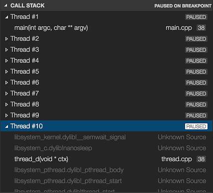

+++
title = "10.7.12 调试 C++"
date = "2026-11-06T07:53:25+08:00"
weight = 12
type = "docs"
description = ""
isCJKLanguage = true
draft = false
+++


> 原文链接: [https://code.visualstudio.com/docs/cpp/cpp-debug](https://code.visualstudio.com/docs/cpp/cpp-debug)

# 10.7.12 调试 C++

　　C/C++ 扩展支持使用 GDB、LLDB 和 Visual Studio 调试器调试 C++。基础调试配置请参阅 [launch.json 参考](10.7.13-LaunchJsonReference/)。

## 在 Windows 上使用 GDB 调试 {#windows-debugging-with-gdb}

Windows 上可以使用 MinGW-w64 的 GDB 调试。`launch.json` 中设置：

```json
{
    "type": "cppdbg",
    "request": "launch",
    "name": "C/C++: gdb",
    "program": "${fileDirname}\\${fileBasenameNoExtension}.exe",
    "MIMode": "gdb",
    "miDebuggerPath": "C:\\msys64\\ucrt64\\bin\\gdb.exe"
}
```

## 条件断点 {#conditional-breakpoints}

右键单击断点，选择 **编辑断点**，输入条件表达式。条件为真时暂停：



也可以在 `launch.json` 中设置 `conditional` 表达式。

## 函数断点 {#function-breakpoints}

在 **断点** 视图选择 **添加函数断点**，输入函数名。调试器会在函数入口暂停。适用于没有源代码或不确定行号时。

## 表达式求值 {#expression-evaluation}

暂停时可以在 **监视**、**局部变量** 或 **调试控制台** 中输入 C++ 表达式。支持：

* 变量和成员访问。
* 函数调用（可能产生副作用）。
* 强制类型转换。
* 指针解引用。
* STL 容器（GDB 美化打印）。

## 多线程调试 {#multi-threaded-debugging}

**调用堆栈** 视图下拉列表可以切换线程。**并行堆栈** 视图显示所有线程：



可以在 `launch.json` 中设置 `setupCommands` 配置 GDB 线程行为。

## 内存转储调试 {#memory-dump-debugging}

Windows 上可以调试 `.dmp` 内存转储文件。`launch.json` 中设置：

```json
{
    "type": "cppvsdbg",
    "request": "launch",
    "name": "Open dump",
    "program": "C:\\path\\to\\app.exe",
    "dumpPath": "C:\\path\\to\\dump.dmp"
}
```

## 附加符号 {#additional-symbols}

调试器需要符号文件（PDB 或 DWARF）。可以通过 `symbolSearchPath` 指定 PDB 搜索路径：

```json
"symbolSearchPath": "C:\\symbols;\\\\server\\symbols"
```

GDB 可以使用 `set solib-search-path` 或 `set sysroot`。

## 定位源文件 {#locate-source-files}

源代码路径与编译时不同时，使用 `sourceFileMap` 映射：

```json
"sourceFileMap": {
    "/build/path": "C:\\source\\path"
}
```

## GDB、LLDB 和 LLDB-MI 命令 {#gdb-lldb-and-lldb-mi-commands-gdblldb}

可以在 **调试控制台** 输入调试器原生命令。GDB 命令以 `-exec` 开头，例如：

```text
-exec info registers
```

LLDB 命令：

```text
-exec register read
```

## 其他调试功能 {#other-debugging-features}

### Natvis 框架 {#natvis-framework}

Visual Studio 调试器支持 [Natvis](https://learn.microsoft.com/visualstudio/debugger/create-custom-views-of-native-objects) 自定义类型视图。将 `.natvis` 文件放在项目或 `VisualStudioCustomVisualizers` 目录中。

### 远程调试 {#debug-remotely}

可以在 `launch.json` 中配置 `pipeTransport` 或 `miDebuggerServerAddress` 远程调试。VS Code 远程开发扩展也支持直接在远程主机调试。

### 调试调试器 {#debug-the-debugger}

设置 `"logging": { "engineLogging": true, "trace": true, "traceResponse": true }` 查看调试器通信日志。

## 已知限制 {#known-limitations}

### 符号和代码导航 {#symbols-and-code-navigation}

* 符号必须由编译器生成，并位于调试器搜索路径中。
* 模板和宏展开可能难以导航。
* 优化构建可能内联函数，导致断点位置偏移。

### 调试 {#debugging}

* 某些平台不支持热重载。
* 调试器版本必须与编译器/运行时匹配。
* 多线程和异步代码的单步行为可能因调试器而异。
* Windows 上 MSVC 调试器不支持所有 GDB 功能，反之亦然。

## 后续步骤 {#next-steps}

* [launch.json 参考](10.7.13-LaunchJsonReference/)
* [配置 IntelliSense](10.7.16-ConfigureIntelliSense/)
* [通用调试](../../../debugging-and-testing/6.1-Debugging/)
* [C++ 扩展概述](../../language-support/10.2.9-C++/)
