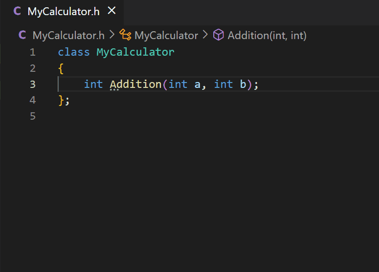
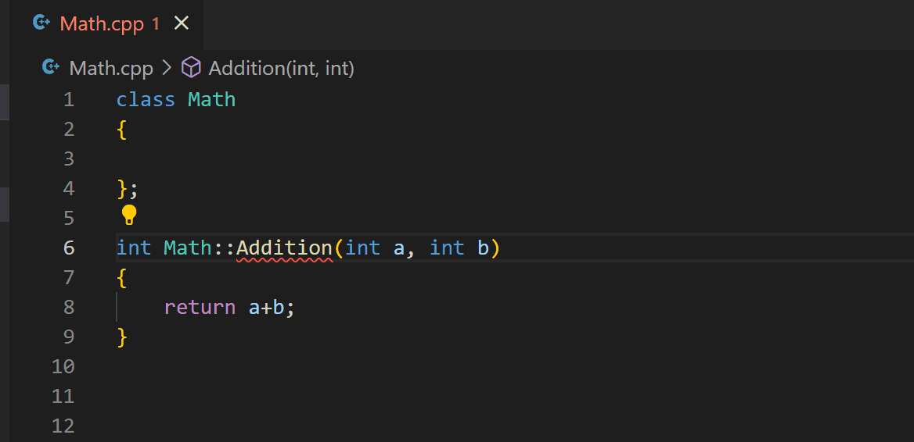
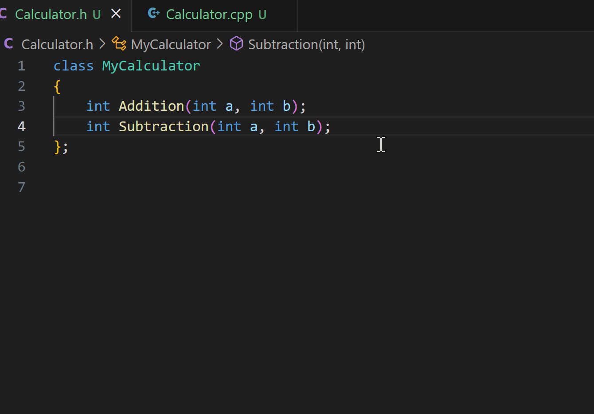
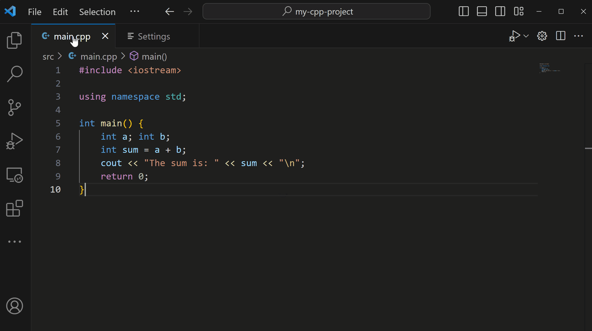
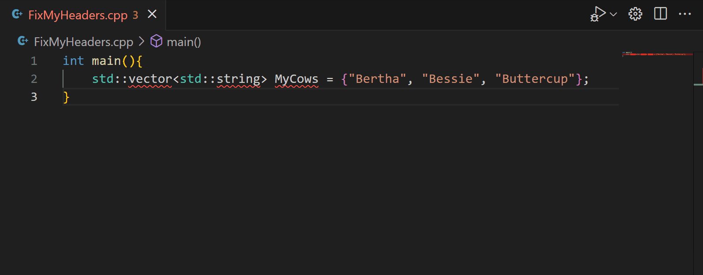

+++
title = "10.7.14 重构 C++"
date = "2026-11-06T07:53:25+08:00"
weight = 14
type = "docs"
description = ""
isCJKLanguage = true
draft = false
+++

> 原文链接: [https://code.visualstudio.com/docs/cpp/cpp-refactoring](https://code.visualstudio.com/docs/cpp/cpp-refactoring)

# 10.7.14 重构 C++

　　C/C++ 扩展提供多种重构功能，帮助改善代码结构、可读性和可维护性，而不改变运行时行为，包括提取方法和创建声明/定义。

## 创建声明或定义 {#create-declarations-or-definitions}

　　扩展可以自动生成函数的声明或定义，适用于成员函数、命名空间中的类和模板。

创建方式：

* 选择类函数定义，单击代码操作灯泡，选择 **Create a Declaration**；选择函数声明并选择 **Create a Definition**。
* 右键单击函数声明或定义，选择 **Create Definition/Declaration**。
* 选择函数，运行命令面板中的 **Create Declaration/Definition**。

生成位置遵循代码中已有的模式。例如之前在同一文件添加声明和定义，扩展也会添加到同一文件，并自动保持函数顺序：

声明和定义位于不同文件时，扩展遵循约定。例如同名头文件和源文件会被识别，即使头文件尚未包含在源文件中；添加后会自动引用头文件。否则扩展会创建与当前文件同名的头文件或源文件，并自动引用。

模板函数在头文件声明时，定义也创建在同一头文件；类模板的非模板成员函数同样如此。

### 复制声明或定义 {#copy-declarations-or-definitions}

需要选择声明/定义添加位置时，使用 **Copy Declaration/Definition** 代码操作。它会将内容复制到剪贴板，而不是直接插入代码。

选择有快速修复的函数，单击代码操作灯泡，选择 **Copy definition of 'YourFunctionName'** 或 **Copy declaration of 'YourFunctionName'**：

## 提取为方法 {#extract-to-method}

　　提取方法将代码块提取到单独函数，提高可读性、减少重复并提高模块化。

选择要提取的 C++ 代码，单击代码操作灯泡，选择 **Extract to Function**。也可以右键选择 **重构 > 提取**，或使用键盘命令（Windows 上 `Ctrl + Shift + R, Ctrl + E`）。

输入新函数名称。包含所选代码的新函数会放在当前函数上方：

## 快速修复/代码操作 {#quick-fixescode-actions}

　　C/C++ 扩展根据代码上下文提供修复和改进建议。悬停在符号上选择 **QuickFix** 链接，或选择代码旁的灯泡。例如代码可以提取为方法时，单击灯泡会显示提取方法。

### 添加缺失头文件 {#add-missing-header-files}

代码中有未知符号且扩展在工作区找到正确头文件时，会提供快速修复。选择后必要的 `#include` 会添加到当前 C++ 文件顶部：

## 后续步骤 {#next-steps}

* [C++ 代码导航](10.7.11-CppIDE/)
* [基本编辑](../../../editor/3.2-WriteCode/3.2.1-BasicEditing/)
* [任务](../../../debugging-and-testing/6.3-Tasks/)
* [调试](../../../debugging-and-testing/6.1-Debugging/)

遇到问题请在 [GitHub](https://github.com/microsoft/vscode-cpptools/issues) 提交议题，可能需要提供扩展日志。
