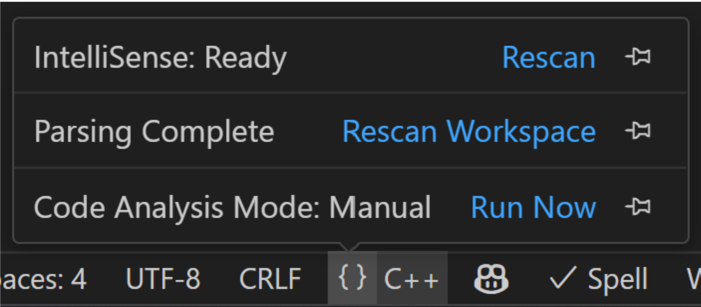
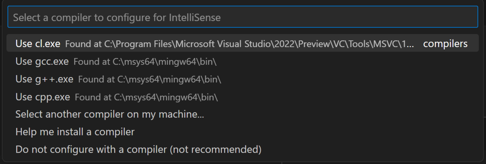
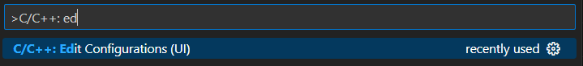
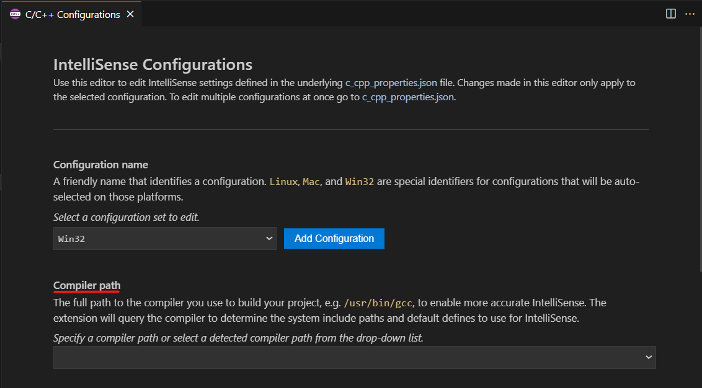
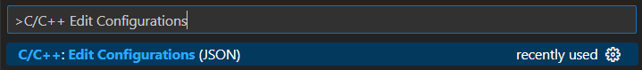
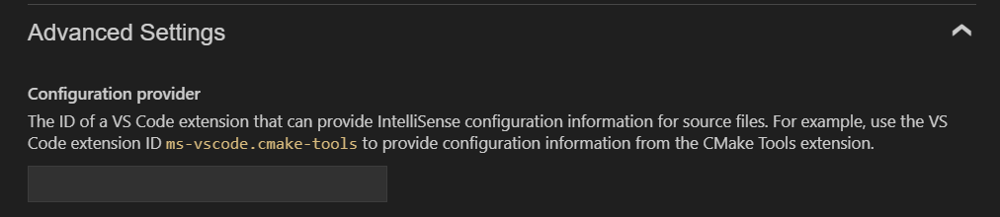

+++
title = "10.7.16 配置 C++ IntelliSense"
date = "2026-11-06T07:53:25+08:00"
weight = 16
type = "docs"
description = ""
isCJKLanguage = true
draft = false
+++


> 原文链接: [https://code.visualstudio.com/docs/cpp/configure-intellisense](https://code.visualstudio.com/docs/cpp/configure-intellisense)

# 10.7.16 配置 C++ IntelliSense

　　C/C++ 扩展使用 IntelliSense 提供代码补全、错误检查、悬停信息、转到定义等功能。正确配置后，IntelliSense 才能找到头文件、编译器和标准库。

## 扩展何时会自动配置核心 IntelliSense？ {#when-will-the-cc-extension-configure-core-intellisense-features-for-me}

　　扩展会尝试自动检测编译器。打开 C++ 文件时，如果没有配置，通常会提示选择编译器。选择后，扩展会查询编译器获取系统包含路径和默认定义。

## 如何检查 IntelliSense 是否已配置 {#how-to-check-whether-intellisense-is-configured}

状态栏语言项显示 IntelliSense 状态。绿色对勾表示已配置；警告图标表示需要配置。


单击语言项查看详情：



## 如何配置 IntelliSense {#how-to-configure-intellisense}

### 选项 1：通过配置快速选择 {#option-1-select-a-configuration-option-through-the-configuration-quick-pick}

打开命令面板运行 **C/C++: Select IntelliSense Configuration**，从检测到的编译器列表选择：



选项包括：

* 使用检测到的编译器（GCC、Clang、MSVC）。
* 使用 `compile_commands.json`。
* 使用 CMake Tools 等配置提供程序。
* 编辑配置。

### 选项 2：通过 UI 编辑配置 {#option-2-edit-your-intellisense-configurations-through-the-ui}

运行 **C/C++: Edit Configurations (UI)**，在设置页面修改：





### 选项 3：直接编辑 c_cpp_properties.json {#option-3-edit-the-c_cpp_propertiesjson-file-directly}

运行 **C/C++: Edit Configurations (JSON)**，编辑 `.vscode/c_cpp_properties.json`：



常见属性：

* `compilerPath`：编译器完整路径，扩展查询系统包含路径和定义。
* `intelliSenseMode`：`windows-msvc-x64`、`linux-gcc-x64`、`macos-clang-x64` 等。
* `includePath`：头文件搜索路径，`/**` 表示递归。
* `defines`：预处理器定义。
* `cStandard` / `cppStandard`：C/C++ 标准。
* `compileCommands`：`compile_commands.json` 路径。
* `configurationProvider`：配置提供程序扩展 ID。
* `mergeConfigurations`：合并提供程序配置。
* `forcedInclude`：强制包含文件。
* `macFrameworkPath`：macOS 框架路径。
* `windowsSdkVersion`：Windows SDK 版本。
* `dotConfig`：Kconfig `.config` 文件。
* `browse`：符号浏览路径。

高级设置：



完整架构请参阅[C++ 设置参考](10.7.15-CustomizeCppSettings/)。

## 项目级 IntelliSense 配置 {#project-level-intellisense-configuration}

### 配置提供程序 {#configuration-providers}

CMake Tools 等扩展可以实现 `configurationProvider`，向 C/C++ 扩展提供包含路径、定义和编译器信息。设置：

```json
"configurationProvider": "ms-vscode.cmake-tools"
```

提供程序的配置优先于 `c_cpp_properties.json` 其他设置。

### compile_commands.json 文件 {#compile_commandsjson-file}

`compile_commands.json` 包含每个源文件的编译命令。设置：

```json
"compileCommands": "${workspaceFolder}/build/compile_commands.json"
```

打开文件时，扩展会使用匹配的编译命令配置 IntelliSense。CMake 可以通过 `CMAKE_EXPORT_COMPILE_COMMANDS` 生成。

### 使用语言状态栏检查 IntelliSense 活动 {#check-intellisense-activity-using-the-language-status-bar}

单击状态栏语言项可以查看：

* 当前配置。
* 使用的编译器。
* 包含路径和定义数量。
* IntelliSense 活动日志。

## 后续步骤 {#next-steps}

* [C++ 设置参考](10.7.15-CustomizeCppSettings/)
* [交叉编译 IntelliSense](10.7.17-ConfigureIntelliSenseCrossCompilation/)
* [C++ 常见问题](10.7.18-FAQ/)
* [C++ 扩展概述](../../language-support/10.2.9-C++/)
