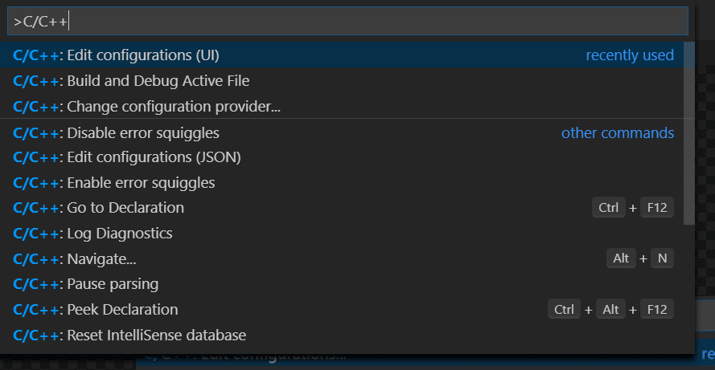
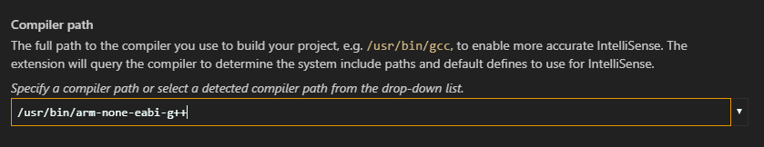
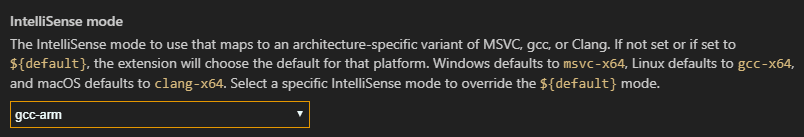
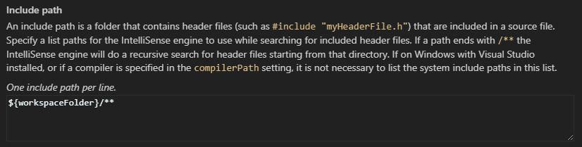

+++
title = "10.7.17 交叉编译 IntelliSense"
date = "2026-11-06T07:53:25+08:00"
weight = 17
type = "docs"
description = ""
isCJKLanguage = true
draft = false
+++


> 原文链接: [https://code.visualstudio.com/docs/cpp/configure-intellisense-crosscompilation](https://code.visualstudio.com/docs/cpp/configure-intellisense-crosscompilation)

# 10.7.17 交叉编译 IntelliSense

　　本文介绍在为不同于开发主机的架构编译时，如何配置 C/C++ 扩展以提供正确的 IntelliSense。例如主机是 x64，但为 Arm 编译。

　　C/C++ 扩展不是编译器，提供语法高亮和 IntelliSense 等语言功能。为提供正确建议并反映数据类型大小，需要配置扩展模拟目标架构。

配置存储在项目 `c_cpp_properties.json` 中。从命令面板（`Ctrl + Shift + P`）运行 **C/C++: Edit Configurations (UI)**：



## IntelliSense 配置示例 {#example-intellisense-configuration}

以下示例配置 Linux x64 主机为 Linux Arm 目标编译：

* **编译器路径**：扩展查询该位置的编译器获取系统库和定义。
* **IntelliSense 模式**：模拟目标架构和编译器，反映 `pointer`、`size_t`、`long` 等类型的大小。

至少设置编译器路径和 IntelliSense 模式即可模拟目标架构；如果扩展能根据编译器查询结果正确选择模式，也可以不设置模式。

### 编译器路径 {#compiler-path}

设置为构建项目所用编译器的完整路径：



### IntelliSense 模式 {#intellisense-mode}

设置为编译器的架构特定变体：



### 包含路径 {#include-path}

只有程序包含工作区或标准库路径之外的头文件时才需要修改 **Include path**。扩展会查询编译器填充包含路径。找不到目标系统库路径时，可以手动输入：



示例 `c_cpp_properties.json`：

```json
{
    "configurations": [
        {
            "name": "myConfigurationName",
            "includePath": [
                "${workspaceFolder}/**"
            ],
            "defines": [],
            "compilerPath": "/usr/bin/arm-none-eabi-g++",
            "cStandard": "c11",
            "cppStandard": "c++14",
            "IntelliSenseMode": "gcc-arm"
        }
    ],
    "version": 4
}
```

## 后续步骤 {#next-steps}

* [自定义默认设置](10.7.15-CustomizeCppSettings/)
* 配置问题请到 [GitHub discussions](https://github.com/microsoft/vscode-cpptools/discussions)讨论，缺陷请提交 [GitHub issues](https://github.com/microsoft/vscode-cpptools/issues)。
* [C++ 扩展概述](../../language-support/10.2.9-C++/)
