+++
title = "10.7.2 Linux 上的 C++"
date = 2026-11-06T07:53:25+08:00
weight = 2
type = "docs"
description = ""
isCJKLanguage = true
draft = false
+++


> 原文链接: [https://code.visualstudio.com/docs/cpp/config-linux](https://code.visualstudio.com/docs/cpp/config-linux)

# 10.7.2 Linux 上的 C++

　　本教程在 Linux 上配置 VS Code 使用 GCC C++ 编译器（g++）和 GDB 调试器。GCC 是 GNU 编译器集合，GDB 是 GNU 调试器。

配置后编译并调试一个简单 C++ 程序。本教程不教授 GCC、GDB、Ubuntu 或 C++ 语言本身。

遇到问题可以在 [VS Code 文档仓库](https://github.com/microsoft/vscode-docs/issues)提交议题。

## 前提条件 {#prerequisites}

1. 安装 [VS Code](https://code.visualstudio.com/download)。
2. 安装 [C++ 扩展](https://marketplace.visualstudio.com/items?itemName=ms-vscode.cpptools)。在扩展视图（`Ctrl + Shift + X`）搜索 `c++`。

   

### 确保安装 GCC {#ensure-gcc-is-installed}

用 g++ 编译源代码，用 GDB 调试。Ubuntu 默认不安装这些工具。

先检查 GCC 是否已安装：

```bash
gcc -v
```

未安装时更新包列表：

```bash
sudo apt-get update
```

安装 GNU 编译工具和 GDB：

```bash
sudo apt-get install build-essential gdb
```

## 创建 Hello World {#create-hello-world}

创建 `projects` 文件夹，再创建 `helloworld` 子文件夹并打开：

```bash
mkdir projects
cd projects
mkdir helloworld
cd helloworld
code .
```

`code .` 在当前文件夹打开 VS Code，该文件夹成为工作区。教程会在 `.vscode` 文件夹创建：

* `tasks.json`：编译器生成设置。
* `launch.json`：调试器设置。
* `c_cpp_properties.json`：编译器路径和 IntelliSense 设置。

### 添加 Hello World 源文件 {#add-hello-world-source-code-file}

在文件资源管理器标题栏选择 **新建文件**，命名为 `helloworld.cpp`。

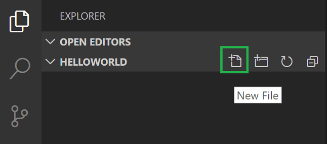

粘贴：

```cpp
#include <iostream>
#include <vector>
#include <string>

using namespace std;

int main()
{
    vector<string> msg {"Hello", "C++", "World", "from", "VS Code", "and the C++ extension!"};

    for (const string& word : msg)
    {
        cout << word << " ";
    }
    cout << endl;

    return 0;
}
```

按 `Ctrl + S` 保存。文件会显示在 **文件资源管理器**（`Ctrl + Shift + E`）中：

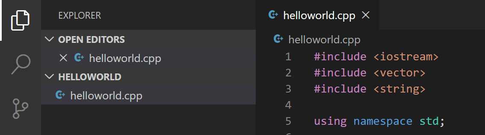

也可以在 **文件** 菜单勾选 **自动保存**。

活动栏可以打开 **搜索**、**源代码管理** 和 **运行** 等视图。其他视图请参阅 [VS Code 用户界面](../../../editor/3.1-GettingStarted/3.1.2-UserInterface/)。

> **注意**：保存或打开 C++ 文件时，C/C++ 扩展可能提示 Insiders 版本可用。可以选择 `X` 清除通知。

## 探索 IntelliSense {#explore-intellisense}

悬停在 `vector` 或 `string` 上查看类型信息。声明 `msg` 后输入 `msg.`，会立即显示成员函数补全列表和类型信息：

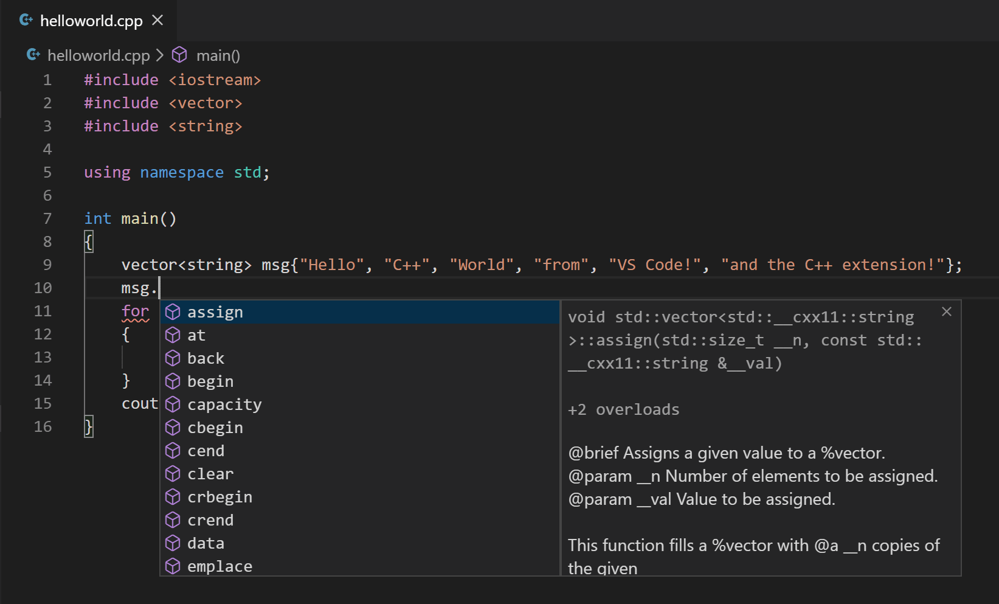

按 `Tab` 插入选中成员。添加左括号后会显示参数信息。

## 运行 helloworld.cpp {#run-helloworldcpp}

C++ 扩展使用本机安装的 C++ 编译器构建程序。运行前请确保已安装编译器。

1. 打开 `helloworld.cpp` 使其成为活动文件。
2. 单击编辑器右上角播放按钮。

   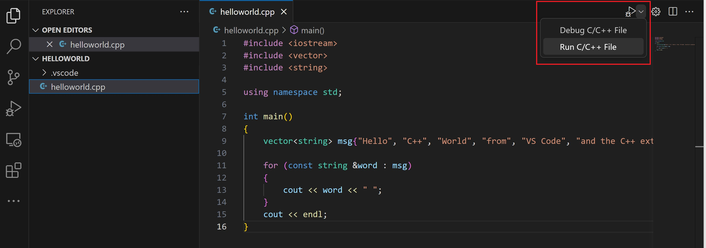

3. 从检测到的编译器列表选择 **g++ build and debug active file**。

   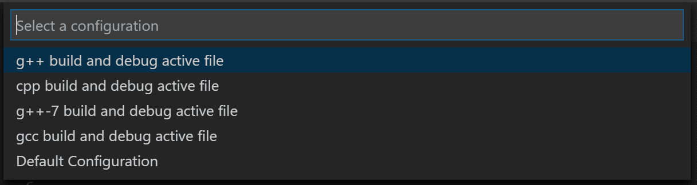

   第一次运行时会询问编译器，之后会将其设为 `tasks.json` 中的默认编译器。

4. 构建成功后，程序输出显示在集成 **终端**：

   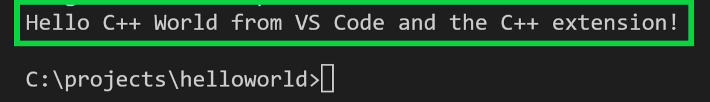

第一次运行时 C++ 扩展会创建 `.vscode/tasks.json`，保存构建配置：

```json
{
"version": "2.0.0",
"tasks": [
    {
        "type": "shell",
        "label": "C/C++: g++ build active file",
        "command": "/usr/bin/g++",
        "args": [
            "-g",
            "${file}",
            "-o",
            "${fileDirname}/${fileBasenameNoExtension}"
        ],
        "options": {
            "cwd": "/usr/bin"
        },
        "problemMatcher": [
            "$gcc"
        ],
        "group": {
            "kind": "build",
            "isDefault": true
        },
        "detail": "Task generated by Debugger."
    }
]
}
```

> **注意**：`tasks.json` 变量请参阅[变量参考](../../../editor/3.4-Reference/3.4.3-SubstitutionVariables/)。

`command` 指定要运行的程序（g++），`args` 按编译器要求的顺序传递参数。该任务编译活动文件（`${file}`），在 `${fileDirname}` 生成同名无扩展名可执行文件 `${fileBasenameNoExtension}`。

`label` 显示在任务列表中，`detail` 显示任务描述，建议修改以区分相似任务。

编辑器播放按钮会读取 `tasks.json` 决定构建和运行方式。可以定义多个构建任务，默认任务会被播放按钮使用。修改默认编译器可以运行 **Tasks: Configure default build task**，或修改 `tasks.json`：

```json
    "group": {
        "kind": "build",
        "isDefault": true
    },
```

改为：

```json
    "group": "build",
```

> **注意**：编辑器标签栏的播放按钮运行活动文件；**运行和调试** 视图的播放按钮启动所选调试配置，配置可以来自 `launch.json` 或由扩展动态提供。

### 修改 tasks.json {#modifying-tasksjson}

使用 `"${workspaceFolder}/*.cpp"` 代替 `"${file}"` 可以构建当前文件夹所有 `.cpp` 文件。也可以将输出文件名改为硬编码名称（例如 `helloworld.out`）。

## 调试 helloworld.cpp {#debug-helloworldcpp}

1. 回到 `helloworld.cpp` 使其成为活动文件。
2. 单击编辑器边距或按 `F9` 设置断点。

   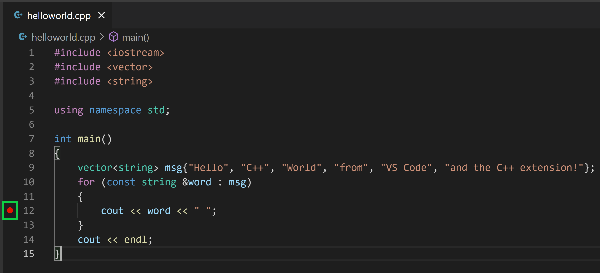

3. 从播放按钮下拉列表选择 **Debug C/C++ File**。

   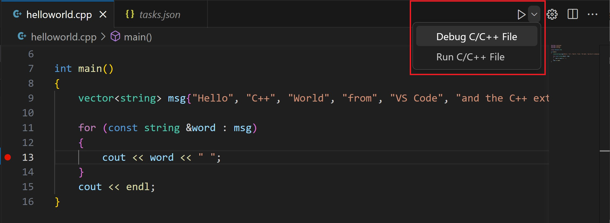

4. 从检测到的编译器选择 **C/C++: g++ build and debug active file**。

播放按钮有两种模式：**Run C/C++ File** 和 **Debug C/C++ File**，默认使用上次模式。播放按钮显示调试图标时，直接单击即可调试。

## 探索调试器 {#explore-the-debugger}

开始单步执行前，注意 UI 变化：

* 集成终端出现在编辑器底部，**调试输出** 标签显示调试器启动信息。
* 编辑器高亮第 12 行断点：

   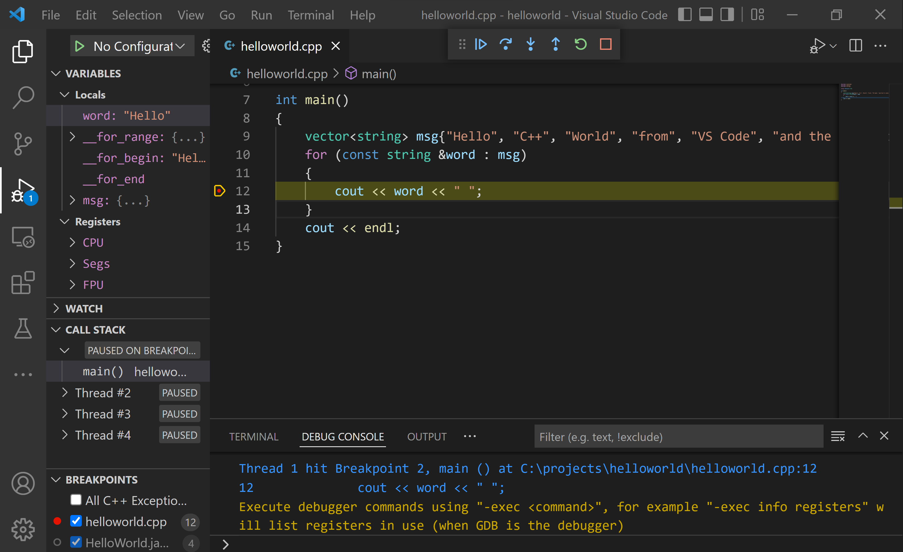

* 左侧 **运行和调试** 视图显示调试信息。
* 编辑器顶部出现调试控制面板，可以拖动左侧圆点移动。

   

工作区已有 `launch.json` 时播放按钮会读取它。没有时会在运行时创建临时“快速调试”配置，无需 `launch.json`。

## 单步执行代码 {#step-through-the-code}

1. 单击或按调试控制面板的 **单步跳过** 图标。

   

   程序会执行到 for 循环第一行，跳过 `vector` 和 `string` 类内部调用。**变量** 窗口会更新：

   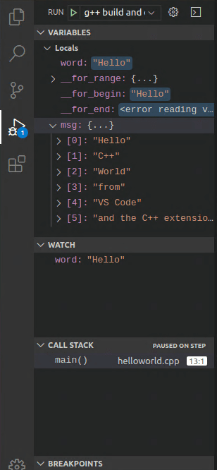

2. 再次按 **单步跳过** 进入下一条语句，**变量** 窗口显示循环变量。
3. 再次按 **单步跳过** 执行 `cout`（C++ 扩展在最后一个 cout 执行前不会向 **调试控制台** 输出）。
4. 可以继续单步执行直到输出所有单词。也可以按 **单步进入** 进入 C++ 标准库源代码：

   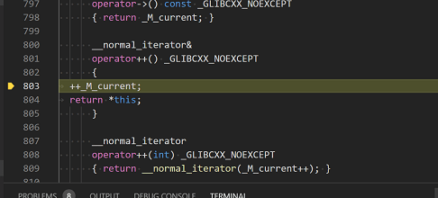

   返回自己的代码可以继续按 **单步跳过**，或切换到 `helloworld.cpp`，在循环内 `cout` 语句设置断点（装订线显示红点）：

   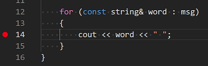

   按 `F5` 从标准库头文件当前行继续，执行会在 `cout` 中断。再次按 `F9` 可以取消断点。

   循环完成后，**调试控制台** 显示输出和 GDB 诊断信息：

   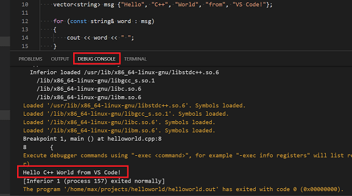

## 设置监视 {#set-a-watch}

1. 将插入点放在循环内。在 **监视** 窗口单击加号，输入循环变量名 `word`，单步执行时观察值。

   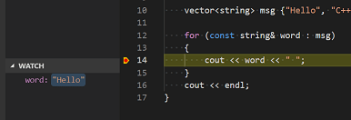

2. 暂停在断点时，将鼠标悬停在变量上可以快速查看值。

   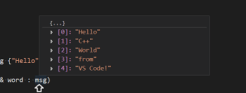

## 使用 launch.json 自定义调试 {#customize-debugging-with-launchjson}

使用播放按钮或 `F5` 调试时，C++ 扩展会动态创建调试配置。需要自定义（例如传递运行时参数）时，可以在 `launch.json` 中定义。

从播放按钮下拉菜单选择 **Add Debug Configuration**：

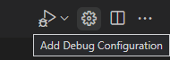

选择 **g++ build and debug active file** 后，VS Code 创建：

```json
{
    "version": "0.2.0",
    "configurations": [
        {
            "name": "C/C++: g++ build and debug active file",
            "type": "cppdbg",
            "request": "launch",
            "program": "${fileDirname}/${fileBasenameNoExtension}",
            "args": [],
            "stopAtEntry": false,
            "cwd": "${workspaceFolder}",
            "environment": [],
            "externalConsole": false,
            "MIMode": "gdb",
            "miDebuggerPath": "/usr/bin/gdb",
            "setupCommands": [
                {
                    "description": "Enable pretty-printing for gdb",
                    "text": "-enable-pretty-printing",
                    "ignoreFailures": true
                }
            ],
            "preLaunchTask": "C/C++: g++ build active file",
        }
    ]
}
```

`program` 指定要调试的程序，`args` 是运行时参数数组。默认不添加断点，`stopAtEntry` 为 `false`；改为 `true` 会在 `main` 方法停止。

之后播放按钮和 `F5` 会读取 `launch.json` 启动调试。

## C/C++ 配置 {#cc-configurations}

需要更多控制时，可以创建 `c_cpp_properties.json`，修改编译器路径、包含路径、C++ 标准（默认 C++17）等。

从命令面板（`Ctrl + Shift + P`）运行 **C/C++: Edit Configurations (UI)**：

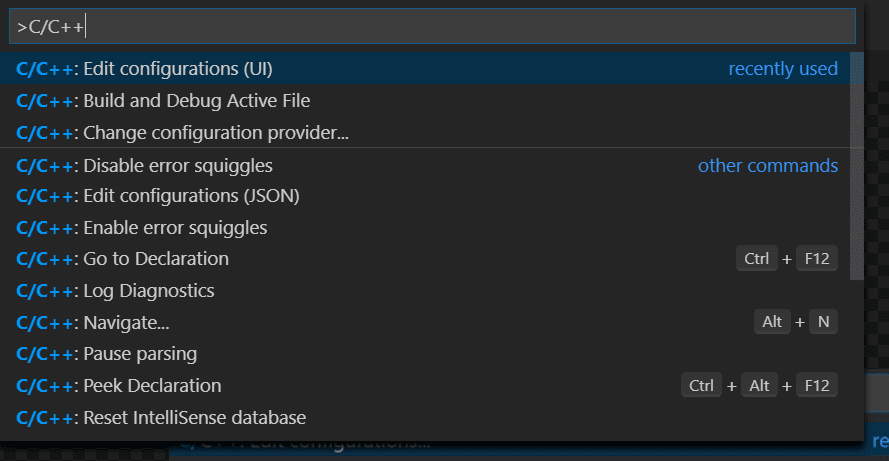

打开 **C/C++ Configurations** 页面，更改会写入 `.vscode/c_cpp_properties.json`。

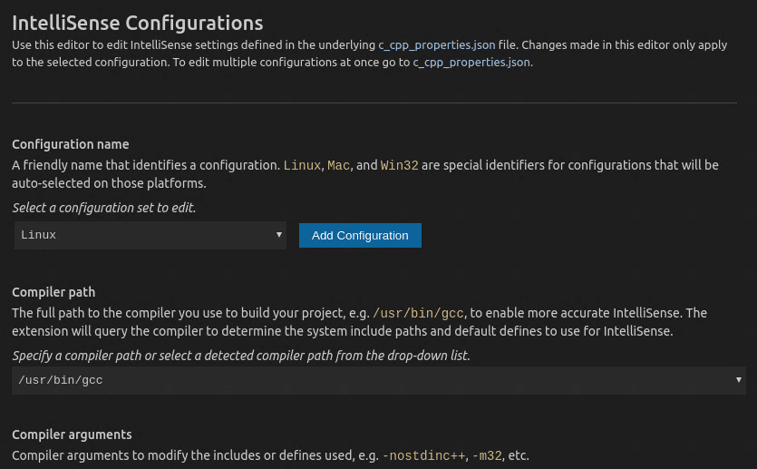

只有程序包含工作区或标准库路径之外的头文件时才需要修改 **Include path**。

直接打开 `.vscode/c_cpp_properties.json` 时类似：

```json
{
    "configurations": [
        {
            "name": "Linux",
            "includePath": [
                "${workspaceFolder}/**"
            ],
            "defines": [],
            "compilerPath": "/usr/bin/gcc",
            "cStandard": "c11",
            "cppStandard": "c++17",
            "intelliSenseMode": "clang-x64"
        }
    ],
    "version": 4
}
```

## 复用 C++ 配置 {#reusing-your-cc-configuration}

VS Code 现在配置为在 Linux 上使用 gcc，配置仅适用于当前工作区。复用配置时，将 JSON 文件复制到新项目 `.vscode` 文件夹，并按需修改源文件名和可执行文件名。

## 故障排除 {#troubleshooting}

### 编译和链接错误 {#compiler-and-linking-errors}

常见错误（例如 `undefined _main`、`attempting to link with file built for unknown-unsupported file format`）通常是因为启动构建或调试时 `helloworld.cpp` 不是活动文件。编译器可能尝试编译 `launch.json`、`tasks.json` 或 `c_cpp_properties.json` 等非源文件。

## 后续步骤 {#next-steps}

* 阅读 [VS Code 用户指南](../../../editor/3.2-WriteCode/3.2.1-BasicEditing/)。
* 查看 [C++ 扩展概述](../../language-support/10.2.9-C++/)。
* 创建新工作区，复制 `.json` 文件并调整路径和程序名，开始编码。
