+++
title = "10.7.3 Windows 上的 MinGW"
date = 2026-11-06T07:53:25+08:00
weight = 3
type = "docs"
description = ""
isCJKLanguage = true
draft = false
+++


> 原文链接: [https://code.visualstudio.com/docs/cpp/config-mingw](https://code.visualstudio.com/docs/cpp/config-mingw)

# 10.7.3 Windows 上的 MinGW

　　本教程配置 VS Code 使用 [mingw-w64](http://mingw-w64.org)的 GCC C++ 编译器（g++）和 GDB 调试器创建 Windows 程序，然后编译、运行和调试 Hello World。

本教程不教授 GCC、GDB、MinGW-w64 或 C++ 语言本身。

遇到问题可以在 [VS Code 文档仓库](https://github.com/microsoft/vscode-docs/issues/new)提交议题。

## 前提条件 {#prerequisites}

1. 安装 [VS Code](https://code.visualstudio.com/download)。
2. 安装 [C++ 扩展](https://marketplace.visualstudio.com/items?itemName=ms-vscode.cpptools)，在扩展视图搜索 `C++`。

   

## 安装 MinGW-w64 工具链 {#installing-the-mingw-w64-toolchain}

通过 [MSYS2](https://www.msys2.org/)获取最新 MinGW-w64，它提供 GCC、MinGW-w64 和其他 C++ 工具的更新本机构建。

[](https://www.youtube.com/watch?v=oC69vlWofJQ)

1. 从 MSYS2 页面下载最新安装程序，或使用[直接链接](https://github.com/msys2/msys2-installer/releases/download/2025-08-30/msys2-x86_64-20250830.exe)。
2. 运行安装程序。MSYS2 需要 64 位 Windows 10（1809 或更高版本）。
3. 选择安装文件夹并记录路径。完成后勾选 **Run MSYS2 now**，选择 **Finish** 打开 MSYS2 终端。
4. 在终端安装工具链：

   ```sh
   pacman -S --needed base-devel mingw-w64-ucrt-x86_64-toolchain
   ```

5. 按 `Enter` 接受 `toolchain` 组的默认包数量。

   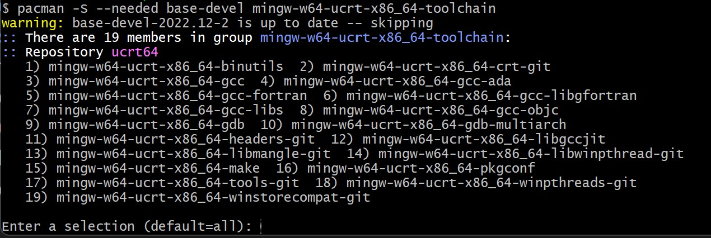

6. 提示是否继续时输入 `Y`。
7. 将 `ucrt64\bin` 添加到 Windows `PATH`：
   1. Windows 搜索 **Settings**。
   2. 搜索 **Edit environment variables for your account**。
   3. 在 **User variables** 中选择 `Path`，选择 **Edit**。
   4. 选择 **New**，添加 `C:\msys64\ucrt64\bin`（或安装时记录的路径）。
   5. 选择 **OK** 保存。需要重新打开控制台窗口使新 PATH 生效。

### 检查 MinGW 安装 {#check-your-mingw-installation}

打开**新的**命令提示符，运行：

```bash
gcc --version
g++ --version
gdb --version
```

应显示 GCC、g++ 和 GDB 版本。否则：

1. 确认 PATH 条目与实际安装的 MinGW-w64 二进制位置匹配。
2. `gcc` 正常但 `gdb` 不正常时，安装缺少的包。出现“The value of miDebuggerPath is invalid.”通常是缺少 `mingw-w64-gdb` 包。

## 创建 Hello World 应用 {#create-a-hello-world-app}

在 Windows 命令提示符运行：

```bat
mkdir projects
cd projects
mkdir helloworld
cd helloworld
code .
```

`code .` 在当前文件夹打开 VS Code，该文件夹成为工作区。选择 **Yes, I trust the authors** 接受工作区信任对话框。

教程会在 `.vscode` 文件夹创建：

* `tasks.json`：构建说明。
* `launch.json`：调试器设置。
* `c_cpp_properties.json`：编译器路径和 IntelliSense 设置。

### 添加 Hello World 源文件 {#add-a-hello-world-source-code-file}

在文件资源管理器标题栏选择 **新建文件**，命名为 `helloworld.cpp`。

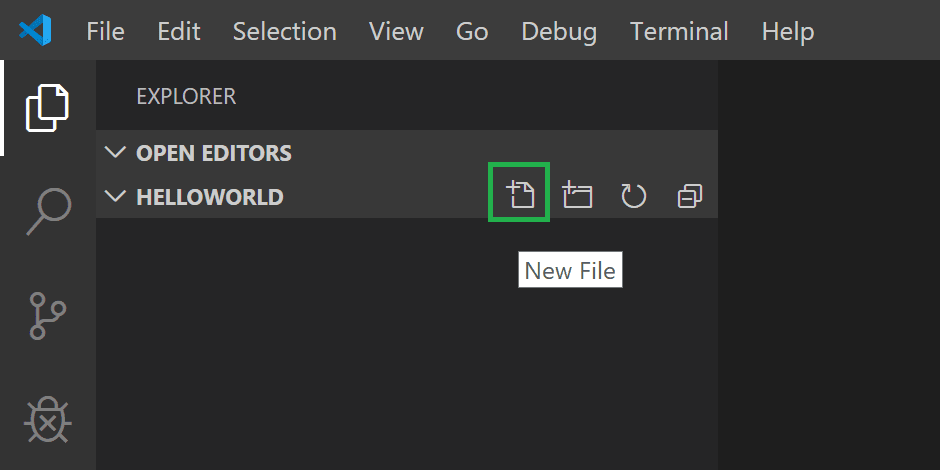

粘贴：

```cpp
#include <iostream>
#include <vector>
#include <string>

using namespace std;

int main()
{
    vector<string> msg {"Hello", "C++", "World", "from", "VS Code", "and the C++ extension!"};

    for (const string& word : msg)
    {
        cout << word << " ";
    }
    cout << endl;
}
```

按 `Ctrl + S` 保存。文件会显示在 **文件资源管理器**：

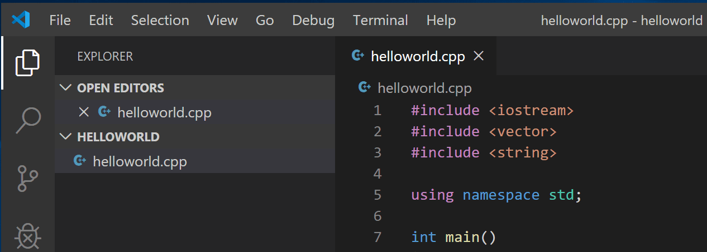

也可以在 **文件 > 自动保存** 启用自动保存。其他视图请参阅 [VS Code 用户界面](../../../editor/3.1-GettingStarted/3.1.2-UserInterface/)。

> **注意**：保存或打开 C++ 文件时可能提示 C/C++ 扩展 Insiders 版本。可以选择 `X` 清除通知。

## 探索 IntelliSense {#explore-intellisense}

悬停在 `vector` 或 `string` 上查看类型信息。在第 10 行输入 `msg.` 会看到成员函数补全列表：

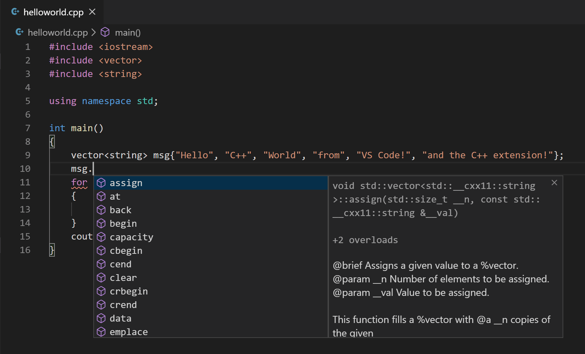

按 `Tab` 插入选中成员，添加左括号后显示参数信息。

IntelliSense 未配置时，打开命令面板输入 **Select IntelliSense Configuration**，从编译器下拉列表选择 `Use gcc.exe`。详情请参阅 [IntelliSense 配置](10.7.16-ConfigureIntelliSense/)。

## 运行 helloworld.cpp {#run-helloworldcpp}

1. 打开 `helloworld.cpp` 使其成为活动文件。
2. 单击编辑器右上角播放按钮。

   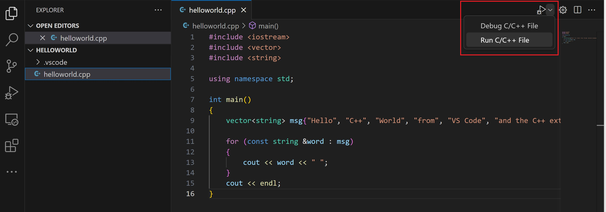

3. 从检测到的编译器列表选择 **C/C++: g++.exe build and debug active file**。

   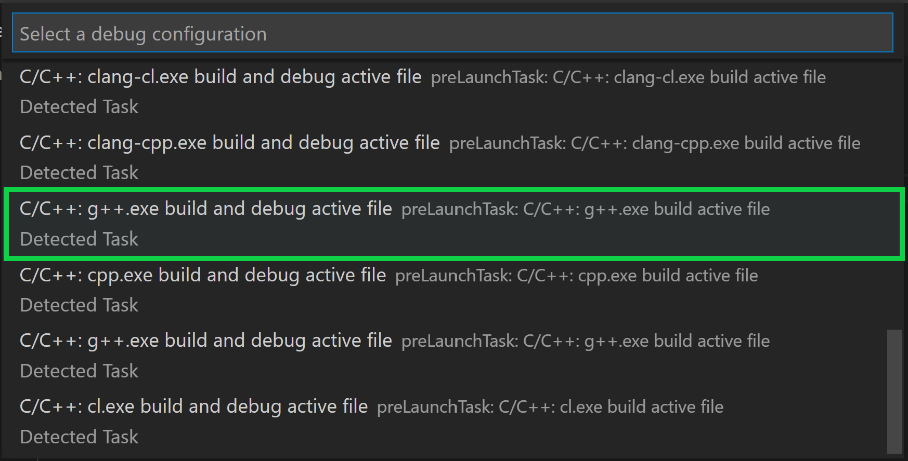

   第一次运行时会询问编译器，之后会设为 `tasks.json` 中的默认编译器。

4. 构建成功后输出显示在集成 **终端**：

   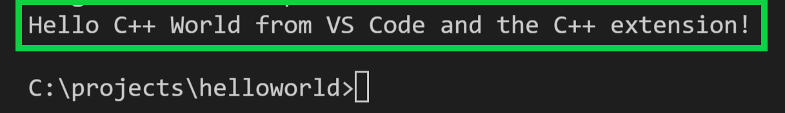

第一次运行会创建 `.vscode/tasks.json`：

```json
{
"version": "2.0.0",
"tasks": [
    {
        "type": "cppbuild",
        "label": "C/C++: g++.exe build active file",
        "command": "C:\\msys64\\ucrt64\\bin\\g++.exe",
        "args": [
            "-fdiagnostics-color=always",
            "-g",
            "${file}",
            "-o",
            "${fileDirname}\\${fileBasenameNoExtension}.exe"
        ],
        "options": {
            "cwd": "${fileDirname}"
        },
        "problemMatcher": [
            "$gcc"
        ],
        "group": {
            "kind": "build",
            "isDefault": true
        },
        "detail": "Task generated by Debugger."
    }
]
}
```

`command` 指定 g++.exe 路径，`args` 编译活动文件并生成 `.exe`。`label` 显示在任务列表，`detail` 为描述。

### 理解 tasks.json {#understanding-tasksjson}

* `command`：要运行的程序。
* `args`：按编译器顺序传递的参数。
* `group`：`build` 表示生成任务，`isDefault` 表示默认任务。
* `problemMatcher`：`$gcc` 解析编译器错误。

播放按钮读取 `tasks.json` 决定构建方式。可以定义多个任务，默认任务会被使用。修改默认编译器可以运行 **Tasks: Configure default build task**。

### 修改 tasks.json {#modifying-tasksjson}

使用 `"${workspaceFolder}\\*.cpp"` 构建所有 `.cpp` 文件。可以将输出文件名改为硬编码名称。

## 调试 helloworld.cpp {#debug-helloworldcpp}

1. 回到 `helloworld.cpp`。
2. 单击边距或按 `F9` 设置断点。

   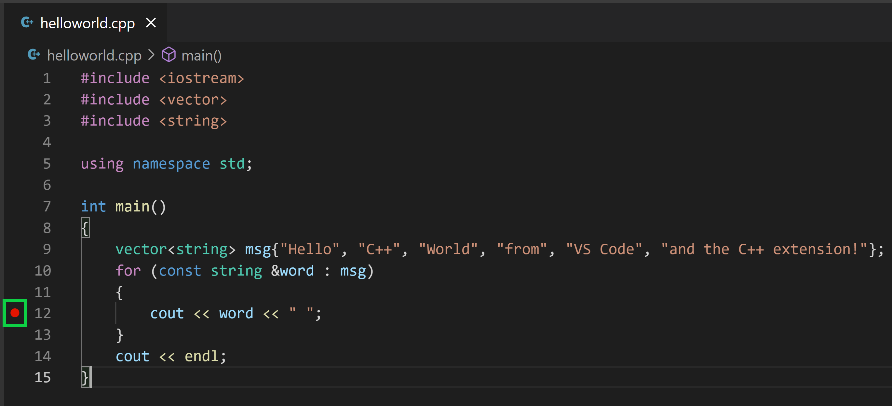

3. 从播放按钮下拉列表选择 **Debug C/C++ File**。

   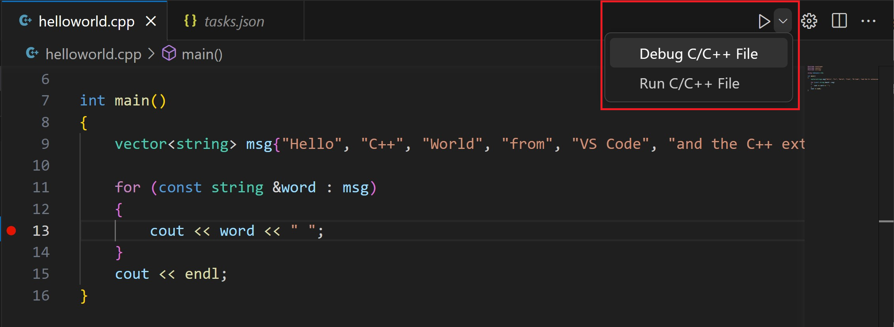

4. 选择 **C/C++: g++.exe build and debug active file**。

## 探索调试器 {#explore-the-debugger}

* 集成终端显示调试输出。
* 编辑器高亮断点行：

   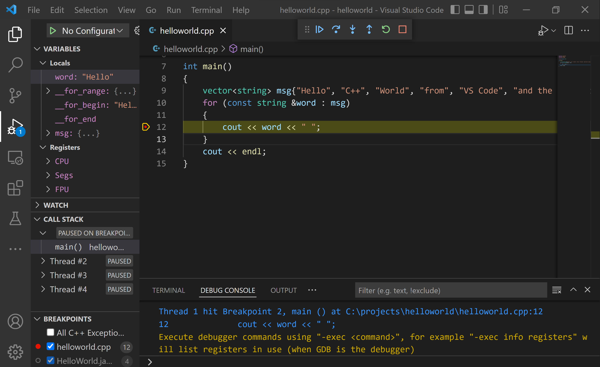

* 左侧 **运行和调试** 视图显示调试信息。
* 编辑器顶部出现调试控制面板：

   

已有 `launch.json` 时播放按钮会读取它；没有时会创建临时快速调试配置。

### 单步执行代码 {#step-through-the-code}

1. 单击 **单步跳过**：

   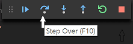

   执行到 for 循环第一行，跳过 `vector` 和 `string` 内部调用。**变量** 窗口更新：

   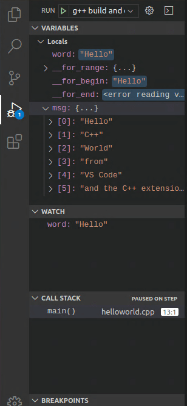

2. 再次单步跳过，**变量** 显示循环变量。
3. 再次单步跳过执行 `cout`。
4. 可以继续单步或按 **单步进入** 进入标准库：

   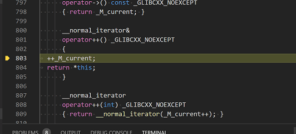

   返回自己的代码可以继续单步，或在 `cout` 行设置断点后按 `F5`：

   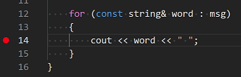

   循环完成后 **调试控制台** 显示输出和 GDB 信息：

   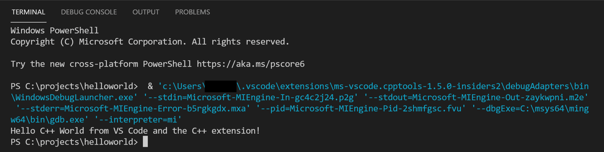

### 设置监视 {#set-a-watch}

在 **监视** 窗口单击加号，输入 `word`，单步执行时观察值：

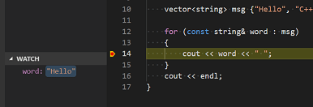

暂停时悬停变量可快速查看值：

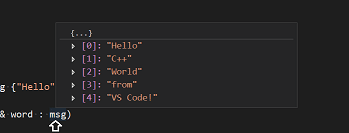

## 使用 launch.json 自定义调试 {#customize-debugging-with-launchjson}

从播放按钮下拉菜单选择 **Add Debug Configuration**：

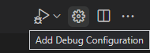

选择 **C/C++: g++.exe build and debug active file**，创建：

```json
{
    "version": "0.2.0",
    "configurations": [
        {
            "name": "C/C++: g++.exe build and debug active file",
            "type": "cppdbg",
            "request": "launch",
            "program": "${fileDirname}\\${fileBasenameNoExtension}.exe",
            "args": [],
            "stopAtEntry": false,
            "cwd": "${workspaceFolder}",
            "environment": [],
            "externalConsole": false,
            "MIMode": "gdb",
            "miDebuggerPath": "C:\\msys64\\ucrt64\\bin\\gdb.exe",
            "setupCommands": [
                {
                    "description": "Enable pretty-printing for gdb",
                    "text": "-enable-pretty-printing",
                    "ignoreFailures": true
                }
            ],
            "preLaunchTask": "C/C++: g++.exe build active file"
        }
    ]
}
```

`program` 指定调试程序，`args` 是运行时参数。将 `stopAtEntry` 改为 `true` 可在 `main` 停止。

## 添加其他 C/C++ 设置 {#adding-additional-cc-settings}

运行 **C/C++: Edit Configurations (UI)** 打开配置页面：

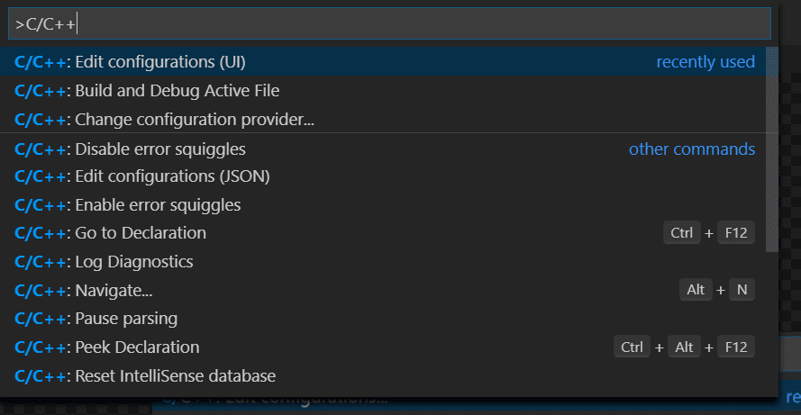

更改会写入 `.vscode/c_cpp_properties.json`：

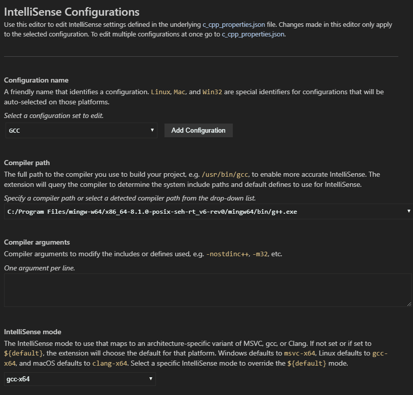

### 编译器路径 {#compiler-path}

确认 `compilerPath` 指向 MinGW-w64 g++.exe：

```json
{
    "configurations": [
        {
            "name": "Win32",
            "includePath": [
                "${workspaceFolder}/**"
            ],
            "defines": [
                "_DEBUG",
                "UNICODE",
                "_UNICODE"
            ],
            "compilerPath": "C:\\msys64\\ucrt64\\bin\\g++.exe",
            "cStandard": "c17",
            "cppStandard": "c++17",
            "intelliSenseMode": "windows-gcc-x64"
        }
    ],
    "version": 4
}
```

## 故障排除 {#troubleshooting}

### 已安装 MSYS2 但找不到 g++ 和 gdb {#msys2-is-installed-but-g-and-gdb-are-still-not-found}

确认 `C:\msys64\ucrt64\bin` 已加入 PATH，并重新打开命令提示符。

### Windows 上运行 pacman 报错 {#as-a-windows-user-running-the-pacman-command-gives-me-an-error}

请从 MSYS2 终端（而不是普通命令提示符）运行 `pacman`。

## 后续步骤 {#next-steps}

* 阅读 [VS Code 用户指南](../../../editor/3.2-WriteCode/3.2.1-BasicEditing/)。
* 查看 [C++ 扩展概述](../../language-support/10.2.9-C++/)。
* 创建新工作区，复制 `.json` 文件并调整设置。
