+++
title = "10.7.4 WSL 中的 C++"
date = 2026-11-06T07:53:25+08:00
weight = 4
type = "docs"
description = ""
isCJKLanguage = true
draft = false
+++


> 原文链接: [https://code.visualstudio.com/docs/cpp/config-wsl](https://code.visualstudio.com/docs/cpp/config-wsl)

# 10.7.4 WSL 中的 C++

　　本教程配置 VS Code 使用 [Windows Subsystem for Linux](https://learn.microsoft.com/windows/wsl/install)（WSL）中 Ubuntu 的 GCC C++ 编译器（g++）和 GDB 调试器。WSL 是 Windows 内的 Linux 环境，直接运行在机器硬件上，而不是虚拟机中。

> **注意**：本教程大部分内容也适用于直接在 Linux 机器上使用 C++ 和 VS Code。

VS Code 通过 [WSL 扩展](https://marketplace.visualstudio.com/items?itemName=ms-vscode-remote.remote-wsl)支持直接在 WSL 中工作。推荐这种 [WSL 开发](../../../remote/8.6-WSL/)模式：源代码文件、编译器都位于 Linux 发行版中。

遇到问题可以在 [VS Code 文档仓库](https://github.com/microsoft/vscode-docs/issues)提交议题。

## 前提条件 {#prerequisites}

1. 安装 [VS Code](https://code.visualstudio.com/download)。
2. 安装 [WSL 扩展](https://marketplace.visualstudio.com/items?itemName=ms-vscode-remote.remote-wsl)。
3. 安装 [WSL](https://learn.microsoft.com/windows/wsl/install)并安装 Linux 发行版（本教程使用 Ubuntu）。请记住 Linux 用户密码，安装软件时需要。

## 设置 Linux 环境 {#set-up-your-linux-environment}

1. 打开 WSL Bash。安装了 Ubuntu 时在 Windows 搜索框输入 `Ubuntu` 并打开：

   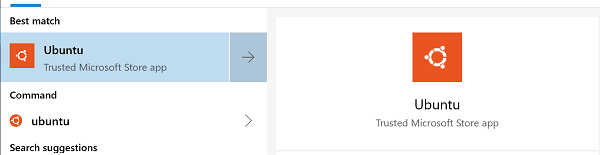

   默认提示符包含用户名和计算机名，位于主目录：

   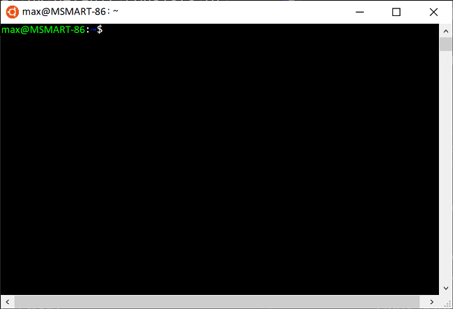

2. 创建项目文件夹：

   ```bash
   mkdir projects
   cd projects
   mkdir helloworld
   ```

3. 更新包列表：

   ```bash
   sudo apt-get update
   ```

   也可以运行 `sudo apt-get update && sudo apt-get dist-upgrade` 更新系统包，但可能耗时较长。

4. 安装 GNU 编译工具和 GDB：

   ```bash
   sudo apt-get install build-essential gdb
   ```

5. 验证安装：

   ```bash
   whereis g++
   whereis gdb
   ```

   没有返回文件名时重新运行更新命令。

> **注意**：这些 g++ 和 GDB 安装步骤也适用于直接在 Linux 机器上工作。VS Code 中的编辑、构建和调试步骤相同。

## 在 WSL 中运行 VS Code {#run-vs-code-in-wsl}

进入项目文件夹，从 WSL 终端运行 `code .`：

```bash
cd $HOME/projects/helloworld
code .
```

会看到“Installing VS Code Server”消息，VS Code 在 Linux 端下载并安装小型服务器。随后打开 `helloworld` 文件夹，文件资源管理器标题栏显示 **WSL: Ubuntu**：

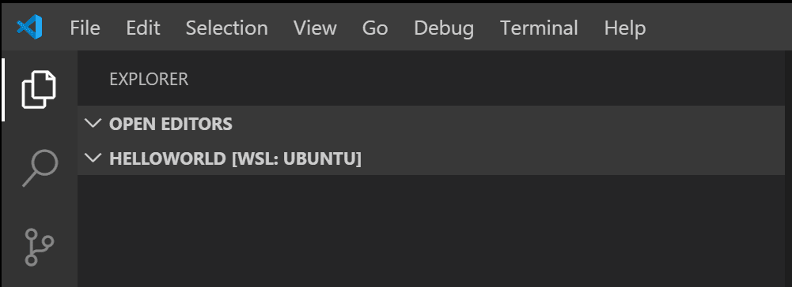

状态栏也会显示远程上下文：


单击状态栏远程项可以查看远程命令。例如选择 **Close Remote Connection** 结束 WSL 会话。再次在 WSL 提示符运行 `code .` 会重新启动。

教程会在 `.vscode` 文件夹创建：

* `c_cpp_properties.json`：编译器路径和 IntelliSense 设置。
* `tasks.json`：构建说明。
* `launch.json`：调试器设置。

## 添加源代码文件 {#add-a-source-code-file}

在文件资源管理器标题栏选择 **新建文件**，命名为 `helloworld.cpp`。

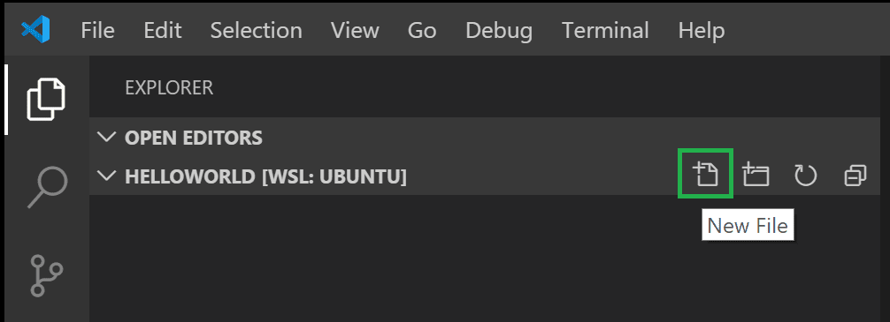

### 安装 C/C++ 扩展 {#install-the-cc-extension}

创建文件并检测到 C++ 语言后，可能提示安装 [Microsoft C/C++ 扩展](https://marketplace.visualstudio.com/items?itemName=ms-vscode.cpptools)：

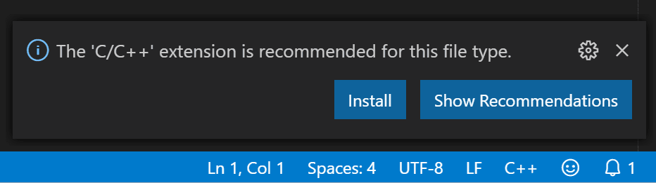

选择 **Install**，扩展视图显示按钮时选择 **Reload Required**。

本地已安装 C/C++ 扩展时，需要在扩展视图（`Ctrl + Shift + X`）中选择 **Install in WSL**，然后 **Reload Required**：

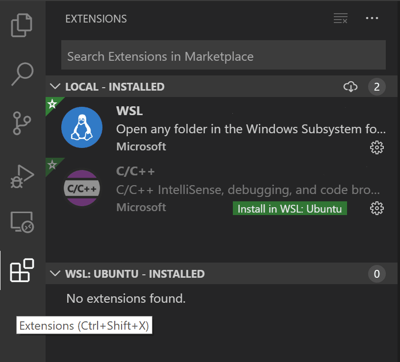

### 添加 Hello World 源代码 {#add-hello-world-source-code}

```cpp
#include <iostream>
#include <vector>
#include <string>

using namespace std;

int main()
{
    vector<string> msg {"Hello", "C++", "World", "from", "VS Code", "and the C++ extension!"};

    for (const string& word : msg)
    {
        cout << word << " ";
    }
    cout << endl;

    return 0;
}
```

按 `Ctrl + S` 保存。

## 探索 IntelliSense {#explore-intellisense}

悬停在 `vector` 或 `string` 上查看类型信息。输入 `msg.` 查看成员函数补全：

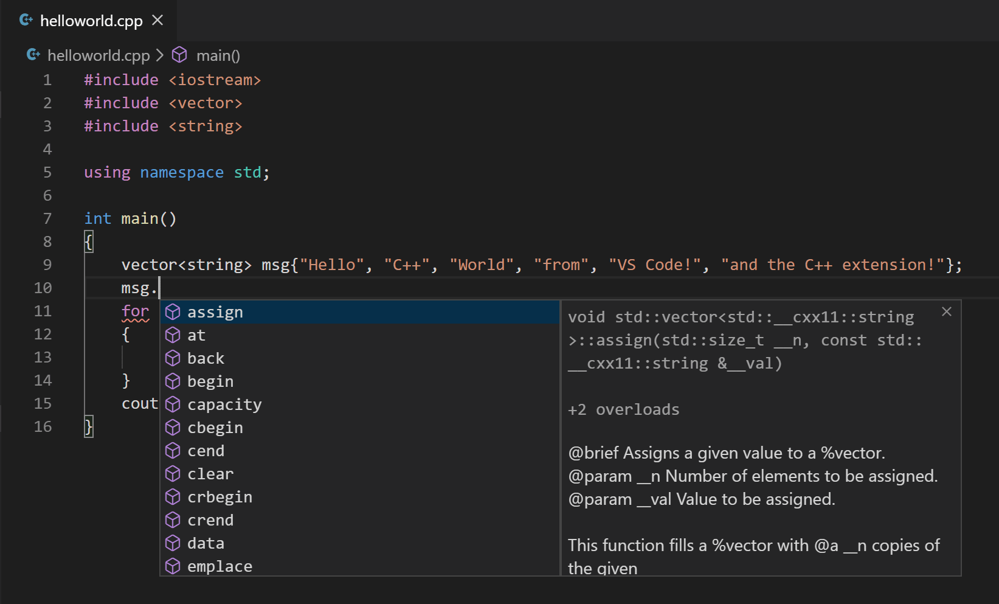

按 `Tab` 插入成员，输入左括号查看参数信息。

## 运行 helloworld.cpp {#run-helloworldcpp}

1. 打开 `helloworld.cpp`。
2. 单击编辑器右上角播放按钮。

   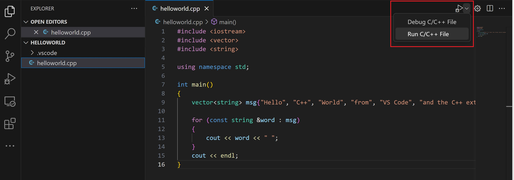

3. 选择 **g++ build and debug active file**。

   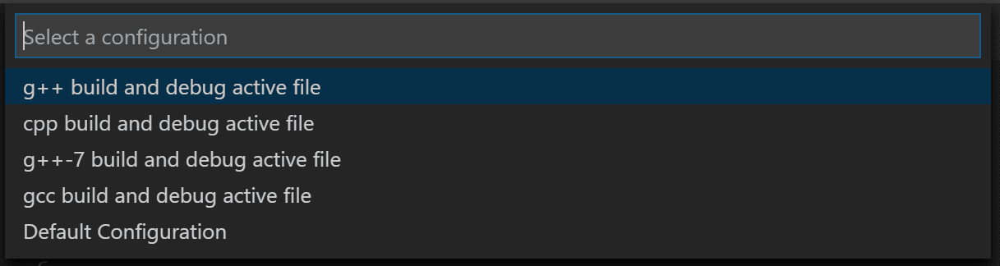

4. 构建成功后输出显示在集成终端：

   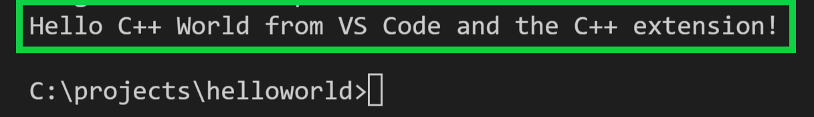

首次运行创建 `.vscode/tasks.json`：

```json
{
"version": "2.0.0",
"tasks": [
    {
        "type": "shell",
        "label": "C/C++: g++ build active file",
        "command": "/usr/bin/g++",
        "args": [
            "-g",
            "${file}",
            "-o",
            "${fileDirname}/${fileBasenameNoExtension}"
        ],
        "options": {
            "cwd": "/usr/bin"
        },
        "problemMatcher": [
            "$gcc"
        ],
        "group": {
            "kind": "build",
            "isDefault": true
        },
        "detail": "Task generated by Debugger."
    }
]
}
```

`command` 是 g++，`args` 编译活动文件并生成可执行文件。`label` 显示在任务列表，`detail` 为描述。

### 修改 tasks.json {#modifying-tasksjson}

使用 `"${workspaceFolder}/*.cpp"` 构建所有 `.cpp` 文件。可以修改输出文件名。

## 调试 helloworld.cpp {#debug-helloworldcpp}

1. 回到 `helloworld.cpp`。
2. 单击边距或按 `F9` 设置断点。

   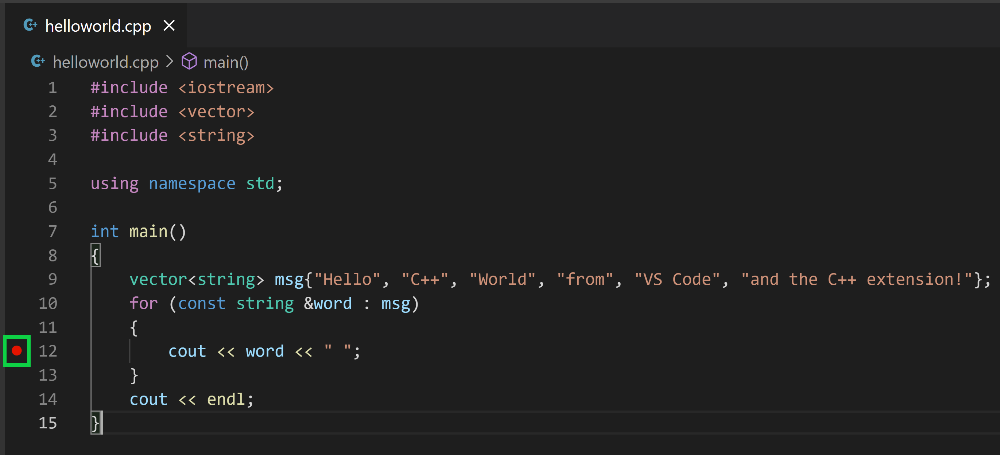

3. 从播放按钮下拉列表选择 **Debug C/C++ File**。

   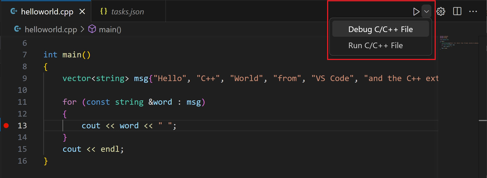

4. 选择 **C/C++: g++ build and debug active file**。

## 探索调试器 {#explore-the-debugger}

* 编辑器高亮断点行：

   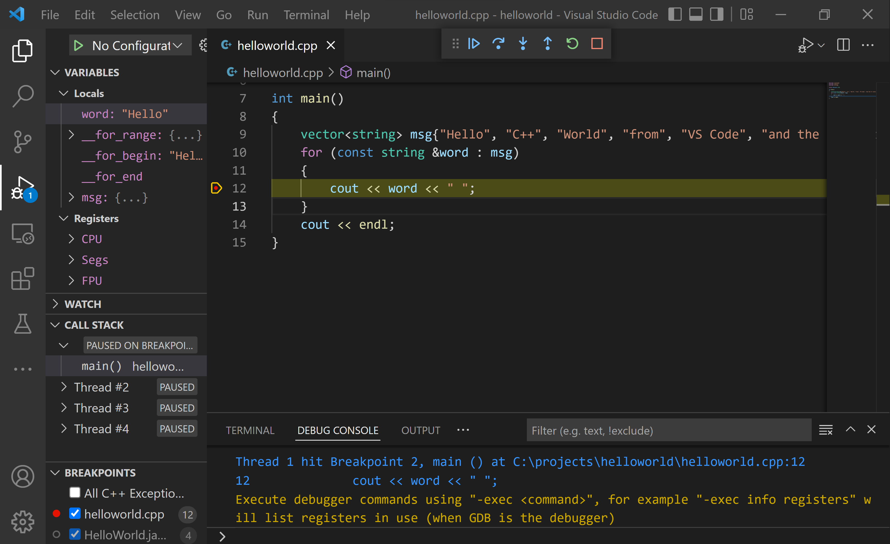

* 左侧 **运行和调试** 视图显示调试信息。
* 编辑器顶部出现调试控制面板：

   

### 单步执行代码 {#step-through-the-code}

1. 单击 **单步跳过**：

   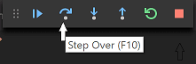

   执行到 for 循环第一行。**变量** 窗口更新：

   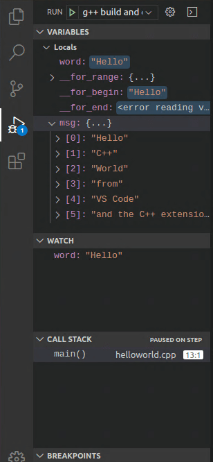

2. 再次单步跳过，显示循环变量。
3. 再次单步跳过执行 `cout`。
4. 可以按 **单步进入** 进入标准库：

   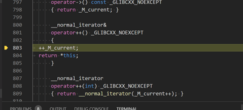

   返回自己的代码可以继续单步，或在 `cout` 行设置断点后按 `F5`：

   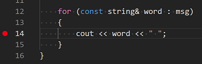

   循环完成后 **调试控制台** 显示输出和 GDB 信息：

   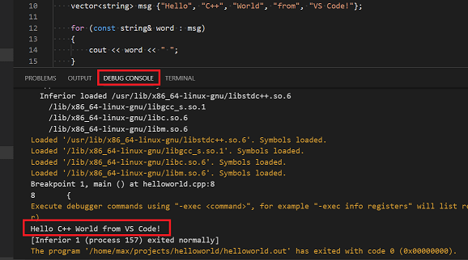

### 设置监视 {#set-a-watch}

在 **监视** 窗口单击加号，输入 `word`：

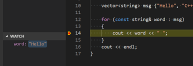

暂停时悬停变量查看值：

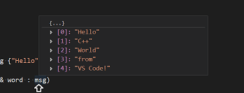

## 使用 launch.json 自定义调试 {#customize-debugging-with-launchjson}

从播放按钮下拉菜单选择 **Add Debug Configuration**：

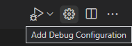

创建：

```json
{
    "version": "0.2.0",
    "configurations": [
        {
            "name": "C/C++: g++ build and debug active file",
            "type": "cppdbg",
            "request": "launch",
            "program": "${fileDirname}/${fileBasenameNoExtension}",
            "args": [],
            "stopAtEntry": false,
            "cwd": "${workspaceFolder}",
            "environment": [],
            "externalConsole": false,
            "MIMode": "gdb",
            "miDebuggerPath": "/usr/bin/gdb",
            "setupCommands": [
                {
                    "description": "Enable pretty-printing for gdb",
                    "text": "-enable-pretty-printing",
                    "ignoreFailures": true
                }
            ],
            "preLaunchTask": "C/C++: g++ build active file"
        }
    ]
}
```

将 `stopAtEntry` 改为 `true` 可在 `main` 停止。

## C/C++ 配置 {#cc-configurations}

运行 **C/C++: Edit Configurations (UI)** 打开配置页面：

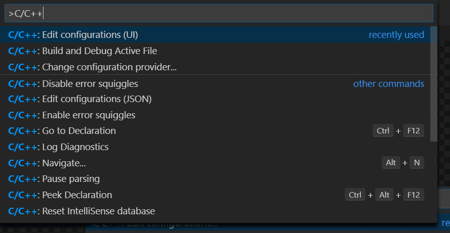

更改写入 `.vscode/c_cpp_properties.json`：

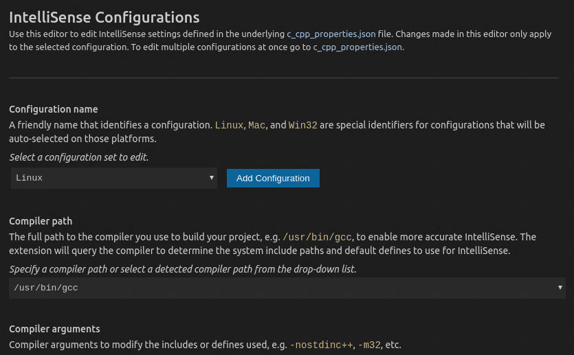

```json
{
    "configurations": [
        {
            "name": "Linux",
            "includePath": [
                "${workspaceFolder}/**"
            ],
            "defines": [],
            "compilerPath": "/usr/bin/gcc",
            "cStandard": "c11",
            "cppStandard": "c++17",
            "intelliSenseMode": "clang-x64"
        }
    ],
    "version": 4
}
```

## 关闭 WSL 会话 {#closing-the-wsl-session}

选择状态栏远程项，运行 **Close Remote Connection**，或关闭 VS Code 窗口。

## 后续步骤 {#next-steps}

* 阅读 [VS Code 用户指南](../../../editor/3.2-WriteCode/3.2.1-BasicEditing/)。
* 查看 [C++ 扩展概述](../../language-support/10.2.9-C++/)。
* 创建新工作区并调整 JSON 配置。
