+++
title = "10.7.5 macOS 上的 Clang"
date = 2026-11-06T07:53:25+08:00
weight = 5
type = "docs"
description = ""
isCJKLanguage = true
draft = false
+++


> 原文链接: [https://code.visualstudio.com/docs/cpp/config-clang-mac](https://code.visualstudio.com/docs/cpp/config-clang-mac)

# 10.7.5 macOS 上的 Clang

　　本教程配置 VS Code 在 macOS 上使用 Clang/LLVM 编译器和 LLDB 调试器编译、运行和调试 C++ 程序。

本教程不教授 Clang、LLDB、macOS 或 C++ 语言本身。

遇到问题可以在 [VS Code 文档仓库](https://github.com/microsoft/vscode-docs/issues)提交议题。

## 前提条件 {#prerequisites}

1. 安装 [VS Code](https://code.visualstudio.com/download)。
2. 安装 [C++ 扩展](https://marketplace.visualstudio.com/items?itemName=ms-vscode.cpptools)。

   

### 确保安装 Clang {#ensure-clang-is-installed}

在 macOS 终端运行：

```bash
clang --version
```

没有安装时，运行：

```bash
xcode-select --install
```

这会安装 Clang 和 macOS SDK。也可以安装完整 Xcode。

## 创建 Hello World 应用 {#create-hello-world-app}

在终端创建项目文件夹：

```bash
mkdir projects
cd projects
mkdir helloworld
cd helloworld
code .
```

`code .` 在当前文件夹打开 VS Code，该文件夹成为工作区。

教程会在 `.vscode` 文件夹创建：

* `tasks.json`：构建说明。
* `launch.json`：调试器设置。
* `c_cpp_properties.json`：编译器路径和 IntelliSense 设置。

### 添加 Hello World 源文件 {#add-a-hello-world-source-code-file}

在文件资源管理器标题栏选择 **新建文件**，命名为 `helloworld.cpp`。

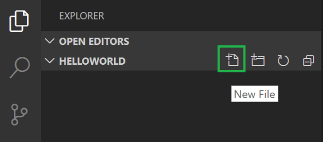

粘贴：

```cpp
#include <iostream>
#include <vector>
#include <string>

using namespace std;

int main()
{
    vector<string> msg {"Hello", "C++", "World", "from", "VS Code", "and the C++ extension!"};

    for (const string& word : msg)
    {
        cout << word << " ";
    }
    cout << endl;

    return 0;
}
```

按 `Ctrl + S`（macOS：`Cmd + S`） 保存。文件会显示在 **文件资源管理器**：

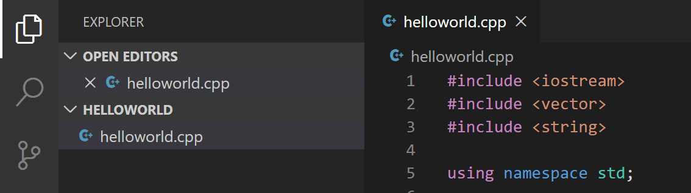

## 探索 IntelliSense {#explore-intellisense}

悬停在 `vector` 或 `string` 上查看类型信息。输入 `msg.` 查看成员函数补全：

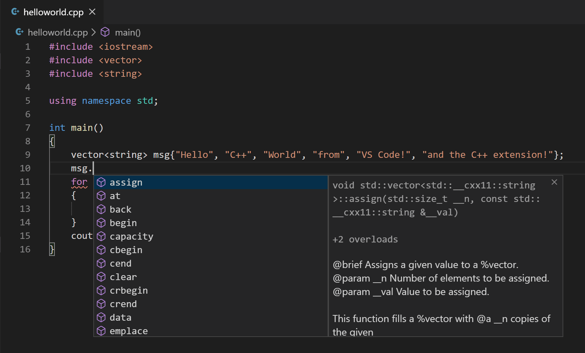

按 `Tab` 插入成员，输入左括号查看参数信息。

## 运行 helloworld.cpp {#run-helloworldcpp}

1. 打开 `helloworld.cpp`。
2. 单击编辑器右上角播放按钮。

   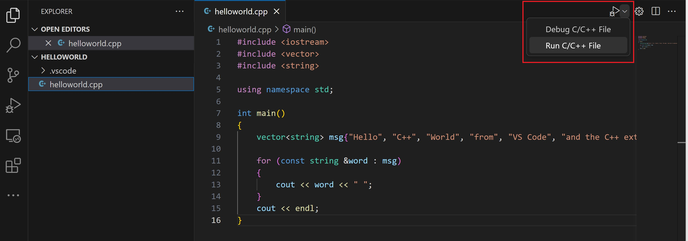

3. 从检测到的编译器列表选择 **clang++ build and debug active file**。

   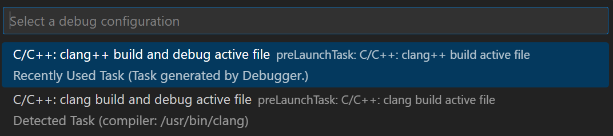

4. 构建成功后输出显示在集成终端：

   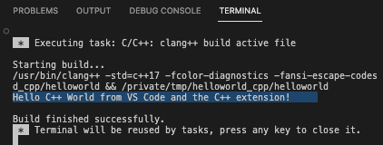

首次运行会创建 `.vscode/tasks.json`：

```json
{
"version": "2.0.0",
"tasks": [
    {
        "type": "shell",
        "label": "C/C++: clang++ build active file",
        "command": "/usr/bin/clang++",
        "args": [
            "-std=c++17",
            "-g",
            "${file}",
            "-o",
            "${fileDirname}/${fileBasenameNoExtension}"
        ],
        "options": {
            "cwd": "${workspaceFolder}"
        },
        "problemMatcher": [
            "$gcc"
        ],
        "group": {
            "kind": "build",
            "isDefault": true
        },
        "detail": "Task generated by Debugger."
    }
]
}
```

`command` 是 clang++，`args` 使用 C++17 编译活动文件并生成可执行文件。`label` 显示在任务列表，`detail` 为描述。

### 理解 tasks.json {#understanding-tasksjson}

* `command`：要运行的程序。
* `args`：按编译器顺序传递的参数。
* `group`：`build` 表示生成任务，`isDefault` 表示默认任务。
* `problemMatcher`：`$gcc` 解析编译器错误。

### 修改 tasks.json {#modifying-tasksjson}

使用 `"${workspaceFolder}/*.cpp"` 构建所有 `.cpp` 文件，或修改输出文件名。

## 调试 helloworld.cpp {#debug-helloworldcpp}

1. 回到 `helloworld.cpp`。
2. 单击边距或按 `F9` 设置断点。

   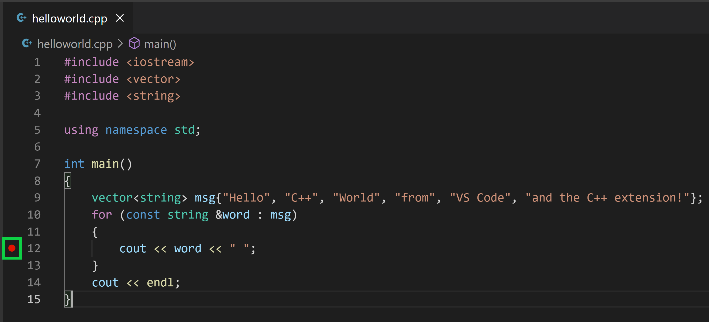

3. 从播放按钮下拉列表选择 **Debug C/C++ File**。

   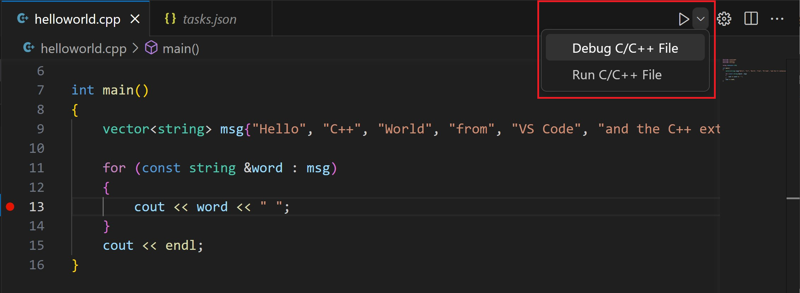

4. 选择 **C/C++: clang++ build and debug active file**。

## 探索调试器 {#explore-the-debugger}

* 编辑器高亮断点行：

   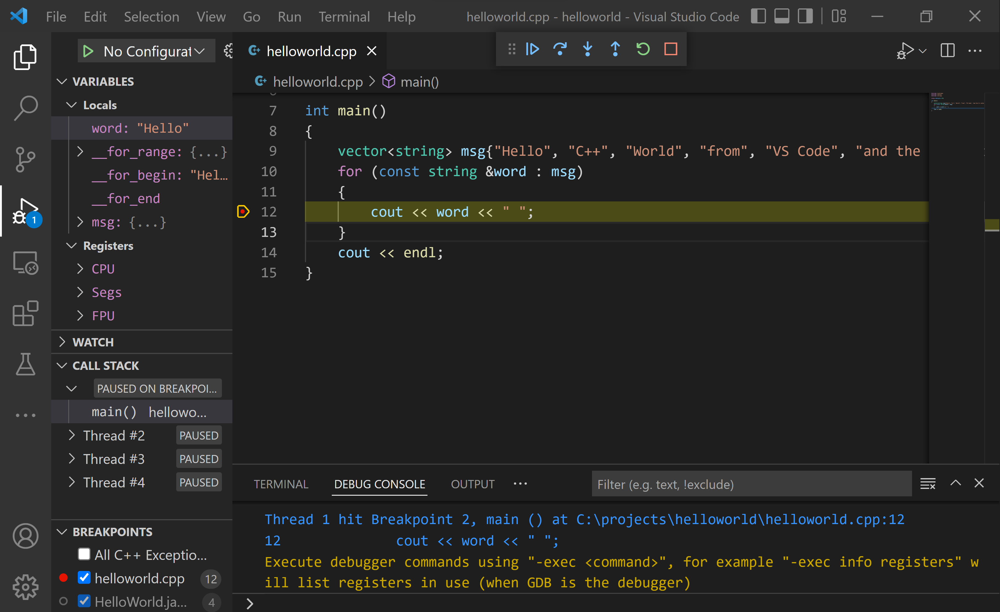

* 左侧 **运行和调试** 视图显示调试信息。
* 编辑器顶部出现调试控制面板：

   

### 单步执行代码 {#step-through-the-code}

1. 单击 **单步跳过**：

   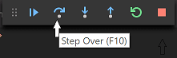

   执行到 for 循环第一行。**变量** 窗口更新：

   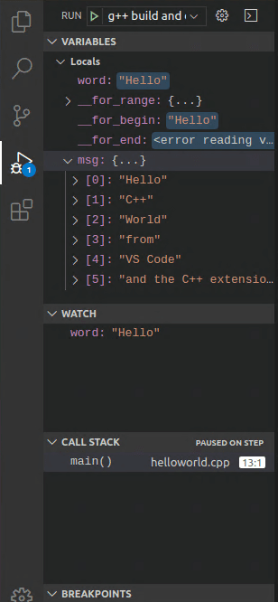

2. 再次单步跳过，显示循环变量。
3. 再次单步跳过执行 `cout`。
4. 可以按 **单步进入** 进入标准库：

   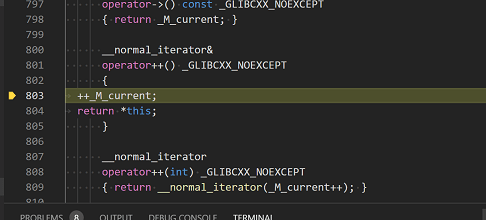

   返回自己的代码可以继续单步，或在 `cout` 行设置断点后按 `F5`：

   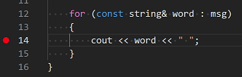

   循环完成后 **调试控制台** 显示输出：

   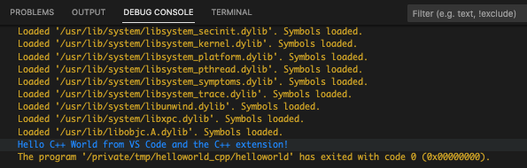

### 设置监视 {#set-a-watch}

在 **监视** 窗口单击加号，输入 `word`：

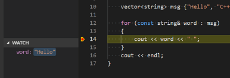

暂停时悬停变量查看值：

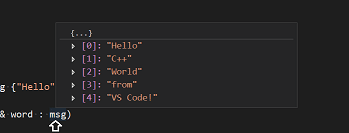

## 使用 launch.json 自定义调试 {#customize-debugging-with-launchjson}

从播放按钮下拉菜单选择 **Add Debug Configuration**：

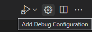

创建：

```json
{
    "version": "0.2.0",
    "configurations": [
        {
            "name": "C/C++: clang++ build and debug active file",
            "type": "cppdbg",
            "request": "launch",
            "program": "${fileDirname}/${fileBasenameNoExtension}",
            "args": [],
            "stopAtEntry": false,
            "cwd": "${workspaceFolder}",
            "environment": [],
            "externalConsole": false,
            "MIMode": "lldb",
            "preLaunchTask": "C/C++: clang++ build active file"
        }
    ]
}
```

`MIMode` 使用 `lldb`。`program` 指定调试程序，`args` 是运行时参数。将 `stopAtEntry` 改为 `true` 可在 `main` 停止。

## 添加其他 C/C++ 设置 {#adding-additional-cc-settings}

运行 **C/C++: Edit Configurations (UI)** 打开配置页面：

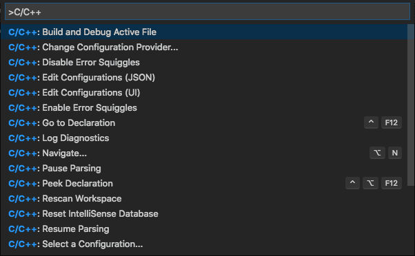

更改写入 `.vscode/c_cpp_properties.json`：

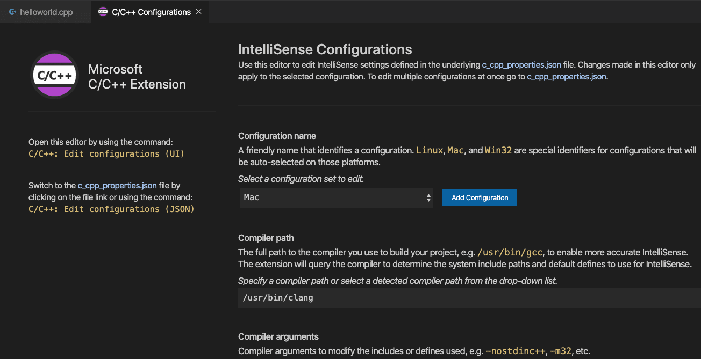

### 编译器路径 {#compiler-path}

确认 `compilerPath` 指向 Clang：

```json
{
    "configurations": [
        {
            "name": "Mac",
            "includePath": [
                "${workspaceFolder}/**"
            ],
            "defines": [],
            "compilerPath": "/usr/bin/clang++",
            "cStandard": "c17",
            "cppStandard": "c++17",
            "intelliSenseMode": "macos-clang-x64"
        }
    ],
    "version": 4
}
```

### Mac 框架路径 {#mac-framework-path}

使用 macOS 框架时，可以在 `includePath` 或 `frameworks` 中配置。C++ 扩展会自动检测 SDK 路径。

## 故障排除 {#troubleshooting}

### 编译和链接错误 {#compiler-and-linking-errors}

常见错误通常是因为启动构建时 `helloworld.cpp` 不是活动文件。编译器可能尝试编译 `.json` 文件。

### 终端无法启动输入 {#terminal-wont-launch-for-input}

程序需要标准输入时，将 `launch.json` 的 `console` 设置为 `integratedTerminal` 或 `externalTerminal`。

## 后续步骤 {#next-steps}

* 阅读 [VS Code 用户指南](../../../editor/3.2-WriteCode/3.2.1-BasicEditing/)。
* 查看 [C++ 扩展概述](../../language-support/10.2.9-C++/)。
* 创建新工作区并调整 JSON 配置。
