+++
title = "10.7.6 Windows 上的 MSVC"
date = 2026-11-06T07:53:25+08:00
weight = 6
type = "docs"
description = ""
isCJKLanguage = true
draft = false
+++


> 原文链接: [https://code.visualstudio.com/docs/cpp/config-msvc](https://code.visualstudio.com/docs/cpp/config-msvc)

# 10.7.6 Windows 上的 MSVC

　　本教程配置 VS Code 使用 Microsoft Visual C++ 编译器（MSVC）`cl.exe` 和调试器编译、运行和调试 C++ 程序。

本教程不教授 MSVC、Windows 或 C++ 语言本身。

遇到问题可以在 [VS Code 文档仓库](https://github.com/microsoft/vscode-docs/issues)提交议题。

## 前提条件 {#prerequisites}

1. 安装 [VS Code](https://code.visualstudio.com/download)。
2. 安装 [C++ 扩展](https://marketplace.visualstudio.com/items?itemName=ms-vscode.cpptools)。

   

3. 安装 Visual Studio Build Tools（或 Visual Studio），并选择 **使用 C++ 的桌面开发** 工作负载：

   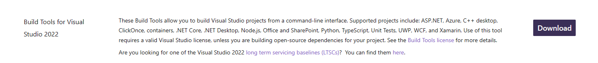

   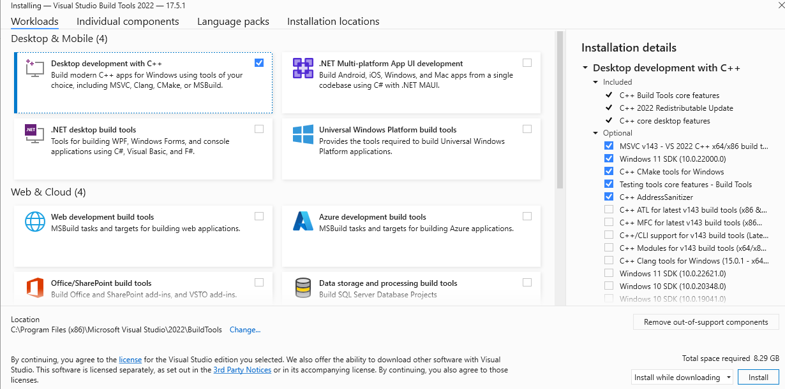

### 检查 Microsoft Visual C++ 安装 {#check-your-microsoft-visual-c-installation}

打开 **Developer Command Prompt for Visual Studio**（开始菜单搜索）：

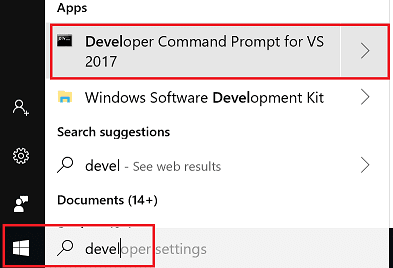

在命令提示符运行：

```bat
cl
```

应看到 Microsoft C/C++ 编译器版本信息：

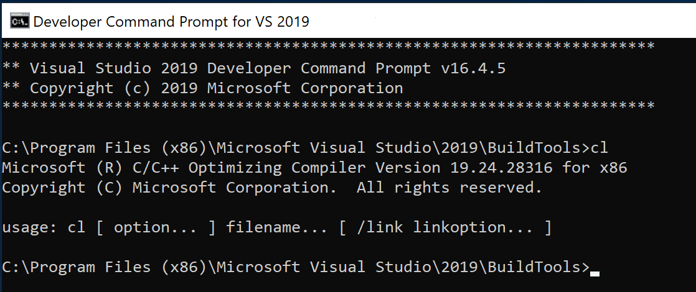

没有找到 `cl.exe` 时，请确认安装了 C++ 工作负载，并使用 Developer Command Prompt。

## 创建 Hello World {#create-hello-world}

在 **Developer Command Prompt** 中运行：

```bat
mkdir projects
cd projects
mkdir helloworld
cd helloworld
code .
```

`code .` 在当前文件夹打开 VS Code。必须从 Developer Command Prompt 启动，VS Code 才能继承 `cl.exe` 所需环境变量。

教程会在 `.vscode` 文件夹创建：

* `tasks.json`：构建说明。
* `launch.json`：调试器设置。
* `c_cpp_properties.json`：编译器路径和 IntelliSense 设置。

### 添加源代码文件 {#add-a-source-code-file}

在文件资源管理器标题栏选择 **新建文件**，命名为 `helloworld.cpp`。

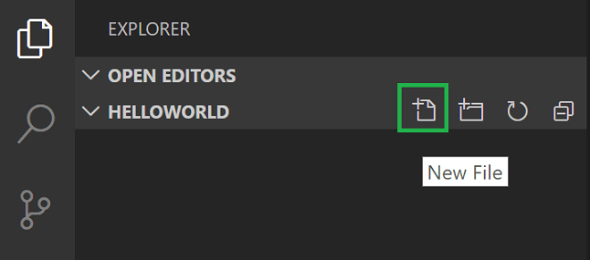

### 添加 Hello World 源代码 {#add-hello-world-source-code}

```cpp
#include <iostream>
#include <vector>
#include <string>

using namespace std;

int main()
{
    vector<string> msg {"Hello", "C++", "World", "from", "VS Code", "and the C++ extension!"};

    for (const string& word : msg)
    {
        cout << word << " ";
    }
    cout << endl;
}
```

按 `Ctrl + S`（macOS：`Cmd + S`） 保存。文件显示在 **文件资源管理器**：

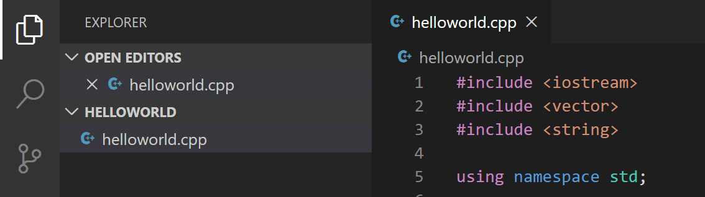

## 探索 IntelliSense {#explore-intellisense}

悬停在 `vector` 或 `string` 上查看类型信息。输入 `msg.` 查看成员函数补全：

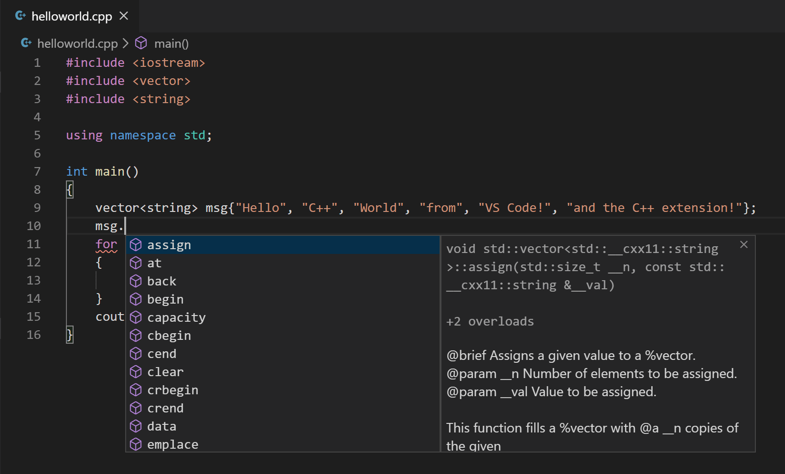

按 `Tab` 插入成员，输入左括号查看参数信息。

## 运行 helloworld.cpp {#run-helloworldcpp}

1. 打开 `helloworld.cpp`。
2. 单击编辑器右上角播放按钮。

   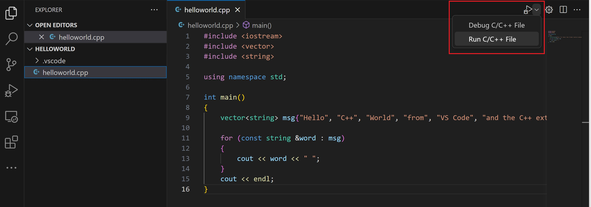

3. 选择 **C/C++: cl.exe build and debug active file**。

   

   第一次运行时会询问编译器，之后设为 `tasks.json` 中的默认编译器。

4. 构建成功后输出显示在集成终端：

   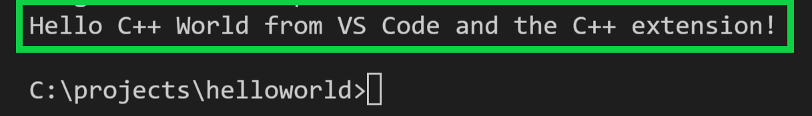

如果使用 cl.exe 构建调试报错，请确认已从 Developer Command Prompt 使用 `code .` 启动 VS Code：

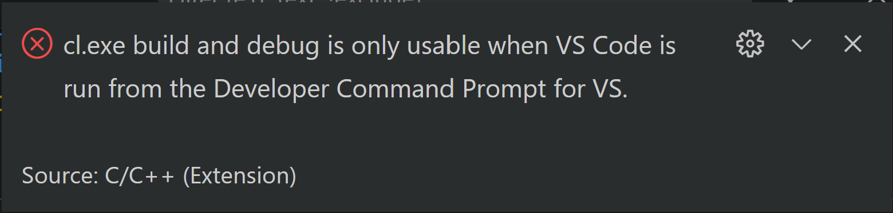

首次运行创建 `.vscode/tasks.json`：

```json
{
"version": "2.0.0",
"tasks": [
    {
        "type": "shell",
        "label": "C/C++: cl.exe build active file",
        "command": "cl.exe",
        "args": [
            "/Zi",
            "/EHsc",
            "/Fe:",
            "${fileDirname}\\${fileBasenameNoExtension}.exe",
            "${file}"
        ],
        "problemMatcher": [
            "$msCompile"
        ],
        "group": {
            "kind": "build",
            "isDefault": true
        },
        "detail": "Task generated by Debugger."
    }
]
}
```

`command` 是 `cl.exe`，`args` 使用 `/Zi` 生成调试信息、`/EHsc` 启用异常处理，`/Fe:` 指定输出 `.exe`。`$msCompile` 解析 MSVC 输出。

### 修改 tasks.json {#modifying-tasksjson}

使用 `"${workspaceFolder}\\*.cpp"` 构建所有 `.cpp` 文件，或修改输出文件名。

## 调试 helloworld.cpp {#debug-helloworldcpp}

1. 回到 `helloworld.cpp`。
2. 单击边距或按 `F9` 设置断点。

   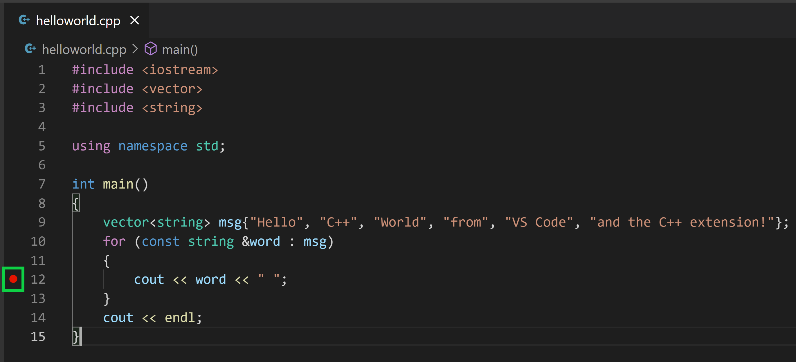

3. 从播放按钮下拉列表选择 **Debug C/C++ File**。

   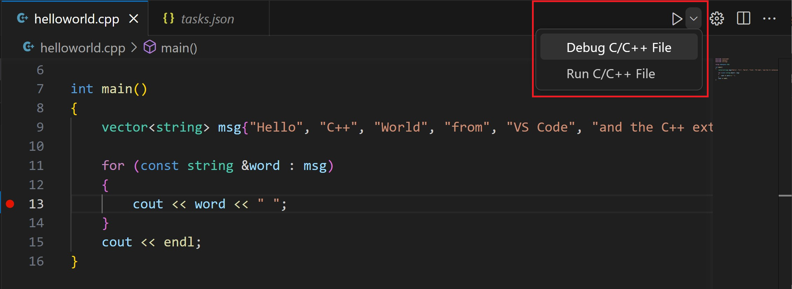

4. 选择 **C/C++: cl.exe build and debug active file**。

## 探索调试器 {#explore-the-debugger}

* 编辑器高亮断点行：

   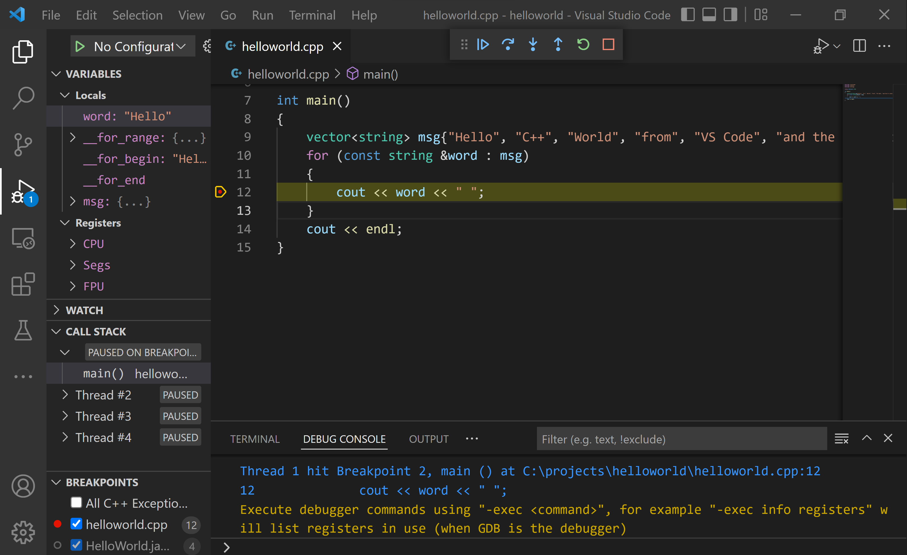

* 左侧 **运行和调试** 视图显示调试信息。
* 编辑器顶部出现调试控制面板：

   

### 单步执行代码 {#step-through-the-code}

1. 单击 **单步跳过**：

   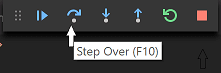

   执行到 for 循环第一行。**变量** 窗口更新：

   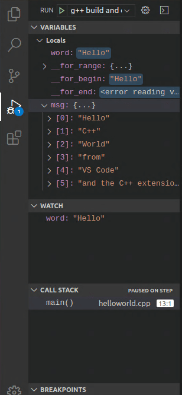

2. 再次单步跳过，显示循环变量。
3. 再次单步跳过执行 `cout`。
4. 可以按 **单步进入** 进入标准库头文件：

   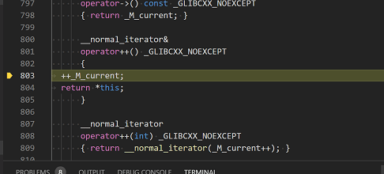

   返回自己的代码可以继续单步，或在 `cout` 行设置断点后按 `F5`：

   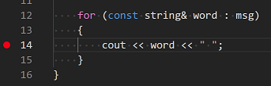

   循环完成后 **调试控制台** 显示输出。

### 设置监视 {#set-a-watch}

在 **监视** 窗口单击加号，输入 `word`：

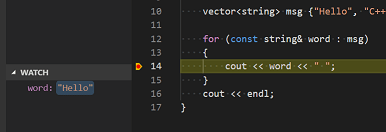

暂停时悬停变量查看值：

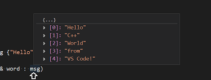

## 使用 launch.json 自定义调试 {#customize-debugging-with-launchjson}

从播放按钮下拉菜单选择 **Add Debug Configuration**：

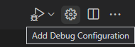

选择 **C/C++: cl.exe build and debug active file**，创建：

```json
{
"version": "0.2.0",
"configurations": [
    {
        "name": "C/C++: cl.exe build and debug active file",
        "type": "cppvsdbg",
        "request": "launch",
        "program": "${fileDirname}\\${fileBasenameNoExtension}.exe",
        "args": [],
        "stopAtEntry": false,
        "cwd": "${workspaceFolder}",
        "environment": [],
        "externalConsole": false,
        "preLaunchTask": "C/C++: cl.exe build active file"
    }
]
}
```

`type` 为 `cppvsdbg`，`program` 指定 `.exe`，`args` 是运行时参数。将 `stopAtEntry` 改为 `true` 可在 `main` 停止。

## C/C++ 配置 {#cc-configurations}

运行 **C/C++: Edit Configurations (UI)** 打开配置页面：

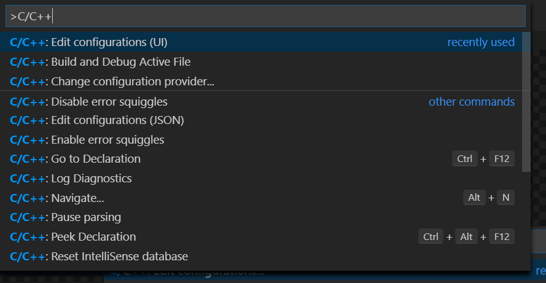

更改写入 `.vscode/c_cpp_properties.json`：

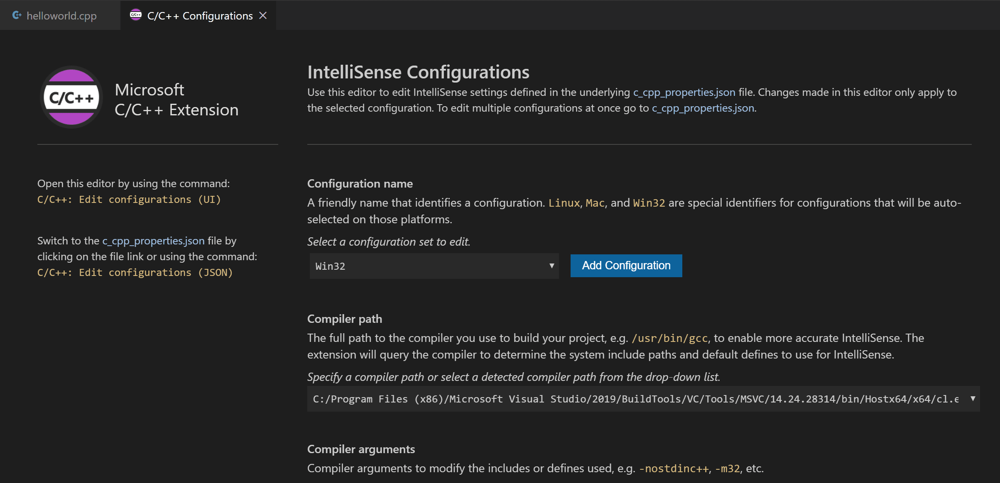

```json
{
"configurations": [
    {
        "name": "Win32",
        "includePath": [
            "${workspaceFolder}/**"
        ],
        "defines": [
            "_DEBUG",
            "UNICODE",
            "_UNICODE"
        ],
        "windowsSdkVersion": "10.0.18362.0",
        "compilerPath": "C:/Program Files/Microsoft Visual Studio/2022/BuildTools/VC/Tools/MSVC/14.51/bin/Hostx64/x64/cl.exe",
        "cStandard": "c11",
        "cppStandard": "c++17",
        "intelliSenseMode": "msvc-x64"
    }
],
"version": 4
}
```

### 编译器路径 {#compiler-path}

确认 `compilerPath` 指向实际的 `cl.exe`，`intelliSenseMode` 为 `msvc-x64` 或 `msvc-x86`。

## 复用 C++ 配置 {#reusing-your-cc-configuration}

将 `.vscode` 中的 JSON 文件复制到新项目文件夹，按需修改源文件名和可执行文件名。

## 在 Developer Command Prompt 外运行 VS Code {#run-vs-code-outside-the-developer-command-prompt}

可以从普通 Windows 终端启动 VS Code，但必须确保 `cl.exe` 和 Windows SDK 环境变量可用。可以在 `tasks.json` 中使用 `VsDevCmd.bat` 初始化环境，或从 Developer Command Prompt 启动。

## 故障排除 {#troubleshooting}

### 无法识别 cl.exe {#the-term-cl-exe-is-not-recognized}

请从 **Developer Command Prompt for Visual Studio** 启动 VS Code，或运行 `VsDevCmd.bat` 设置环境。

### fatal error C1034: assert.h: no include path set {#fatal-error-c1034-asserth-no-include-path-set}

Windows SDK 包含路径未设置，请从 Developer Command Prompt 启动，或在 `c_cpp_properties.json` 中配置 SDK 路径。

## 后续步骤 {#next-steps}

* 阅读 [VS Code 用户指南](../../../editor/3.2-WriteCode/3.2.1-BasicEditing/)。
* 查看 [C++ 扩展概述](../../language-support/10.2.9-C++/)。
* 创建新工作区并调整 JSON 配置。
