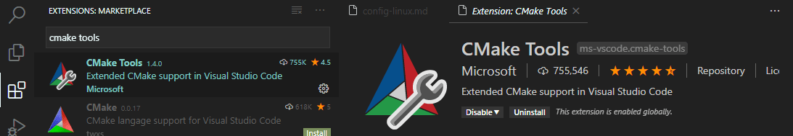
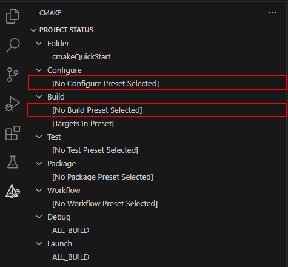
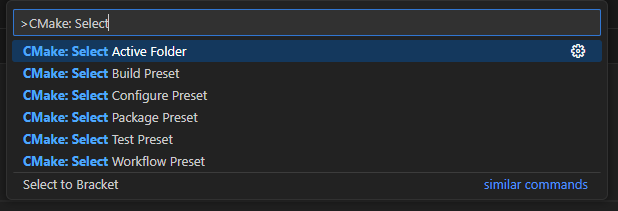
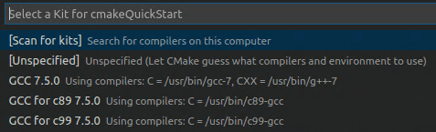
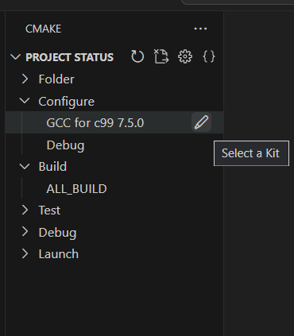
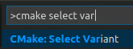
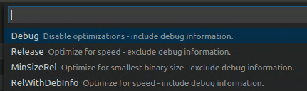
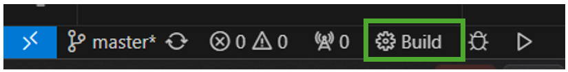
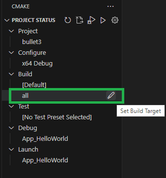
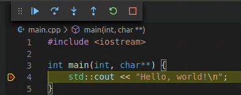

+++
title = "10.7.8 Linux 上的 CMake"
date = 2026-11-06T07:53:25+08:00
weight = 8
type = "docs"
description = ""
isCJKLanguage = true
draft = false
+++


> 原文链接: [https://code.visualstudio.com/docs/cpp/cmake-linux](https://code.visualstudio.com/docs/cpp/cmake-linux)

# 10.7.8 Linux 上的 CMake

　　CMake 是开源跨平台工具，使用与编译器和平台无关的配置文件生成特定于编译器和平台的本机构建文件。

　　CMake Tools 扩展集成 VS Code 和 CMake，便于配置、构建和调试 C++ 项目。本教程在 Linux 上配置、构建和调试简单 C++ CMake 项目。除安装 CMake、编译器、调试器和构建工具外，步骤也适用于 Windows 等其他平台。

遇到问题可以在 [VS Code 文档仓库](https://github.com/microsoft/vscode-docs/issues)提交议题。CMake Tools 详情请参阅[文档](https://github.com/microsoft/vscode-cmake-tools/blob/main/docs/README.md)。

## 前提条件 {#prerequisites}

在 Ubuntu 上安装：

1. [VS Code](https://code.visualstudio.com/download)。
2. [C++ 扩展](https://marketplace.visualstudio.com/items?itemName=ms-vscode.cpptools)，在扩展视图搜索 `c++`。

   

3. [CMake Tools 扩展](https://marketplace.visualstudio.com/items?itemName=ms-vscode.cmake-tools)，在扩展视图搜索 `CMake tools`。

   

4. 安装 CMake、编译器、调试器和构建工具。

### 视频：什么是构建系统？如何添加 CMake？ {#video-what-is-a-build-system-how-do-you-add-cmake-to-your-project}

[](https://www.youtube.com/watch?v=_BWU5mWqVA4)

### 确保安装 CMake {#ensure-that-cmake-is-installed}

CMake Tools 使用系统安装的 CMake。建议 CMake 3.27 或更高版本。

检查：

```bash
cmake --version
```

安装或升级请参阅 [Kitware APT 仓库](https://apt.kitware.com/)。

### 确保安装开发工具 {#ensure-that-development-tools-are-installed}

教程使用 GCC、GDB 和 `make`。Ubuntu 默认未安装：

```bash
gcc -v
```

未安装时更新包列表：

```bash
sudo apt-get update
```

安装：

```bash
sudo apt-get install build-essential gdb
```

## 创建 CMake 项目 {#create-a-cmake-project}

没有现有项目时，请按照[创建 CMake 项目](10.7.9-CMakeQuickstart/)步骤。已有根目录 `CMakeLists.txt` 时直接跳到[配置 Hello World](#configure-hello-world)。

### 配置 Hello World {#configure-hello-world}

使用 CMake Tools 构建前需要配置编译器。有两种方式：

* 使用 CMake Presets（推荐）。
* 使用 CMake Kits/Variants。

#### 使用 CMake Presets 配置 {#configure-using-cmake-presets}

推荐使用 CMake Presets 管理配置。Presets 将项目所有配置存储在共享 JSON 文件中，可跨 IDE 和操作系统共享。

按照[创建 CMake 项目](10.7.9-CMakeQuickstart/)创建的项已配置 Presets。项目有 `CMakePresets.json` 时，可以使用 Configure 和 Build presets。

在 CMake Tools 视图的 **Project Status** 中，**Configure** 和 **Build** 节点显示活动配置，选择节点可以设置或更改 presets。



也可以运行 **CMake: Select Configure Preset** 或 **CMake: Select Build Preset** 命令。



#### 使用 CMake Kits 配置 {#configure-using-cmake-kits}

项目没有 `CMakePresets.json` 时使用 kits。Kit 表示工具链（编译器、链接器等）。

扫描 kits：

1. 打开命令面板运行 **CMake: Select a Kit**，扩展会扫描系统编译器。
2. 选择编译器：

   

   选中的 kit 显示在 **Project Status**：

   

更改 kit 可以在 **Project Status** 中选择，或再次运行 **CMake: Select a Kit**。找不到编译器时可以运行 **CMake: Edit User-Local CMake Kits** 编辑 `cmake-tools-kits.json`。

然后选择 variant（构建类型）：

* `Debug`：禁用优化，包含调试信息。
* `Release`：包含优化，无调试信息。
* `MinRelSize`：优化大小，无调试信息。
* `RelWithDebInfo`：优化速度，包含调试信息。

运行 **CMake: Select Variant**：



选择 **Debug**：



选中的 variant 显示在状态栏活动 kit 旁。

### CMake: Configure {#cmake-configure}

运行 **CMake: Configure** 命令，使用所选配置在项目 build 文件夹生成构建文件。

## 构建 hello world {#build-hello-world}

运行 **CMake: Build** 命令，或选择状态栏 **Build** 按钮：



可以通过 **CMake: Set Build Target** 选择目标。默认构建所有目标，选中目标显示在 **Project Status** 的 **Build** 节点下：



## 调试 hello world {#debug-hello-world}

打开 `main.cpp`，在 `std::cout` 行设置断点。运行 **CMake: Debug** 命令，调试器会停在 `std::cout`：



按 `F5` 继续。

现在已使用 CMake Tools 在 Ubuntu 上构建和调试 C++ 应用。其他平台步骤相同，区别是 CMake 和编译器/调试器安装方式：

* [Windows 上的 Microsoft C++](10.7.6-ConfigMSVC/)
* [macOS 上的 Clang](10.7.5-ConfigClangMac/)
* [WSL 上的 GCC](10.7.4-ConfigWSL/)

## 后续步骤 {#next-steps}

* [CMake Tools 文档](https://aka.ms/cmaketoolsdocumentation)
* [C++ 扩展概述](../../language-support/10.2.9-C++/)
