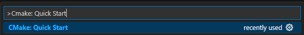
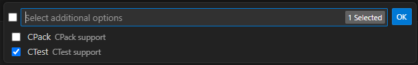
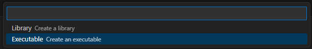
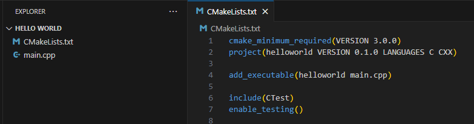
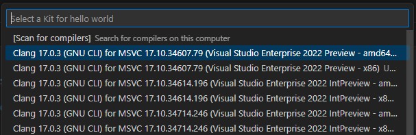
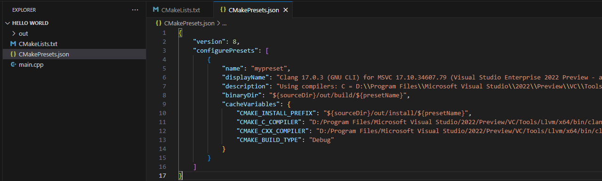

+++
title = "10.7.9 CMake 快速开始"
date = 2026-11-06T07:53:25+08:00
weight = 9
type = "docs"
description = ""
isCJKLanguage = true
draft = false
+++


> 原文链接: [https://code.visualstudio.com/docs/cpp/cmake-quickstart](https://code.visualstudio.com/docs/cpp/cmake-quickstart)

# 10.7.9 CMake 快速开始

　　本文使用 CMake Tools 扩展从零创建 CMake Hello World 项目。

已有根目录 `CMakeLists.txt` 但没有 CMake presets 的项目，可以跳到[创建 CMakePresets.json](#create-a-cmakepresetsjson-file)。

否则创建新项目文件夹：

```bash
mkdir helloworld
cd helloworld
code .
```

`code .` 在当前文件夹打开 VS Code，该文件夹成为工作区。

## 创建 CMakeLists.txt 文件 {#create-a-cmakeliststxt-file}

CMake Tools 可以创建基本 CMake 项目文件。

1. 打开命令面板（`Ctrl + Shift + P`，macOS：`Cmd + Shift + P`），运行 **CMake: Quick Start**：

   

2. 输入项目名称，选择 **C++** 作为项目语言。信息会写入 `CMakeLists.txt` 和初始源文件。

   > **注意**：文件夹中已有其他源文件并想添加为目标时会显示选项；本教程只保留 Hello World 文件。

3. 选择 **CTest** 添加测试支持，也可以选择 **CPack**。

   

4. 选择 **Executable** 创建包含 `main()` 的 `main.cpp`：

   

   > **注意**：需要源文件和头文件时选择 **Library**。提示配置 IntelliSense 时选择 **Allow**。

这会创建 `CMakeLists.txt`，告诉 CMake Tools 如何构建项目：



## 创建 CMakePresets.json 文件 {#create-a-cmakepresetsjson-file}

继续快速开始创建 `CMakePresets.json`：

1. 选择 **Add a New Preset** 和 **Create from Compilers**。
2. 扩展扫描系统编译器，选择要使用的编译器：

   

3. 输入新 preset 名称，写入 `CMakePresets.json`。

完成后项目包含 `main.cpp`、`CMakeLists.txt` 和 `CMakePresets.json`：



后续配置、构建和调试请参阅 [Linux 上的 CMake](10.7.8-CMakeLinux/)。
