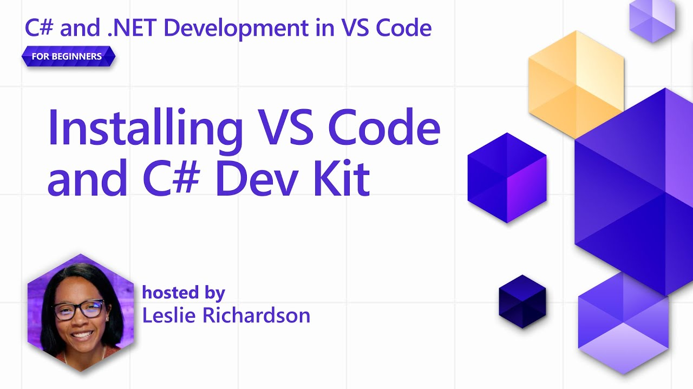
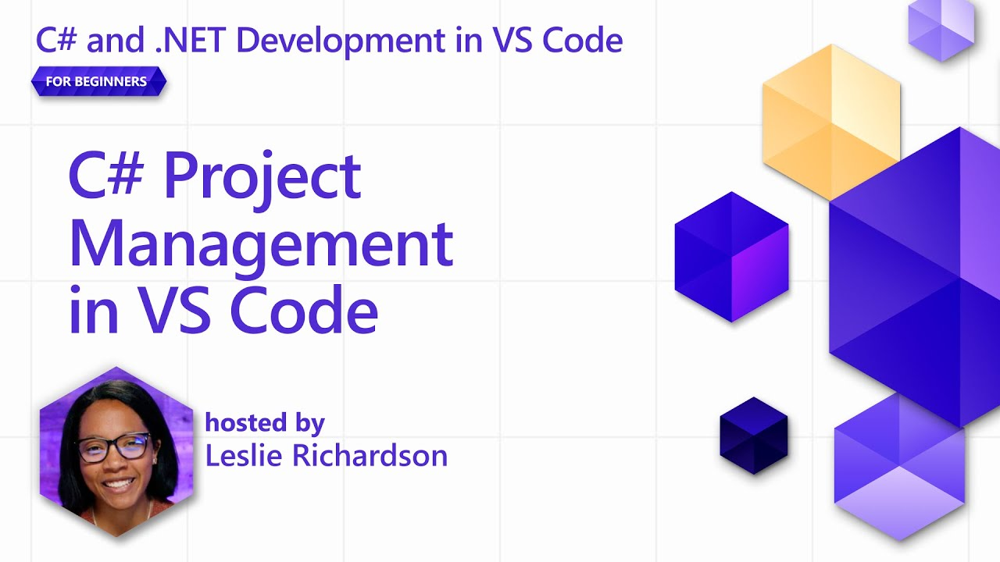
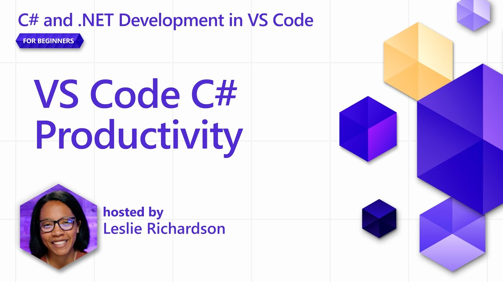
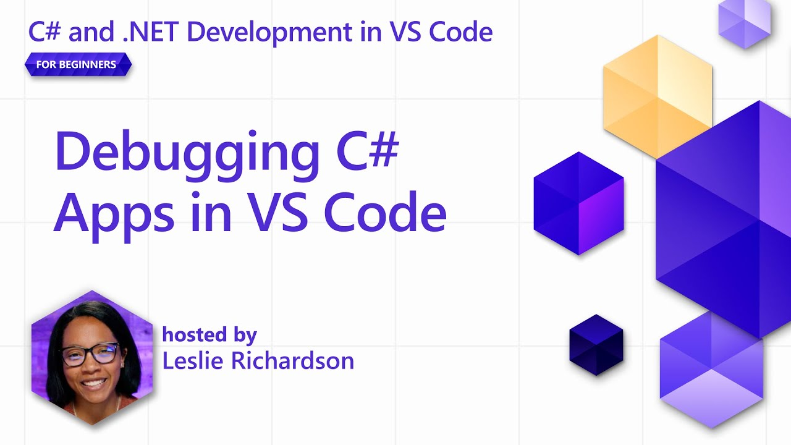
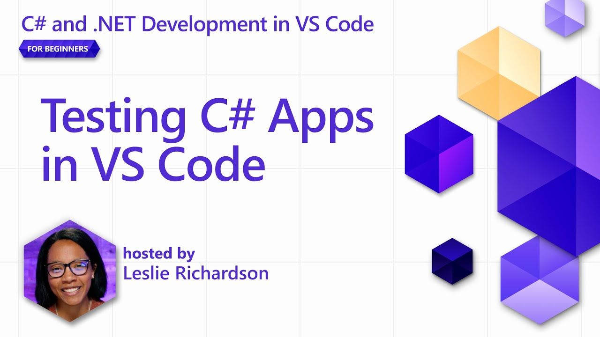

+++
title = "10.8.1 C# 入门视频"
date = "2026-11-06T07:53:25+08:00"
weight = 1
type = "docs"
description = ""
isCJKLanguage = true
draft = false
+++

> 原文链接: [https://code.visualstudio.com/docs/csharp/introvideos-csharp](https://code.visualstudio.com/docs/csharp/introvideos-csharp)

# 10.8.1 C# 入门视频

　　观看这些入门视频开始使用 VS Code 中的 C#。视频帮助设置 [C# Dev Kit](https://marketplace.visualstudio.com/items?itemName=ms-dotnettools.csdevkit)，并在 VS Code 中构建和调试 C# 项目。

## 什么是 C# Dev Kit？ {#what-is-c-dev-kit}

视频解释 VS Code 与 C# Dev Kit 扩展如何提供高效强大的 C# 开发环境。

## 安装 C# Dev Kit {#installing-c-dev-kit}

学习安装 VS Code 和 C# Dev Kit，并创建第一个 C# 项目。

## C# 项目管理 {#c-project-management}

视频演示如何使用 C# Dev Kit 的解决方案资源管理器浏览 C# 项目。

## VS Code C# 生产力 {#vs-code-c-productivity}

视频演示如何在 VS Code 中编写 C# 代码并发现生产力工具。

## 调试 C# 应用 {#debugging-c-apps}

视频演示如何使用 C# Dev Kit 调试器工具调试 C# 应用。

## 测试 C# 应用 {#testing-c-apps}

视频演示如何使用 C# Dev Kit 测试 C# 应用。

## 如何为 VS Code 中的 C# 做贡献 {#how-to-contribute-to-c-in-vs-code}

视频介绍如何为更好的 VS Code C# 体验做贡献。

## 后续步骤 {#next-steps}

* 了解 [C# 编辑体验](../../language-support/10.2.19-CSharp/)。
* [C# 入门](10.8.2-GetStarted/)。
