+++
title = "10.8.10 调试 C#"
date = "2026-11-06T07:53:25+08:00"
weight = 10
type = "docs"
description = ""
isCJKLanguage = true
draft = false
+++

> 原文链接: [https://code.visualstudio.com/docs/csharp/debugging](https://code.visualstudio.com/docs/csharp/debugging)

# 10.8.10 调试 C#

　　C# Dev Kit 提供多种启动调试的方式，并支持断点、异常设置、表达式求值和 Hot Reload。

## 运行和调试 {#run-and-debug}

### 使用 F5 调试 {#debug-with-f5}

打开 C# 文件，按 `F5` 或选择 **运行 > 启动调试**。首次调试时可以选择调试配置。

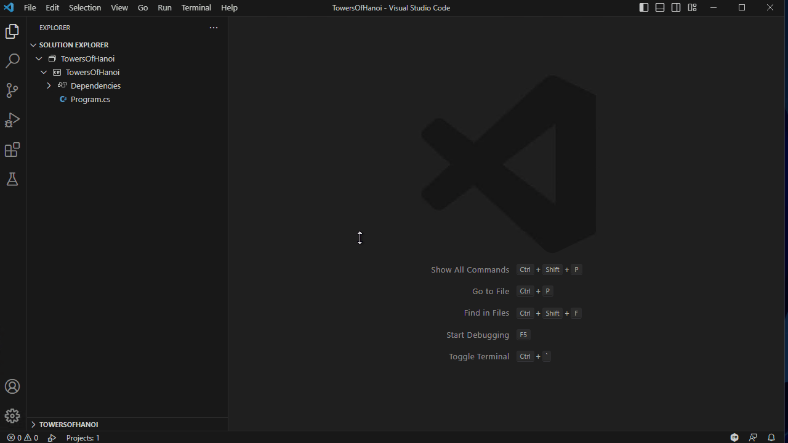

### 从解决方案资源管理器调试 {#debug-with-solution-explorer}

右键项目或解决方案，选择 **Debug**：

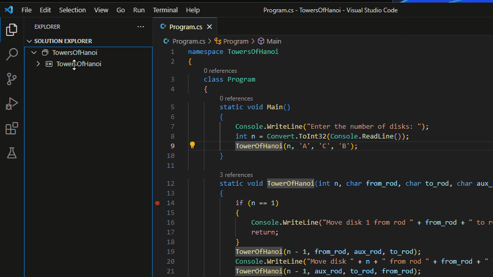

### 从命令面板调试 {#debug-with-command-palette}

运行 **.NET: Debug** 或 **.NET: Run** 命令。也可以使用 **Debug: Select and Start Debugging** 命令启动调试，这会在调试下拉列表中添加启动配置项。

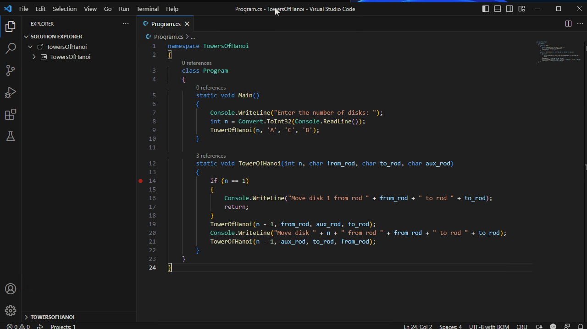

### 使用动态（内存中）启动配置调试 {#debug-with-dynamic-in-memory-launch-configurations}

没有 `launch.json` 时，C# Dev Kit 可以动态创建启动配置：

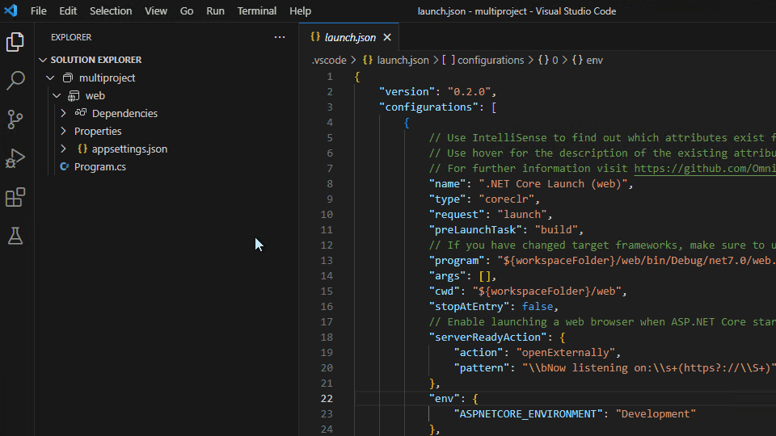

显示所有自动调试配置：

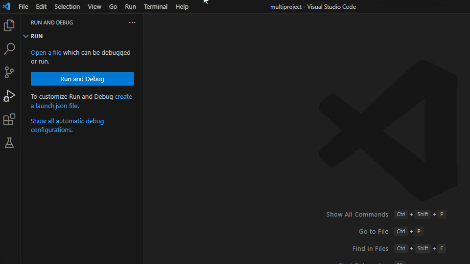

删除动态配置：

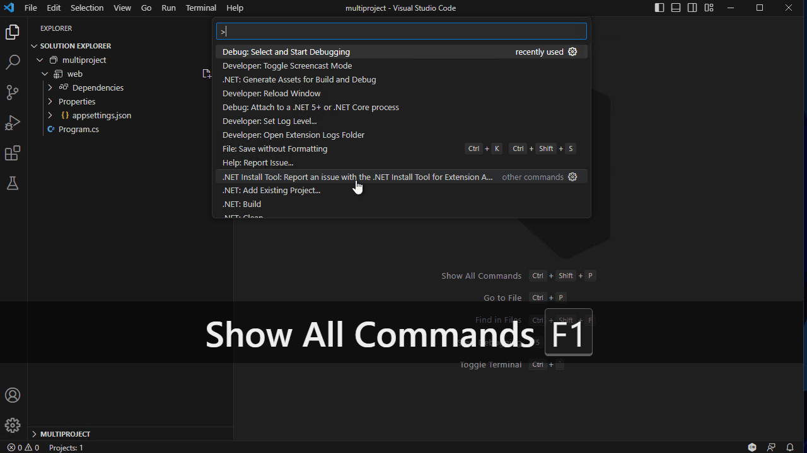

### 使用编辑器调试/运行按钮 {#debug-with-editor-debugrun-buttons}

编辑器右上角提供运行和调试按钮：

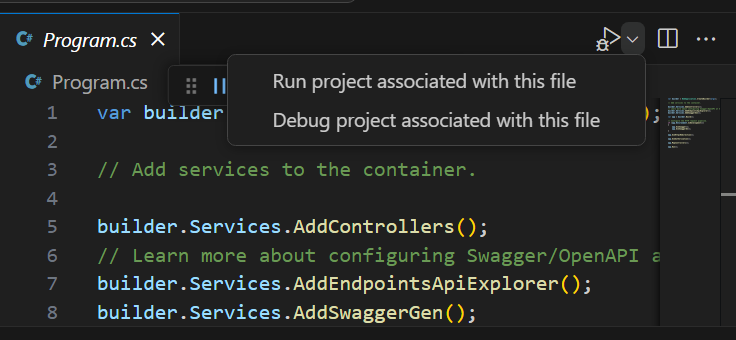

### 使用 launch.json 调试 {#debug-with-launchjson}

创建 `launch.json` 可以自定义配置。C# Dev Kit 支持 `launchSettings.json` 中的配置文件：

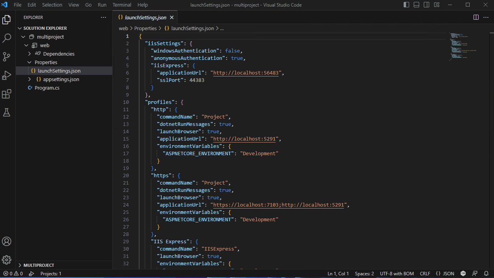

## 附加到进程 {#attaching-to-a-process}

运行 **.NET: Attach to Process**，选择要附加的进程：

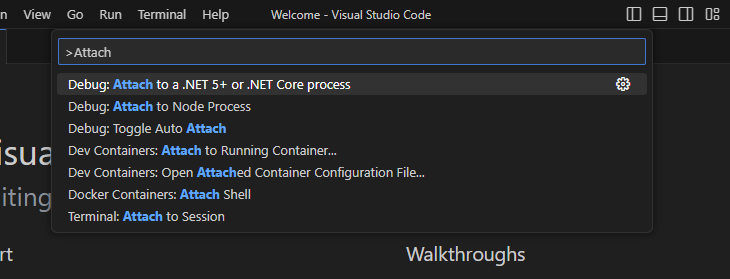

## 配置选项 {#configuration-options}

### launchSettings.json {#launchsettingsjson}

ASP.NET Core 项目可以使用 `Properties/launchSettings.json` 定义配置文件、环境变量和启动 URL。C# Dev Kit 会读取这些配置文件。

### 用户设置 {#user-settings}

| 设置 | 说明 |
| --- | --- |
| `dotnet.debug.enableDiagnostics` | 启用调试诊断日志。 |
| `dotnet.debug.hotReload` | 启用 Hot Reload。 |
| `dotnet.debug.justMyCode` | 只调试用户代码。 |
| `dotnet.debug.console` | 调试控制台类型，`internalConsole`、`integratedTerminal`、`externalTerminal`。 |

## 断点 {#breakpoints}

### 条件断点 {#breakpoint---conditional-breakpoint}

右键单击装订线，选择 **添加条件断点**，输入表达式：

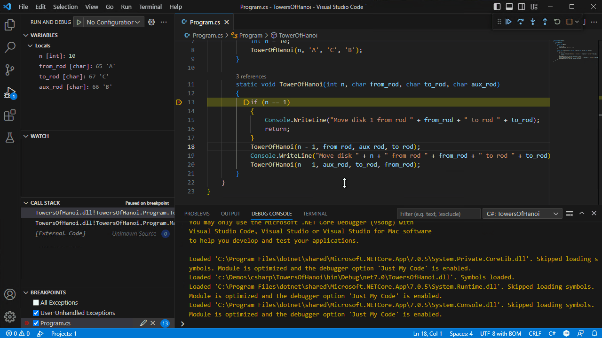

### 函数断点 {#breakpoint---function-breakpoint}

在 **断点** 视图选择 **添加函数断点**，输入函数名：

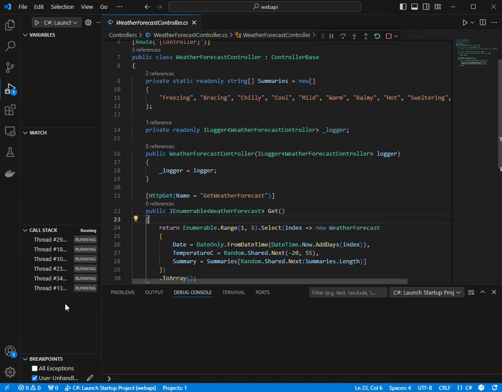

### 日志点 {#breakpoint---logpoints}

日志点在命中时输出消息而不暂停：

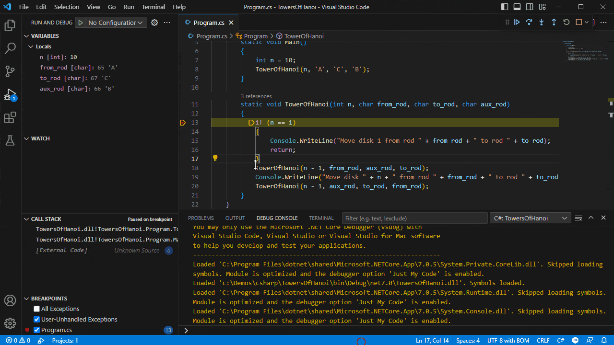

### 触发断点 {#breakpoint---triggered-breakpoints}

触发断点在另一个断点命中后启用：

<video src="https://code.visualstudio.com/assets/docs/editor/debugging/debug-triggered-breakpoint.mp4" autoplay loop muted playsinline controls title="触发断点"></video>

## 异常时停止 {#stopping-on-exceptions}

在 **断点** 视图选择 **异常设置**，配置首次机会异常和用户未处理异常：

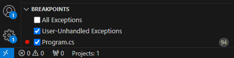

### 异常条件 {#exception-conditions}

可以按异常类型、模块或表达式筛选何时中断。

## 表达式求值 {#expression-evaluation}

暂停时在 **监视**、**局部变量** 或 **调试控制台** 中输入 C# 表达式。支持方法调用、LINQ 查询和对象创建。

## Hot Reload {#hot-reload}

Hot Reload 在调试时应用代码更改，无需重启应用：

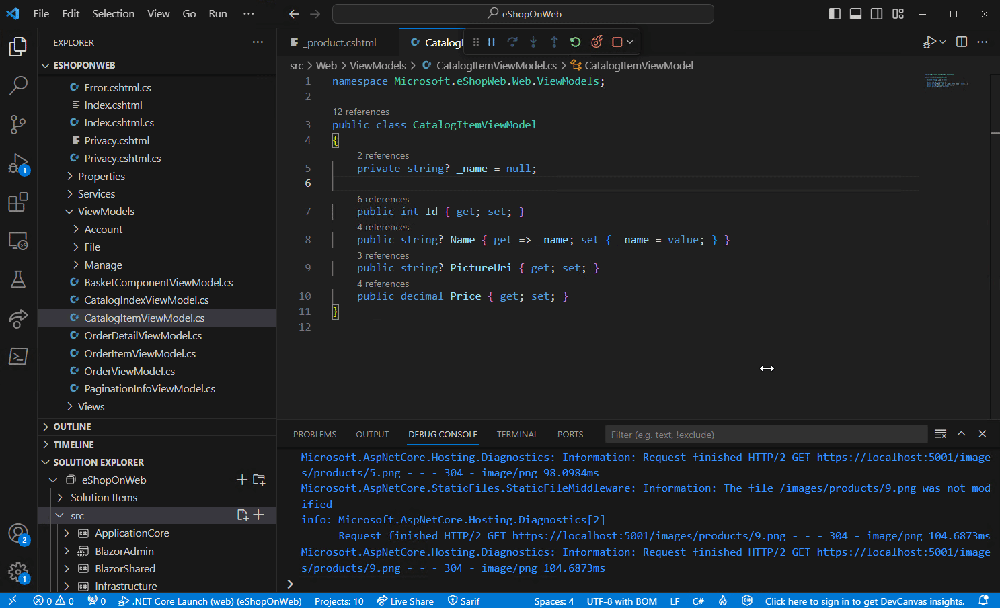

工具栏显示 Hot Reload 状态：

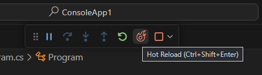

### 支持的项目和场景 {#supported-projects-and-scenarios}

* ASP.NET Core、控制台、WPF、WinForms 等项目。
* 支持方法体修改、添加新方法/类型、修改属性等。
* 某些更改（例如修改方法签名）需要重启。

### 如何应用代码更改 {#how-to-apply-code-changes}

保存文件后，Hot Reload 会提示应用更改。可以单击调试工具栏的 **应用代码更改** 按钮，或使用 **调试 > 应用代码更改** 命令。

## 后续步骤 {#next-steps}

* [C# 测试](10.8.11-Testing/)
* [C# 项目管理](10.8.7-ProjectManagement/)
* [调试配置](../../../debugging-and-testing/6.2-DebuggingConfiguration/)
