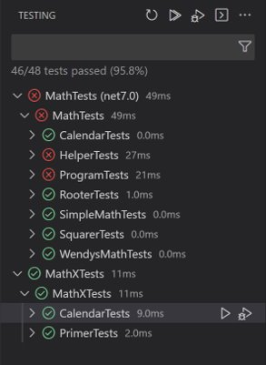
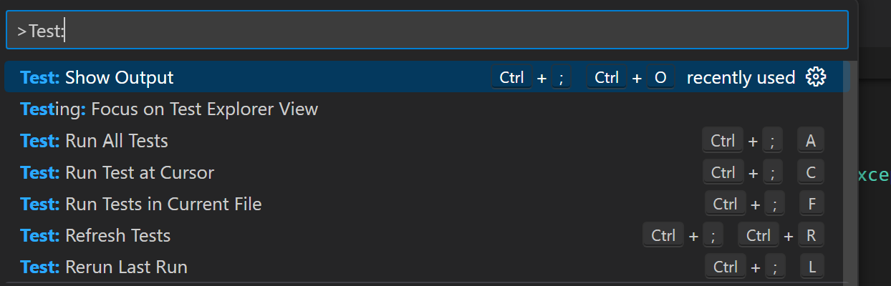
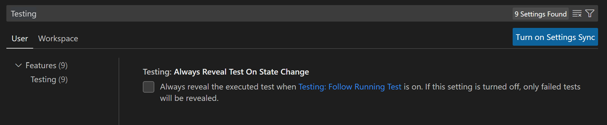

+++
title = "10.8.11 测试 C#"
date = "2026-11-06T07:53:25+08:00"
weight = 11
type = "docs"
description = ""
isCJKLanguage = true
draft = false
+++


> 原文链接: [https://code.visualstudio.com/docs/csharp/testing](https://code.visualstudio.com/docs/csharp/testing)

# 10.8.11 测试 C#

　　C# Dev Kit 支持 C# 测试，提供运行/调试测试、查看测试报告、测试资源管理器和代码覆盖率。

## 概述 {#overview}

支持框架：

* [xUnit](https://learn.microsoft.com/dotnet/core/testing/unit-testing-with-dotnet-test)
* [NUnit](https://learn.microsoft.com/dotnet/core/testing/unit-testing-with-nunit)
* [MSTest](https://learn.microsoft.com/dotnet/core/testing/unit-testing-with-mstest)

功能：

* 运行/调试测试
* 查看测试报告
* 在测试资源管理器中查看测试

## 要求 {#requirements}

* [.NET 6.0 SDK 或更高版本](https://dotnet.microsoft.com/download)
* VS Code 1.58.0+
* [C# Dev Kit](https://marketplace.visualstudio.com/items?itemName=ms-dotnettools.csdevkit)

## 项目设置 {#project-setup}

项目已配置测试框架时可以跳到[功能](#features)。

### 启用测试并添加测试框架包 {#enable-testing-and-adding-test-framework-packages-to-your-project}

**xUnit**

命令面板选择 **.NET: New Project..**，选择 **xUnit Test Project**，输入名称和位置。项目会添加：

* `Microsoft.NET.Test.Sdk`
* `xunit`
* `xunit.runner.visualstudio`
* `coverlet.collector`

然后运行：

```bash
dotnet add [测试 csproj 路径] reference [被测项目 csproj 路径]
```

**NUnit**

选择 **NUnit3 Test Project**，添加：

* `Microsoft.NET.Test.Sdk`
* `nunit`
* `NUnit3TestAdapter`

然后运行相同的 `dotnet add ... reference ...` 命令。

**MSTest**

选择 **MSTest Test Project**，添加：

* `Microsoft.NET.Test.Sdk`
* `MSTest.TestAdapter`
* `MSTest.TestFramework`
* `coverlet.collector`

然后运行相同的引用命令。

## 功能 {#features}

### 运行/调试测试 {#rundebug-test-cases}

编写测试后需要构建测试项目。运行 **.NET: Build** 构建。C# Dev Kit 会在类和方法定义左侧显示绿色播放按钮，单击运行，右键查看更多选项。

### 测试资源管理器 {#test-explorer}

测试资源管理器显示工作区所有测试。选择活动栏试管图标打开，可以运行/调试测试并查看结果。未构建项目时，选择 **刷新测试** 执行构建并发现测试。

### C# Dev Kit 中的代码覆盖率 {#code-coverage-in-c-dev-kit}

C# Dev Kit 通过 VS Code Code Coverage API 支持代码覆盖率，显示测试执行和未执行的代码行。

运行带覆盖率的测试：

1. 从活动栏打开测试资源管理器。
2. 选择测试并 **运行带覆盖率的测试**。
3. 覆盖率数据自动生成并显示在测试资源管理器中。

查看覆盖率报告：

1. 命令面板搜索 **Test: Show Coverage**。
2. 编辑器中绿色行表示已测试，红色行表示未测试。
3. 测试资源管理器提供总体覆盖率摘要。

改进覆盖率：检查红色未测试区域，创建新测试，重新运行并查看更新后的覆盖率。

### 查看测试结果 {#view-test-results}

运行/调试后，编辑器装饰和测试资源管理器会更新状态。单击堆栈跟踪链接导航到源代码。



### VS Code 测试命令 {#vs-code-testing-commands}

命令面板搜索 **Test:** 可以找到 **Run All Tests** 等命令。



### VS Code 测试设置 {#vs-code-testing-settings}

在设置编辑器搜索 **Testing** 查看测试相关设置。



## 后续步骤 {#next-steps}

* [C# 调试](10.8.10-Debugging/)
* [C# 项目管理](10.8.7-ProjectManagement/)
* [测试视图](../../../debugging-and-testing/6.4-Testing/)
