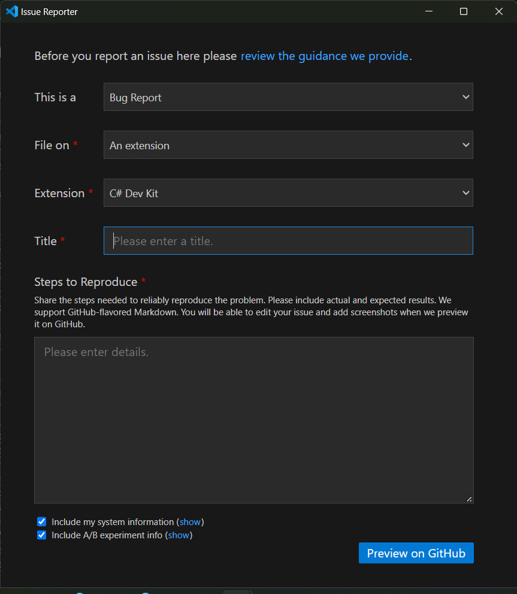
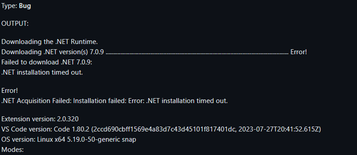
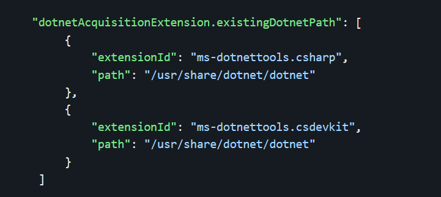
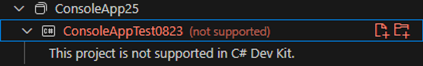
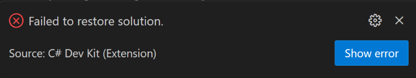
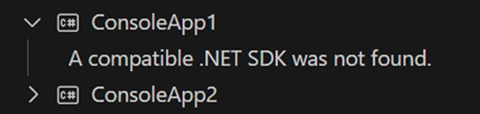
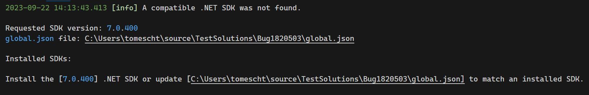
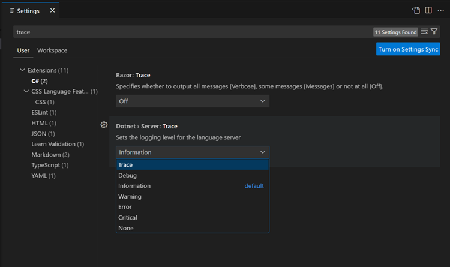
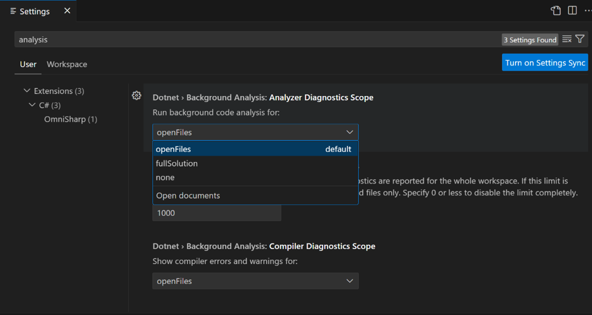
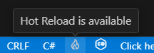

+++
title = "10.8.12 C# Dev Kit 常见问题"
date = "2026-11-06T07:53:25+08:00"
weight = 12
type = "docs"
description = ""
isCJKLanguage = true
draft = false
+++


> 原文链接: [https://code.visualstudio.com/docs/csharp/cs-dev-kit-faq](https://code.visualstudio.com/docs/csharp/cs-dev-kit-faq)

# 10.8.12 C# Dev Kit 常见问题

## 常规 {#general}

### 什么是 C# Dev Kit？ {#what-is-c-dev-kit}

　　[C# Dev Kit](https://marketplace.visualstudio.com/items?itemName=ms-dotnettools.csdevkit)是增强 VS Code C# 开发体验的扩展，提供更广泛、高效和可靠的 C# 体验。它不替代现有 [C# 扩展](https://marketplace.visualstudio.com/items?itemName=ms-dotnettools.csharp)，而是在其语言服务之上添加功能。

### 当前支持哪些项目类型？ {#what-project-types-are-currently-supported}

　　支持 .NET Core/.NET 的 Web 应用、控制台应用、类库和测试项目。 [.NET MAUI 扩展](https://marketplace.visualstudio.com/items?itemName=ms-dotnettools.dotnet-maui)和 [Unity 扩展](https://marketplace.visualstudio.com/items?itemName=visualstudiotoolsforunity.vstuc)基于 C# Dev Kit，支持 MAUI 和 Unity 应用。这些扩展支持 SDK 风格项目。.NET Framework 和 Xamarin 等非 SDK 项目请参阅[项目系统](#project-system)。

### C# Dev Kit 包含哪些扩展？ {#what-extensions-are-included-in-c-dev-kit}

* [C# Dev Kit](https://marketplace.visualstudio.com/items?itemName=ms-dotnettools.csdevkit)
* [IntelliCode for C# Dev Kit](https://marketplace.visualstudio.com/items?itemName=ms-dotnettools.vscodeintellicode-csharp)
* [.NET MAUI](https://marketplace.visualstudio.com/items?itemName=ms-dotnettools.dotnet-maui)
* [Unity](https://aka.ms/vscode-unity)

使用受 [C# Dev Kit 系列 EULA](https://aka.ms/vs/csdevkit/license)约束。依赖项包括 [C# 扩展](https://marketplace.visualstudio.com/items?itemName=ms-dotnettools.csharp)和 [.NET Install Tool](https://marketplace.visualstudio.com/items?itemName=ms-dotnettools.vscode-dotnet-runtime)。

### 为什么 C# Dev Kit 未激活/找不到命令？ {#why-isnt-c-dev-kit-activating--c-dev-kit-commands-are-not-found}

1. 未安装 C# 扩展 2.0+。
2. 工作区偏好 C# 扩展：设置 `dotnet.preferCSharpExtension` 为 `true` 会禁用 C# Dev Kit。非 .NET Framework 项目请关闭。
3. 操作系统只读：C# Dev Kit 需要写入扩展文件夹和 VS Code 提供的扩展状态文件夹。

检查后仍找不到命令，请报告问题并提供 C# Dev Kit 输出窗口信息。

## 许可和贡献 {#licensing-and-contributing}

### 谁可以使用 C# Dev Kit？ {#who-can-use-c-dev-kit}

　　C# Dev Kit 通过 Community License 提供给符合条件者，也包含在 Visual Studio 订阅中。个人、学术和开源项目可免费使用；商业用途最多 5 人团队免费；6 人以上需要 Visual Studio Professional 或更高订阅。GitHub Codespaces 和 Microsoft Dev Box 用户无需额外付费。

### 在哪里提交反馈和建议？ {#where-do-i-submit-feedback-and-suggestions}

通过 **帮助 > 报告问题**，选择缺陷、功能请求或性能问题，选择 **An extension**，然后选择 **C# Dev Kit**：



### C# Dev Kit 是开源的吗？为什么不是？ {#is-c-dev-kit-open-source-why-not}

　　不是，C# Dev Kit 是闭源的，但依赖开源的 C# 扩展，并与 [Roslyn](https://github.com/dotnet/roslyn)和 [Razor](https://github.com/dotnet/razor)等开源组件通信。闭源是为了提供与其他工具共享的专有生产力功能。

### 如何贡献？ {#how-can-i-contribute}

　　C# 扩展完全开源，源代码位于 [dotnet/vscode-csharp](https://github.com/dotnet/vscode-csharp)，采用 MIT 许可证。项目遵循 Contributor Covenant 行为准则。

## .NET SDK {#net-sdk}

### 安装脚本超时 {#install-script-timed-out}

　　.NET 运行时安装默认超过 4.5 分钟会失败。可以设置 `dotnetAcquisitionExtension.installTimeoutValue` 调整超时（秒）：

```json
{
    "dotnetAcquisitionExtension.installTimeoutValue": 180
}
```

### 获取 .NET SDK 时出错 {#error-acquiring-net-sdk}



中国地区下载可能被阻止导致超时。请确保已安装 .NET SDK，或将 .NET 运行时获取扩展指向现有安装：



### 如何手动安装 .NET？ {#how-do-i-manually-install-net}

使用 `dotnetAcquisitionExtension.existingDotnetPath` 指向手动安装：

**Windows：**

```json
{
    "dotnetAcquisitionExtension.existingDotnetPath": [
        { "extensionId": "msazuretools.azurerm-vscode-tools", "path": "C:\\Program Files\\dotnet\\dotnet.exe" }
    ]
}
```

**macOS：**

```json
{
    "dotnetAcquisitionExtension.existingDotnetPath": [
        { "extensionId": "msazuretools.azurerm-vscode-tools", "path": "/usr/local/share/dotnet/dotnet" }
    ]
}
```

### 有代理但扩展认为离线（400/407） {#the-extension-thinks-i-am-offline-with-error-response-of-400-or-407-and-i-have-a-proxy}

系统使用代理且禁用注册表访问时，需要显式设置代理 URL：

```json
{
    "dotnetAcquisitionExtension.proxyUrl": "https://your_proxy_url:port"
}
```

## 项目系统 {#project-system}

### 解决方案资源管理器报告项目不受支持 {#the-solution-explorer-reports-that-my-project-is-not-supported-in-c-dev-kit}

通常是因为项目目标为 .NET Framework 而不是 .NET Core/.NET。C# Dev Kit 不支持 .NET Framework 项目。



解决方法：

* [升级项目](https://learn.microsoft.com/dotnet/core/porting)为 SDK 风格。
* 在工作区设置中启用 **Prefer CSharp Extension**，将项目加载委托给 C# 扩展。部分 C# Dev Kit 功能不可用，需要重新加载 VS Code。

### 单击“Create .NET Project”没有反应 {#i-clicked-on-the-create-net-project-button-and-nothing-happened}

通常是扩展版本不匹配。C# Dev Kit 需要 C# 扩展 2.0+，请升级。

### 项目系统报告遇到问题 {#the-project-system-reports-that-it-ran-into-a-problem}

出现内部错误时会显示通知：



选择 **打开日志** 查看堆栈跟踪，复制日志文本并通过 VS Code 报告问题。

### 打开解决方案时提示“Failed to restore solution” {#when-i-open-my-solution-i-get-the-notification-failed-to-restore-solution}

选择 **显示错误**，打开 NuGet 输出面板，根据错误排查包还原问题。

### 解决方案资源管理器显示“A compatible .NET SDK was not found” {#the-solution-explorer-displays-a-compatible-net-sdk-was-not-found}

通常是因为 `global.json` 指定了系统未安装的 SDK：



打开输出窗口的 **Projects** 面板查看更多信息：



修复：更新 `global.json` 指定已安装 SDK，或从 [Download .NET](https://aka.ms/dotnet/download)安装指定 SDK，然后关闭并重新打开工作区。

SDK 由包管理器安装而不是 Microsoft 安装程序时，也可能无法检测。请卸载后从官方页面安装。

## 测试资源管理器 {#test-explorer}

### 测试未出现在测试资源管理器 {#why-dont-my-tests-appear-in-the-test-explorer-panel}

确认测试项目属于打开的解决方案（在解决方案资源管理器中查看，右键添加或创建测试项目）。C# Dev Kit 需要成功构建项目后测试才会出现；执行 **Clean** 会移除测试 DLL。

构建解决方案（右键 **Build** 或 `Ctrl + Shift + B`（macOS：`Cmd + Shift + B`））后测试应出现。仍未出现时检查：

* 使用受支持的 .NET Core SDK。
* SDK 安装有效（ASDF、Mise 等非官方工具安装的 SDK 可能无法检测）。
* 构建输出生成了 `.dll`/`.exe`。
* 所有项目加载完成，测试项目旁有测试图标。

### 测试出现但无法调试 {#my-tests-appear-in-the-test-explorer-panel-but-i-cannot-debug-them}

确认测试目标为 .NET Core。C# Dev Kit 不支持 .NET Framework，VS Code 调试器也不支持。

### 新添加的测试未出现 {#i-just-added-new-tests-to-my-test-project-and-they-are-not-appearing-in-the-test-explorer-panel}

需要先成功构建项目。构建后测试会出现在测试资源管理器。

### 如何收集测试资源管理器日志 {#how-do-i-collect-logs-for-troubleshooting-issues-with-test-explorer}

1. 将 C# Dev Kit 的 Test Explorer Verbosity 从 `minimal` 提高到 `diagnostic`。
2. 打开输出窗口，选择 **C# Dev Kit - Test Explorer**，诊断消息带 `[dev]` 前缀。
3. 报告问题时包含日志、操作系统版本和扩展版本。

## 调试器 {#debugger}

### 按 F5 没有反应 {#when-i-f5-nothing-happens}

确认打开了 C# 项目，或活动文档是 `.cs`/`.razor` 文件。确保 C# Dev Kit 和 C# 扩展均已激活。

### 按 F5 提示“Select a Debugger” {#when-i-f5-it-asks-me-to-select-a-debugger-how-do-i-know-which-one-to-pick}

调试 .NET 控制台、Blazor Server、Blazor WebAssembly 或 Web 应用时选择 **C#**。其他选项可能属于 Node 或 Python 扩展。

### 按 F5 提示输入密码（仅 macOS） {#when-i-f5-it-prompts-me-to-input-a-password-macos-only}

macOS 默认禁用 Developer Mode，使用调试器时会要求密码。可以运行：

```bash
DevToolsSecurity --enable
sudo dscl . append /Groups/_developer GroupMembership $USER
```

### 为什么调试不工作？ {#why-is-debugging-not-working}

调试库或测试项目时需要额外步骤：为库创建控制台/Web 应用，或使用测试资源管理器调试测试。

### 断点未绑定 {#while-debugging-my-breakpoints-arent-binding}

被调试进程不是 Debug 构建，请以调试配置重新构建。

## C# 编辑器 {#c-editor}

### 如何让 IntelliSense 正常工作？ {#how-do-i-get-intellisense-to-work-correctly}

确保打开项目或解决方案。在设置搜索 `Trace`，将 **Dotnet > Server** 设置为 `Trace`：



重新加载窗口，在输出面板选择 **Projects** 查看项目加载错误。复制输出并报告问题。

### C# 扩展无法启动服务器 {#c-extension-fails-to-launch-the-server}

将 .NET 运行时获取扩展指向现有 .NET 7 安装：

```json
{
    "dotnetAcquisitionExtension.existingDotnetPath": [
        {
            "extensionId": "msazuretools.azurerm-vscode-tools",
            "path": "C\\Program Files\\dotnet\\dotnet.exe"
        }
    ]
}
```

### 诊断过多或过少 {#i-have-too-many-diagnostics-or-i-dont-have-enough-diagnostics}

在 **文件 > 首选项 > 设置** 搜索 `analysis`，在 **Run background code analysis for:** 选择分析范围（打开文件、整个解决方案、无等）：



也可以使用 EditorConfig 配置诊断和代码分析。诊断过少可能是项目未完全加载，请参考 IntelliSense 排查。

## Razor 编辑器 {#razor-editor}

### 大多数或所有 Blazor 组件显示警告 {#most-or-all-blazor-components-show-up-with-warnings}

C# Dev Kit 需要成功加载项目，Razor 语言服务器需要生成 `project.razor.vscode.bin`。该文件通常位于 `obj\Debug\<tfm>`，大小至少约 150KB。文件过小说明标记助手/组件未正确发现。

强制重新生成：关闭所有 `.razor`/`.cshtml` 文件，重新加载窗口，项目加载后打开任一 Razor 文件。

### Razor 文件提到目标框架错误 {#target-framework-errors-are-mentioned-in-razor-files}

Razor 服务器根据 `project.razor.vscode.bin` 加载项目。旧目标框架文件可能导致多目标或组件引用混乱。清除 `obj` 中的旧文件夹，重新加载窗口并打开 `.razor` 文件。

## IntelliCode {#intellicode}

请参阅 [C# IntelliCode](10.8.4-IntelliCode/)。

## Hot Reload {#hot-reload}

### 调试开始后未显示 Hot Reload 图标 {#hot-reload-icon-not-appearing-after-i-started-debugging}

调试器仅在 C# Dev Kit 调试器设置启用 Hot Reload 时启动会话。启用后状态栏应显示图标：



单击图标或打开 **C# Hot Reload** 输出窗口查看诊断信息。项目不受支持时请参阅 [Hot Reload 支持的项目](10.8.10-Debugging/#supported-projects-and-scenarios)。

### Hot Reload 支持哪些编辑？ {#what-types-of-edits-are-supported-with-hot-reload}

请参阅[支持的 C# 代码更改](https://learn.microsoft.com/visualstudio/debugger/supported-code-changes-csharp?view=vs-2022)。
