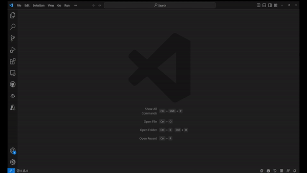
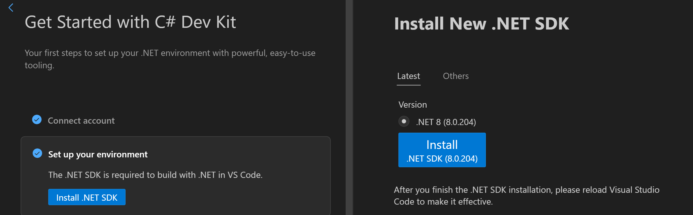
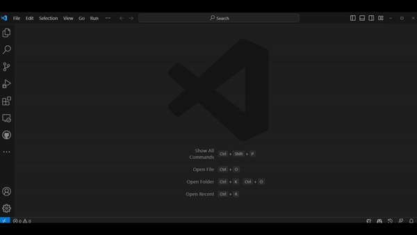

+++
title = "10.8.2 C# 入门"
date = "2026-11-06T07:53:25+08:00"
weight = 2
type = "docs"
description = ""
isCJKLanguage = true
draft = false
+++

> 原文链接: [https://code.visualstudio.com/docs/csharp/get-started](https://code.visualstudio.com/docs/csharp/get-started)

# 10.8.2 C# 入门

　　本指南介绍 VS Code 中的 C# 和 .NET：

1. 安装并设置 VS Code C# 开发环境。
2. 编写并运行简单“Hello World”C# 应用。
3. 介绍其他 C# 学习资源。

本指南不教授 C# 语言本身，而是介绍如何设置 C# 开发环境。

## 必需工具 {#necessary-tools}

* [VS Code](https://code.visualstudio.com)
* [C# Dev Kit](https://marketplace.visualstudio.com/items?itemName=ms-dotnettools.csdevkit)扩展
* .NET 开发需要 [.NET SDK](https://dotnet.microsoft.com/download)

## 安装 {#install}

### 安装 VS Code 和扩展 {#installing-vs-code-and-extensions}

1. 安装 [VS Code](https://code.visualstudio.com)。
2. 从 Marketplace 安装 [C# Dev Kit](https://marketplace.visualstudio.com/items?itemName=ms-dotnettools.csdevkit)。扩展安装详情请参阅[扩展 Marketplace](../../../editor/3.3-ConfigureTheEditor/3.3.6-Extensions/3.3.6.2-ExtensionMarketplace/)。扩展名为 **C# Dev Kit**，发布者为 Microsoft。

> **注意**：C# Dev Kit 支持云原生开发。跨平台移动和桌面开发可以配合 [.NET MAUI 扩展](https://aka.ms/mauidevkit-marketplace)使用。详情请参阅 [.NET MAUI 设置](https://aka.ms/mauidevkit-docs)。

安装后 C# Dev Kit 会启动扩展演练。可以按照步骤了解功能或安装最新 .NET SDK。随时可以从命令面板（`Ctrl + Shift + P`，macOS：`Cmd + Shift + P`）选择 **Welcome: Open Walkthrough**，然后选择 **Get Started with C# Dev Kit** 重新打开。

> **注意**：使用 C# Dev Kit 需要登录 Visual Studio 订阅。详情请参阅[登录 C# Dev Kit](https://code.visualstudio.com/docs/csharp/signing-in)。

在演练中选择 **Set up your environment**，然后选择 **Install .NET SDK**。旁边的窗口会显示安装最新 .NET SDK 的按钮。选择 **Install** 下载并安装，按照屏幕说明完成。

## 创建 Hello World 应用 {#create-a-hello-world-app}

转到 **资源管理器** 视图，选择 **Create .NET Project**。也可以打开命令面板（`Ctrl + Shift + P`，macOS：`Cmd + Shift + P`），输入 `.NET`，选择 **.NET: New Project**。

1. 选择项目模板 **Console app**。
2. 运行应用：选择 **运行 > 不调试运行**，或按 `Ctrl + F5`。

调试 C# 项目详情请参阅[调试](10.8.10-Debugging/)。

## 了解更多 {#learn-more}

在命令面板搜索 `.NET` 可以探索 C# 扩展的所有功能。其他文档页面提供详细说明。

C# 和 .NET 学习资源：

1. [学习 C# 编程](https://aka.ms/selfguidedcsharp)
2. [在 VS Code 中使用 .NET 构建应用](https://learn.microsoft.com/training/paths/build-dotnet-applications-csharp/)
3. [学习构建 Web 应用](https://learn.microsoft.com/training/paths/build-web-apps-with-blazor/)

## 加入社区 {#join-the-community}

[.NET 开发者社区](https://dotnet.microsoft.com/platform/community)：与其他开发者交流。
