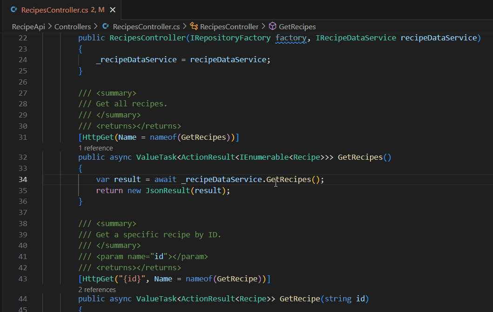
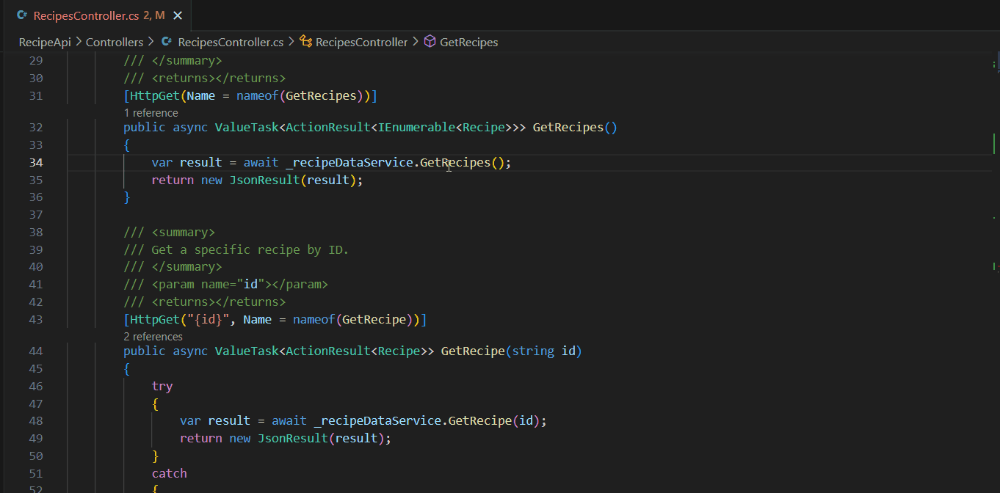
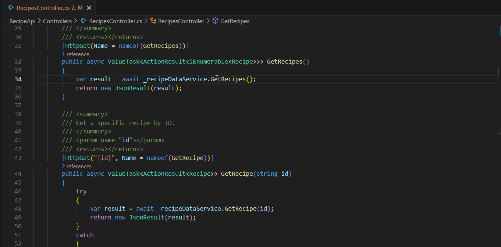
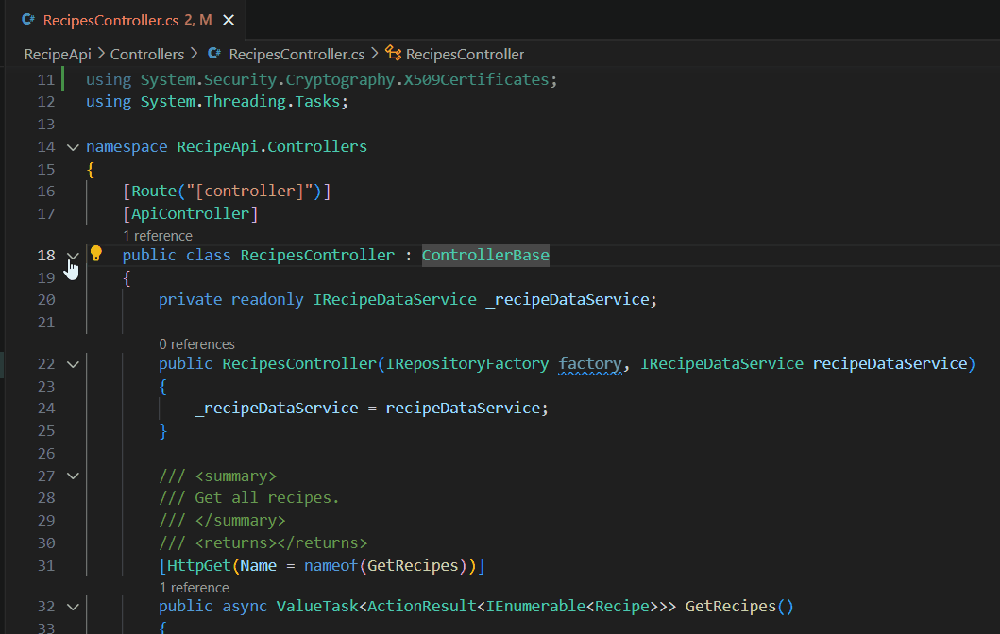
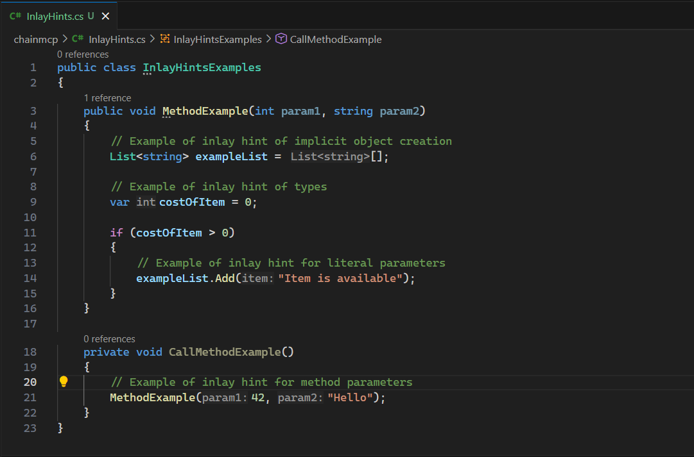

+++
title = "10.8.3 导航和编辑 C#"
date = "2026-11-06T07:53:25+08:00"
weight = 3
type = "docs"
description = ""
isCJKLanguage = true
draft = false
+++

> 原文链接: [https://code.visualstudio.com/docs/csharp/navigate-edit](https://code.visualstudio.com/docs/csharp/navigate-edit)

# 10.8.3 导航和编辑 C#

　　C# Dev Kit 和 C# 扩展提供丰富的代码导航和编辑功能。本文介绍常用功能，通用编辑功能请参阅[代码导航](../../../editor/3.2-WriteCode/3.2.5-CodeNavigation/)。

## 代码导航 {#code-navigation}

C# Dev Kit 支持解决方案资源管理器、转到定义、速览定义、速览实现、速览引用、折叠、智能选择和内联提示。

## 转到定义 {#go-to-definition}

将光标放在符号上按 `F12`，或右键选择 **转到定义**，导航到符号定义。多个定义时显示选择列表。

## 速览定义 {#peek-definition}

按 `Alt + F12`（macOS：`Option + F12`），或右键选择 **速览定义**，在编辑器中直接查看定义，不离开当前位置：

## 速览实现 {#peek-implementations}

右键单击接口或抽象成员，选择 **速览实现**，查看所有实现：

## 速览引用 {#peek-references}

右键单击符号，选择 **速览引用**，查看所有引用位置：

## 折叠或展开代码片段 {#collapse-or-expand-code-snippets}

使用编辑器装订线中的折叠箭头折叠或展开代码块。快捷键：

* 折叠：`Ctrl + Shift + [`
* 展开：`Ctrl + Shift + ]`
* 折叠全部：`Ctrl + K Ctrl + 0`
* 展开全部：`Ctrl + K Ctrl + J`

## 智能选择 {#smart-selection}

智能选择根据语义扩展或缩小选择范围：

* 扩展：`Shift + Alt + →`（macOS：`Ctrl + Cmd + Shift + →`）
* 缩小：`Shift + Alt + ←`（macOS：`Ctrl + Cmd + Shift + ←`）

## 内联提示 {#inlay-hints}

内联提示在代码中显示参数名、类型和返回类型等信息：

可以通过 `dotnet.inlayHints.enableInlayHintsForParameters`、`dotnet.inlayHints.enableInlayHintsForTypes` 等设置控制。

## 后续步骤 {#next-steps}

* [C# 重构](10.8.5-Refactoring/)
* [C# IntelliCode](10.8.4-IntelliCode/)
* [C# 格式化和 Lint](10.8.6-FormattingLinting/)
